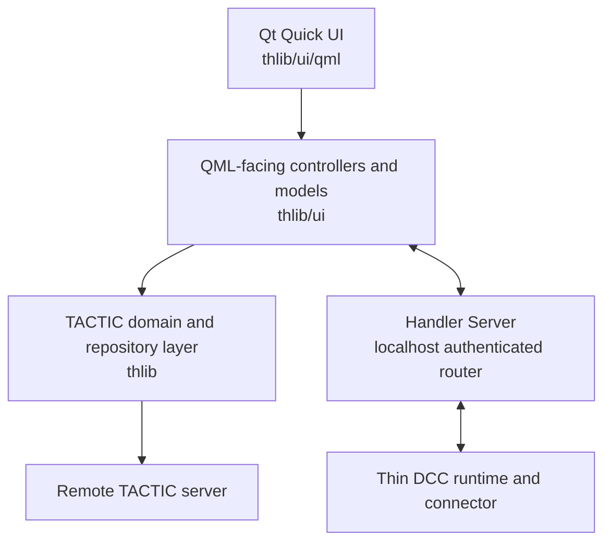

# TACTIC-Handler

**English** | [Русский](README.ru.md)

[Changelog](CHANGELOG.md) records the changes shipped in each version.

TACTIC-Handler is a Python 3 and Qt Quick desktop client for
[Southpaw TACTIC](https://github.com/Southpaw-TACTIC/TACTIC). It provides one
workspace for project navigation, search, object and task management, review,
repository synchronization, controlled check-in, automation, administration,
and thin DCC integration.

TACTIC remains the system of record. Handler does not replace the TACTIC
server, its database, permissions, workflows, naming rules, or repositories.
It presents those server-owned concepts in a responsive native desktop UI and
keeps slow TACTIC, network, repository, and filesystem work outside the Qt UI
thread.

> **Project status**
>
> This repository is under active development. The automated release gate is
> extensive, but a production release also requires manual acceptance against
> the intended TACTIC server, repositories, Windows environment, and DCC host.
> See [Release readiness](docs/release_readiness.md) before deploying an update.

## Contents

- [What Handler provides](#what-handler-provides)
- [Typical workflow](#typical-workflow)
- [Requirements](#requirements)
- [Installation](#installation)
- [First connection](#first-connection)
- [Maya integration](#maya-integration)
- [Adding another DCC](#adding-another-dcc)
- [Scripting and automation](#scripting-and-automation)
- [Unified Handler API](#unified-handler-api)
- [Configuration and server storage](#configuration-and-server-storage)
- [Architecture](#architecture)
- [Repository layout](#repository-layout)
- [Documentation](#documentation)
- [Development and verification](#development-and-verification)
- [Operational and security notes](#operational-and-security-notes)
- [Known boundaries](#known-boundaries)
- [License](#license)

## What Handler provides

### Workspace, navigation, and layouts

- A native PySide6/QML workspace with movable, stackable, resizable, detachable,
  and restorable docks.
- Named project-wide workspace layout presets. A sidebar entry can apply a
  saved layout when its Search tab opens.
- Independent Search tabs with retained query, loaded pages, selection,
  expansion, view, grouping, sorting, scroll position, and dock state.
- Recently closed Search tabs and an all-tabs menu when the available width is
  exhausted.
- Separate navigation roots for Handler and native web TACTIC:
  - Handler uses the `tactic_handler` sidebar view.
  - Native TACTIC uses the `project_view` sidebar view.
- A Sidebar Editor with Simple and XML modes, links, sections, separators,
  icons, saved-search bindings, default result views, workspace layouts,
  script shelves, and access rules.
- A login-group preview in the Handler Sidebar Editor. An administrator can
  edit while viewing exactly which draft entries a modeller, rigger,
  supervisor, or another TACTIC group would see.
- English and Russian UI localization. Project-configured Search Type,
  pipeline, process, status, context, group, and repository labels are kept
  exactly as the server supplies them.
- Light/dark appearance settings, selectable icon families, text settings, and
  a configurable Qt Quick rendering backend.

### Search and result presentation

Each Search tab owns one complete query. Text, tags, Quick Filters, manual
conditions, and TACTIC Expression Language conditions are combined rather than
run as unrelated client-side filters.

Available search tools include:

- broad name/title, keyword, and description search;
- asynchronous suggestions and middle-click opening in a new Search tab;
- project tag catalogs and multi-tag filtering;
- compact Quick Filters for direct fields and related tasks;
- administrator-published Quick Filter layouts and default values;
- per-tab personal Quick Filter overrides with a restore-to-standard action;
- Advanced Search with ordered `AND`/`OR` conditions;
- text, numeric, currency, date, login, timecode, empty, distinct, and list
  relations;
- `**Expression` filters using TACTIC Expression Language, including related
  object `Have`/`Do not have` queries and deliberately slower per-object Match;
- server-backed Saved Searches with create, update, rename, duplicate, link,
  delete, and refresh actions;
- explicit pages or continuous loading without losing scroll position;
- process visibility filtering;
- server-side sorting and grouping, including object and task statuses;
- continuous tree, cards, table, compact rows, versions-right, and
  versions-bottom result modes.

The result tree lazily loads child relations, processes, tasks, snapshots, and
versions. Stale responses are rejected when the user changes a project, tab,
selection, or request scope while work is still running.

### Search Objects and relationships

Handler uses the current TACTIC EditWdg definition to render object forms. It
preserves server field order, titles, required/read-only state, option labels,
and stored values.

Supported workflows include:

- create and edit project sObjects;
- responsive forms for text, multiline text, booleans, selects, users,
  projects, processes, pipelines, statuses, dates, passwords, parents,
  previews, and thumbnails;
- multi-object creation with `{n}` and zero-padded forms such as `{n:03}`;
- a batch preview wizard where every proposed object can receive individual
  field and preview changes before the whole batch is created;
- link and unlink related objects in either direction;
- searchable available/linked lists, continuous paging, multi-selection, and
  drag-and-drop relation editing;
- duplicate objects;
- dependency-aware deletion with an explicit review of related data;
- direct database-field editing where permissions and context allow;
- an Object Report with identity, fields, tasks, notes, children, snapshots,
  files, activity, work hours, and cost information.

Unsupported custom EditWdg fields remain visible and read-only. Handler does
not silently coerce them into a different widget and risk writing invalid data.

### Snapshots, previews, and repositories

The Snapshot Browser follows the current sObject, process, context, snapshot,
and file. It provides:

- Preview and Files, Preview Only, and Files Only layouts;
- horizontal or vertical split presentation;
- Fit mode for the complete image and Fill mode for a cropped full surface;
- high-DPI-aware preview selection: the web image is used while sufficient,
  and the original is requested when the physical display size requires it;
- navigation across all previewable files in the selected snapshot;
- versioned and versionless/latest snapshot presentation;
- file name, role, size, repository, path, local-state, and freshness details;
- open, reveal, path-copy, synchronize, and supported DCC actions;
- exact native File-object path and repository semantics rather than paths
  reconstructed from display names.

Repository tools include:

- a Repository Editor for server definitions and platform-specific local
  mappings;
- selectable and validated default repositories;
- Repository Sync discovery by object, snapshot, process preset, child scope,
  and version scope;
- an explicit transfer queue with progress, conflict policy, retry, and
  cancellation;
- freshness checks based on existence, expected size, and server timestamp;
- optional full checksum verification;
- Watch Folders bound to an explicit project, object, repository root,
  matching rules, and check-in behavior.

A current local file is reused immediately. Handler does not create a visible
download job or network request for a file already known to be current.

### Check-in, Drop Plate, and Commit Queue

Handler separates preparation from execution so adding files never means that
they were already published.

The check-in toolchain supports:

- file, sequence, layer, UV/UDIM, animation, and multi-file grouping;
- drag-and-drop publishing and attachment targets on result objects;
- direct icon publishing for supported preview images;
- Drop Plate scanning and matching through configurable Matching Templates;
- quick ingest and optional project Ingest Rules;
- child-object creation from files, including relationship creation and
  duplicate-name decisions;
- process, context, repository, description, transfer method, version,
  destination filename, versionless, naming, and preview options;
- generated versioned and versionless path previews before execution;
- explicit preview images from files, clipboard, or Screenshot Maker;
- grouped or separate check-ins for a multi-file drop;
- current-only, checked-only, all-ready, and sequential batch submission;
- safe cancellation boundaries, retry, progress, errors, and persistent
  unfinished operations;
- optional automatic removal of successful queue items.

The standalone application owns version allocation, repository transfer, and
TACTIC snapshot creation. A DCC save only prepares native scene data for the
same Commit Queue workflow.

### Tasks, planning, and work hours

The Tasks workspace and compact task controls share one task store and support:

- current object, selected objects, Search Type, project, user, and team scopes;
- process, assignee, status, date, progress, text, and quick filters;
- table, grouped, calendar, and Gantt presentations;
- server-side filtering, sorting, grouping, and pagination;
- Shift/Ctrl selection, staged edits, bulk updates, create, and dependency-aware
  delete;
- configurable table columns;
- task history and exact Task Inspector synchronization;
- notes scoped to object/process/task rules;
- unscheduled and scheduled Gantt sections;
- working-day-aware date changes and bounded undo/redo;
- time entry, timesheet review, approval state, task calendar, work reports,
  and cost reports where the required server data and permissions exist.

Task workspace state is retained per project, while checked rows and unsaved
edits are intentionally not restored after restart as if they were still
valid server operations.

### Notes, messages, activity, and notifications

- Notes attached to sObjects, processes, and task contexts.
- Personal and group conversations.
- Text, replies, mentions, reactions, forwarding, pins, search, members,
  delivery state, and conversation files.
- Attachments from a file dialog, clipboard images, screenshot capture, and
  drag-and-drop.
- Independent drafts per note target and conversation, preserved across target
  switches and restarts.
- A project Activity Feed for object mutations, task changes, notes,
  publications, work hours, and supported relationship events.
- In-app message and activity notifications with independent switches.
- Unread counts and history even when pop-up presentation is disabled.
- Full Unicode emoji browsing with search and category navigation.

Notifications are summaries. Complete exceptions, tracebacks, request data,
and script output remain available in the Debug Log or the owning editor.

### Scripting and automation

Handler includes:

- a server-backed Script Editor for `config/custom_script`;
- a script tree, multiple tabs, persistent dirty drafts, line numbers, syntax
  highlighting, find/replace, occurrence and token matching, completion,
  symbol outline, in-file definition navigation, and bounded edit history;
- per-tab output with stdout, stderr, results, and tracebacks;
- saved revision history reconstructed from native TACTIC transactions;
- Local Python, Server Python, Server JavaScript where supported, and selected
  DCC execution targets;
- execution of the current selection or complete source;
- validated synchronization of saved project scripts into the local
  `custom_scripts/<project>` tree;
- ordered Script Triggers before and after Handler or DCC actions;
- any number of matching scripts for one action, run from top to bottom;
- optional Search Type, exact search key, process, and context filters;
- explicit failure semantics: a failing Before trigger blocks the action,
  while a failing After trigger is logged and later After triggers continue;
- personal and project-shared Script Shelves;
- common and sidebar-tab-specific shelf assignment;
- fixed-size shelf buttons with label, icon, complete tooltip, ordering, and
  horizontal overflow;
- direct application of a configured shared shelf to the current sidebar tab;
- creation or replacement of a native Maya shelf when a capable Maya client is
  connected.

Snapshot open/save triggers run around standalone Handler operations. Maya
scene open, import, reference, and save triggers are explicitly marked as Maya
DCC events and execute in the client that performs the action.

### Administration

The native Administration window is available only to TACTIC administrators.
All changes are local drafts until explicitly saved.

It covers:

- Search Type catalogs, fields, title, description, color, preview, pipeline
  support, counts, relationships, and safe deletion constraints;
- creation of project Search Types and additional database fields;
- project schema graphs, key columns, direct relationships, many-to-many link
  tables, staged layout, and connection inspection;
- workflow graphs, pipelines, processes, task-status workflows, dependencies,
  naming rules, triggers, and notifications;
- users, profiles, passwords, retirement/reactivation, and group membership;
- groups and descriptions;
- access matrices for projects, sidebar links, menu actions, Search Types,
  processes, and task statuses;
- native XML/JSON access for configuration not exposed by the normal form;
- revision/conflict checks so another administrator's server edit is not
  silently overwritten.

Schema and workflow canvases support pointer and keyboard selection, group
movement, connection editing, pan, zoom, centering, automatic layout, and edge
autopan. Removing a schema node from the canvas does not delete its table;
destructive Search Type deletion is a separate confirmed operation.

### Diagnostics and lifecycle

- A structured Debug Log with filters, live and saved sessions, complete
  messages, details, payloads, script bodies, and tracebacks.
- Credential redaction before diagnostic persistence.
- Request identifiers for Handler Server routing and errors.
- A bounded in-app notification stack.
- A UI hang watchdog that records Python thread stacks and, on Windows, a
  native minidump before terminating an unrecoverable stalled process.
- One desktop instance: launching Handler again restores the existing window.
- Optional close-to-system-tray behavior.
- Ordered shutdown for polling, workers, queues, watchers, the local Handler
  Server, DCC clients, models, and logs.

## Typical workflow

1. Start Handler and connect a server preset with a valid TACTIC ticket.
2. Configure an enabled default repository for the current operating system.
3. Activate a project from the project selector.
4. Open a Search Type or Saved Search from the Handler sidebar.
5. Refine the current Search tab with text, tags, Quick Filters, or Advanced
   Search.
6. Select an sObject. Following docks update to its tasks, notes, description,
   snapshots, files, and activity.
7. Review or edit the object, create/link children, update tasks, communicate,
   synchronize files, or prepare a check-in.
8. Review every file, destination, name, version, preview, and option in Commit
   Queue, then submit explicitly.
9. When a DCC action is needed, connect and select the exact DCC client in the
   main header before opening, importing, referencing, saving, or running a DCC
   script.

Most writes follow the same pattern: select an exact target, prepare a draft,
review it, save explicitly, and refresh the owning server-backed view.

## Requirements

### Runtime

- Python 3. The application does not support Python 2.
- The exact PySide6 version pinned in [requirements.txt](requirements.txt).
- Access to an existing Southpaw TACTIC server.
- A valid TACTIC account and ticket with permissions appropriate to the
  intended operations.
- Reachable repository storage with correct platform mappings for file work.

The bundled upstream TACTIC client and compatibility packages live under
`thlib/side`; they do not need to be installed separately.

### Platform and DCC expectations

- Windows is the primary desktop acceptance environment and owns the tray,
  taskbar identity, minidump, multi-display, and native-window checks.
- Repository mappings support platform-specific roots, but a target platform
  is not release-qualified until its manual acceptance scenarios pass.
- The checked-in production DCC connector is Maya and requires a Maya version
  with Python 3.
- Other DCCs are enabled by adding a thin connector manifest and native
  implementation. Their names must not be treated as supported merely because
  the generic protocol can host them.

## Installation

This repository contains the Handler client. It does **not** install or start a
TACTIC server.

### Development checkout

```powershell
git clone https://github.com/listyque/TACTIC-Handler.git
cd TACTIC-Handler

py -m venv .venv
.\.venv\Scripts\Activate.ps1
python -m pip install --upgrade pip
python -m pip install -r requirements.txt
```

Start with a visible console while configuring or diagnosing the application:

```powershell
python launch.py
```

Start without a console window after the installation is working:

```powershell
pythonw launch.pyw
```

`launch.py` and `launch.pyw` are the supported application entry points. The
launchers can be invoked from another working directory; application paths are
resolved from the checkout.

### Clean-environment verification

Before distributing a build, validate the pinned runtime in a fresh Python
environment:

```powershell
python tests/run_clean_environment_smoke.py
```

For a controlled offline install, pass `--wheelhouse PATH` to that command.

## First connection

1. Open **Configuration → Server**.
2. Select or create a server preset.
3. Enter the server address, portal, and proxy settings required by the
   installation.
4. Use **Test** to check the visible draft without saving credentials.
5. Use **Generate ticket** to authenticate and save the connection.
6. Select a project from **Configuration → Projects** or the main project
   chooser.
7. Open **Configuration → Repositories** and configure an enabled, reachable
   local path for the default repository.

A reachable endpoint and a valid ticket are separate conditions. The server
can respond while authentication is missing, and a previously saved ticket can
expire while the endpoint remains available.

On startup failure, use the Application Error window and Debug Log. Check the
server address, VPN/proxy, ticket, selected project, and repository mapping as
separate causes rather than retrying a write blindly.

## Maya integration

### Installer

Drag [installer/drop_install.mel](installer/drop_install.mel) into a Maya
viewport. Choose the installation parent and one of the available action sets,
then select **Install**.

The installer:

- installs Handler as `TACTIC-handler` beneath the selected parent;
- creates the `Niki_And_Friends` Maya shelf;
- offers Animation, Modelling/Rig, and Full button presets;
- points every shelf action at the same thin runtime;
- keeps TACTIC credentials, repository configuration, and check-in ownership
  in the standalone application.

See [installer/README.md](installer/README.md) for recovery when the package
source is unavailable.

### Manual startup

The Maya shelf ultimately calls the same production entry point:

```python
import importlib
import sys

HANDLER_PATH = "D:/TACTIC-Handler"
if HANDLER_PATH not in sys.path:
    sys.path.insert(0, HANDLER_PATH)

from tactic_handler_dcc import maya

maya = importlib.reload(maya)
maya.startup(HANDLER_PATH)
```

Startup returns immediately. It discovers an existing local Handler instance
or launches `launch.pyw`, connects in the background, and reuses a live client
on repeated calls. Use:

```python
maya.status()        # Current startup and connection state.
maya.show_handler()  # Restore/show the standalone Handler window.
maya.stop()          # Drain API work, release handles, and disconnect.
```

When several Maya or other DCC processes are connected, select the intended
client in Handler's top bar. Commands are routed by client ID, not merely by
application name.

### Native Maya actions

The Maya connector advertises only fixed registered capabilities, including
scene information, preparation, validation, save, playblast, open, import,
reference, script execution, and native shelf creation. Handler shows an action
only when the selected client advertises its required capability.

Repository downloads and uploads never move into Maya. Handler resolves and
synchronizes the file first, then sends the validated local path to the exact
client. Scene save returns preparation data; Handler subsequently allocates the
version, transfers files, and creates the snapshot.

## Adding another DCC

DCC support is manifest-driven. A normal new integration does not require edits
to central QML menus, Handler Server, application composition, check-in
controllers, trigger menus, or configuration routing.

Copy the two templates under one application ID, for example `nuke`:

```text
tactic_handler_dcc/connectors/_template.py -> tactic_handler_dcc/connectors/nuke.py
tactic_handler_dcc/_template.py            -> tactic_handler_dcc/nuke.py
```

Then:

1. Set the connector manifest's application ID, title, labels, supported
   actions, trigger events, configuration fields, and focus preferences.
2. Keep the DCC SDK import inside the connector constructor or native methods
   so standalone Handler can discover the module without that host installed.
3. Implement the host's main-thread dispatcher.
4. Register only fixed native methods. Do not register dummy implementations
   for unsupported actions.
5. Return local scene/preparation data from DCC check-in methods; do not upload
   to TACTIC from the DCC.
6. Add an optional host-exit callback so the runtime can disconnect cleanly.
7. Restart Handler, connect the new client, and verify its configuration page,
   item actions, Tools actions, triggers, and focus behavior.

Item actions declare one target contract:

- `file`: Handler synchronizes a published file, then supplies its local path;
- `scene_checkin`: Handler starts the shared DCC preparation and Commit Queue
  path;
- `item`: Handler supplies structured sObject/snapshot context to a native
  command.

See [DCC startup and API](docs/dcc_api.md#adding-another-dcc) and
[Thin client protocol](docs/thin_client_protocol.md) for the complete manifest,
capability, lifecycle, and threading contracts.

## Scripting and automation

### Script execution targets

| Target | Runs in | Intended use |
| --- | --- | --- |
| Local Python | TACTIC-Handler | Trusted UI code, local orchestration, and submitted Handler API work. |
| Server Python | TACTIC server | Server-side operations supported by the configured TACTIC installation. |
| Server JavaScript | TACTIC server | Supported server-side JavaScript scripts. |
| Selected DCC | Exact connected client | Native host operations through a validated saved script or temporary editor file. |

Local Python runs on Handler's Qt UI thread. Never perform blocking TACTIC,
repository, database, large filesystem, or CPU work there; submit data work to
the public API instead. DCC scripts must follow the host's own main-thread rules.

### Script trigger payload

Every trigger receives `TACTIC_SCRIPT_KWARGS`. Common values include:

```python
data = TACTIC_SCRIPT_KWARGS

event = data.get("event")
phase = data.get("phase")             # "before" or "after"
operation_id = data.get("operation_id")
project_code = data.get("project_code")
client_id = data.get("client_id")
targets = data.get("targets", [])
search_key = data.get("search_key")
process = data.get("process")
context = data.get("context")
```

Targets and snapshots in this dictionary are plain descriptors. Resolve a real
object through the public API before using its fields, tasks, relationships, or
files:

```python
from tactic_handler_api import get_api

th = get_api()
data = TACTIC_SCRIPT_KWARGS

for target in data.get("targets", []):
    key = target.get("search_key")
    if key:
        sobject = th.sobject(key)
        print(dict(sobject.get_info()))
```

Before object creation there may be no search key. A successful batch creation
supplies `result_search_keys`. Snapshot actions can include a snapshot search
key whose native File objects are available through `th.snapshot(...)`.

### Script shelves

Shelves provide quick access to saved scripts from the Search toolbar.

- Personal shelves belong to the signed-in login.
- Shared shelves belong to the current project.
- Each owner has one common shelf and may override it for a specific sidebar
  tab.
- The shared common shelf is fixed and cannot be renamed or deleted.
- Tab-specific shared shelves have stable server identity and editable display
  names.
- Each button stores a script path, label, icon, tooltip, and order.
- The visible shelf scrolls horizontally instead of shrinking actions when the
  row exceeds the available width.
- **Apply to this tab** attaches the saved shelf to the currently active
  sidebar entry.
- **Create/update Maya shelf** appears only for a connected Maya client with
  the required capability. The generated Maya shelf begins with a Handler
  launcher and mirrors the configured script buttons.

## Unified Handler API

The `tactic_handler_api` package exposes the same object-oriented API to the
Handler Script Editor, standalone Python, and connected DCCs. TACTIC and
repository work still executes in standalone Handler.

### Borrow the running API

```python
from tactic_handler_api import get_api

th = get_api()

operation = th.submit(
    lambda: [project.get_code() for project in th.projects()]
)

# Read the result later, after the operation has completed.
if operation.done:
    print(operation.result())
```

Do not call `wait()` or blocking data methods from Handler's or a DCC's UI
thread. DCC callbacks that touch host UI must use that host's explicit deferred
dispatcher.

### Standalone/headless use

```python
from tactic_handler_api import local

with local() as th:
    result = (
        th.project("demo")
        .stype("types/object")
        .query(limit=50, order_by=["name asc"])
    )
    for sobject in result.items:
        print(sobject.get_code(), sobject.get_value("name"))
```

The example identifiers are placeholders; Handler never assumes that a Search
Type namespace equals its project code.

### Main API areas

- projects and Search Types;
- paged object queries;
- staged sObject create/edit/commit and relationship lookup;
- task, note, snapshot, dependency, workflow, pipeline, schema, login, and
  group access;
- native File metadata and path semantics;
- file matching, localization, opening, and reveal;
- repository discovery and synchronization;
- headless Commit Queue operations;
- optional UI navigation to projects, objects, docks, and windows;
- asynchronous operations, progress callbacks, cancellation, subscriptions,
  and explicit resource release.

The remote surface is an allowlist in `tactic_handler_api/contract.py`.
Arbitrary Python attribute access and generated network code are not part of the
protocol. Full examples and the method tree are in the
[Unified Handler API guide](docs/handler_api.md).

## Configuration and server storage

### Local application state

Production settings use only `thlib.environment.env_read_config` and
`env_write_config`. Handler does not use QSettings, the Windows Registry, or a
second compatibility format for production state.

Examples of local/user state include:

- server presets and the active connection;
- language, appearance, icon set, renderer, and notifications;
- window geometry and visibility;
- current dock layout;
- per-project Search tabs and task workspace state;
- cache policies and retained catalogs;
- check-in defaults and DCC preferences.

Every user-facing persistent option has a logically matching Configuration
page. Internal caches, transient selection, and in-progress native modal state
are not presented as preferences.

### TACTIC-backed configuration

Handler reuses native TACTIC configuration tables rather than creating a
parallel database for desktop-only copies.

| Data | Server owner |
| --- | --- |
| Handler sidebar | `config/widget_config`, `search_type=SideBarWdg`, `view=tactic_handler` |
| Native web sidebar | `config/widget_config`, `search_type=SideBarWdg`, `view=project_view` |
| Child sidebar views | Referenced `SideBarWdg` view rows in `config/widget_config` |
| Saved searches and Quick Filter standards | Categorized `config/widget_config` records |
| Workspace layout presets | Categorized `config/widget_config` records |
| Shared and personal Script Shelves | Categorized `config/widget_config` records, scoped by project/login |
| Saved scripts | `config/custom_script` |
| Script and workflow triggers | `config/trigger` using their respective native contracts |
| Tasks, notes, snapshots, files, users, groups, workflows, and security | Their native TACTIC objects and configuration |

Changing the TH/TACTIC selector in Sidebar Editor chooses an independent root;
it does not copy either sidebar into local settings. Group preview is a
presentation filter over the draft and native access rules, not another saved
sidebar variant.

## Architecture



### Ownership boundaries

- QML owns presentation and transient pointer/focus state. It does not perform
  TACTIC, repository, database, or expensive filesystem work.
- Feature controllers own requests, validation, errors, generation/cancellation,
  model publication, and persistent feature state.
- `ApplicationController` is the public QML-facing facade for application-wide
  navigation and coordination, not a universal business-logic owner.
- `thlib` owns native TACTIC objects, repository/file semantics, server
  procedures, and compatibility APIs.
- Standalone Handler owns authentication, project state, downloads, uploads,
  naming, version allocation, and snapshot creation.
- A DCC connector owns only fixed native host operations and its main-thread
  dispatch.
- Each mutable state and side effect has one authoritative owner. Other views
  consume projections and reject stale completions.

### Handler Server

Handler Server is a separate local process used to connect the desktop client
to one or more thin DCC clients.

- It binds only to `127.0.0.1` on an ephemeral port.
- Discovery is per user and session.
- Every server session uses a random handshake token.
- Clients register an ID, application type, process ID, and capabilities.
- Heartbeats, reconnect, request IDs, timeouts, and disconnect errors are
  explicit.
- The selected client ID determines routing.
- Protocol messages are length-prefixed JSON with a 1 MiB limit.
- DCC execution is restricted to methods registered in `CommandRegistry`.
- Generated Python, `eval`, and `exec` payloads are forbidden.

See [Handler Server architecture](docs/handler_server_architecture.md).

### Responsiveness and lifecycle

- Network and TACTIC requests run in owned worker pools.
- Repository and long filesystem work never runs on the UI thread.
- Requests carry generation or operation identity so late results cannot
  mutate another tab, project, or controller lifetime.
- Inactive heavy dock content is retained briefly for fast switching and then
  released to keep memory bounded.
- Server polling for messages, activity, reactions, and presence is shared
  rather than duplicated by each view.
- Shutdown is ordered and idempotent.

## Repository layout

| Path | Purpose |
| --- | --- |
| `launch.py`, `launch.pyw` | Supported console and windowed application entry points. |
| `thlib/ui/` | Current PySide6/QML application, controllers, models, services, help, translations, and assets. |
| `thlib/ui/qml/` | Feature views, hosts, responsive layouts, and shared controls. |
| `thlib/` | TACTIC domain model, queries, server procedures, repositories, files, and runtime environment. |
| `thlib/side/client/` | Bundled upstream legacy TACTIC client transport and compatibility code. |
| `handler_server/` | Local discovery, authenticated protocol, routing, client registry, timeout, and process lifecycle. |
| `tactic_handler_dcc/` | Thin DCC runtime, public remote objects, connector manifests, Maya startup, and connector templates. |
| `tactic_handler_api/` | Unified public Handler API and allowlisted contracts. |
| `custom_scripts/` | Project script mirrors and repository-provided script modules. |
| `installer/` | Maya drag-and-drop installer and shelf assets. |
| `project_templates/` | Project template resources used by supported setup workflows. |
| `docs/` | Architecture, feature contracts, API guides, database reference, testing, and release documentation. |
| `tests/` | Unit, controller, QML, protocol, architecture, integration, smoke, and release-gate checks. |

`thlib/ui` is the only current application UI package. Removed QWidget screens
and compatibility launchers are not release paths.

## Documentation

Start with the [Documentation index](docs/index.md).

### User-facing help

The application reads UTF-8 Markdown directly from
[`thlib/ui/help_articles`](thlib/ui/help_articles). Every topic has an English
and Russian form where available and can contain headings, tables, lists,
quotes, links, images, and fenced code. Missing translations fall back to
English.

Important topics include:

- [Overview](thlib/ui/help_articles/overview.en.md)
- [Getting started](thlib/ui/help_articles/getting_started.en.md)
- [Search and filters](thlib/ui/help_articles/search.en.md)
- [Creating and editing sObjects](thlib/ui/help_articles/sobject_editor.en.md)
- [Check-in](thlib/ui/help_articles/checkin.en.md)
- [Commit Queue](thlib/ui/help_articles/commit_queue.en.md)
- [Snapshot Browser](thlib/ui/help_articles/dock.snapshot.en.md)
- [Tasks and planning](thlib/ui/help_articles/tasks.en.md)
- [Notes and messages](thlib/ui/help_articles/communication.en.md)
- [Repositories](thlib/ui/help_articles/repositories.en.md)
- [Script Editor](thlib/ui/help_articles/script_editor.en.md)
- [Script Triggers](thlib/ui/help_articles/script_triggers.en.md)
- [Script Shelf](thlib/ui/help_articles/script_shelf.en.md)
- [Sidebar Editor](thlib/ui/help_articles/sidebar_editor.en.md)
- [Administration](thlib/ui/help_articles/administration.en.md)

### Developer references

- [Application architecture](docs/application_architecture.md)
- [Current UI behavior](docs/application_ui_explained.md)
- [UI component policy](docs/ui_component_policy.md)
- [Search architecture](docs/search_architecture.md)
- [DCC API](docs/dcc_api.md)
- [Unified Handler API](docs/handler_api.md)
- [Handler Server architecture](docs/handler_server_architecture.md)
- [Communication and activity contract](docs/communication_and_feed_contract.md)
- [Cache and invalidation policy](docs/cache_invalidation_policy.md)
- [TACTIC compatibility map](docs/tactic_compatibility/README.md)
- [TACTIC database reference](docs/tactic_database/README.md)
- [Testing strategy](docs/testing_strategy.md)
- [Release acceptance checklist](docs/release_acceptance_checklist.md)

## Development and verification

Install development requirements:

```powershell
python -m pip install -r requirements-dev.txt
```

### Focused checks

Run focused `unittest` modules while developing:

```powershell
python -m unittest tests.test_contracts tests.test_controller_scenarios -v
```

Run the real QML composition root offscreen:

```powershell
python -m unittest tests.test_qml_smoke_harness -v
```

The smoke harness uses isolated settings and does not start TACTIC bootstrap,
Handler Server, or normal server polling.

### Isolated suite

```powershell
python tests/run_isolated_suite.py
```

Each test module runs in a separate process so Qt Quick, fonts, clipboard,
sockets, and QML engine state cannot leak between modules.

### Release gate

The strict merge/release command is:

```powershell
python tests/run_release_gate.py
```

It checks the worktree and whitespace, runs Ruff and `qmllint`, compiles Python,
executes the isolated suite, loads both application entry points from another
working directory, and exercises the real offscreen QML lifecycle.

During development only, `--allow-dirty` permits a dirty worktree while keeping
the remaining checks. It is not the release-candidate command.

The automated gate intentionally cannot certify live authentication,
permissions, server mutations, repositories, Windows tray/multi-display
behavior, or Maya. Record those manual results as described in
[Release readiness](docs/release_readiness.md).

### Engineering rules

- Preserve server-defined names and native object semantics.
- Keep QML free of transport and business logic.
- Never perform TACTIC, network, database, repository, or expensive work on the
  UI thread.
- Reuse native File methods for repository identity, path, preview, size, and
  freshness behavior.
- Route DCC commands to the explicitly selected client ID.
- Keep changes focused and include regression coverage and documentation for
  behavior changes.
- Preserve unrelated work in a dirty worktree.
- Treat QML warnings, binding loops, lifecycle leaks, missing scrollbars, and
  high-DPI layout defects as failures.

Repository-wide rules are defined in [AGENTS.md](AGENTS.md); UI-specific rules
are in [thlib/ui/AGENTS.md](thlib/ui/AGENTS.md).

## Operational and security notes

- Run scripts only from trusted authors. Local and DCC scripts can perform all
  actions available to their host process and authenticated user.
- Handler Server is a local DCC bridge, not a remote automation service. It
  rejects non-loopback configuration.
- Tokens, tickets, passwords, and connection secrets must never be committed or
  included in reports.
- Debug logging redacts credentials but intentionally preserves complete
  non-secret diagnostic details.
- Remote Handler API sessions and handles are bounded and expire when abandoned.
- Writes are not automatically retried. Correct the cause and retry explicitly
  to avoid duplicate mutations.
- Repository conflict and overwrite choices are explicit. Discovery alone does
  not copy or delete files.
- Deleting a Watch Folder definition does not implicitly delete its directory.
- DCC command cancellation is cooperative; it cannot interrupt a native host
  API call already executing on the host's main thread.

## Known boundaries

- A configured and supported TACTIC server is required; no server distribution
  is bundled here.
- Server behavior, procedures, plugins, schemas, permissions, and repository
  layouts vary by installation and require live acceptance.
- Maya is the checked-in production DCC implementation. A connector template
  is an extension path, not proof that another DCC is complete.
- The current Handler Server transport is local length-prefixed JSON/TCP rather
  than WebSocket.
- There is no persistent DCC command queue across Handler Server restarts.
- Cancellation cannot forcibly stop an in-progress native Maya API call.
- Destructive server, schema, repository, and DCC flows must be tested only in
  an isolated project, repository, and scene.

## License

TACTIC-Handler is distributed under the
[Eclipse Public License 1.0](LICENSE). Bundled third-party components and fonts
retain their own licenses and attribution files.

## Perforce-like file projects

Selecting a native `file_project` project opens a separate QML workspace through CommitWorkspaceView; Classic keeps CommitQueueView. Use the Perforce-like file project template in Project creation. The desktop controller owns paged changelists, SHA reconciliation/Have, ordinary/exclusive checkout, upload/resume, Get latest, shelves/move/remove, actual history and three-way/manual conflict resolution. Work runs in the existing commit pool, with disk journals and bounded native manifests; upload cancel restores the entire original draft and Submit retains native ACL/triggers/atomic rollback.

Depot/stream/directories are on the left; numbered, expandable changelists and their selectable file rows occupy the main work area on the right. Children load in bounded pages. Move/unshelve accept the project number (for example `#42`) through the native command and existing owner/depot checks.

Handler Help → Perforce-like workspace documents all actions, the explicit reconciliation workflow and current history/preview limits. Stream provides browser inspection/server administration, not desktop filesystem operations. Test counterpart: Stream tests/test_handler_file_workspace_ui.py loads the installed real QML against its own temporary HTTP server. Millions of physical files/TB GUI IO, automatic text merge and continuous filesystem watching are unmeasured or not implemented.
