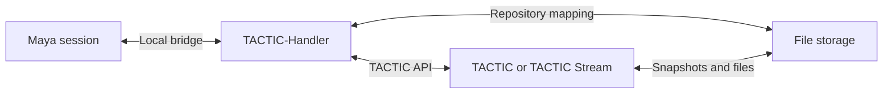

# TACTIC-Handler

**Native desktop workspace for TACTIC asset production.** Find an asset or shot, follow its tasks and versions, and turn local files into a TACTIC snapshot. Handler runs as a standalone Python and Qt Quick application. Its local bridge connects a Maya session to the same workspace.

[Русский](README.ru.md) · [Start on Windows](#start-on-windows) · [Maya integration](#maya-integration) · [Python API](#python-api) · [Handbook](docs/handbook.en.md)


*Orbit Studio is a demonstration project. This is the standalone Qt application connected to a local TACTIC Stream server.*

> **Development prototype.** Evaluate Handler with a test project and repository. The Perforce-like file workspace is a separate prototype.

## Work from the asset

Open a project and choose a Search Type from the sidebar. Each search tab keeps its own view, filters, and selection. Use **Item View** for visual assets and their related work, the continuous tree to follow processes and versions, or the table for field-oriented work.

### Browse records and keep the context

Cards and rows link to tasks, notes, related objects, and snapshots. Docks can sit alongside the current selection, so opening a discussion or checking a version keeps the search results in view. Save a workspace layout when a department needs the same panel arrangement again.


*The notes dock follows the selected asset. [Table view](docs/assets/github-workspace.png)*

### Configure Item View

When connected to Stream with layout authoring enabled, use the native **Item Layouts** editor to assemble a card or row. Bind previews and text to object fields, add actions such as Notes or Object details, and preview the draft with project data before saving it. Sidebar configuration can select how users enter a search workspace. [Item Layouts](thlib/ui/help_articles/item_layouts.en.md) · [Sidebar Editor](thlib/ui/help_articles/sidebar_editor.en.md)

## Publish files and review versions

1. Select an object and the process or context that should own the publication.
2. Add local files or folders to **Drop Plate**, then review the groups and check-in settings in **Commit Queue**.
3. Submit the check-in. The server applies its permissions, naming, and repository rules and records the resulting snapshot.
4. Open **Snapshot Browser** to inspect files and previews. Choose two image snapshots to compare their versions side by side or with a divider.


*Published files belong to a snapshot on the server. The desktop client also handles local repository mappings and synchronization.*

[Check-in guide](thlib/ui/help_articles/checkin.en.md) · [Commit Queue](thlib/ui/help_articles/commit_queue.en.md) · [Snapshot Browser](thlib/ui/help_articles/dock.snapshot.en.md) · [Repository setup](thlib/ui/help_articles/repositories.en.md)

## Maya integration

The Maya connector registers a session with **Handler Server**, the local desktop bridge. Choose the connected session in Handler before sending a native operation. The connector performs Maya work such as open, import, or reference; Handler manages the TACTIC session and file transfers.



Maya is the integration shipped in this checkout. A separate connector can register its own native actions through the thin-client protocol. [Install the Maya connector](installer/README.md) · [DCC API](docs/dcc_api.md) · [Thin-client protocol](docs/thin_client_protocol.md)

## Python API

Use Handler's configured session from a standalone script. This example reads records from the demo Search Type. Substitute your project code and Search Type for a real installation.

```python
from tactic_handler_api import local

with local() as handler:
    assets = handler.project("orbit").stype("orbit/asset")
    result = assets.query(limit=12, order_by=["name asc"])
    for asset in result.items:
        print(asset.get_code(), asset.get_value("name"))
```

The same API family also has entry points for the desktop Script Editor and connected DCC clients. Studio tools can query and edit objects, initiate file operations, and call supported UI actions. [API examples and execution contexts](docs/handler_api.md) · [Script Editor](thlib/ui/help_articles/script_editor.en.md) · [Script Shelf](thlib/ui/help_articles/script_shelf.en.md)

## Start on Windows

Use a modern source checkout containing `launch.py`, Python 3.14, and a TACTIC account.

```powershell
py -3.14 -m venv .venv
.\.venv\Scripts\python.exe -m pip install -r requirements.txt
.\.venv\Scripts\python.exe launch.py
```

Start the TACTIC server first. In Handler, open **Configuration → Server**, test the preset, and generate a ticket. Choose a project. Set up its local repository mapping before trying check-in or synchronization. [First connection](docs/handbook.en.md#first-connection) · [Getting started](thlib/ui/help_articles/getting_started.en.md)

| Where to go next | Reference |
| --- | --- |
| Desktop workflows, tasks, and administration | [Handbook](docs/handbook.en.md) · [Product Help](thlib/ui/help_articles/README.md) |
| Client structure and shared Frame | [Architecture](docs/application_architecture.md) · [Frame contracts](docs/frame/index.md) |
| Compatibility with an existing TACTIC installation | [Compatibility map](docs/tactic_compatibility/README.md) |
| Release verification | [Readiness and manual acceptance](docs/release_readiness.md) |

Handler connects to [Southpaw TACTIC](https://github.com/Southpaw-TACTIC/TACTIC) or TACTIC Stream. It is distributed under the [Eclipse Public License 1.0](LICENSE).
