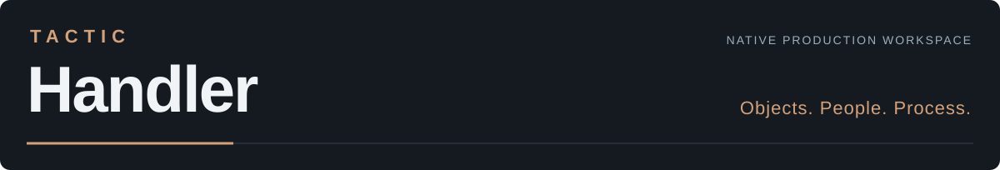
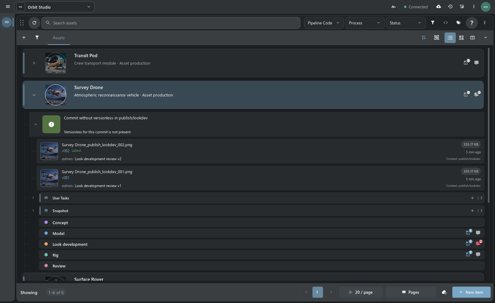
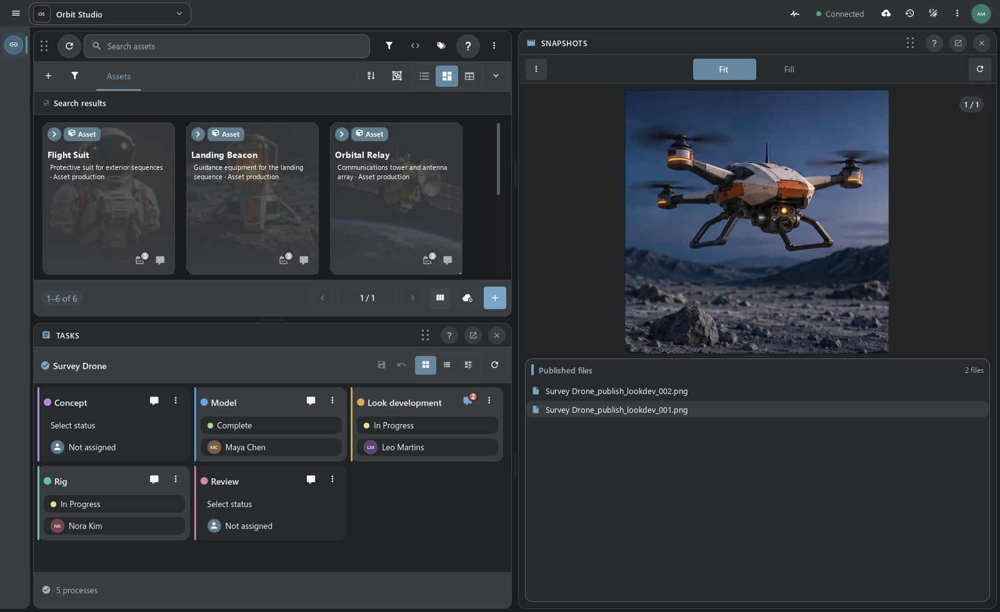
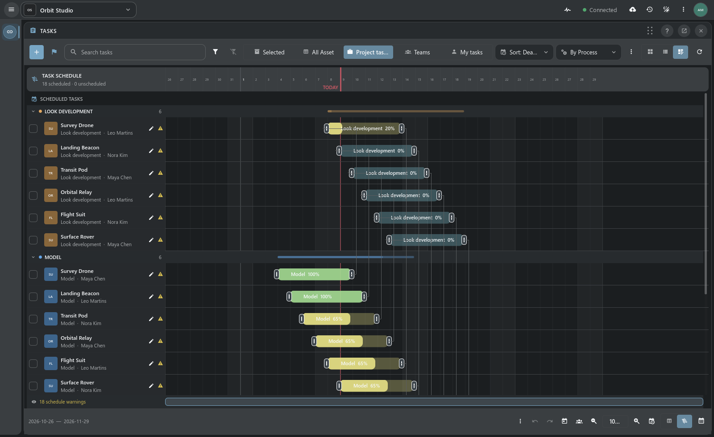
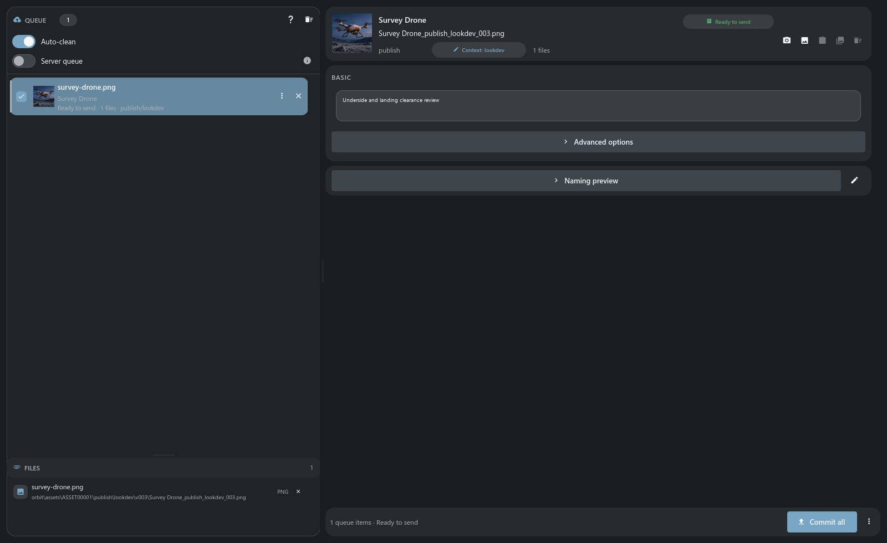
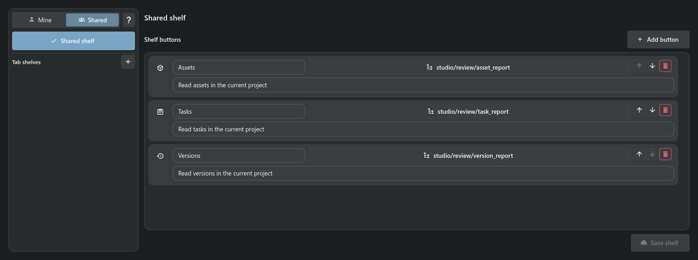
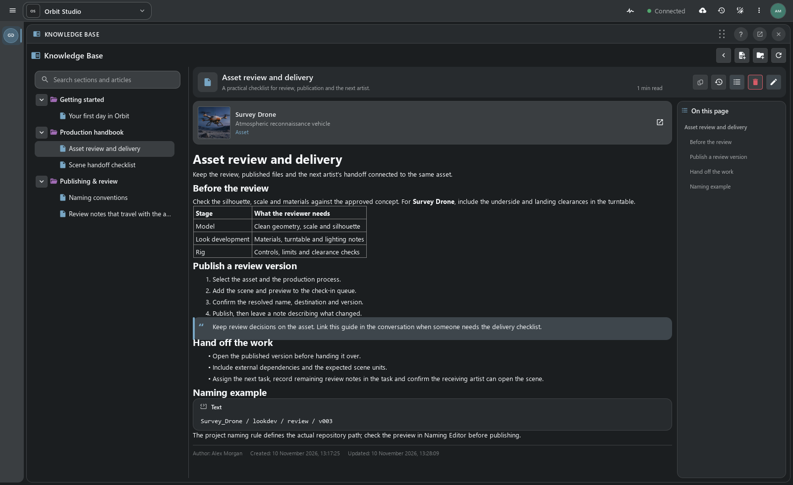
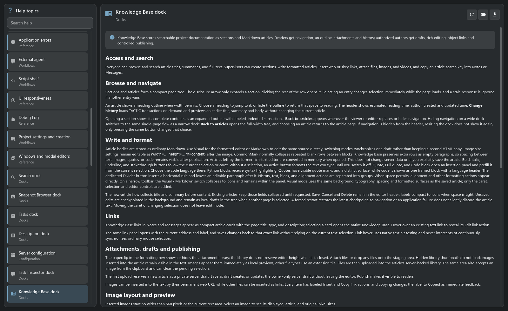
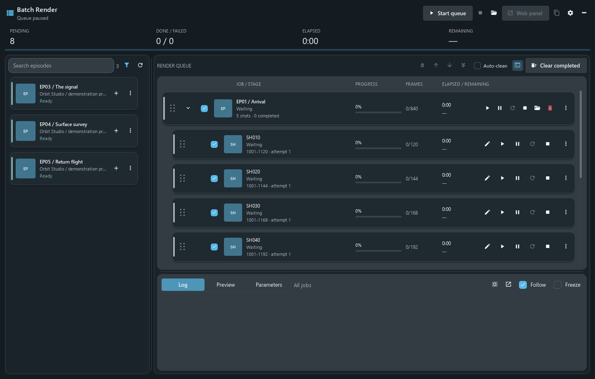
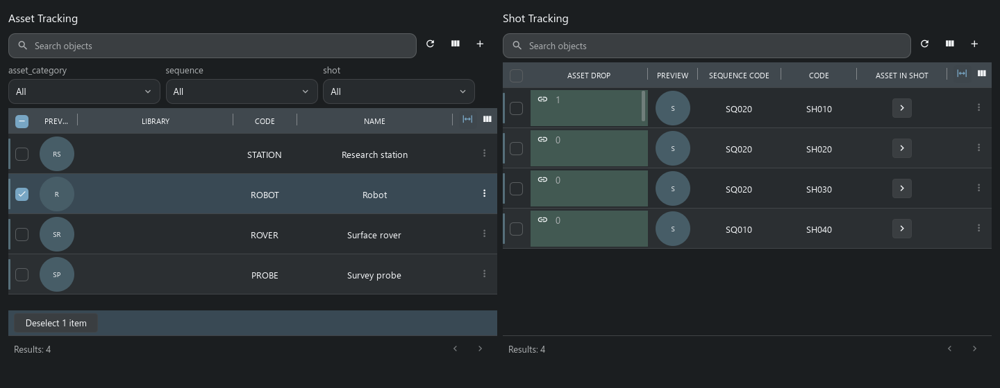

# 

**Desktop client for TACTIC and TACTIC Stream.**

[Русский](README.ru.md) · **[Get started](#installation-and-connection)** · [Feature tour](docs/presentations/product-tour.en.md) · [Maya integration](docs/presentations/maya.en.md) · [Plugins](#plugins-in-practice) · [Documentation](docs/index.md)

TACTIC Handler is a desktop application for managing assets, shots, tasks and published files in animation and VFX production. It is written in **Python and PySide6**, with a native **Qt Quick / QML** interface. Handler connects a studio’s TACTIC project to the files on an artist’s workstation and to Maya.

You can find a shot, see who is working on it, read the feedback, open the required scene version and publish your changes from the same workspace. The project’s records, permissions and workflow live on a **Southpaw TACTIC** server or its actively developed fork, **TACTIC Stream**. Handler is a separate client providing the desktop tools: file preparation and transfer, version browsing, local queues, script shelves and DCC integration.



> **Development prototype**, including the Perforce-like File Workspace.

## Item View

Item View is Handler’s main view. Expand an object to see its processes, tasks and publications, with file versions directly in the search results. Cards provide a visual view; tables support editing fields across many records.

Tasks, notes and file previews can sit beside the results. Save the arrangement as a layout and put project scripts on a personal or shared shelf.

## Who it is for

- **Artists** — find scenes, textures and caches, follow assigned tasks, read review notes and publish work with the right version and filename.
- **Supervisors and coordinators** — track assets and shots, assign work, plan dates in Gantt, review publications and follow project activity.
- **Pipeline TDs and administrators** — define project types and relationships, set naming and access rules, build workspaces, write scripts and distribute studio tools as plugins.

Handler uses the types and relationships defined in your project. Assets and shots are common examples; the same tools can work with a library of models, reference materials, deliveries or your own record types.

## Features at a glance

| Area | What you can do |
| --- | --- |
| **Find and organize work** | Search by text, tags, fields and related tasks; save searches; browse objects, processes and versions in [Item View](docs/presentations/product-tour.en.md#item-view-and-search), cards or editable tables. |
| **Publish files** | Check in scenes, **UDIM textures, image sequences, animation and groups of files**. Match names in Drop Plate and review the context, version, previews and destination in [Commit Queue](docs/presentations/product-tour.en.md#check-in-and-check-out). |
| **Manage repositories** | Check out a selected version, download dependencies, synchronize local repositories and set up [Watch Folders](docs/presentations/product-tour.en.md#repository-sync-and-watch-folders). Edit file and directory rules in Naming Editor. |
| **Plan production** | Assign tasks, change statuses, edit dates and progress in [Task Manager, Gantt and calendar](docs/presentations/product-tour.en.md#planning); record work hours. Configure process transitions in Workflow. |
| **Review and communicate** | Keep Notes with their object and process, talk in Messages, inspect an object’s overview and follow server activity. |
| **Arrange the workspace** | Combine dock panels, save layouts, edit sidebar entries, design item cards and build [custom dashboards](docs/presentations/dashboards.en.md). |
| **Work with Maya** | Open, import or reference published files, choose the connected Maya session, save scenes for check-in and export [script shelves](docs/presentations/maya.en.md). |
| **Automate studio work** | Use Script Editor for local and server scripts, call the [object-based Python API](docs/handler_api.md), attach tools to shelves and install desktop plugins. |
| **Configure the project** | Manage schema, relationships, users, groups, access, workflow and plugins through [Administration](docs/presentations/product-tour.en.md#project-administration). |
| **Keep knowledge close** | Read searchable EN/RU Help, publish studio instructions in the [Knowledge Base](docs/presentations/knowledge-base.en.md) and query project information with the [assistant](docs/presentations/assistant.en.md). |

The tour below shows these tools with TACTIC Stream. Original TACTIC support depends on the server’s available APIs; see the [compatibility map](docs/tactic_compatibility/README.md).

## Technology

| Part | Implementation |
| --- | --- |
| Application | **Python 3**; the current Windows source setup uses **Python 3.14**. |
| Desktop interface | **PySide6 / Qt 6**, **Qt Quick and QML**, native windows and docks. The runtime version is pinned in [requirements.txt](requirements.txt). |
| Shared UI descriptions | **Tactic Frame**, authored as JavaScript modules. Shared screens render as Qt Quick in Handler and Vue in Stream. |
| Server connection | TACTIC’s **XML-RPC API** and file-transfer routes. Python wrappers expose projects, Search Types, objects, snapshots and files. |
| Background operations | Worker pools handle server queries, repository transfers and other long operations. Qt models deliver their results to the interface. |
| Maya connection | A thin Python connector and the local **Handler Server** router. Scene operations run in the selected Maya process; repository work runs in Handler. |

The current delivery target is Windows. Maya is the documented DCC integration; the [connector API](docs/dcc_api.md#adding-another-dcc) explains how to add another application. The server is a separate installation and can run on another machine.

[Application architecture](docs/application_architecture.md) · [Handler Python API](docs/handler_api.md) · [Tactic Frame](docs/frame/index.md)

## Installation and connection

For a Windows source checkout, use Python 3.14 and a running TACTIC Stream or compatible TACTIC server:

```powershell
py -3.14 -m venv .venv
.\.venv\Scripts\python.exe -m pip install -r requirements.txt
.\.venv\Scripts\python.exe launch.py
```

Open **Configuration → Server**, connect and sign in. Select a project, then configure repository mappings before working with files.

[Installation and first connection](docs/handbook.en.md#installation) · [Maya setup](docs/presentations/maya.en.md#connector-installation) · [Original TACTIC compatibility](docs/tactic_compatibility/README.md)

## Handler tools

### Docks and workspace layouts

Docks divide the window into panels that can be rearranged, stacked into tabs or moved to a second monitor. Save a review or planning layout and assign it to a sidebar entry, along with the search and view the department needs.



[Docks and saved layouts →](docs/presentations/product-tour.en.md#docks-and-layouts) · [Sidebar Editor →](docs/presentations/product-tour.en.md#sidebar-editor)

### Tasks and scheduling

Task Manager shows personal assignments, a department’s work or the whole project. Gantt lets you edit dates and progress and see overlapping assignments. Object feedback stays in Notes, team conversations in Messages. Workflow defines the transitions between production stages.



[Tasks and Gantt →](docs/presentations/product-tour.en.md#planning) · [Workflow →](docs/presentations/product-tour.en.md#workflow-graph-and-execution) · [Notes and Messages →](docs/presentations/product-tour.en.md#messages-and-notes)

### Check-in, versions and synchronization

Add files through Drop Plate, then review the version, description and resolved path in Commit Queue. Check-in saves a snapshot against the object. Repository Sync downloads selected versions to a local repository; Naming Editor defines the file and directory rules.



[Check-in, check-out, naming and Repository Sync →](docs/presentations/product-tour.en.md#check-in-and-check-out)

### Maya and script shelves

The plugin opens, imports or references a file in the selected Maya session. To publish, Maya saves the scene and Handler performs check-in: transferring the files and recording the publication on the server.


Script Shelf holds saved scripts with labels, icons and tooltips. Shelves can be personal, shared or assigned to a project tab. The editor can export a shelf to Maya and update it there when the tools change.



[Maya plugin, shelves and scene workflow →](docs/presentations/maya.en.md)

### Project assistant

Ask the assistant to read an asset’s tasks, notes and publications and prepare a report. The screenshot shows that request for Survey Drone. Modeling is marked complete, but there is no published model file; the assistant called out the missing delivery.


[Assistant: providers, tools and capabilities →](docs/presentations/assistant.en.md)

### Custom dashboards

Dashboard Editor builds pages from metrics, charts, Item View and object actions. The example below shows workload and project statuses. Pages open from the sidebar and can be configured for each department.


[Custom dashboards and visual authoring →](docs/presentations/dashboards.en.md)

### Help and Knowledge Base

Knowledge Base stores studio instructions: delivery requirements, onboarding material and technical notes. Articles can link to assets and shots, contain attachments and be found through search. Authors have Visual / Markdown editing, drafts and revision history.



[Knowledge Base: reading, editing and publishing →](docs/presentations/knowledge-base.en.md)

Built-in Help opens from working tools and the main menu. It covers commands, settings and procedures in English and Russian, with full-text search and Markdown export.



[Explore built-in Help →](docs/presentations/help.en.md)

## Plugins in practice

### Batch Render: a Maya queue inside Handler

Batch Render was built specifically for Handler for the Niki production workflow. Add episodes, choose shots and frame ranges, then start the queue. The plugin prepares local scenes and dependencies, runs Maya batch and displays progress and logs. You can pause, reorder or retry work and control the running queue from its web panel.



This is a desktop plugin with its own releases, distributed through the project’s TACTIC server. Its project types, repository presets, cache paths and Maya settings need to match the studio using it. The screenshot shows demonstration entries before rendering starts.

[Batch Render workflow and setup →](docs/presentations/plugins.en.md#batch-render) · [Plugin source](plugins/batch_render)

### VFX: the original TACTIC project template

The restored VFX template shows another kind of extension: an entire project structure with assets, sequences, shots, relationships and working pages. In **Shot Planner**, assets sit beside shots so their use in the sequence can be planned. **Shot Sheet** brings shot information and related work together; **Review** submits a specific published version to a review session.



These are the legacy template’s retained layouts rendered by Handler’s native controls, shown with TACTIC Stream. The adapted package repairs its configuration and supported actions; some original production widgets remain excluded.

[VFX pages, adaptation and limits →](docs/presentations/plugins.en.md#vfx-project-template)

### Build a tool for your studio

Start with a saved search, dock layout and shelf for a department. Add a Python action to validate a delivery or prepare files; use a desktop plugin when the tool needs its own window and local processes. Project packages can distribute schema, workflow, naming, sidebar entries and reusable widgets. Batch Render and VFX show both approaches in use.

[Extension options and authoring references →](docs/presentations/plugins.en.md#building-your-own-tools)

## Configuration and APIs

| Area | Explore |
| --- | --- |
| **Project authoring** | [Schema and administration](docs/presentations/product-tour.en.md#project-administration), [users and access](docs/presentations/product-tour.en.md#users-and-permissions), [configuration](docs/presentations/product-tour.en.md#configuration). |
| **Context and activity** | [Object overview](docs/presentations/product-tour.en.md#object-overview) and [server history](docs/presentations/product-tour.en.md#activity-feed-and-project-history). |
| **Automation** | [Script Editor and runtimes](docs/presentations/product-tour.en.md#script-editor-and-automation), [Python API](docs/handler_api.md), [DCC API](docs/dcc_api.md). |
| **Interface development** | [Tactic Frame](docs/presentations/product-tour.en.md#tactic-frame): shared descriptions rendered by native Qt Quick and Vue. |

**[Full product tour →](docs/presentations/product-tour.en.md)** · [All documentation](docs/index.md)

Project editors, dashboards and the assistant are shown here with a TACTIC Stream server. Use the compatibility map for original TACTIC. Screenshots show the current application with demonstration data: Orbit Studio, a paused Batch Render queue and an isolated VFX project.

Built on the [Southpaw TACTIC](https://github.com/Southpaw-TACTIC/TACTIC) ecosystem. [Eclipse Public License 1.0](LICENSE).
