# 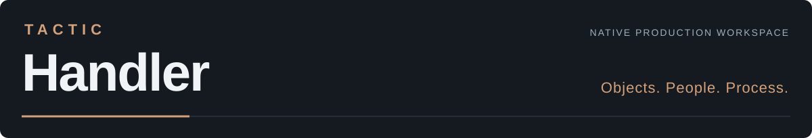

**Настольный клиент для TACTIC и TACTIC Stream.**

[English](README.md) · **[Начать работу](#установка-и-подключение)** · [Обзор возможностей](https://github.com/listyque/TACTIC-Handler/wiki/Tour-product-tour-ru) · [Maya-плагин](https://github.com/listyque/TACTIC-Handler/wiki/Tour-maya-ru) · [Плагины](#примеры-плагинов) · [Документация](https://github.com/listyque/TACTIC-Handler/wiki/Home-ru)

TACTIC Handler — настольное приложение для работы с ассетами, шотами, задачами и опубликованными файлами в анимации и VFX. Оно написано на **Python и PySide6**, интерфейс — **Qt Quick / QML**. Handler связывает проект студии в TACTIC с файлами на рабочем компьютере художника и с Maya.

В одном рабочем пространстве можно найти шот, увидеть исполнителей и замечания, открыть нужную версию сцены и сдать свою работу. Записи проекта, права и workflow хранятся на сервере **Southpaw TACTIC** или его развиваемом форке **TACTIC Stream**. Handler — отдельный клиент, который отвечает за работу на компьютере: подготовку и передачу файлов, просмотр версий, локальные очереди, полки скриптов и интеграцию с DCC.

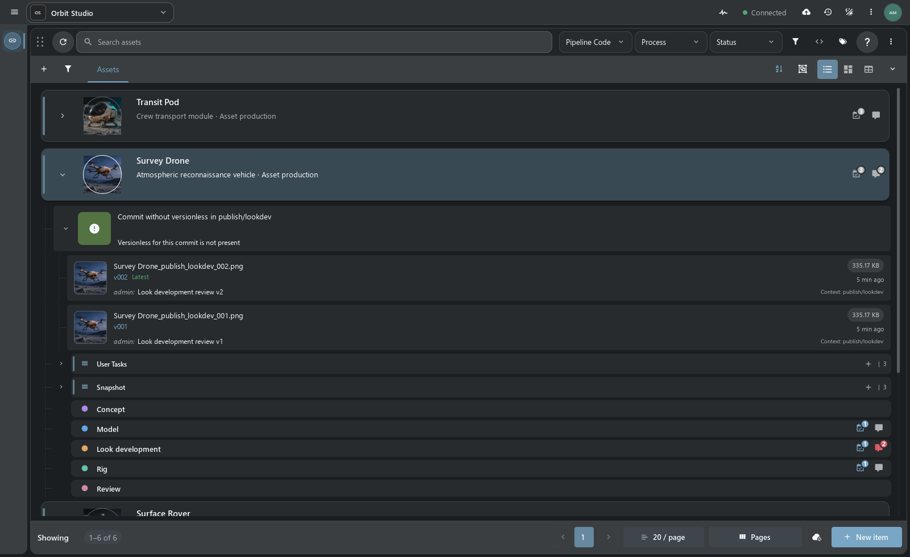

> **Прототип в разработке**, в том числе Perforce-like File Workspace.

## Item View

Основное представление Handler — Item View. Объект раскрывается в дерево процессов, задач и публикаций: версии файлов видны прямо в результатах поиска. Для визуального просмотра есть карточки, для массовой правки полей — таблица.

Рядом с результатами можно разместить задачи, заметки и превью файлов. Раскладки сохраняются, а скрипты проекта доступны с личной или общей полки.

## Кому пригодится

- **Художнику** — найти сцену, текстуры и кеши, посмотреть свои задачи и замечания, сдать работу с правильной версией и именем файла.
- **Супервайзеру и координатору** — следить за ассетами и шотами, назначать работу, планировать сроки в Gantt, просматривать публикации и историю проекта.
- **Pipeline TD и администратору** — задавать типы объектов и связи, настраивать нейминг и права, собирать рабочие пространства, писать скрипты и распространять инструменты студии как плагины.

Handler работает с типами и связями, заданными в проекте. Ассеты и шоты — привычные примеры; теми же средствами можно вести библиотеку моделей, референсы, поставки или свои типы записей.

## Основные возможности

| Область | Что можно делать |
| --- | --- |
| **Поиск и организация работы** | Искать по тексту, тегам, полям и связанным задачам; сохранять поиски; просматривать объекты, процессы и версии в [Item View](https://github.com/listyque/TACTIC-Handler/wiki/Tour-product-tour-ru#item-view-и-поиск), карточках или редактируемых таблицах. |
| **Публикация файлов** | Сдавать сцены, **UDIM-текстуры, секвенции изображений, анимацию и наборы файлов**. Разбирать имена в Drop Plate, проверять контекст, версию, превью и путь в [Commit Queue](https://github.com/listyque/TACTIC-Handler/wiki/Tour-product-tour-ru#чекин-и-чекаут). |
| **Репозитории** | Забирать выбранную версию и зависимости, синхронизировать локальный репозиторий, настраивать [Watch Folders](https://github.com/listyque/TACTIC-Handler/wiki/Tour-product-tour-ru#repository-sync-и-watch-folders). Задавать правила имён и каталогов в Naming Editor. |
| **Планирование** | Назначать задачи, менять статусы, сроки и прогресс в [Task Manager, Gantt и календаре](https://github.com/listyque/TACTIC-Handler/wiki/Tour-product-tour-ru#планирование), учитывать рабочее время. Настраивать переходы между процессами в Workflow. |
| **Ревью и общение** | Хранить Notes у объекта и процесса, переписываться в Messages, открывать обзор объекта и следить за событиями сервера. |
| **Рабочее пространство** | Комбинировать доки, сохранять раскладки, редактировать sidebar, оформлять карточки объектов и собирать [свои дашборды](https://github.com/listyque/TACTIC-Handler/wiki/Tour-dashboards-ru). |
| **Maya** | Открывать, импортировать и подключать reference из публикаций, выбирать сессию Maya, сохранять сцену для чекина и экспортировать [полки скриптов](https://github.com/listyque/TACTIC-Handler/wiki/Tour-maya-ru). |
| **Автоматизация** | Писать локальные и серверные скрипты в Script Editor, обращаться к [объектному Python API](https://github.com/listyque/TACTIC-Handler/wiki/Handler-Python-API), выносить инструменты на полки и устанавливать клиентские плагины. |
| **Настройка проекта** | Управлять схемой, связями, пользователями, группами, правами, workflow и плагинами через [Administration](https://github.com/listyque/TACTIC-Handler/wiki/Tour-product-tour-ru#администрирование-проекта). |
| **Справка и знания** | Читать встроенную справку с поиском на русском и английском, вести инструкции студии в [базе знаний](https://github.com/listyque/TACTIC-Handler/wiki/Tour-knowledge-base-ru), обращаться к [помощнику](https://github.com/listyque/TACTIC-Handler/wiki/Tour-assistant-ru) за информацией о проекте. |

Ниже эти инструменты показаны с сервером TACTIC Stream. Возможности подключения к оригинальному TACTIC зависят от доступных серверных API — они описаны в [карте совместимости](https://github.com/listyque/TACTIC-Handler/wiki/TACTIC-compatibility).

## На чём написан

| Часть | Технологии |
| --- | --- |
| Приложение | **Python 3**; текущий запуск исходников на Windows рассчитан на **Python 3.14**. |
| Интерфейс | **PySide6 / Qt 6**, **Qt Quick и QML**, нативные окна и доки. Версия зависимости закреплена в [requirements.txt](requirements.txt). |
| Общие описания UI | **Tactic Frame**, модули на JavaScript. Общие экраны отображаются через Qt Quick в Handler и через Vue в Stream. |
| Связь с сервером | **XML-RPC API** TACTIC и маршруты передачи файлов. Python API предоставляет объекты проекта, Search Type, записи, snapshots и файлы. |
| Фоновые операции | Запросы к серверу, передача файлов и другие длительные операции выполняются в рабочих потоках. Результаты поступают в интерфейс через модели Qt. |
| Связь с Maya | Тонкий Python-коннектор и локальный маршрутизатор **Handler Server**. Операции со сценой выполняются в выбранном процессе Maya, работа с репозиторием — в Handler. |

Текущая целевая платформа поставки — Windows. Для Maya есть готовая описанная интеграция; подключение другого приложения разбирается в [API коннекторов](https://github.com/listyque/TACTIC-Handler/wiki/DCC-API#adding-another-dcc). Сервер устанавливается отдельно и может работать на другой машине.

[Архитектура приложения](https://github.com/listyque/TACTIC-Handler/wiki/Architecture) · [Python API Handler](https://github.com/listyque/TACTIC-Handler/wiki/Handler-Python-API) · [Tactic Frame](https://github.com/listyque/TACTIC-Handler/wiki/Frame)

## Установка и подключение

**[Сборки Windows: Clean / Demo](https://github.com/listyque/TACTIC-Handler/releases)** · [Инструкция](docs/windows_downloads.ru.md) · [Комплекты TH + TS](https://github.com/listyque/TACTIC-Stream/releases)

Для запуска исходников на Windows нужны Python 3.14 и работающий сервер TACTIC Stream или совместимый TACTIC:

```powershell
py -3.14 -m venv .venv
.\.venv\Scripts\python.exe -m pip install -r requirements.txt
.\.venv\Scripts\python.exe launch.py
```

Откройте **Configuration → Server**, подключитесь и войдите в систему. Выберите проект и настройте пути репозитория перед работой с файлами.

[Установка и первое подключение](https://github.com/listyque/TACTIC-Handler/wiki/Handbook-ru) · [Подключение Maya](https://github.com/listyque/TACTIC-Handler/wiki/Tour-maya-ru) · [Совместимость с оригинальным TACTIC](https://github.com/listyque/TACTIC-Handler/wiki/TACTIC-compatibility)

## Работа в Handler

### Доки и рабочие раскладки

Доки делят окно на панели, которые можно переставлять, объединять во вкладки и выносить на второй монитор. Раскладку для ревью или планирования можно сохранить и назначить пункту sidebar. Вместе с поиском и выбранным представлением она задаёт рабочее место отдела.

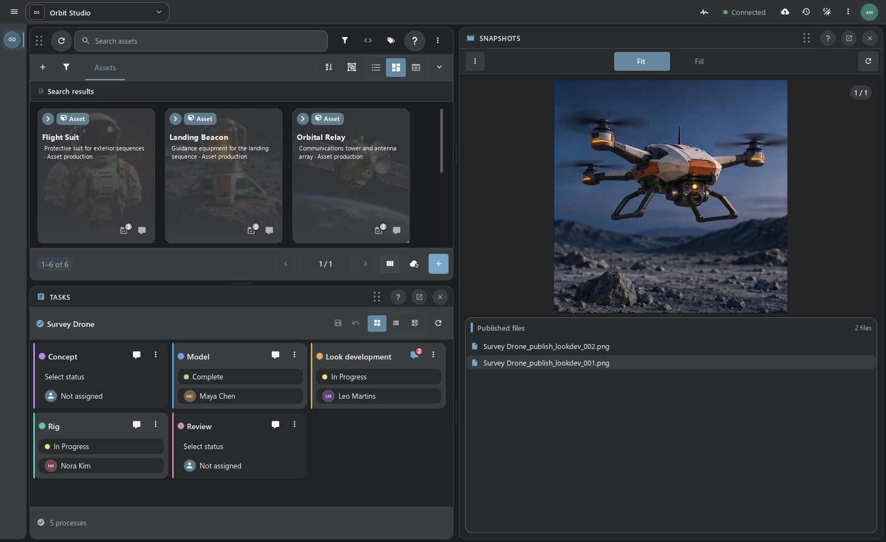

[Доки и сохранённые раскладки →](https://github.com/listyque/TACTIC-Handler/wiki/Tour-product-tour-ru#доки-и-раскладки) · [Sidebar Editor →](https://github.com/listyque/TACTIC-Handler/wiki/Tour-product-tour-ru#sidebar-editor)

### Задачи и расписание

Task Manager показывает личные задачи, работу отдела или весь проект. В Gantt редактируются сроки и прогресс, видны пересечения назначений. Замечания к объекту хранятся в Notes, переписка команды — в Messages. Переходы между производственными этапами задаёт Workflow.

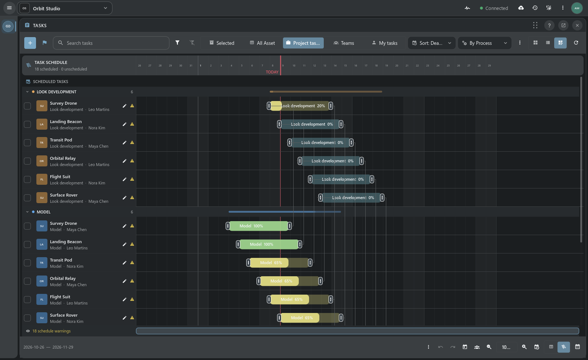

[Задачи и Gantt →](https://github.com/listyque/TACTIC-Handler/wiki/Tour-product-tour-ru#планирование) · [Workflow →](https://github.com/listyque/TACTIC-Handler/wiki/Tour-product-tour-ru#workflow-граф-и-исполнение) · [Notes и Messages →](https://github.com/listyque/TACTIC-Handler/wiki/Tour-product-tour-ru#messages-и-notes)

### Чекин, версии и синхронизация

Файлы добавляются через Drop Plate и попадают в Commit Queue. Перед отправкой видны версия, описание и рассчитанный путь. Публикация сохраняется у объекта в виде snapshot; Repository Sync скачивает выбранные версии в локальный репозиторий. Имена и каталоги задаются правилами Naming Editor.

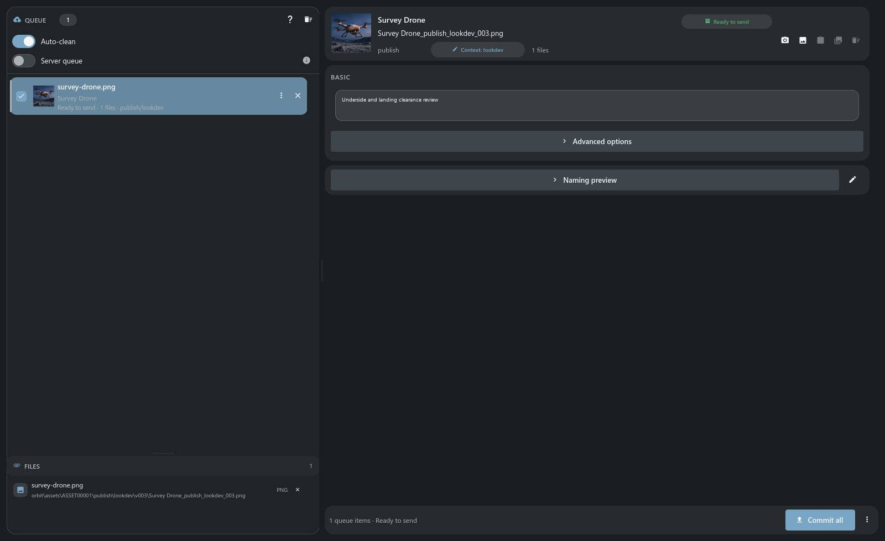

[Чекин, чекаут, нейминг и Repository Sync →](https://github.com/listyque/TACTIC-Handler/wiki/Tour-product-tour-ru#чекин-и-чекаут)

### Maya и полки скриптов

Плагин открывает, импортирует или подключает reference в выбранной сессии Maya. Для сдачи Maya сохраняет сцену, затем Handler выполняет чекин: передаёт файлы и регистрирует публикацию на сервере.

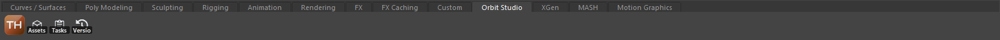

На Script Shelf размещаются сохранённые скрипты с подписями, иконками и подсказками. Полка может быть личной, общей или привязанной к вкладке проекта. Из редактора её можно перенести в Maya и обновлять там по мере изменения инструментов.

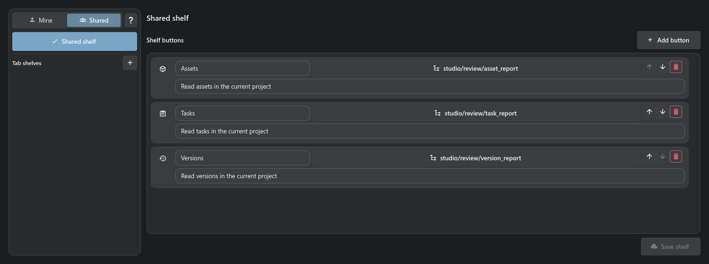

[Maya-плагин, полки и работа со сценами →](https://github.com/listyque/TACTIC-Handler/wiki/Tour-maya-ru)

### Помощник проекта

Помощнику можно поручить разбор выбранного ассета: прочитать задачи, замечания и публикации, затем составить отчёт. На снимке — такой запрос по Survey Drone. Моделинг отмечен завершённым, но файла модели среди публикаций нет; помощник отметил это в ответе.

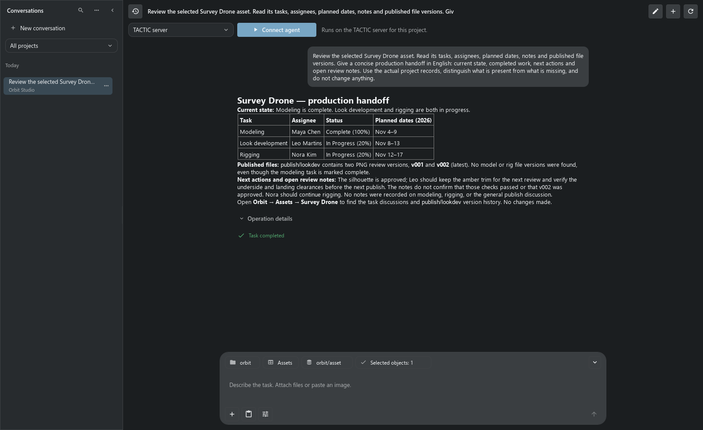

[Чат-бот: провайдеры, инструменты и возможности →](https://github.com/listyque/TACTIC-Handler/wiki/Tour-assistant-ru)

### Собственные дашборды

В Dashboard Editor собираются страницы с показателями, диаграммами, Item View и действиями над объектами. Ниже — обзор загрузки и статусов проекта. Страницу можно открыть из sidebar и настроить под нужный отдел.

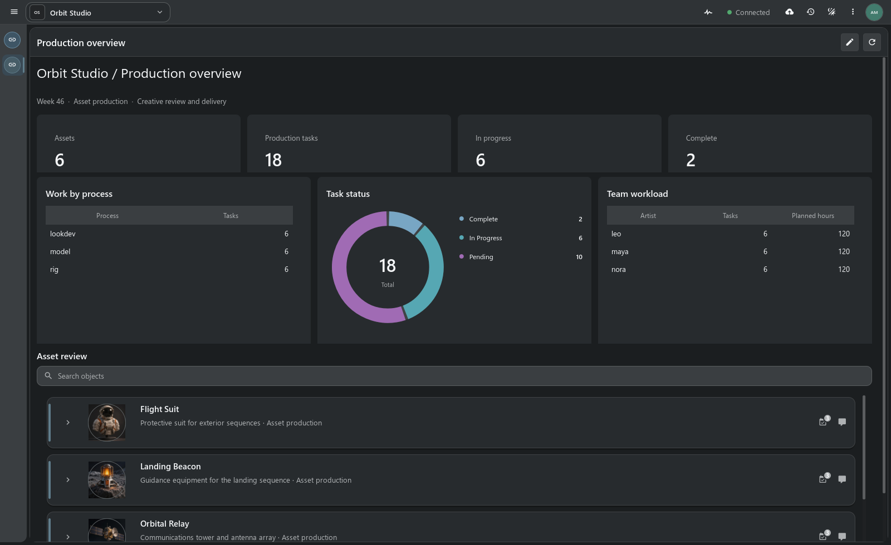

[Дашборды и визуальное редактирование →](https://github.com/listyque/TACTIC-Handler/wiki/Tour-dashboards-ru)

### Справка и база знаний

В базе знаний хранятся инструкции студии: требования к сдаче, вводные для новых сотрудников, технические заметки. Статьи связываются с ассетами и шотами, содержат вложения и доступны через поиск. Есть Visual / Markdown, черновики и история редакций.

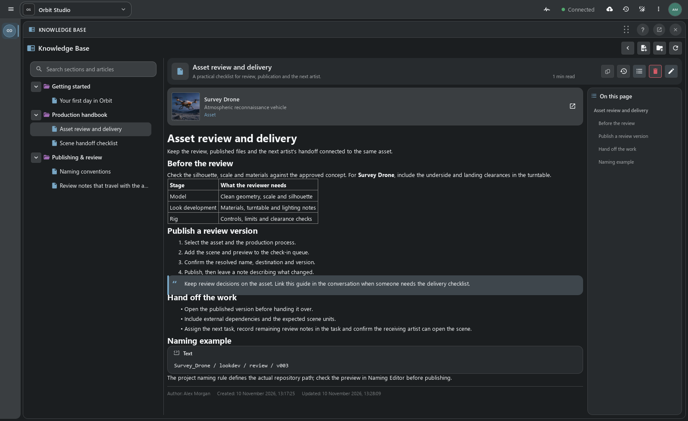

[База знаний: чтение, редактор и публикация →](https://github.com/listyque/TACTIC-Handler/wiki/Tour-knowledge-base-ru)

Встроенная справка открывается из рабочих окон и главного меню. В ней описаны команды, настройки и процедуры; статьи доступны на русском и английском. Поиск работает по тексту, текущую статью можно сохранить в Markdown.

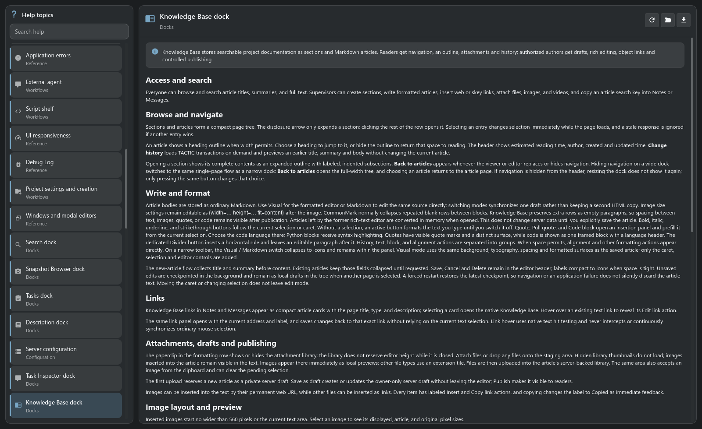

[Презентация встроенной справки →](https://github.com/listyque/TACTIC-Handler/wiki/Tour-help-ru)

## Примеры плагинов

### Batch Render: очередь Maya в Handler

Batch Render сделан специально для Handler под производственный процесс Niki. Добавьте эпизоды, выберите шоты и диапазоны кадров, затем запустите очередь. Плагин подготовит локальные сцены и зависимости, запустит Maya batch и покажет прогресс и логи. Задания можно приостанавливать, переставлять и запускать повторно; управлять работающей очередью можно и через её веб-панель.

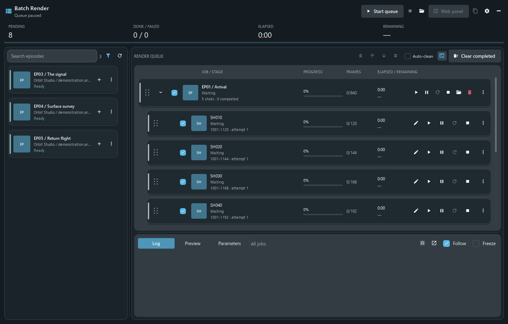

Это клиентский плагин со своими версиями, которые распространяются через TACTIC-сервер проекта. Типы объектов, пресеты репозитория, пути кешей и настройки Maya должны соответствовать проекту студии. На снимке — демонстрационная очередь до запуска рендера.

[Работа и настройка Batch Render →](https://github.com/listyque/TACTIC-Handler/wiki/Tour-plugins-ru#batch-render) · [Исходники плагина](plugins/batch_render)

### VFX: оригинальный шаблон проекта TACTIC

Восстановленный VFX показывает другой вид расширения: структуру целого проекта с ассетами, секвенциями, шотами, связями и рабочими страницами. В **Shot Planner** ассеты расположены рядом с шотами — здесь планируется их использование. **Shot Sheet** собирает сведения о шоте и связанную работу; **Review** отправляет конкретную опубликованную версию на сессию просмотра.

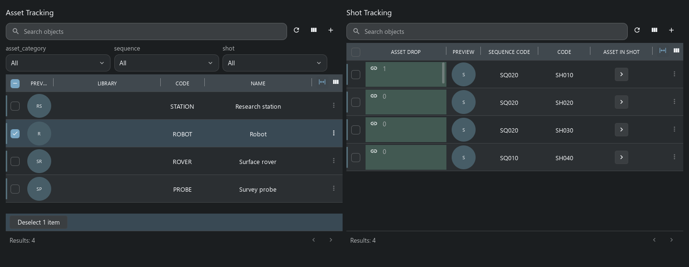

Сохранённые раскладки legacy-шаблона отображаются нативными контролами Handler; здесь они работают с TACTIC Stream. В адаптированном пакете исправлены конфигурации и поддерживаемые действия. Часть старых производственных виджетов остаётся исключённой.

[Экраны VFX, адаптация и ограничения →](https://github.com/listyque/TACTIC-Handler/wiki/Tour-plugins-ru#шаблон-проекта-vfx)

### Свой инструмент для студии

Для рабочего места отдела можно начать с сохранённого поиска, раскладки доков и полки. Затем добавить Python-действие для проверки поставки или подготовки файлов. Если инструменту нужны своё окно и локальные процессы, его можно оформить как клиентский плагин. Пакеты проекта позволяют переносить схему, workflow, нейминг, sidebar и переиспользуемые виджеты. Batch Render и VFX показывают оба подхода на конкретных задачах.

[Варианты расширения и документация для авторов →](https://github.com/listyque/TACTIC-Handler/wiki/Tour-plugins-ru#свои-инструменты)

## Настройка и API

| Область | Подробнее |
| --- | --- |
| **Устройство проекта** | [Схема и администрирование](https://github.com/listyque/TACTIC-Handler/wiki/Tour-product-tour-ru#администрирование-проекта), [пользователи и права](https://github.com/listyque/TACTIC-Handler/wiki/Tour-product-tour-ru#пользователи-и-права), [конфигурация](https://github.com/listyque/TACTIC-Handler/wiki/Tour-product-tour-ru#configuration). |
| **Контекст и события** | [Обзор объекта](https://github.com/listyque/TACTIC-Handler/wiki/Tour-product-tour-ru#обзор-объекта) и [история работы на сервере](https://github.com/listyque/TACTIC-Handler/wiki/Tour-product-tour-ru#activity-feed-и-история-проекта). |
| **Автоматизация** | [Script Editor и среды выполнения](https://github.com/listyque/TACTIC-Handler/wiki/Tour-product-tour-ru#script-editor-и-автоматизация), [Python API](https://github.com/listyque/TACTIC-Handler/wiki/Handler-Python-API), [DCC API](https://github.com/listyque/TACTIC-Handler/wiki/DCC-API). |
| **Разработка интерфейса** | [Tactic Frame](https://github.com/listyque/TACTIC-Handler/wiki/Tour-product-tour-ru#tactic-frame): общие описания для нативного Qt Quick и Vue. |

**[Полный обзор продукта →](https://github.com/listyque/TACTIC-Handler/wiki/Tour-product-tour-ru)** · [Вся документация](https://github.com/listyque/TACTIC-Handler/wiki/Home-ru)

Редакторы проекта, дашборды и помощник в этой презентации показаны с сервером TACTIC Stream. Для оригинального TACTIC доступна карта совместимости. На снимках — текущее приложение с демонстрационными данными: Orbit Studio, очередь Batch Render на паузе и изолированный VFX-проект.

Проект основан на экосистеме [Southpaw TACTIC](https://github.com/Southpaw-TACTIC/TACTIC). [Eclipse Public License 1.0](LICENSE).
