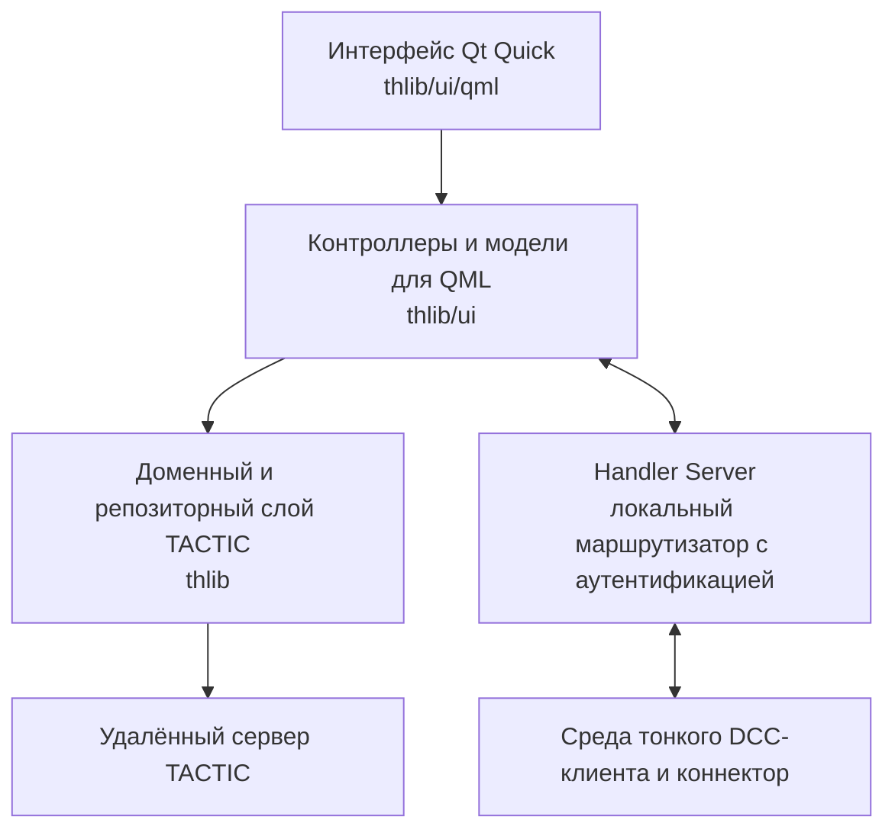

# TACTIC-Handler

[English](README.md) | **Русский**

[История изменений](CHANGELOG.md) описывает изменения каждой версии.

TACTIC-Handler — настольный клиент на Python 3 и Qt Quick для
[Southpaw TACTIC](https://github.com/Southpaw-TACTIC/TACTIC). Он объединяет в
одном рабочем пространстве навигацию по проектам, поиск, управление объектами и
задачами, просмотр публикаций, синхронизацию репозиториев, контролируемый
check-in, автоматизацию, администрирование и тонкую интеграцию с DCC.

TACTIC остаётся единственным источником серверных данных. Handler не заменяет
сервер TACTIC, базу данных, права доступа, пайплайны, правила именования или
репозитории. Он предоставляет для них адаптивный нативный интерфейс и выносит
медленные операции TACTIC, сети, репозиториев и файловой системы из UI-потока
Qt.

> **Состояние проекта**
>
> Репозиторий находится в активной разработке. Автоматическая предрелизная проверка
> достаточно строгий, но перед рабочим развёртыванием всё равно нужна ручная
> приёмка на целевом сервере TACTIC, реальных репозиториях, Windows и нужном DCC.
> Перед обновлением смотрите [готовность релиза](docs/release_readiness.md).

## Содержание

- [Возможности Handler](#возможности-handler)
- [Типичный рабочий процесс](#типичный-рабочий-процесс)
- [Требования](#требования)
- [Установка](#установка)
- [Первое подключение](#первое-подключение)
- [Интеграция с Maya](#интеграция-с-maya)
- [Добавление нового DCC](#добавление-нового-dcc)
- [Скрипты и автоматизация](#скрипты-и-автоматизация)
- [Единый Handler API](#единый-handler-api)
- [Конфигурация и серверное хранение](#конфигурация-и-серверное-хранение)
- [Архитектура](#архитектура)
- [Структура репозитория](#структура-репозитория)
- [Документация](#документация)
- [Разработка и проверка](#разработка-и-проверка)
- [Эксплуатация и безопасность](#эксплуатация-и-безопасность)
- [Известные границы](#известные-границы)
- [Лицензия](#лицензия)

## Возможности Handler

### Рабочее пространство, навигация и раскладки

- Нативное рабочее пространство PySide6/QML с доками, которые можно двигать,
  складывать во вкладки, менять по размеру, отделять в окна и восстанавливать.
- Именованные общепроектные пресеты раскладки. Пункт сайдбара может применять
  сохранённую раскладку при открытии своей вкладки поиска.
- Независимые вкладки поиска, сохраняющие запрос, загруженные страницы,
  выделение, раскрытые элементы, вид результатов, группировку, сортировку,
  позицию прокрутки и состояние доков.
- История недавно закрытых вкладок и меню всех вкладок, когда они перестают
  помещаться по ширине.
- Отдельные корни навигации для Handler и оригинального веб-интерфейса TACTIC:
  - Handler использует представление `tactic_handler`.
  - Оригинальный TACTIC использует представление `project_view`.
- Редактор сайдбара с обычным и XML-режимом, ссылками, секциями,
  разделителями, иконками, привязкой сохранённых поисков, начального вида
  результатов, раскладки рабочего пространства, скриптового шелфа и прав
  доступа.
- Предпросмотр сайдбара Handler от лица группы учётных записей. Администратор может
  редактировать структуру и сразу видеть, какие черновые пункты увидит modeller,
  rigger, supervisor или другая группа TACTIC.
- Русская и английская локализация интерфейса. Настроенные на сервере названия
  Search Type, пайплайнов, процессов, статусов, контекстов, групп и репозиториев
  показываются без перевода и переосмысления.
- Светлая и тёмная темы, выбор набора иконок, настройки текста и переключаемый
  бэкенд рендеринга Qt Quick.

### Поиск и представление результатов

Каждая вкладка поиска владеет одним полным запросом. Текст, теги, быстрые
фильтры, ручные условия и условия на TACTIC Expression Language объединяются в
один запрос, а не выполняются как несвязанные клиентские фильтры.

Доступны:

- широкий поиск по полям `name`, `title`, `keywords` и `description`;
- асинхронные подсказки и открытие найденного средней кнопкой в новой вкладке;
- каталоги проектных тегов и выбор нескольких тегов;
- компактные Quick Filters по полям объекта и связанным задачам;
- опубликованные администратором раскладки и начальные значения Quick Filters;
- персональные изменения Quick Filters в каждой вкладке с возвратом к
  общепроектному стандарту;
- расширенный поиск с упорядоченными условиями `AND`/`OR`;
- текстовые, числовые, денежные, временные, пользовательские и списковые
  отношения, а также проверки на пустое и уникальное значение;
- фильтры `**Expression` на TACTIC Expression Language, включая
  `Have`/`Do not have` по связанным объектам и заведомо более медленный Match по
  каждому объекту;
- серверные Saved Searches с созданием, обновлением, переименованием,
  дублированием, копированием ссылки, удалением и обновлением каталога;
- обычная пагинация и непрерывная загрузка без сброса позиции;
- фильтрация показываемых процессов;
- серверная сортировка и группировка, включая статусы объектов и задач;
- дерево, карточки, таблица, компактные строки, версии справа и версии снизу.

Дерево результатов лениво загружает дочерние связи, процессы, задачи, снапшоты
и версии. Если пользователь во время запроса сменил проект, вкладку, выделение
или область данных, устаревший ответ не применяется к новому состоянию.

### Search Objects и связи

Handler строит форму объекта по текущему описанию TACTIC EditWdg. Сохраняются
серверные порядок полей, заголовки, обязательность, режим только чтение,
варианты выбора и фактические значения.

Поддерживаются:

- создание и редактирование проектных sObject;
- адаптивные формы для текста, многострочного текста, флагов, списков,
  пользователей, проектов, процессов, пайплайнов, статусов, дат, паролей,
  родителей, превью и миниатюр;
- массовое создание объектов с шаблонами `{n}` и выравниванием нулями,
  например `{n:03}`;
- мастер предпросмотра пачки, где каждый будущий объект можно отдельно изменить
  и снабдить своим превью до общего создания на сервере;
- создание и удаление связей в обоих направлениях;
- поиск в списках доступных и связанных объектов, непрерывная пагинация,
  множественное выделение и редактирование связей перетаскиванием;
- дублирование объектов;
- удаление с предварительным просмотром зависимостей;
- непосредственное редактирование полей базы, где это допускают контекст и
  права;
- Object Report с идентификацией, полями, задачами, заметками, детьми,
  снапшотами, файлами, активностью, рабочими часами и стоимостью.

Неподдерживаемые кастомные поля EditWdg остаются видимыми, но доступны только для чтения. Handler
не подменяет их другим контролом и не рискует записать некорректное значение.

### Снапшоты, превью и репозитории

Snapshot Browser следует за текущими sObject, процессом, контекстом, снапшотом
и файлом. В нём есть:

- режимы «Превью и файлы», «Только превью» и «Только файлы»;
- горизонтальное и вертикальное разделение панелей;
- «Вписать» для полного изображения и «Заполнить» для заполнения области с обрезкой краёв;
- выбор качества с учётом DPI: web-превью используется, пока его хватает, а
  оригинал запрашивается, когда физический размер изображения на экране требует
  большего разрешения;
- переход между всеми файлами выбранного снапшота, доступными для предпросмотра;
- представление версионных снапшотов и снапшотов `versionless`/`latest`;
- имя, роль, размер, репозиторий, путь, локальное состояние и актуальность
  файла;
- открытие, показ в проводнике, копирование пути, синхронизация и доступные DCC
  действия;
- использование нативной семантики File для путей и репозиториев вместо
  реконструкции пути из показанного имени.

Инструменты репозиториев включают:

- Repository Editor для серверных описаний и локальных путей под каждую
  платформу;
- выбор и проверку репозитория по умолчанию;
- Repository Sync по объекту, снапшоту, пресету процесса, дочерней области и
  диапазону версий;
- явную очередь передачи с прогрессом, политикой конфликтов, повтором и
  отменой;
- проверку актуальности по существованию, ожидаемому размеру и времени на
  сервере;
- необязательную полную проверку контрольной суммы;
- Watch Folders, привязанные к конкретным проекту, объекту, корню репозитория,
  правилам сопоставления и параметрам check-in.

Если локальный файл уже актуален, он используется сразу. Handler не создаёт для
него видимую задачу скачивания и не делает лишний сетевой запрос.

### Check-in, Drop Plate и Commit Queue

Handler отделяет подготовку от выполнения: добавление файлов само по себе не
означает, что они уже опубликованы.

Цепочка check-in поддерживает:

- отдельные файлы, последовательности, слои, UV/UDIM, анимации и многофайловые
  группы;
- области перетаскивания Publish и Attachment на объектах результатов;
- непосредственную публикацию иконки для поддерживаемых изображений;
- сканирование Drop Plate и сопоставление через Matching Templates;
- быструю загрузку и необязательные проектные правила загрузки;
- создание дочерних объектов из файлов вместе со связью и выбором поведения
  при совпадении имён;
- процесс, контекст, репозиторий, описание, метод передачи, версию, итоговое
  имя, `versionless`, правила именования и параметры превью;
- предпросмотр версионных и `versionless`-путей до отправки;
- превью из файлов, буфера обмена и Screenshot Maker;
- объединённый или раздельный check-in для пачки файлов;
- отправку текущей операции, отмеченных операций или всех готовых операций в
  порядке очереди;
- безопасные границы отмены, повтор, прогресс, ошибки и сохранение
  незавершённых операций;
- автоматическое удаление успешно выполненных элементов.

Версию, путь репозитория, передачу файлов и создание снапшота TACTIC всегда
контролирует автономный Handler. Сохранение сцены в DCC только подготавливает
нативные данные для той же очереди отправки.

### Задачи, планирование и рабочее время

Полное рабочее пространство Tasks и компактные редакторы используют общее хранилище задач
и поддерживают:

- области текущего объекта, выделенных объектов, Search Type, проекта,
  пользователя и команды;
- фильтры по процессу, исполнителю, статусу, дате, прогрессу, тексту и быстрые
  фильтры;
- таблицу, группы, календарь и Gantt;
- серверную фильтрацию, сортировку, группировку и пагинацию;
- выделение с Shift/Ctrl, черновые изменения, массовое редактирование, создание
  и удаление с зависимостями;
- настраиваемые колонки таблицы;
- историю задач и точную синхронизацию с Task Inspector;
- заметки с областью объекта, процесса или отдельной задачи;
- секции запланированных и незапланированных задач Gantt;
- изменение дат с учётом рабочих дней и ограниченной отменой или повтором;
- ввод рабочего времени, табель, состояние утверждения, календарь задач, рабочие и
  финансовые отчёты при наличии нужных серверных данных и прав.

Состояние рабочего пространства Tasks сохраняется отдельно для каждого проекта. Отмеченные
строки и несохранённые изменения намеренно не восстанавливаются после
перезапуска как будто это всё ещё действительные серверные операции.

### Заметки, сообщения, активность и уведомления

- Notes для sObject, процессов и контекстов задач.
- Личные и групповые диалоги.
- Текст, ответы, упоминания, реакции, пересылка, закрепление, поиск, участники,
  состояние доставки и файлы беседы.
- Вложения через файловый диалог, изображение из буфера, Screenshot Maker и
  перетаскивание.
- Независимые черновики для каждой цели Notes и каждого диалога, сохраняемые
  при переключении и перезапуске.
- Проектный Activity Feed с изменениями объектов и задач, заметками,
  публикациями, рабочим временем и поддерживаемыми событиями связей.
- Внутренние уведомления о сообщениях и активности с независимыми
  переключателями.
- История и счётчики непрочитанного даже при отключённых всплывающих уведомлениях.
- Полный каталог Unicode emoji с категориями и поиском.

Уведомление — только краткий итог. Полные исключения, трассировки, параметры
запросов и вывод скриптов остаются в Debug Log или исходном редакторе.

### Скрипты и автоматизация

Handler содержит:

- серверный Script Editor для `config/custom_script`;
- дерево скриптов, общие вкладки, постоянные грязные черновики, номера строк,
  подсветку синтаксиса, поиск и замену, подсветку совпадений и токенов,
  автодополнение, структуру символов, переход к определению внутри файла и
  ограниченную историю правок;
- отдельный вывод для каждой вкладки со `stdout`, `stderr`, результатами и
  трассировкой;
- историю сохранённых редакций из нативных транзакций TACTIC;
- цели Local Python, Server Python, поддерживаемый Server JavaScript и выбранный
  DCC;
- выполнение выделенного фрагмента или всего исходника;
- проверенную синхронизацию проектных скриптов в локальное дерево
  `custom_scripts/<project>`;
- упорядоченные Script Triggers до и после действий Handler или DCC;
- любое число подходящих скриптов на одно действие с запуском сверху вниз;
- необязательные фильтры по Search Type, точному `search_key`, процессу и
  контексту;
- явную обработку ошибок: упавший триггер Before блокирует действие, а ошибка
  триггера After записывается в лог и не мешает следующим After-скриптам;
- персональные и общепроектные Script Shelves;
- общий шелф и переопределение для конкретной вкладки сайдбара;
- кнопки фиксированного размера с именем, иконкой, полной подсказкой и порядком;
- горизонтальную прокрутку при нехватке ширины;
- применение настроенного общего шелфа к текущей вкладке прямо из редактора;
- создание или замену нативного шелфа Maya при подключённом Maya-клиенте с
  нужной возможностью.

Триггеры открытия и сохранения снапшота оборачивают операции автономного Handler. События
открытия, импорта, референса и сохранения сцены Maya явно помечены как Maya DCC и
выполняются именно в клиенте, который совершает действие.

### Администрирование

Нативное окно Administration доступно только администраторам TACTIC. Все
изменения остаются локальными черновиками до явного сохранения.

Оно включает:

- каталоги Search Type, поля, заголовки, описания, цвета, превью, поддержку
  пайплайнов, счётчики, связи и ограничения безопасного удаления;
- создание проектных Search Type и дополнительных полей базы;
- граф схемы проекта, ключевые колонки, прямые связи, таблицы many-to-many,
  черновую раскладку и инспектор соединений;
- граф рабочих процессов, пайплайны, процессы, рабочие процессы статусов задач, зависимости,
  правила именования, триггеры и уведомления;
- пользователей, профили, пароли, деактивацию, повторную активацию и членство в группах;
- группы и их описания;
- матрицы доступа к проектам, пунктам сайдбара, действиям меню, Search Type,
  процессам и статусам задач;
- нативный XML/JSON для конфигурации, которой нет в обычной форме;
- проверку редакций и конфликтов, чтобы не перезаписать незаметно изменение
  другого администратора.

Холсты схемы и рабочих процессов поддерживают мышь и клавиатуру, групповое
выделение и перемещение, редактирование соединений, панорамирование,
масштабирование, центрирование, автоматическую раскладку и автопрокрутку у краёв.
Удаление узла из схемы проекта не удаляет таблицу;
разрушительное удаление Search Type — отдельная подтверждаемая операция.

### Диагностика и жизненный цикл

- Структурированный Debug Log с фильтрами, живыми и сохранёнными сессиями,
  полными сообщениями, деталями, данными запросов, телами скриптов и трассировками.
- Маскирование секретов перед записью диагностики.
- ID запроса для маршрутизации и ошибок Handler Server.
- Ограниченный стек внутренних уведомлений.
- Сторож зависания интерфейса, сохраняющий стеки Python-потоков и нативный минидамп в
  Windows перед завершением безнадёжно зависшего процесса.
- Один экземпляр приложения: повторный запуск восстанавливает существующее
  окно.
- Необязательное закрытие в системный трей.
- Упорядоченное завершение опроса, рабочих потоков, очередей, наблюдателей, локального
  Handler Server, DCC-клиентов, моделей и логов.

## Типичный рабочий процесс

1. Запустите Handler и подключите пресет сервера с действующим билетом TACTIC.
2. Настройте включённый репозиторий по умолчанию для текущей ОС.
3. Активируйте проект в переключателе проектов.
4. Откройте Search Type или Saved Search из сайдбара Handler.
5. Уточните запрос текущей вкладки текстом, тегами, Quick Filters или Advanced
   Search.
6. Выберите sObject. Следящие доки обновят его задачи, заметки, описание,
   снапшоты, файлы и активность.
7. Просмотрите или отредактируйте объект, создайте/свяжите детей, обновите
   задачи, напишите сообщение, синхронизируйте файлы или подготовьте check-in.
8. Проверьте в Commit Queue каждый файл, назначение, имя, версию, превью и
   параметр, затем явно запустите отправку.
9. Для DCC-действия подключите и выберите точный DCC-клиент в верхней панели до
   открытия, импорта, референса, сохранения или запуска DCC-скрипта.

Большинство записей следует одному правилу: выбрать точную цель, подготовить
черновик, проверить его, явно сохранить и обновить владеющее серверное
представление.

## Требования

### Среда выполнения

- Python 3. Python 2 не поддерживается.
- Точная версия PySide6 из [requirements.txt](requirements.txt).
- Доступ к существующему серверу Southpaw TACTIC.
- Учётная запись и билет TACTIC с правами для нужных операций.
- Доступное хранилище репозитория и корректные сопоставления путей платформ для работы с
  файлами.

Исходный клиент TACTIC и пакеты совместимости уже находятся в `thlib/side`,
отдельно устанавливать их не нужно.

### Платформа и DCC

- Windows — основная среда приёмки настольного приложения. На ней проверяются
  системный трей, идентичность на панели задач, minidump, несколько мониторов и нативные окна.
- Репозитории поддерживают платформенные корни, но любая новая целевая платформа
  считается готовой только после ручной приёмки.
- Готовый рабочий DCC-коннектор в репозитории — Maya; нужна версия Maya с
  Python 3.
- Другие DCC подключаются отдельным манифестом тонкого коннектора и нативной
  реализацией. Наличие общего протокола само по себе не означает, что конкретный
  DCC уже поддерживается.

## Установка

В этом репозитории находится клиент Handler. Он **не устанавливает и не
запускает сервер TACTIC**.

### Рабочая копия для разработки

```powershell
git clone https://github.com/listyque/TACTIC-Handler.git
cd TACTIC-Handler

py -m venv .venv
.\.venv\Scripts\Activate.ps1
python -m pip install --upgrade pip
python -m pip install -r requirements.txt
```

При первой настройке или диагностике запускайте с видимой консолью:

```powershell
python launch.py
```

После настройки можно запускать без консольного окна:

```powershell
pythonw launch.pyw
```

`launch.py` и `launch.pyw` — поддерживаемые точки запуска. Их можно вызывать из
другой рабочей директории: пути приложения вычисляются от самой рабочей копии.

### Проверка в чистой среде

Перед распространением сборки проверьте зафиксированную среду выполнения в новом
окружении Python:

```powershell
python tests/run_clean_environment_smoke.py
```

Для контролируемой автономной установки передайте `--wheelhouse PATH`.

## Первое подключение

1. Откройте **Configuration → Server**.
2. Выберите или создайте пресет сервера.
3. Укажите адрес сервера, портал и прокси, необходимые вашей установке.
4. Нажмите **Проверить**, чтобы проверить текущий черновик без сохранения учётных данных.
5. Нажмите **Получить тикет**, чтобы авторизоваться и сохранить подключение.
6. Выберите проект через **Configuration → Projects** или главный переключатель
   проектов.
7. Откройте **Configuration → Repositories** и задайте включённый доступный путь
   для репозитория по умолчанию.

Доступная конечная точка и действующий тикет — разные состояния. Сервер может
отвечать без авторизации, а сохранённый тикет может истечь при по-прежнему
доступном сервере.

При ошибке старта используйте окно ошибки приложения и Debug Log. Отдельно
проверяйте адрес, VPN или прокси, билет, выбранный проект и путь репозитория — не
повторяйте серверную запись вслепую.

## Интеграция с Maya

### Установщик

Перетащите [installer/drop_install.mel](installer/drop_install.mel) в область просмотра
Maya. Выберите родительскую директорию установки и нужный набор действий, затем
нажмите **Установить**.

Установщик:

- устанавливает Handler как `TACTIC-handler` внутри выбранной директории;
- создаёт шелф Maya `Niki_And_Friends`;
- предлагает наборы Animation, Modelling/Rig и Full;
- подключает все действия шелфа через одну тонкую среду выполнения;
- оставляет учётные данные TACTIC, настройки репозитория и check-in в автономном
  приложении.

В [installer/README.md](installer/README.md) описано восстановление, если
источник пакета недоступен.

### Ручной запуск

Шелф Maya в итоге вызывает ту же рабочую точку запуска:

```python
import importlib
import sys

HANDLER_PATH = "D:/TACTIC-Handler"
if HANDLER_PATH not in sys.path:
    sys.path.insert(0, HANDLER_PATH)

from tactic_handler_dcc import maya

maya = importlib.reload(maya)
maya.startup(HANDLER_PATH)
```

Запуск возвращает управление сразу. Он ищет работающий локальный Handler или запускает
`launch.pyw`, подключается в фоне и переиспользует уже подключённый клиент при
повторном вызове:

```python
maya.status()        # Текущее состояние старта и подключения.
maya.show_handler()  # Показать или восстановить окно Handler.
maya.stop()          # Завершить работу API, освободить дескрипторы и отключиться.
```

Если одновременно подключено несколько Maya или других DCC, выберите нужный
клиент в верхней панели Handler. Команда маршрутизируется по ID клиента, а не
только по названию приложения.

### Нативные действия Maya

Коннектор Maya объявляет только фиксированные зарегистрированные возможности:
информацию о сцене, подготовку, проверку, сохранение, playblast, открытие, импорт,
референс, выполнение скрипта и создание нативного шелфа. Handler показывает
действие только тогда, когда выбранный клиент объявил нужную возможность.

Скачивание и загрузка репозитория никогда не переносятся в Maya. Handler сначала
разрешает и синхронизирует файл, затем отправляет проверенный локальный путь
точному клиенту. Сохранение сцены возвращает подготовленные данные, после чего Handler
выделяет версию, переносит файлы и создаёт снапшот.

## Добавление нового DCC

Поддержка DCC управляется манифестом. Обычная новая интеграция не требует менять
центральные QML-меню, Handler Server, корень композиции, контроллеры check-in,
меню триггеров или маршрутизацию Configuration.

Скопируйте два шаблона под одинаковым идентификатором приложения, например `nuke`:

```text
tactic_handler_dcc/connectors/_template.py -> tactic_handler_dcc/connectors/nuke.py
tactic_handler_dcc/_template.py            -> tactic_handler_dcc/nuke.py
```

Дальше:

1. Задайте в манифесте идентификатор и название приложения, подписи,
   поддерживаемые действия и события триггеров, поля конфигурации и правила фокуса.
2. Импортируйте SDK хоста внутри конструктора коннектора или нативных методов,
   чтобы автономный Handler мог обнаружить модуль без установленного DCC.
3. Реализуйте диспетчер главного потока хоста.
4. Регистрируйте только фиксированные нативные методы. Не создавайте заглушки
   для неподдерживаемых действий.
5. Возвращайте из DCC локальные данные сцены и подготовки; не загружайте файлы в
   TACTIC из DCC.
6. Добавьте необязательный обработчик закрытия хоста для корректного отключения.
7. Перезапустите Handler, подключите новый клиент и проверьте страницу Configuration,
   действия объектов, действия Tools, триггеры и работу фокуса.

Действие объекта задаёт один контракт цели:

- `file`: Handler синхронизирует опубликованный файл и передаёт локальный путь;
- `scene_checkin`: Handler запускает общую подготовку сцены и Commit Queue;
- `item`: Handler передаёт нативной команде структурированный контекст sObject
  или снапшота.

Полный контракт манифеста, возможностей, жизненного цикла и потоков описан в
[DCC API](docs/dcc_api.md#adding-another-dcc) и
[протоколе тонкого клиента](docs/thin_client_protocol.md).

## Скрипты и автоматизация

### Цели выполнения

| Цель | Где выполняется | Для чего |
| --- | --- | --- |
| Local Python | TACTIC-Handler | Доверенный UI-код, локальная оркестрация и отправленная через Handler API работа. |
| Server Python | Сервер TACTIC | Серверные операции, поддерживаемые установленной версией TACTIC. |
| Server JavaScript | Сервер TACTIC | Поддерживаемые серверные JavaScript-скрипты. |
| Selected DCC | Точный подключённый клиент | Нативные действия хоста через проверенный сохранённый скрипт или временный файл редактора. |

Local Python работает в UI-потоке Qt приложения Handler. Нельзя выполнять там блокирующую
работу TACTIC, репозитория, базы, большой файловой системы или CPU; отправляйте
операцию через открытый API. DCC-скрипты обязаны соблюдать правила главного потока
своего хоста.

### Данные Script Trigger

Каждый триггер получает `TACTIC_SCRIPT_KWARGS`. Основные значения:

```python
data = TACTIC_SCRIPT_KWARGS

event = data.get("event")
phase = data.get("phase")             # "before" или "after"
operation_id = data.get("operation_id")
project_code = data.get("project_code")
client_id = data.get("client_id")
targets = data.get("targets", [])
search_key = data.get("search_key")
process = data.get("process")
context = data.get("context")
```

Цели и снапшоты здесь представлены обычными описаниями. Перед чтением полей,
задач, связей или файлов получите настоящий объект через открытый API:

```python
from tactic_handler_api import get_api

th = get_api()
data = TACTIC_SCRIPT_KWARGS

for target in data.get("targets", []):
    key = target.get("search_key")
    if key:
        sobject = th.sobject(key)
        print(dict(sobject.get_info()))
```

До создания объекта `search_key` может отсутствовать. После успешного массового
создания новые ключи приходят в `result_search_keys`. Действие со снапшотом может
содержать `search_key` снапшота, чьи нативные объекты File доступны через
`th.snapshot(...)`.

### Скриптовые шелфы

Шелфы дают быстрый доступ к сохранённым скриптам из панели Search.

- Персональные шелфы принадлежат текущей учётной записи.
- Общие шелфы принадлежат текущему проекту.
- У каждого владельца есть общий шелф и возможное переопределение для конкретной
  вкладки сайдбара.
- Общий шелф фиксирован: его нельзя переименовать или удалить.
- Шелфы отдельных вкладок имеют стабильный серверный идентификатор и
  редактируемое отображаемое имя.
- Кнопка хранит путь скрипта, подпись, иконку, подсказку и порядок.
- При нехватке ширины строка прокручивается горизонтально, а кнопки не сжимаются
  до нечитаемого состояния.
- **Применить к этой вкладке** назначает сохранённый шелф текущему пункту сайдбара.
- **Создать/обновить шелф Maya** доступно только для подключённой Maya с нужной
  возможностью. Созданный шелф Maya начинается с запускалки Handler и повторяет
  настроенные кнопки скриптов.

## Единый Handler API

Пакет `tactic_handler_api` предоставляет один объектный API для Script Editor,
отдельного Python и подключённых DCC. Работа TACTIC и репозитория всё равно
выполняется в автономном Handler.

### Получение API текущего Handler

```python
from tactic_handler_api import get_api

th = get_api()

operation = th.submit(
    lambda: [project.get_code() for project in th.projects()]
)

# Прочитайте результат позже, когда операция завершилась.
if operation.done:
    print(operation.result())
```

Не вызывайте `wait()` и блокирующие методы данных из UI-потока Handler или DCC.
Обработчик, изменяющий UI DCC, нужно явно отправлять через отложенный диспетчер
этого хоста.

### Автономное использование без интерфейса

```python
from tactic_handler_api import local

with local() as th:
    result = (
        th.project("demo")
        .stype("types/object")
        .query(limit=50, order_by=["name asc"])
    )
    for sobject in result.items:
        print(sobject.get_code(), sobject.get_value("name"))
```

Идентификаторы в примере условные. Handler не предполагает, что пространство имён
Search Type совпадает с кодом проекта.

### Основные области API

- проекты и Search Types;
- постраничные запросы объектов;
- поэтапное создание, редактирование и сохранение sObject, а также получение связей;
- задачи, заметки, снапшоты, зависимости, рабочие процессы, пайплайны, схема,
  учётные записи и группы;
- нативные метаданные File и семантика путей;
- сопоставление, локализация, открытие и показ файлов в файловом менеджере;
- просмотр и синхронизация репозиториев;
- Commit Queue без интерфейса;
- необязательная навигация UI по проектам, объектам, докам и окнам;
- асинхронные операции, обработчики прогресса, отмена, подписки и
  явное освобождение ресурсов.

Доступная удалённо поверхность API задаётся разрешающим списком в `tactic_handler_api/contract.py`.
Произвольный доступ к атрибутам Python и сгенерированный сетевой код не являются
частью протокола. Полные примеры и дерево методов находятся в
[руководстве Handler API](docs/handler_api.md).

## Конфигурация и серверное хранение

### Локальное состояние приложения

Рабочие настройки используют только `thlib.environment.env_read_config` и
`env_write_config`. Handler не использует QSettings, реестр Windows или
параллельный формат совместимости для рабочего состояния.

Примеры локальных и пользовательских данных:

- пресеты серверов и активное подключение;
- язык, тема, набор иконок, средство отрисовки и уведомления;
- геометрия и видимость окон;
- текущая раскладка доков;
- вкладки Search и состояние рабочего пространства Tasks отдельно по проектам;
- политика кэша и сохранённые каталоги;
- значения check-in по умолчанию и настройки DCC.

Каждой пользовательской постоянной настройке соответствует логичная страница
Configuration. Внутренние кэши, временное выделение и активное состояние
нативного модального редактора не выдаются за пользовательские настройки.

### Конфигурация в TACTIC

Handler использует нативные таблицы конфигурации TACTIC, а не заводит
параллельную базу для локальных копий.

| Данные | Серверный владелец |
| --- | --- |
| Сайдбар Handler | `config/widget_config`, `search_type=SideBarWdg`, `view=tactic_handler` |
| Оригинальный веб-сайдбар | `config/widget_config`, `search_type=SideBarWdg`, `view=project_view` |
| Дочерние представления сайдбара | Связанные строки `SideBarWdg` в `config/widget_config` |
| Сохранённые поиски и стандарты Quick Filter | Категоризированные записи `config/widget_config` |
| Пресеты раскладки рабочего пространства | Категоризированные записи `config/widget_config` |
| Общие и персональные Script Shelves | Категоризированные записи `config/widget_config` с областью проекта или учётной записи |
| Сохранённые скрипты | `config/custom_script` |
| Скриптовые триггеры и триггеры рабочих процессов | `config/trigger` по соответствующим нативным контрактам |
| Tasks, Notes, Snapshots, Files, Users, Groups, Workflows и Security | Их нативные объекты и конфигурация TACTIC |

Переключатель TH/TACTIC в Sidebar Editor выбирает независимый корень, а не
копирует сайдбар в локальные настройки. Предпросмотр группы — фильтр представления
над черновиком и нативными правилами доступа, а не ещё один сохранённый вариант сайдбара.

## Архитектура



### Границы владения

- QML отвечает за представление и временное состояние указателя и фокуса. В нём нет
  работы TACTIC, репозитория, базы или тяжёлой файловой системы.
- Контроллеры функций владеют запросами, проверкой, ошибками, поколениями запросов,
  отменой, публикацией моделей и постоянным состоянием функции.
- `ApplicationController` — общий фасад навигации и координации для QML, а
  не универсальный владелец бизнес-логики.
- `thlib` владеет нативными объектами TACTIC, семантикой репозитория и File,
  серверными процедурами и API совместимости.
- Автономный Handler владеет аутентификацией, проектным состоянием, скачиванием,
  загрузкой, именованием, выделением версий и созданием снапшотов.
- Коннектор DCC владеет только фиксированными нативными действиями хоста и
  их отправкой в главный поток хоста.
- У каждого изменяемого состояния и побочного эффекта есть один ответственный
  владелец. Остальные представления используют проекции и отбрасывают устаревшие результаты.

### Handler Server

Handler Server — отдельный локальный процесс, соединяющий настольный клиент с
одним или несколькими тонкими DCC-клиентами.

- Слушает только `127.0.0.1` на временном порту.
- Обнаружение относится к конкретным пользователю и сессии.
- Каждая серверная сессия получает случайный токен рукопожатия.
- Клиенты регистрируют ID, тип приложения, ID процесса и возможности.
- Проверки соединения, переподключение, ID запросов, тайм-ауты и ошибки отключения явные.
- Маршрутизация определяется выбранным ID клиента.
- Протокол использует JSON с префиксом длины и пределом 1 MiB.
- DCC может выполнить только методы, зарегистрированные в `CommandRegistry`.
- Сгенерированный Python-код и данные для `eval` и `exec` запрещены.

Подробности: [архитектура Handler Server](docs/handler_server_architecture.md).

### Отзывчивость и жизненный цикл

- Сетевые и TACTIC-запросы выполняются в принадлежащих функциям пулах рабочих потоков.
- Репозиторий и тяжёлая файловая работа никогда не идут в UI-потоке.
- Запросы несут поколение или идентификатор операции, поэтому поздний ответ не
  изменяет уже другую вкладку, проект или новый жизненный цикл контроллера.
- Неактивный тяжёлый док ненадолго сохраняет содержимое для быстрого
  переключения, затем освобождает его для ограничения памяти.
- Опрос сообщений, активности, реакций и присутствия общий, а не создаётся
  отдельно каждым представлением.
- Завершение работы упорядочено и идемпотентно.

## Структура репозитория

| Путь | Назначение |
| --- | --- |
| `launch.py`, `launch.pyw` | Поддерживаемые консольная и оконная точки запуска. |
| `thlib/ui/` | Текущее приложение PySide6/QML: контроллеры, модели, сервисы, справка, переводы и ресурсы. |
| `thlib/ui/qml/` | Представления функций, хосты, адаптивные раскладки и общие элементы управления. |
| `thlib/` | Доменная модель TACTIC, запросы, серверные процедуры, репозитории, файлы и среда выполнения. |
| `thlib/side/client/` | Встроенный транспорт унаследованного клиента TACTIC и код совместимости из исходного проекта. |
| `handler_server/` | Локальное обнаружение, протокол с аутентификацией, маршрутизация, реестр клиентов, тайм-ауты и жизненный цикл процесса. |
| `tactic_handler_dcc/` | Среда тонких DCC-клиентов, открытые удалённые объекты, манифесты коннекторов, запуск Maya и шаблоны. |
| `tactic_handler_api/` | Единый открытый API Handler и разрешённые контракты. |
| `custom_scripts/` | Локальные зеркала проектных скриптов и серверные или репозиторные модули скриптов. |
| `installer/` | Установщик Maya с перетаскиванием и ресурсы шелфа. |
| `project_templates/` | Ресурсы шаблонов проектов для поддерживаемых сценариев настройки. |
| `docs/` | Архитектура, контракты функций, руководства API, справочник базы, тестирование и документация релизов. |
| `tests/` | Модульные, контроллерные, QML-, протокольные, архитектурные, интеграционные, дымовые и предрелизные проверки. |

`thlib/ui` — единственный актуальный пакет интерфейса приложения. Удалённые экраны
QWidget и запускалки совместимости не являются путями выпуска.

## Документация

Начните с [индекса документации](docs/index.md).

### Пользовательская справка

Приложение напрямую читает UTF-8 Markdown из
[`thlib/ui/help_articles`](thlib/ui/help_articles). По возможности у темы есть
английский и русский варианты. Поддерживаются заголовки, таблицы, списки,
цитаты, ссылки, изображения и ограждённые блоки кода. При отсутствии перевода открывается
английский вариант.

Основные темы:

- [Обзор](thlib/ui/help_articles/overview.ru.md)
- [Начало работы](thlib/ui/help_articles/getting_started.ru.md)
- [Поиск и фильтры](thlib/ui/help_articles/search.ru.md)
- [Создание и редактирование sObject](thlib/ui/help_articles/sobject_editor.ru.md)
- [Check-in](thlib/ui/help_articles/checkin.ru.md)
- [Commit Queue](thlib/ui/help_articles/commit_queue.ru.md)
- [Snapshot Browser](thlib/ui/help_articles/dock.snapshot.ru.md)
- [Задачи и планирование](thlib/ui/help_articles/tasks.ru.md)
- [Заметки и сообщения](thlib/ui/help_articles/communication.ru.md)
- [Репозитории](thlib/ui/help_articles/repositories.ru.md)
- [Script Editor](thlib/ui/help_articles/script_editor.ru.md)
- [Script Triggers](thlib/ui/help_articles/script_triggers.ru.md)
- [Script Shelf](thlib/ui/help_articles/script_shelf.ru.md)
- [Sidebar Editor](thlib/ui/help_articles/sidebar_editor.ru.md)
- [Администрирование](thlib/ui/help_articles/administration.ru.md)

### Документация разработчика

- [Архитектура приложения](docs/application_architecture.md)
- [Текущее поведение UI](docs/application_ui_explained.md)
- [Политика UI-компонентов](docs/ui_component_policy.md)
- [Архитектура поиска](docs/search_architecture.md)
- [DCC API](docs/dcc_api.md)
- [Единый Handler API](docs/handler_api.md)
- [Архитектура Handler Server](docs/handler_server_architecture.md)
- [Контракт сообщений и Activity Feed](docs/communication_and_feed_contract.md)
- [Политика кэша и сброса данных](docs/cache_invalidation_policy.md)
- [Карта совместимости TACTIC](docs/tactic_compatibility/README.md)
- [Справочник базы TACTIC](docs/tactic_database/README.md)
- [Стратегия тестирования](docs/testing_strategy.md)
- [Чеклист приёмки релиза](docs/release_acceptance_checklist.md)

## Разработка и проверка

Установите зависимости разработки:

```powershell
python -m pip install -r requirements-dev.txt
```

### Точечные проверки

Во время разработки запускайте нужные модули `unittest`:

```powershell
python -m unittest tests.test_contracts tests.test_controller_scenarios -v
```

Проверка настоящего корня композиции QML в заэкранном режиме:

```powershell
python -m unittest tests.test_qml_smoke_harness -v
```

Дымовой стенд использует изолированные настройки и не запускает обычную
инициализацию TACTIC, Handler Server или опрос сервера.

### Изолированный набор

```powershell
python tests/run_isolated_suite.py
```

Каждый тестовый модуль запускается в отдельном процессе, чтобы глобальное состояние
Qt Quick, шрифтов, буфера обмена, сокетов и движка QML не протекало между модулями.

### Предрелизная проверка

Строгая команда проверки перед слиянием и выпуском:

```powershell
python tests/run_release_gate.py
```

Она проверяет рабочее дерево и пробельные символы, запускает Ruff и `qmllint`,
компилирует Python, выполняет изолированный набор, загружает обе точки запуска
из другой рабочей директории и проверяет жизненный цикл настоящего корня QML
в заэкранном режиме.

Только во время разработки `--allow-dirty` разрешает грязное рабочее дерево,
сохраняя остальные проверки. Этот параметр не предназначен для кандидата в релиз.

Автоматическая проверка намеренно не притворяется, что проверила живую авторизацию,
права, изменения, репозитории, трей и несколько дисплеев Windows или Maya.
Ручные результаты записываются по инструкции
[готовности релиза](docs/release_readiness.md).

### Инженерные правила

- Сохранять серверные названия и нативную семантику объектов.
- Не помещать транспорт и бизнес-логику в QML.
- Не выполнять TACTIC, сеть, базу, репозиторий или тяжёлую работу в UI-потоке.
- Использовать нативные методы File для идентификации репозитория, пути,
  предпросмотра, размера и проверки актуальности.
- Направлять команду DCC точному выбранному ID клиента.
- Делать сфокусированные изменения и обновлять регрессионные проверки и документацию
  вместе с поведением.
- Не трогать посторонние пользовательские изменения в грязном рабочем дереве.
- Считать предупреждения QML, циклы привязок, утечки жизненного цикла,
  отсутствующие полосы прокрутки и дефекты раскладки при высоком DPI настоящими ошибками.

Общие правила репозитория находятся в [AGENTS.md](AGENTS.md), правила UI — в
[thlib/ui/AGENTS.md](thlib/ui/AGENTS.md).

## Эксплуатация и безопасность

- Запускайте скрипты только доверенных авторов. Локальные и DCC-скрипты имеют все
  возможности своего процесса хоста и авторизованного пользователя.
- Handler Server — локальный мост DCC, а не удалённый сервис автоматизации. Он
  отвергает конфигурацию с доступом не только через loopback-интерфейс.
- Токены, тикеты, пароли и секреты подключения нельзя коммитить или
  прикладывать к отчётам.
- Debug Log маскирует учётные данные, но намеренно сохраняет полные несекретные
  диагностические данные.
- Удалённые сессии и дескрипторы Handler API ограничены и освобождаются после
  бездействия.
- Записи не повторяются автоматически. Сначала исправьте причину, затем явно
  повторите операцию, чтобы не создать дубликаты.
- Политика конфликтов и перезаписи в репозитории всегда явная. Обнаружение ничего не
  копирует и не удаляет.
- Удаление определения Watch Folder не удаляет саму директорию.
- Отмена команды DCC кооперативная: она не может прервать нативный вызов API хоста,
  уже выполняющийся в главном потоке хоста.

## Известные границы

- Нужен настроенный поддерживаемый сервер TACTIC; дистрибутив сервера в
  репозиторий не входит.
- Поведение сервера, процедуры, плагины, схемы, права и раскладки репозиториев
  различаются между установками и требуют живой приёмки.
- Maya — готовая DCC-реализация в репозитории. Шаблон коннектора показывает
  путь расширения, но не доказывает готовность другого DCC.
- Текущий транспорт Handler Server — локальный JSON/TCP с префиксом длины, а не
  WebSocket.
- Очередь команд DCC не сохраняется между перезапусками Handler Server.
- Отмена не может принудительно остановить уже выполняющийся вызов Maya API.
- Разрушительные серверные, схемные, репозиторные и DCC-сценарии проверяются только в
  изолированных проекте, репозитории и сцене.

## Лицензия

TACTIC-Handler распространяется по
[Eclipse Public License 1.0](LICENSE). Встроенные сторонние компоненты и шрифты
сохраняют собственные лицензии и файлы атрибуции.
