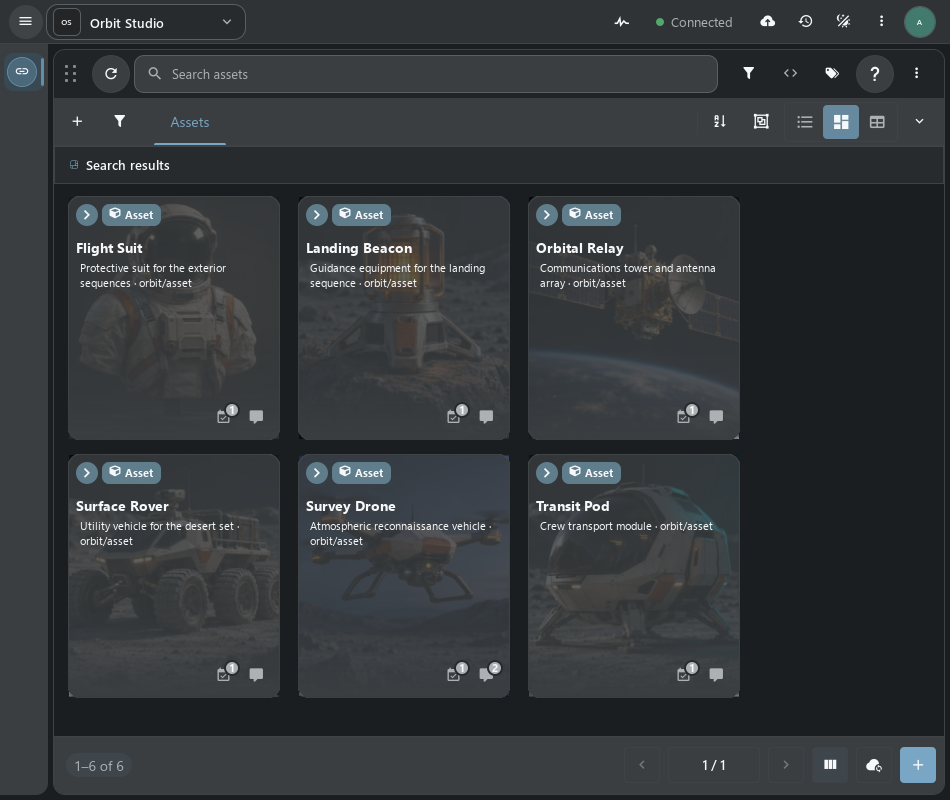
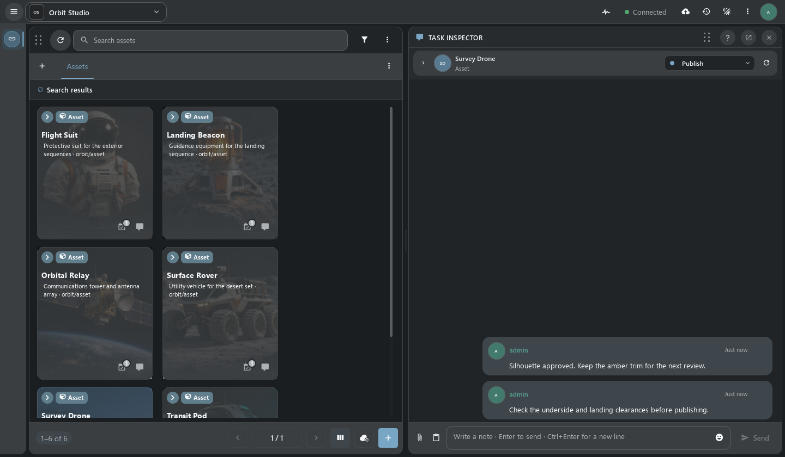
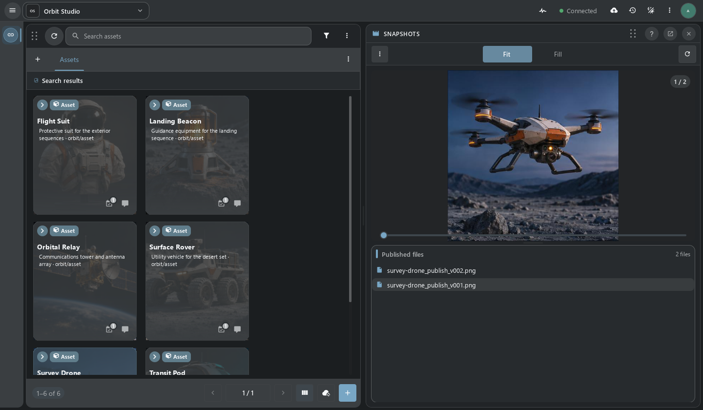
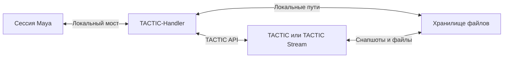

# TACTIC-Handler

**Настольное рабочее пространство TACTIC для производства ассетов.** Найдите ассет или шот, проверьте задачи и версии, подготовьте локальные файлы и опубликуйте снапшот. Handler работает как самостоятельное приложение на Python и Qt Quick и подключает сессии Maya через локальный мост.

[English](README.md) · [Запуск на Windows](#запуск-на-windows) · [Интеграция с Maya](#интеграция-с-maya) · [Python API](#python-api) · [Руководство](docs/handbook.ru.md)



*Orbit Studio — демонстрационный проект. На снимке самостоятельное Qt-приложение, подключённое к локальному TACTIC Stream.*

> **Прототип в разработке.** Для знакомства используйте тестовый проект и репозиторий. Perforce-like workspace — отдельный прототип.

## Работа с ассетом

Откройте проект и выберите Search Type в сайдбаре. Каждая вкладка поиска сохраняет свой вид, фильтры и выделение. **Item View** показывает ассеты и связанное с ними производство. В дереве удобно идти от объекта к процессу и версиям. Таблица подходит для работы с полями.

### Поиск, задачи и заметки в одном пространстве

Из карточки или строки можно открыть задачи, заметки, связи и снапшоты. Док-панели работают рядом с поиском и следуют за выбранным объектом. Когда команде нужно одинаковое расположение панелей, его можно сохранить как раскладку.



*Панель заметок следует за выделением. [Табличный вид](docs/assets/github-workspace.png)*

### Настройка Item View

При подключении к Stream с API редактирования раскладок откройте нативный редактор **Item Layouts**. Соберите карточку или строку из полей, превью и действий, например «Заметки» или «Детали объекта». Проверьте черновик на данных проекта и сохраните именованное представление. Настройки сайдбара определяют, с каким видом открывается поиск. [Раскладки объектов](thlib/ui/help_articles/item_layouts.ru.md) · [Редактор сайдбара](thlib/ui/help_articles/sidebar_editor.ru.md)

## Публикация и проверка версий

1. Выберите объект и процесс или контекст публикации.
2. Добавьте файлы или папки в **Drop Plate**. Проверьте группы и параметры check-in в **Commit Queue**.
3. Отправьте публикацию. Сервер применит права, правила именования и настройки репозитория и запишет снапшот.
4. Откройте **Snapshot Browser**, чтобы проверить файлы и превью. Две версии изображений можно сравнить рядом или с разделителем.



*Публикация хранится на сервере как снапшот. Handler управляет локальными путями репозитория и синхронизацией.*

[Check-in](thlib/ui/help_articles/checkin.ru.md) · [Commit Queue](thlib/ui/help_articles/commit_queue.ru.md) · [Snapshot Browser](thlib/ui/help_articles/dock.snapshot.ru.md) · [Репозитории](thlib/ui/help_articles/repositories.ru.md)

## Интеграция с Maya

Коннектор Maya регистрирует сессию в **Handler Server**. В Handler выбирается сессия, которой адресовано действие. Открытие, импорт и добавление референса выполняются внутри Maya. Авторизация TACTIC и передача файлов остаются в настольном Handler.



Maya — интеграция, поставляемая в этой версии исходного кода. Протокол тонкого клиента позволяет зарегистрировать нативные действия отдельного коннектора. [Установка Maya-коннектора](installer/README.md) · [DCC API](docs/dcc_api.md) · [Протокол](docs/thin_client_protocol.md)

## Python API

Самостоятельный скрипт может использовать настроенное подключение Handler. В примере ниже читаются записи демопроекта. Подставьте код своего проекта и Search Type.

```python
from tactic_handler_api import local

with local() as handler:
    assets = handler.project("orbit").stype("orbit/asset")
    result = assets.query(limit=12, order_by=["name asc"])
    for asset in result.items:
        print(asset.get_code(), asset.get_value("name"))
```

Точки входа этого API есть также в редакторе скриптов и подключённых DCC. Через API можно запрашивать и редактировать объекты, работать с файлами и вызывать поддерживаемые действия интерфейса. [Примеры и контексты выполнения](docs/handler_api.md) · [Редактор скриптов](thlib/ui/help_articles/script_editor.ru.md) · [Script Shelf](thlib/ui/help_articles/script_shelf.ru.md)

## Запуск на Windows

Понадобятся Python 3.14, учётная запись TACTIC и актуальная рабочая копия с файлом `launch.py`.

```powershell
py -3.14 -m venv .venv
.\.venv\Scripts\python.exe -m pip install -r requirements.txt
.\.venv\Scripts\python.exe launch.py
```

Сначала запустите сервер TACTIC. В Handler откройте **Конфигурация → Сервер**, проверьте подключение и получите тикет. Выберите проект и настройте локальный путь репозитория перед check-in и синхронизацией. [Первое подключение](docs/handbook.ru.md#первое-подключение) · [Начало работы](thlib/ui/help_articles/getting_started.ru.md)

| Что дальше | Документация |
| --- | --- |
| Настольные сценарии, задачи и администрирование | [Руководство](docs/handbook.ru.md) · [Справка](thlib/ui/help_articles/README.md) |
| Устройство клиента и общий Frame | [Архитектура](docs/application_architecture.md) · [Контракты Frame](docs/frame/index.md) |
| Совместимость с существующим TACTIC | [Карта совместимости](docs/tactic_compatibility/README.md) |
| Проверка релиза | [Готовность и ручная приёмка](docs/release_readiness.md) |

Handler подключается к [Southpaw TACTIC](https://github.com/Southpaw-TACTIC/TACTIC) или TACTIC Stream. [Eclipse Public License 1.0](LICENSE)
