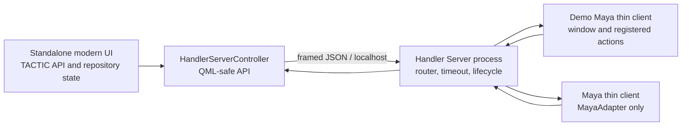

# Handler Server and thin DCC clients

## Purpose

The subsystem keeps TACTIC access, repository work, snapshot selection, and modern
client state outside Maya. A DCC process loads only the transport, command registry,
and its small adapter. The pre-existing `thlib/tactic_server.py` and
`tactic_api_server.py` are Qt local-socket experiments with full application imports;
they were inspected but not modified or reused as the DCC bridge.

## Modules

| Module | Responsibility |
|---|---|
| `handler_server/protocol.py` | framing, versioning, validation, size limit, message factories |
| `handler_server/server.py` | localhost listener, handshake, clients, heartbeats, auto-target selection |
| `handler_server/router.py` | request ownership, result routing, cancel, timeout, disconnect errors |
| `handler_server/client.py` | reconnecting thin client and command execution boundary |
| `handler_server/registry.py` | explicit allow-list of callable actions; no `eval` or `exec` |
| `handler_server/demo_adapter.py` | dependency-free text-document example |
| `handler_server/demo_maya_adapter.py` | Maya-shaped standalone adapter for UI and routing tests |
| `handler_server/maya_adapter.py` | Maya-only commands and main-thread dispatch |
| `handler_server/launcher.py` | separate Handler Server process entry point |
| `modern_ui/handler_server_controller.py` | process lifecycle and QML-safe client/result models |
| `modern_ui/tactic_rpc.py` | native TACTIC object handles and modern application command surface |
| `tactic_handler_dcc/` | name-compatible DCC SDK; local DCC helpers plus remote TACTIC objects |
| `HandlerServerView.qml` | clients, capabilities, command payload, timeout, results |

## Lifecycle

1. The modern UI generates a cryptographically random session token.
2. It starts `python -m handler_server.launcher` in a separate process and passes the
   token only through the child environment.
3. The server binds an ephemeral port on `127.0.0.1` and atomically publishes a
   per-user discovery record under local application data. The record is readable
   only in the user's local session and contains the random handshake token.
4. The UI connects as `modern_ui`; DCC clients find the newest live record and
   connect independently without connection parameters.
5. Each client completes `hello`, registers id/application/pid/capabilities, and
   begins heartbeat exchange.
6. The user selects the active DCC client in the main header. UI capabilities and
   context actions come from that exact client, and commands target its id.
7. Each client uses a generated id unless an integration supplies a stable one, so
   multiple Maya, Blender, and demo processes are registered separately.
8. Timeout, connection loss, or operator disconnect completes pending requests with
   a structured error. Clients may reconnect with the same client id.
9. Server restart is rediscovered on the next reconnect. Application shutdown removes
   the discovery record and stops clients, demo process, and server process in order.

The standalone UI starts Handler Server automatically after QML has loaded. A manual
stop uses the authenticated local operator connection; process termination is only a
bounded fallback when graceful shutdown does not complete.

## Snapshot and DCC workflow

The standalone client remains responsible for TACTIC search, repository selection,
download, overwrite policy, and local path verification. The local path plus safe
options is sent to the Handler Server only after preparation.

| UI operation | Routed action | Maya capability | Result |
|---|---|---|---|
| Open snapshot | `open_scene` | `open_scene` | success/cancelled/error/opened path |
| Import snapshot | `import_file` | `import_file` | same |
| Reference snapshot | `reference_file` | `reference_file` | same |
| Save current scene | `save_current_scene` | `save_current_scene` | status/current path |
| Get current scene | `get_current_scene` | `get_current_scene` | path/modified/type/workspace/optional selection |

The main UI preserves its standalone runtime. The selected client's application type
acts as the current UI environment, while capability checks expose only supported DCC
actions. Existing Check-in/Out downloads still use the normal repository engine;
only the final DCC-specific action crosses the bridge.

The DCC SDK also preserves the original `env_inst.ui_main` and
`env_inst.get_check_tree()` names. They are command handles, not remote widgets:
the former controls project/navigation state in the running modern application and
the latter opens and prepares its Check-in/Out workflow. Maya saves or exports the
scene locally; standalone TACTIC-Handler owns naming, repository handling, Commit
Queue, and server-side check-in. The default non-silent call prepares a queue item
and leaves the final Commit action visible to the user, as in the original workflow.

## Security boundary

- listener is localhost-only and rejects non-loopback configuration;
- token is random per server session and compared with constant-time comparison;
- message size is limited to 1 MiB and command timeout to 300 seconds;
- client id, application type, process id, capabilities, request id, and sender are
  registered or server-controlled;
- only callbacks in `CommandRegistry` can execute;
- command logs include sender, target, action, and request id, never token/payload;
- arbitrary Python execution is not a protocol capability;
- remote peers cannot be reached in version 1.

## Running the first version

Handler Server starts automatically with the modern application. Open **Tools and
Test Windows > TACTIC Handler Server** to inspect it, then use the Maya icon beside
**Connected clients** to start the simulated Maya client. Its own window can run
registered scene actions. The main header then shows the active DCC and provides a
client selector.

External demos use `python examples/thin_client_demo/demo_client.py`; Maya uses
`maya_client.start()`. Neither normal path accepts or requires an endpoint or token.

## Version 1 limitations

- transport is dependency-free length-prefixed JSON/TCP, not WebSocket;
- command cancellation is cooperative and cannot interrupt a Maya API call already
  executing on Maya's main thread;
- DCC commands require an explicitly selected active client;
- `run_before_checkin` and `run_after_checkin` DCC callbacks still need a bounded
  callback channel before callback-based custom scripts can migrate unchanged;
- Maya execution requires a manual test in Maya;
- no push discovery outside localhost and no persistent request queue.

Future DCC adapters implement the same registry contract, choose a safe main-thread
dispatcher, and register a distinct `application_type`. A WebSocket transport can be
added behind the protocol/client interfaces without putting protocol logic in QML.
