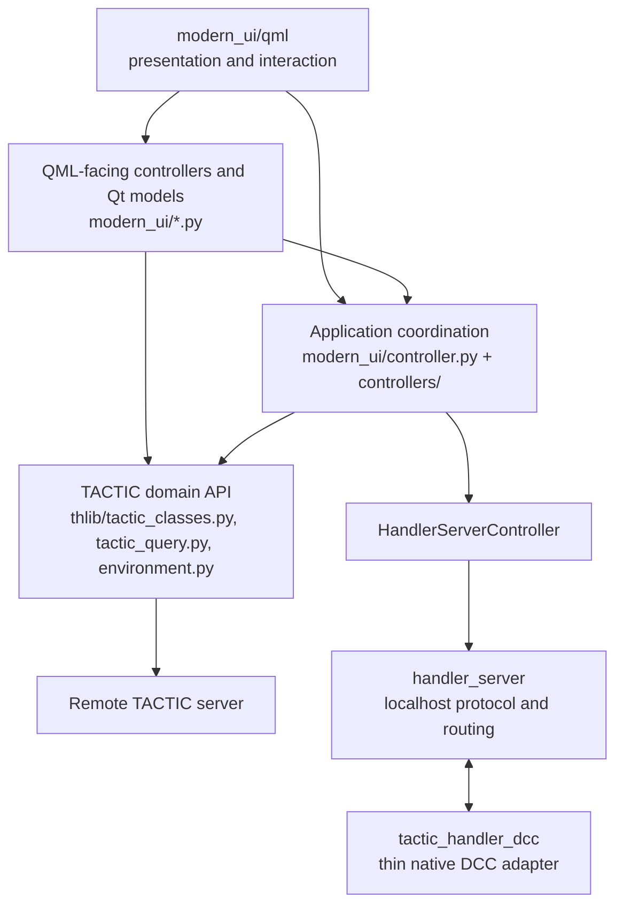

# Modern client architecture

This document records the current architecture after the modern QML client became
the primary development line. It is both a map of the implementation and a set of
dependency rules. `thlib/side` is vendored code and is outside this audit.

## Dependency direction

Dependencies point downward. QML may bind to properties, invoke slots, and emit UI
intent, but it does not perform network, filesystem, repository, or TACTIC business
operations. `thlib` must never import `modern_ui`. Modern Python must not open legacy
`thlib.ui`/`thlib.ui_classes` QWidget interfaces. The only allowed QtWidgets import in
`modern_ui` is the Windows tray platform adapter, `modern_ui/tray.py`.

## Module map

| Module | Purpose | May depend on |
|---|---|---|
| `main_qml.py` | Composition root: creates controllers, connects signals, publishes context properties, loads QML, starts services, and orders shutdown. | All application layers; no domain behavior should originate here. |
| `modern_ui/qml/` | Presentation, responsive layout, view-local transient interaction, and reusable MD3 controls. | QML controls, theme/localization, exposed controller/model APIs. |
| `modern_ui/controller.py` | `ApplicationController` façade for connection, project/navigation/search sessions, selected workspace item, window/dock actions, and application lifecycle. | `modern_ui/controllers`, workspace models, independent `thlib` APIs. |
| `modern_ui/controllers/` | Cohesive mixins implementing the application façade: connection, navigation, search, selection, result tree, item/snapshot actions, commands, and lifecycle. | Workspace models and independent core APIs; never legacy widgets. |
| `modern_ui/workspace_models/` | Qt models and mutable workspace presentation state, including results, selection, docks, floating windows, and their persisted geometry/layout. | QtCore and value/data helpers. |
| `modern_ui/tasks.py`, `task_workspace/` | Task workspace orchestration, normalized task store, catalogs, filters, bulk edits, Gantt/calendar/table projections, and task workers. | Application selection context and `thlib` task APIs. |
| `modern_ui/communication.py`, `communication_feed.py` | Notes, Messages, Activity Feed, unread state, incremental server updates, and navigation intents. | Shared message/attachment helpers and `thlib` communication APIs. |
| `modern_ui/server_updates.py` | One incremental polling loop for messages, activity, reactions, and presence heartbeat. Owns cursors, retry policy, and timer lifecycle. | Application session/project identity and one batched core API. |
| `modern_ui/configuration.py` | Editing façade for user-visible settings. Reads/writes the same keys and invokes the same apply callbacks as functional owners. | `QSettings`, application/controller callbacks. |
| Specialized `modern_ui/*_controller.py` modules | Feature-specific operations such as commit queue, check-in/out, repository sync, work hours, users, milestones, scripts, and Handler Server. | Native TACTIC objects/core APIs and shared Qt models. |
| `thlib/tactic_classes.py`, `tactic_query.py` | TACTIC object model, server-side procedures, repository/file/snapshot semantics, and public core API. | `thlib` infrastructure and TACTIC client transport. |
| `thlib/environment.py`, `pool.py` | Session/project registries and execution pools. | Core/Qt compatibility only; never `modern_ui`. |
| `handler_server/` | Local framed protocol, discovery, authentication, client registry, routing, timeout, reconnect, and fixed command registries. | Standard library and explicit protocol adapters. |
| `tactic_handler_dcc/` | Thin DCC SDK and native DCC actions. It does not import `thlib`, `modern_ui`, or the full Handler Server implementation. | Standard library and DCC-local APIs only. |
| `tests/` | Behavioral tests plus static architecture guards. | Public modules and source inspection. |

## State ownership matrix

An owner is the only component allowed to authoritatively mutate a state. Other
copies listed below are derived views or currently duplicated state discovered by
this audit. Block B records duplicates but deliberately does not consolidate them.

| State | Authoritative runtime owner | Persisted owner | Derived mirrors / duplicates found |
|---|---|---|---|
| Session, login, server ticket and native connection | `thlib.environment.env_server` and `env_inst` | Legacy server preset/config storage | `ApplicationController` mirrors connection/login for QML; `ServerUpdateService` keeps a session tuple only to invalidate cursors. These mirrors must remain derived. |
| Current project | `ApplicationController` for UI selection; `env_inst.projects` for native project objects | Application settings and restored search session | `WorkspaceState._project`, Tasks, Messages, and feed controllers retain target/project references. They are consumers, not project selectors. |
| Search tabs and result selection | `ApplicationController._sessions` for tab definitions; `WorkspaceState` for current selected native sObject and result models | ApplicationController search-session cache and per-tab settings | Task/Notes controllers mirror target search keys; request ids and loaders duplicate only operation state. |
| Task workspace | `TasksController` for commands/filters/selection; `TaskWorkspaceStore` for the normalized task collection | Task-specific settings owned by `TasksController`/field catalogs | `WorkspaceState.task_model` is an older compact projection and is a consolidation candidate; inspector and Gantt models are derived projections. |
| Notes | `CommunicationController` | Notes view settings in the functional controller | `WorkspaceState.note_model` and selected process are the dock-facing projection; task inspector mirrors the target/process. |
| Messages and unread state | `MessagesController` | Message UI/read cursors in its settings namespace; server read state remains in TACTIC | `ServerUpdateService` owns polling cursors but not read state; notifications are derived events and do not mark messages read. |
| Activity Feed | `ActivityFeedController` for visible feed records; `ServerUpdateService` for incremental cursor | Last-read/feed UI state in functional settings | User recent activity is another projection over shared activity records and must not become a second server source. |
| Windows | `FloatingWindowModel` registry | `workspace/floatingWindowsV1` in shared QSettings | QML `WindowHost` owns only live visual instances; geometry passed back to the registry is authoritative. |
| Docks | `DockPanelModel` and its layout tree | `workspace/dockLayoutV2` in shared QSettings | QML dock hosts own pointer/hover state only; stack selection, placement, ratios, and visibility belong to the model. |
| Background operations | The feature controller that starts the operation; `env_inst` pools own thread execution | No persistent operation state unless the feature explicitly queues work | Busy/progress/error flags exist per controller. There is no global operation owner; this distribution is intentional, while duplicated requests are guarded by request ids. |
| Caches | The component that defines the cached value: search sessions in `ApplicationController`, task catalogs in task workspace, quick filters in `QuickFilterCatalog`, skey previews in their resolver, native objects in `env_inst` | Only explicitly durable caches use their component key; most are memory-only | Several target/project identity mirrors exist. A future consolidation must preserve cache scope and invalidation, not create a generic global cache. |
| User-visible configuration | The functional controller that consumes each key | Shared `QSettings("TACTIC-Handler", "modern-qml")` or the corresponding legacy server configuration API | `ConfigurationController` is an editor façade, not a second source of truth. Multiple controllers currently instantiate QSettings; key ownership must stay explicit. |

## Lifecycle

### Application startup

1. `main_qml.py` creates the Qt application and installs the shared Debug Log bridge.
2. It constructs `ApplicationController`, workspace/window/dock models, and each
   specialized controller. Dependencies are passed explicitly from the composition
   root rather than fetched from QML.
3. Controllers and models are registered as QML context properties, then `Main.qml`
   is loaded. QML construction must not start TACTIC mutations.
4. Zero-delay startup jobs bootstrap the TACTIC session, start the local Handler
   Server in the background, and start the incremental server-update service.
5. Restored tabs, selected sObject, docks, and windows are applied after their models
   exist. Stale worker results are rejected by controller request ids.

### Windows and docks

- A standalone window has exactly one registry record in `FloatingWindowModel`.
  `show_window` raises that singleton record; QML does not create an unbounded set of
  copies. Visibility, z-order, modal policy, and final geometry return to the model.
- A dock has exactly one record in `DockPanelModel` and one location in its layout
  tree. Stacking, swapping, detaching, resizing, and reset mutate the model. Pointer
  deltas stay in stable coordinates and only final geometry is persisted.
- Closing a view ends its view-local connections/timers. Feature operations either
  remain owned by their controller or are cancelled according to that controller's
  explicit lifecycle; destroying QML is never the cancellation mechanism.

### Workers and shutdown

- A controller creates a worker in the appropriate `env_inst` pool, retains its
  handle/request id, and updates Qt models only in result/error callbacks on the Qt
  side. Re-entry is rejected or supersedes the prior request explicitly.
- Timers belong to their service/controller. `ServerUpdateService` is the owner of
  the regular messages/activity/presence poll; features must not add parallel polls.
- Shutdown is ordered in `main_qml.py`: stop server updates, tasks/work-hours and
  attachment workers, watch/screenshot work, Handler Server, notifications and
  commit queue, then `ApplicationController`; the latter flushes settings/cache,
  stops repository sync, and exits shared pools. Debug Log is closed last.

## Standalone and DCC boundary

The standalone application owns TACTIC authentication, native TACTIC objects,
repository paths/downloads, check-in preparation and submission, modern UI state,
and user-visible results. Handler Server exposes only authenticated localhost
routing with request ids, timeouts, heartbeat, structured errors, and redacted
logging.

A thin DCC client registers its application type, process id, client id, and fixed
capabilities. It executes only native application actions such as scene open,
reference, import, save, selection, or playblast preparation. It does not import the
full Handler, access TACTIC, upload snapshots, or execute code received over the
network. The selected client id—not global `env_mode`—determines available DCC UI
actions. See `docs/handler_server_architecture.md` for protocol details.

## Enforced boundaries

`tests/test_architecture_boundaries.py` fails when any of these regressions appear:

1. `thlib` (excluding vendored `thlib/side`) imports `modern_ui`.
2. Modern Python imports legacy QWidget UI packages.
3. QtWidgets spreads beyond the explicit tray platform adapter.
4. QML contains transport, storage, or TACTIC server business logic.
5. The thin DCC SDK imports the full Handler layers.
6. Domain controllers/services/resolvers form a static import cycle.

The Snapshot Browser file editor now routes through the existing schema-driven
modern sObject editor. This removes the only discovered modern-to-legacy QWidget
window dependency without changing the core TACTIC edit workflow.

## Executable architecture contracts

Block C turns these boundaries into a layered test harness. Server procedures,
returned shapes, code-based identities, metadata, native object behavior, and the
public `thlib` API are contract-tested. Deterministic controller scenarios exercise
worker cancellation, stale results, persistence, and cache invalidation. The real
QML composition root is loaded offscreen with isolated settings and no network,
then every standalone window is reopened before ordered shutdown. Request/cache
metrics enforce stable call-count budgets. See `docs/testing_strategy.md` and
`docs/tactic_test_project.md`.

## Stabilized workflow verticals

Block D validates the application as six user workflows rather than as isolated
windows: login/configuration, navigation/search, tasks/notes/work hours,
check-in/files, messages/users/activity, and Handler Server/DCC. Their single
manifest maps every workflow to contract tests, controller tests, QML components,
registered windows, and guarded live checks. The shared contract and offscreen QML
smoke layers run for every vertical. See `docs/vertical_stabilization.md`.

## Structural ownership and UI policy

Block E removes content ownership from application hosts. `FloatingWindowModel`
is the single standalone-window registry and supplies each component source and
its construction parameters; `WindowContent.qml` is now only a generic loader.
`DockHost.qml` owns placement, stacking, detaching, and resizing, while the
existing dock content components live in `DockContentRegistry.qml`.

Retained UI data has an explicit owner, key, TTL decision, invalidation event,
refresh entry point, stale-data rule, and maximum size. See
`docs/cache_invalidation_policy.md`. Shared control rules and the deliberately
deferred Results/ApplicationController splits are recorded in
`docs/modern_ui_component_policy.md`. Structural tests prevent the hosts from
absorbing content again and forbid raw common Qt controls outside the shared
control library.
