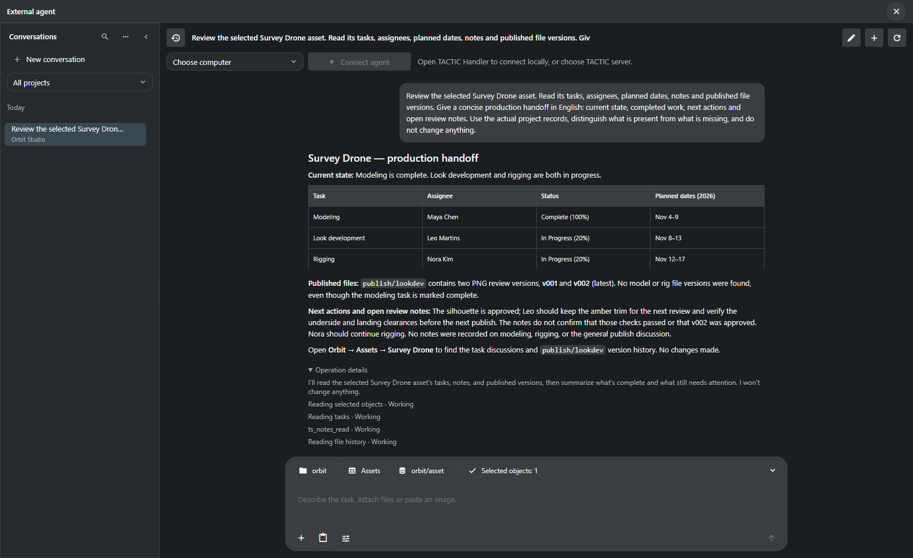
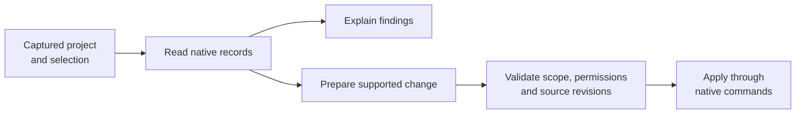
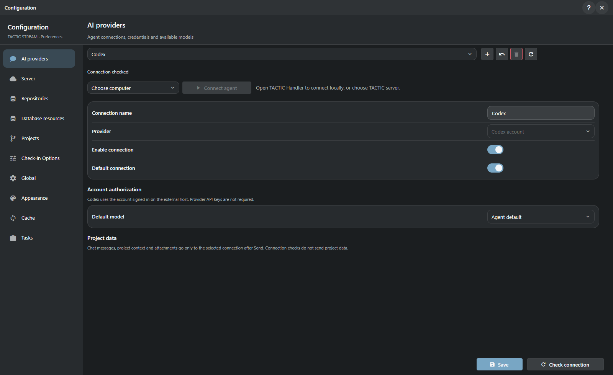

# The project assistant

**Ask about the work. Inspect the evidence. Prepare the next action.**

[TACTIC Handler](../../README.md) · [Русский](assistant.ru.md) · [Custom dashboards](dashboards.en.md)

The native Handler conversation connects to **TACTIC Stream**. Stream owns project operations and conversation records; Handler supplies the desktop window and can host the explicitly selected executor.

The built-in chat window is called **External agent** because a separate executor runs the model and its tools. The conversation stays inside the production application, next to the records being discussed. The current feature requires an administrator account and a configured executor/provider.

*A real completed read-only request in the disposable Orbit Studio project. The model read tasks, notes and publication history; the response was not written into the screenshot.*

## From selected asset to useful handoff

The request was concrete: **read the selected Survey Drone's tasks, assignees, planned dates, notes and published versions; describe current state and next actions without changing anything.**

| Evidence in the project | What the assistant reported |
| --- | --- |
| Modeling: Complete, 100%, assigned to Maya Chen | Modeling is marked complete. |
| Look development and rigging: In Progress | Leo Martins and Nora Kim still have active work, with their planned dates. |
| Two `publish/lookdev` PNG versions | v001 and v002 exist; v002 is latest. |
| No model or rig publication | A completed modeling task is not proof that the model was delivered. |
| Notes approve the silhouette but request clearance checks | The comments do not prove those checks passed or that v002 was approved. |

That distinction is the point: a useful project assistant brings related records together and explains what they establish. It should preserve uncertainty where the records do not provide an answer.

## What it can work with

The assistant discovers the tools available for its session. Requests remain subject to the account's permissions, selected project and enabled change mode.

| Area | Example request | Available work |
| --- | --- | --- |
| Production context | “What is missing before these assets can go to review?” | Read selected objects, related data, tasks, notes and published versions. |
| Records and relationships | “Create ten shots for this episode and link the existing assets.” | Create records/children and link existing records through native project operations. |
| Tasks | “Prepare assignments and dates for the selected work.” | Read, prepare, validate and save supported task fields with per-row revision checks. |
| Workflow and project structure | “Add a review stage to this pipeline.” | Inspect and prepare supported schema, fields, pipelines and configuration changes. |
| Views and naming | “Make a compact asset view and a naming rule for review images.” | Work with supported table/sidebar/item definitions and native naming configuration. |
| Dashboards | “Build a project overview with status counts and an asset navigator.” | Compose, preview and save supported page layouts using the same document model as the visual editor. |
| Files | “Attach these references to this object's review context.” | Upload attachments through native check-in, inspect history and prepare supported downloads. |
| Scripts | “Draft a tool to validate this naming setup.” | Prepare an inactive script draft, inspect it and use the separate trial/activation flow. |

These are supported tool families, not a promise that an arbitrary natural-language instruction will succeed. The handoff above is the scenario executed for this presentation; the other capabilities are described from their implemented contracts.

## Context is captured, not guessed

Open the assistant from the current workspace or an object. Before the first Send, inspect the captured **project, page, Search Type, view and exact selection**. The first request fixes that scope for the conversation. Moving to another project or selecting another asset does not silently redirect an existing conversation; start a new one for a new scope.

Continue a conversation, steer an active request, review its operation details or cancel further work. Closing the window does not cancel the request. A disconnected executor does not automatically rerun a possibly completed action. History, per-conversation drafts and project filtering let work resume without losing its original context.

Project rules add studio instructions to subsequent turns. They guide behavior within the existing permissions; they cannot grant access to another project or enable a missing operation.

## Read, prepare, validate, apply

Read-only is the default. **Allow changes** is a separate choice; a prompt alone does not bypass the tool restrictions. Native commands retain their permission, validation and transaction behavior. Revision checks protect supported edits from overwriting intervening changes.

Cancellation stops further work; it does not reverse already committed operations. Undo is deliberately narrower: the supported entity-field undo checks that the current values still match the saved after-image. It is not a global rollback for files, workflow edits or arbitrary scripts.

### Generated scripts have their own approval path

A generated script starts inactive. Review its source, run the supported trial flow in verified isolation, inspect the result, then explicitly activate the exact reviewed version. The script's execution permission is checked separately. A database rollback or subprocess alone is not an execution sandbox, and a trial is not proof that arbitrary production data will be handled correctly.

## Choose the model and where it runs

| Provider family | Connection |
| --- | --- |
| Codex | Existing account sign-in available to the selected executor. |
| OpenAI | Responses API profile. |
| OpenAI-compatible | Chat Completions endpoint, including suitable local model services. |
| Anthropic | Provider profile and available models. |
| Gemini | Provider profile and available models. |

Models are discovered from the configured provider rather than promised by a fixed marketing list. Reasoning controls, images, tool use and web search depend on that provider and model. Checking a profile or obtaining its model list does not send project context; sending a conversation does.

Choose a connected **Handler computer** or the **TACTIC server** as executor and connect it explicitly. The selection determines where provider sign-in and local endpoint addresses are resolved. Sending a prompt does not silently start a different executor or fall back to another machine. Provider secrets are protected by the server's encrypted storage; they are not plain-text Handler preferences.

## Attachments and optional web access

Attach files or paste an image into the conversation. The current limits are 20 attachments and 64 MB per file; model image input has a separate 20 MB limit. A file can be available for native check-in without the model being able to decode its contents.

Web access is a separate opt-in for a new conversation. Supported downloads use public HTTPS sources and retain source/hash information; private-network fetching is excluded. Web search is available through supported Codex, OpenAI and Anthropic adapters, while other adapters have different capabilities. Retrieved pages and file content are evidence to inspect, not instructions that override project permissions.

## The UI is one entrance to scoped tools

External administrator clients can also connect through the implemented MCP interface. Access is scoped to project and tool permissions, with revocation and expiration. This does not give a model an unrestricted terminal, the application source tree or control over unrelated desktop applications.

For artists and supervisors, the important result is a conversation grounded in their project. For administrators, it is a visible sequence of operations with explicit scope and controlled writes.

**[Continue with custom dashboards →](dashboards.en.md)** · [External agent Help](../../thlib/ui/help_articles/external_agent.en.md)

[Product Help](../../thlib/ui/help_articles/external_agent.en.md) · [Frame contracts](../frame/index.md)

> This assistant is part of the development prototype. Provider availability and model behavior vary; review consequential changes and validate studio-specific automation.
