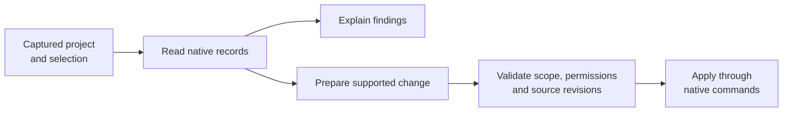

# Project assistant

[TACTIC Handler](../../README.md) · [Русский](assistant.ru.md) · [Custom dashboards](dashboards.en.md)

The assistant reads project records, answers questions and prepares changes. Conversations open in Handler; **TACTIC Stream** stores their context and history and handles project operations. A Handler computer can also serve as the executor.

The window is called **External agent**. It requires an administrator account, an AI provider profile and a connected executor. The executor runs model requests and tools on the selected machine.

*Survey Drone in the Orbit Studio demonstration project. This request made no changes to project data.*

## Example: Survey Drone report

The request was to **read Survey Drone’s tasks, assignees, planned dates, notes and publications, then describe its state and next actions without changing the project**.

| Evidence in the project | What the assistant reported |
| --- | --- |
| Modeling: Complete, 100%, assigned to Maya Chen | Modeling is marked complete. |
| Look development and rigging: In Progress | Leo Martins and Nora Kim still have active work, with their planned dates. |
| Two `publish/lookdev` PNG versions | v001 and v002 exist; v002 is latest. |
| No model or rig publication | A completed modeling task is not proof that the model was delivered. |
| Notes approve the silhouette but request clearance checks | The comments do not prove those checks passed or that v002 was approved. |

The report distinguishes the completed task from the missing model publication. It also avoids treating the reviewer’s notes as approval of the latest version.

## Available tools

The assistant uses the tools listed below. Available operations depend on the project, user permissions and whether changes are enabled.

| Area | Example request | Available work |
| --- | --- | --- |
| Production context | “What is missing before these assets can go to review?” | Read selected objects, related data, tasks, notes and published versions. |
| Records and relationships | “Create ten shots for this episode and link the existing assets.” | Create records/children and link existing records through native project operations. |
| Tasks | “Prepare assignments and dates for the selected work.” | Read, prepare, validate and save supported task fields with per-row revision checks. |
| Workflow and project structure | “Add a review stage to this pipeline.” | Inspect and prepare supported schema, fields, pipelines and configuration changes. |
| Views and naming | “Make a compact asset view and a naming rule for review images.” | Work with supported table/sidebar/item definitions and native naming configuration. |
| Dashboards | “Build a project overview with status counts and an asset navigator.” | Compose, preview and save supported page layouts using the same document model as the visual editor. |
| Files | “Attach these references to this object's review context.” | Upload attachments through native check-in, inspect history and prepare supported downloads. |
| Scripts | “Draft a tool to validate this naming setup.” | Prepare an inactive script draft, inspect it and use the separate trial/activation flow. |

The screenshots cover the Survey Drone report. The other examples describe requests supported by the tools; they were not part of this demonstration run.

## Conversation context

The first message captures the **project, page, Search Type, view and selected objects** for the conversation. Later selections in the workspace do not change that context. Start a new conversation for another project or set of objects.

History, drafts and project filters let you return to a conversation. During execution you can add guidance or cancel further actions. Closing the window does not stop the request. An operation with an unknown result after an executor disconnect is not retried automatically.

Project rules supply studio instructions for subsequent messages. They leave permissions and available tools unchanged.

## Changes and cancellation

Writing requires **Allow changes**. Commands check permissions and data; operations with revision checks also detect changes made after the record was read.

Cancel stops further actions. Changes already saved remain. Undo covers supported field edits when current values still match the operation’s result. There is no general rollback for files, workflows or arbitrary scripts.

### Script review and trials

A script starts inactive. Review its source, run a trial in verified isolation and inspect the result before activation. The reviewed version is activated, with execution permission checked separately. Transaction rollback and a separate subprocess do not provide isolation on their own.

## Models and executors

| Provider family | Connection |
| --- | --- |
| Codex | Existing account sign-in available to the selected executor. |
| OpenAI | Responses API profile. |
| OpenAI-compatible | Chat Completions endpoint, including suitable local model services. |
| Anthropic | Provider profile and available models. |
| Gemini | Provider profile and available models. |

The model list is requested from the configured provider. Images, reasoning controls, tools and web search depend on the adapter and model. Checking the profile and model list does not send project data. Sending a message sends the conversation context to the provider.

The executor can be a **Handler computer** or the **TACTIC server**. Connect it explicitly; provider credentials and local service addresses are used on that machine. There is no automatic fallback to another executor. Secrets are encrypted in server storage.

## Attachments and web access

A conversation accepts up to 20 attachments of 64 MB each. Images sent to the model have a separate 20 MB limit. A file available for check-in may still have a format the model cannot read.

Enable web access when creating the conversation. Downloads use public HTTPS and retain the source and hash; private networks are blocked. Codex, OpenAI and Anthropic adapters support web search. Text in retrieved pages and attachments cannot change the conversation’s permissions.

## MCP access

MCP connects external administrator clients to the same project tools. Access is limited to a project and a set of operations, expires and can be revoked. This interface does not expose a terminal, application source or control over unrelated programs.

**[Continue with custom dashboards →](dashboards.en.md)** · [External agent Help](../../thlib/ui/help_articles/external_agent.en.md)

[Product Help](../../thlib/ui/help_articles/external_agent.en.md) · [Frame contracts](../frame/index.md)

> The assistant is part of the prototype. Review model answers and proposed changes.
