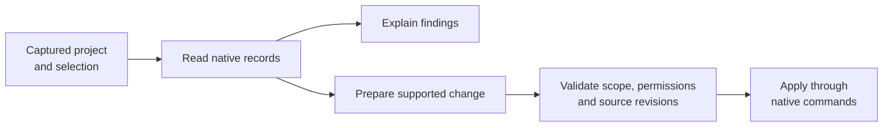

# The project assistant

**A way to work through what is happening in your project.**

[TACTIC Handler](../../README.md) · [Русский](assistant.ru.md) · [Custom dashboards](dashboards.en.md)

Before a review, you want to know what is ready and what is still missing. The assistant can read related tasks, notes and publications and explain the picture they form. The conversation opens in Handler; **TACTIC Stream** stores its history and handles project operations. A selected Handler computer can also run the model requests.

The window is called **External agent**. The conversation lives inside the application, while a separate executor runs the model and its tools on the selected machine. Setup currently requires an administrator account, a provider and a connected executor.

*A real completed read-only request in the disposable Orbit Studio project. The model read tasks, notes and publication history; the response was not written into the screenshot.*

## From selected asset to useful handoff

For this demonstration, we selected Survey Drone and asked the assistant to **read its tasks, assignees, planned dates, notes and published versions, then describe its state and next actions without changing the project**. Here is what those records established.

| Evidence in the project | What the assistant reported |
| --- | --- |
| Modeling: Complete, 100%, assigned to Maya Chen | Modeling is marked complete. |
| Look development and rigging: In Progress | Leo Martins and Nora Kim still have active work, with their planned dates. |
| Two `publish/lookdev` PNG versions | v001 and v002 exist; v002 is latest. |
| No model or rig publication | A completed modeling task is not proof that the model was delivered. |
| Notes approve the silhouette but request clearance checks | The comments do not prove those checks passed or that v002 was approved. |

This is an easy distinction to miss during a handoff. A task status describes progress; a published file tells the next person what they can actually pick up. The assistant brought both parts together and pointed out where the records still left a question unanswered.

## What it can work with

Beyond answering questions, the assistant can help prepare tasks, records or a project page. Available actions depend on the session’s tools, the account’s permissions, the chosen project and whether changes are enabled.

| Area | Example request | Available work |
| --- | --- | --- |
| Production context | “What is missing before these assets can go to review?” | Read selected objects, related data, tasks, notes and published versions. |
| Records and relationships | “Create ten shots for this episode and link the existing assets.” | Create records/children and link existing records through native project operations. |
| Tasks | “Prepare assignments and dates for the selected work.” | Read, prepare, validate and save supported task fields with per-row revision checks. |
| Workflow and project structure | “Add a review stage to this pipeline.” | Inspect and prepare supported schema, fields, pipelines and configuration changes. |
| Views and naming | “Make a compact asset view and a naming rule for review images.” | Work with supported table/sidebar/item definitions and native naming configuration. |
| Dashboards | “Build a project overview with status counts and an asset navigator.” | Compose, preview and save supported page layouts using the same document model as the visual editor. |
| Files | “Attach these references to this object's review context.” | Upload attachments through native check-in, inspect history and prepare supported downloads. |
| Scripts | “Draft a tool to validate this naming setup.” | Prepare an inactive script draft, inspect it and use the separate trial/activation flow. |

The table describes implemented tools and examples of how to ask for them. The Survey Drone report is the scenario run for this presentation; the other capabilities follow the current implementation contracts. A complex request may need clarification or a review of the proposed result.

## Context is captured, not guessed

Before the first message, check the captured **project, page, Search Type, view and objects**. That first request fixes the conversation’s scope. You can then look at another asset without redirecting work already under way. Start a new conversation when you want to change that scope.

Continue the conversation, add guidance to a running request or cancel further work. Operation details show what has already happened. Closing the window does not stop a request; after a disconnect, an action with an uncertain result is not automatically repeated. History, drafts and project filters help you return to the right conversation.

Project rules add studio instructions to subsequent turns. They guide behavior within the existing permissions; they cannot grant access to another project or enable a missing operation.

## Read, prepare, validate, apply

Start by reading and asking questions. Writing requires a separate **Allow changes** choice. Operations still go through native commands, with permission and data checks and, for supported edits, source-revision checks. A record changed by someone else cannot simply be overwritten with the earlier state.

Cancel stops the next actions; changes already saved remain in place. Undo covers supported field edits and first checks that the current values still match what that operation wrote. It does not provide a general rollback of files, workflow changes or arbitrary scripts.

### Generated scripts have their own approval path

A generated script starts inactive. Review its source, run the supported trial flow in verified isolation, inspect the result, then explicitly activate the exact reviewed version. The script's execution permission is checked separately. A database rollback or subprocess alone is not an execution sandbox, and a trial is not proof that arbitrary production data will be handled correctly.

## Choose the model and where it runs

| Provider family | Connection |
| --- | --- |
| Codex | Existing account sign-in available to the selected executor. |
| OpenAI | Responses API profile. |
| OpenAI-compatible | Chat Completions endpoint, including suitable local model services. |
| Anthropic | Provider profile and available models. |
| Gemini | Provider profile and available models. |

The model list comes from the configured provider, so reasoning controls, image support, tools and web search can differ. Checking a profile or loading the model list does not send project data. Sending a message does send the conversation context to the selected provider.

Choose a connected **Handler computer** or the **TACTIC server** as executor and connect it explicitly. The selection determines where provider sign-in and local endpoint addresses are resolved. Sending a prompt does not silently start a different executor or fall back to another machine. Provider secrets are protected by the server's encrypted storage; they are not plain-text Handler preferences.

## Attachments and optional web access

Attach files or paste an image into the conversation. The current limits are 20 attachments and 64 MB per file; model image input has a separate 20 MB limit. A file can be available for native check-in without the model being able to decode its contents.

Web access is a separate opt-in for a new conversation. Supported downloads use public HTTPS sources and retain source/hash information; private-network fetching is excluded. Web search is available through supported Codex, OpenAI and Anthropic adapters, while other adapters have different capabilities. Retrieved pages and file content are evidence to inspect, not instructions that override project permissions.

## The UI is one entrance to scoped tools

External administrator clients can also connect through the implemented MCP interface. Access is scoped to project and tool permissions, with revocation and expiration. This does not give a model an unrestricted terminal, the application source tree or control over unrelated desktop applications.

A useful first step is a small question about a selected object, followed by comparing the answer with its tasks and publications. Operation details show what the assistant read or did. Once that is familiar, you can move on to preparing changes with the tools available to the session.

**[Continue with custom dashboards →](dashboards.en.md)** · [External agent Help](../../thlib/ui/help_articles/external_agent.en.md)

[Product Help](../../thlib/ui/help_articles/external_agent.en.md) · [Frame contracts](../frame/index.md)

> This assistant is part of the development prototype. Provider availability and model behavior vary; review consequential changes and validate studio-specific automation.
