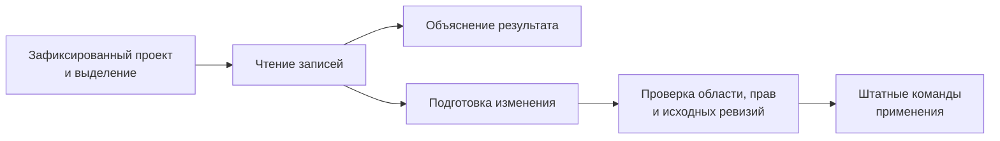

# Помощник, который читает данные проекта

**Помощник, с которым можно разобраться в том, что происходит в проекте.**

[TACTIC Handler](../../README.ru.md) · [English](assistant.en.md) · [Кастомные дашборды](dashboards.ru.md)

Перед ревью хочется понять, что готово и чего ещё не хватает. Помощник может прочитать связанные задачи, заметки и публикации и собрать из них объяснение. Диалог открывается в Handler, а его история и проектные операции хранятся в **TACTIC Stream**. Выбранный компьютер с Handler также может выполнять запросы к модели.

В интерфейсе помощник называется **External agent**. Разговор находится внутри приложения, а модель и инструменты запускает отдельный исполнитель — на выбранной машине. Для подключения сейчас нужны административная учётная запись, настроенный провайдер и исполнитель.

*Реальный завершённый запрос без изменений в изолированном Orbit Studio. Модель прочитала задачи, заметки и историю публикаций; ответ не подставлен в изображение.*

## Survey Drone: задача завершена, а модель ещё не сдана

Для этой демонстрации выбран Survey Drone. Мы попросили помощника **прочитать его задачи, исполнителей, плановые даты, заметки и опубликованные версии, затем описать состояние и дальнейшие действия без изменений в проекте**. Ниже видно, что получилось сопоставить.

| Данные проекта | Вывод ассистента |
| --- | --- |
| Modeling: Complete, 100%, Maya Chen | Моделинг отмечен завершённым. |
| Look development и rigging: In Progress | У Leo Martins и Nora Kim остаётся работа; приведены плановые даты. |
| Две PNG-версии `publish/lookdev` | Существуют v001 и v002; последняя — v002. |
| Нет публикации model или rig | Завершённая задача моделинга ещё не подтверждает передачу модели. |
| Заметки одобряют силуэт, но требуют проверить зазоры | Нет подтверждения, что проверки выполнены или v002 согласована. |

На практике именно такие расхождения легко пропустить. Статус задачи говорит о ходе работы, а опубликованный файл — о том, что следующий участник уже может забрать. Помощник собрал обе части и обозначил, где данных ещё недостаточно для вывода.

## Что можно поручить помощнику

Кроме ответов по текущей работе, помощнику можно поручить подготовку задач, записей или страницы проекта. Доступные действия зависят от инструментов сессии, прав пользователя, выбранного проекта и разрешения на изменения.

| Область | Пример запроса | Поддерживаемая работа |
| --- | --- | --- |
| Контекст производства | «Чего не хватает этим ассетам для ревью?» | Чтение выбранных объектов, связанных данных, задач, заметок и версий файлов. |
| Записи и связи | «Создай десять шотов эпизода и привяжи существующие ассеты». | Создание записей и дочерних объектов, связывание существующих объектов штатными операциями. |
| Задачи | «Подготовь назначения и даты для выбранной работы». | Чтение, подготовка, проверка и сохранение поддерживаемых полей с проверкой ревизии каждой строки. |
| Workflow и структура | «Добавь этап ревью в этот pipeline». | Разбор и подготовка поддерживаемых изменений схемы, полей, pipelines и конфигурации. |
| Представления и naming | «Сделай компактный вид ассетов и правило имён для ревью». | Работа с поддерживаемыми таблицами, sidebar, item layouts и нативным неймингом. |
| Дашборды | «Собери обзор статусов и навигатор по ассетам». | Компоновка, предпросмотр и сохранение страниц в том же формате, что использует визуальный редактор. |
| Файлы | «Прикрепи эти референсы к review-контексту объекта». | Check-in вложений, чтение истории и подготовка поддерживаемых скачиваний. |
| Скрипты | «Подготовь инструмент проверки naming». | Неактивный черновик скрипта, просмотр, отдельные испытания и активация. |

Таблица описывает реализованные инструменты и примеры того, как к ним обратиться. В этой презентации проверен отчёт по Survey Drone; остальные сценарии приведены по действующим контрактам. Сложный запрос может потребовать уточнения или проверки подготовленного результата.

## Один разговор о выбранном проекте и объектах

Перед первым сообщением проверьте, какой **проект, страница, Search Type, представление и объекты** попали в контекст. Первая отправка закрепляет их за разговором. Это позволяет продолжать обсуждение одного ассета, пока вы смотрите другой: простое изменение выделения не перенаправит уже начатую работу. Для нового контекста откройте новый диалог.

Разговор можно продолжить, а выполняющийся запрос — уточнить или отменить. Журнал операций помогает понять, что уже произошло. Закрытие окна не останавливает запрос; после отключения исполнителя действие с неопределённым результатом не повторяется автоматически. История, черновики и фильтр проекта помогают вернуться к нужному разговору.

Правила проекта добавляют инструкции студии к следующим обращениям. Они действуют внутри разрешённой области и не дают прав на другой проект или недоступную операцию.

## От вопроса к разрешённому изменению

Начать можно с чтения и вопросов по проекту. Для записи отдельно включается **Allow changes**. Даже тогда операции проходят через штатные команды: они проверяют права и данные, а для поддерживаемых изменений — ещё и исходную ревизию. Если запись успела измениться, её нельзя молча затереть прежним состоянием.

Кнопка отмены останавливает следующие действия. Уже сохранённые изменения остаются. Undo работает с поддерживаемыми изменениями полей и сначала проверяет, что их значения всё ещё совпадают с результатом той операции. Общего отката файлов, workflow и произвольных скриптов здесь нет.

### Скрипт сначала нужно проверить

Сгенерированный скрипт сначала неактивен. Его исходник нужно просмотреть, запустить поддерживаемые испытания в проверенной изоляции, изучить результат и явно активировать именно просмотренную версию. Право исполнения проверяется отдельно. Откат транзакции или отдельный subprocess сами по себе не создают песочницу; успешное испытание не гарантирует корректность на любых производственных данных.

## Выбрать модель и подключить исполнителя

| Семейство | Подключение |
| --- | --- |
| Codex | Вход в аккаунт, доступный выбранному исполнителю. |
| OpenAI | Профиль Responses API. |
| OpenAI-compatible | Endpoint Chat Completions, включая подходящие локальные сервисы моделей. |
| Anthropic | Профиль провайдера и доступные модели. |
| Gemini | Профиль провайдера и доступные модели. |

Список моделей приходит от настроенного провайдера. Поэтому доступные параметры reasoning, изображения, инструменты и веб-поиск могут отличаться. Проверка профиля и загрузка списка моделей не передают данные проекта; при отправке сообщения контекст разговора уходит выбранному провайдеру.

Выберите подключённый **компьютер с Handler** или **сервер TACTIC** и явно подключите исполнителя. От выбора зависит, где используются авторизация провайдера и адреса локальных сервисов. Отправка запроса не запускает незаметно другой исполнитель и не переключает его на другую машину. Секреты провайдеров защищены шифрованным серверным хранилищем и не записываются как открытые настройки Handler.

## Приложить файлы и разрешить веб-поиск

Прикрепляйте файлы или вставляйте изображения в диалог. Текущие ограничения — 20 вложений и 64 МБ на файл; для изображения, отправляемого модели, действует отдельный предел 20 МБ. Доступность файла для check-in не означает, что модель умеет прочитать его содержимое.

Доступ в интернет включается отдельно для нового диалога. Поддерживаемые скачивания используют публичный HTTPS и сохраняют источник и хеш; обращение к частным сетям исключено. Веб-поиск доступен через поддерживаемые адаптеры Codex, OpenAI и Anthropic; возможности других адаптеров отличаются. Содержимое страниц и файлов — материал для анализа, а не инструкции, расширяющие права.

## Подключить внешнего помощника через MCP

Внешний административный клиент может подключаться через реализованный MCP-интерфейс. Доступ ограничен проектом и разрешёнными инструментами, имеет срок действия и может быть отозван. Это не неограниченный терминал, доступ к исходникам приложения или управление посторонними программами компьютера.

Удобно начать с небольшого вопроса по выбранному объекту и сравнить ответ с его задачами и публикациями. Журнал операций показывает, что именно помощник прочитал или сделал. Когда этот способ работы понятен, можно переходить к подготовке изменений в пределах доступных инструментов.

**[Перейти к кастомным дашбордам →](dashboards.ru.md)** · [Справка External agent](../../thlib/ui/help_articles/external_agent.ru.md)

[Product Help](../../thlib/ui/help_articles/external_agent.ru.md) · [Frame contracts](../frame/index.md)

> Ассистент входит в разрабатываемый прототип. Доступность провайдеров и поведение моделей различаются; существенные изменения и автоматизацию студии необходимо проверять.
