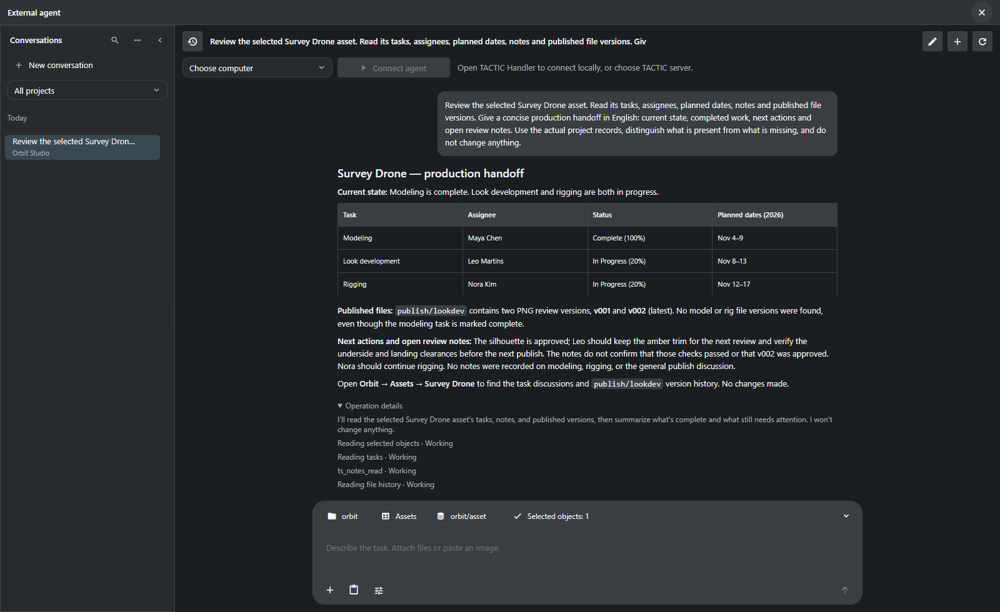
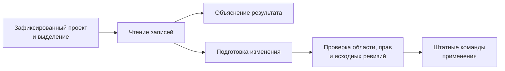
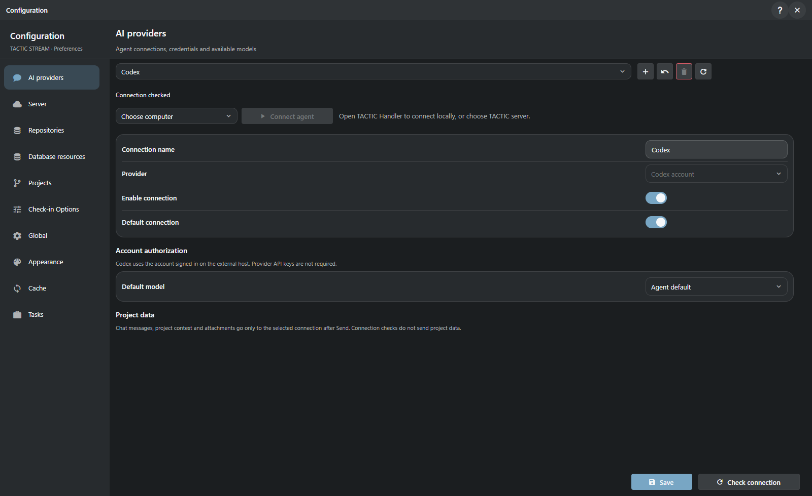

# Помощник проекта

[TACTIC Handler](../../README.ru.md) · [English](assistant.en.md) · [Кастомные дашборды](dashboards.ru.md)

Помощник читает записи проекта, отвечает на вопросы и готовит изменения. Диалог открывается в Handler; контекст, история и проектные операции хранятся в **TACTIC Stream**. Компьютер с Handler также может быть исполнителем запросов.

Окно называется **External agent**. Для работы нужны административная учётная запись, профиль AI-провайдера и подключённый исполнитель. Исполнитель запускает запросы к модели и инструменты на выбранной машине.

*Запрос по Survey Drone в демонстрационном проекте Orbit Studio. Данные проекта при выполнении не менялись.*

## Пример: отчёт по Survey Drone

Запрос: **прочитать задачи Survey Drone, исполнителей, плановые даты, заметки и опубликованные версии; описать состояние и дальнейшие действия, ничего не меняя в проекте**.

| Данные проекта | Вывод ассистента |
| --- | --- |
| Modeling: Complete, 100%, Maya Chen | Моделинг отмечен завершённым. |
| Look development и rigging: In Progress | У Leo Martins и Nora Kim остаётся работа; приведены плановые даты. |
| Две PNG-версии `publish/lookdev` | Существуют v001 и v002; последняя — v002. |
| Нет публикации model или rig | Завершённая задача моделинга ещё не подтверждает передачу модели. |
| Заметки одобряют силуэт, но требуют проверить зазоры | Нет подтверждения, что проверки выполнены или v002 согласована. |

В отчёте отдельно отмечены завершённая задача и отсутствие публикации модели. Замечания ревьюера тоже не приняты за согласование последней версии.

## Доступные инструменты

Помощник работает с перечисленными ниже инструментами. Набор доступных операций зависит от проекта, прав пользователя и разрешения на изменения.

| Область | Пример запроса | Поддерживаемая работа |
| --- | --- | --- |
| Контекст производства | «Чего не хватает этим ассетам для ревью?» | Чтение выбранных объектов, связанных данных, задач, заметок и версий файлов. |
| Записи и связи | «Создай десять шотов эпизода и привяжи существующие ассеты». | Создание записей и дочерних объектов, связывание существующих объектов штатными операциями. |
| Задачи | «Подготовь назначения и даты для выбранной работы». | Чтение, подготовка, проверка и сохранение поддерживаемых полей с проверкой ревизии каждой строки. |
| Workflow и структура | «Добавь этап ревью в этот pipeline». | Разбор и подготовка поддерживаемых изменений схемы, полей, pipelines и конфигурации. |
| Представления и naming | «Сделай компактный вид ассетов и правило имён для ревью». | Работа с поддерживаемыми таблицами, sidebar, item layouts и нативным неймингом. |
| Дашборды | «Собери обзор статусов и навигатор по ассетам». | Компоновка, предпросмотр и сохранение страниц в том же формате, что использует визуальный редактор. |
| Файлы | «Прикрепи эти референсы к review-контексту объекта». | Check-in вложений, чтение истории и подготовка поддерживаемых скачиваний. |
| Скрипты | «Подготовь инструмент проверки naming». | Неактивный черновик скрипта, просмотр, отдельные испытания и активация. |

Сценарий со скриншотов — отчёт по Survey Drone. Остальные примеры показывают, какие запросы поддерживают инструменты; они не входили в этот демонстрационный прогон.

## Контекст разговора

Первое сообщение закрепляет за разговором **проект, страницу, Search Type, представление и выбранные объекты**. Дальнейшее выделение в рабочем окне этот контекст не меняет. Для другого проекта или набора объектов нужен новый диалог.

История, черновики и фильтр проекта позволяют вернуться к разговору. Во время выполнения можно добавить уточнение или отменить дальнейшие действия. Закрытие окна запрос не останавливает. Если исполнитель отключился после операции с неизвестным результатом, она не повторяется автоматически.

Правила проекта задают инструкции студии для следующих сообщений. Права и доступный набор инструментов при этом остаются прежними.

## Изменения и отмена

Для записи включается **Allow changes**. Команды проверяют права и данные; операции с проверкой ревизий также обнаруживают изменения, сделанные после чтения записи.

Отмена прекращает дальнейшие действия. Уже сохранённые изменения остаются. Undo доступен для поддерживаемых правок полей, если их текущие значения ещё совпадают с результатом операции. Файлы, workflow и произвольные скрипты общего отката не имеют.

### Проверка скриптов

Скрипт создаётся неактивным. До активации нужно просмотреть исходник, провести испытание в проверенной изоляции и изучить результат. Активируется именно просмотренная версия; право исполнения проверяется отдельно. Откат транзакции и отдельный subprocess сами по себе не обеспечивают изоляцию.

## Модели и исполнители

| Семейство | Подключение |
| --- | --- |
| Codex | Вход в аккаунт, доступный выбранному исполнителю. |
| OpenAI | Профиль Responses API. |
| OpenAI-compatible | Endpoint Chat Completions, включая подходящие локальные сервисы моделей. |
| Anthropic | Профиль провайдера и доступные модели. |
| Gemini | Профиль провайдера и доступные модели. |

Список моделей запрашивается у настроенного провайдера. Поддержка изображений, reasoning, инструментов и веб-поиска зависит от адаптера и модели. Проверка профиля и списка моделей не отправляет данные проекта. Контекст разговора передаётся провайдеру при отправке сообщения.

Исполнителем может быть **компьютер с Handler** или **сервер TACTIC**. Его подключают явно; там используются учётные данные провайдера и адреса локальных сервисов. Автоматического переключения на другую машину нет. Секреты хранятся на сервере в зашифрованном виде.

## Вложения и веб-доступ

В разговор можно добавить до 20 вложений по 64 МБ. Для изображения, отправляемого модели, предел — 20 МБ. Файл, доступный для чекина, не обязательно имеет формат, который умеет читать модель.

Веб-доступ включается при создании разговора. Скачивание разрешено по публичному HTTPS с сохранением источника и хеша; частные сети недоступны. Веб-поиск поддерживают адаптеры Codex, OpenAI и Anthropic. Текст страниц и вложений не меняет разрешения разговора.

## Подключение через MCP

Через MCP можно подключить внешний административный клиент к тем же проектным инструментам. Доступ ограничен проектом и списком операций, имеет срок действия и отзывается администратором. Терминал, исходники приложения и управление посторонними программами через этот интерфейс недоступны.

**[Перейти к кастомным дашбордам →](dashboards.ru.md)** · [Справка External agent](../../thlib/ui/help_articles/external_agent.ru.md)

[Product Help](../../thlib/ui/help_articles/external_agent.ru.md) · [Frame contracts](../frame/index.md)

> Ассистент входит в прототип. Ответы модели и подготовленные изменения требуют проверки.
