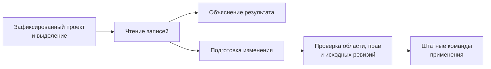

# Ассистент проекта

**Вопрос по работе. Ответ с опорой на данные. Подготовленное следующее действие.**

[TACTIC Handler](../../README.ru.md) · [English](assistant.en.md) · [Кастомные дашборды](dashboards.ru.md)

Нативный диалог Handler подключается к **TACTIC Stream**. Stream хранит диалоги и выполняет проектные операции; Handler предоставляет desktop-окно и может разместить явно выбранного исполнителя.

Встроенное окно называется **External agent**: модель и инструменты запускает отдельный исполнитель. Сам диалог остаётся внутри производственного приложения, рядом с обсуждаемыми объектами. Сейчас функция требует административной учётной записи, настроенного провайдера и подключённого исполнителя.

*Реальный завершённый запрос без изменений в изолированном Orbit Studio. Модель прочитала задачи, заметки и историю публикаций; ответ не подставлен в изображение.*

## От выбранного ассета к содержательному отчёту

Запрос был конкретным: **прочитать задачи, исполнителей, плановые даты, заметки и опубликованные версии выбранного Survey Drone; описать состояние и дальнейшие действия, ничего не меняя.**

| Данные проекта | Вывод ассистента |
| --- | --- |
| Modeling: Complete, 100%, Maya Chen | Моделинг отмечен завершённым. |
| Look development и rigging: In Progress | У Leo Martins и Nora Kim остаётся работа; приведены плановые даты. |
| Две PNG-версии `publish/lookdev` | Существуют v001 и v002; последняя — v002. |
| Нет публикации model или rig | Завершённая задача моделинга ещё не подтверждает передачу модели. |
| Заметки одобряют силуэт, но требуют проверить зазоры | Нет подтверждения, что проверки выполнены или v002 согласована. |

В этом и состоит польза: ассистент сопоставляет связанные записи и объясняет, что из них следует. Если данных недостаточно, неопределённость должна оставаться видимой.

## С чем он умеет работать

Ассистент получает набор инструментов, доступный его сессии. Любой запрос ограничен правами пользователя, выбранным проектом и режимом изменения данных.

| Область | Пример запроса | Поддерживаемая работа |
| --- | --- | --- |
| Контекст производства | «Чего не хватает этим ассетам для ревью?» | Чтение выбранных объектов, связанных данных, задач, заметок и версий файлов. |
| Записи и связи | «Создай десять шотов эпизода и привяжи существующие ассеты». | Создание записей и дочерних объектов, связывание существующих объектов штатными операциями. |
| Задачи | «Подготовь назначения и даты для выбранной работы». | Чтение, подготовка, проверка и сохранение поддерживаемых полей с проверкой ревизии каждой строки. |
| Workflow и структура | «Добавь этап ревью в этот pipeline». | Разбор и подготовка поддерживаемых изменений схемы, полей, pipelines и конфигурации. |
| Представления и naming | «Сделай компактный вид ассетов и правило имён для ревью». | Работа с поддерживаемыми таблицами, sidebar, item layouts и нативным неймингом. |
| Дашборды | «Собери обзор статусов и навигатор по ассетам». | Компоновка, предпросмотр и сохранение страниц в том же формате, что использует визуальный редактор. |
| Файлы | «Прикрепи эти референсы к review-контексту объекта». | Check-in вложений, чтение истории и подготовка поддерживаемых скачиваний. |
| Скрипты | «Подготовь инструмент проверки naming». | Неактивный черновик скрипта, просмотр, отдельные испытания и активация. |

Это группы реализованных инструментов, а не обещание выполнить произвольную фразу без уточнений и проверки. Для этой презентации выполнен отчёт выше; остальные возможности описаны по действующим контрактам реализации.

## Контекст фиксируется явно

Откройте ассистента из рабочего пространства или объекта. Перед первой отправкой проверьте **проект, страницу, Search Type, представление и точное выделение**. Первая отправка закрепляет область диалога. Переход в другой проект или выбор другого ассета не перенаправляют уже начатый разговор — для нового контекста создаётся новый диалог.

Можно продолжить разговор, направить выполняющийся запрос, раскрыть журнал операций или отменить дальнейшую работу. Закрытие окна не отменяет запрос. После отключения исполнителя операция, которая могла завершиться, не запускается автоматически повторно. История, черновики диалогов и фильтрация по проекту помогают вернуться к работе с исходным контекстом.

Правила проекта добавляют инструкции студии к следующим обращениям. Они действуют внутри разрешённой области и не дают прав на другой проект или недоступную операцию.

## Чтение, подготовка, проверка, применение

По умолчанию доступно чтение. **Allow changes** включается отдельно; текст запроса не обходит ограничения инструментов. Нативные команды сохраняют свои проверки прав, валидацию и транзакционное поведение. Проверка ревизий защищает поддерживаемые изменения от перезаписи более свежих данных.

Отмена останавливает дальнейшую работу, но не возвращает уже записанные изменения. Undo имеет более узкую область: отмена поддерживаемого изменения полей проверяет, совпадают ли текущие значения с результатом той операции. Это не общий rollback файлов, workflow и произвольных скриптов.

### Отдельный путь для сгенерированных скриптов

Сгенерированный скрипт сначала неактивен. Его исходник нужно просмотреть, запустить поддерживаемые испытания в проверенной изоляции, изучить результат и явно активировать именно просмотренную версию. Право исполнения проверяется отдельно. Откат транзакции или отдельный subprocess сами по себе не создают песочницу; успешное испытание не гарантирует корректность на любых производственных данных.

## Провайдер, модель и компьютер исполнения

| Семейство | Подключение |
| --- | --- |
| Codex | Вход в аккаунт, доступный выбранному исполнителю. |
| OpenAI | Профиль Responses API. |
| OpenAI-compatible | Endpoint Chat Completions, включая подходящие локальные сервисы моделей. |
| Anthropic | Профиль провайдера и доступные модели. |
| Gemini | Профиль провайдера и доступные модели. |

Список моделей запрашивается у настроенного провайдера. Настройки reasoning, изображения, инструменты и веб-поиск зависят от выбранного адаптера и модели. Проверка профиля и получение списка моделей не отправляют контекст проекта; отправка диалога — отправляет.

Выберите подключённый **компьютер с Handler** или **сервер TACTIC** и явно подключите исполнителя. От выбора зависит, где используются авторизация провайдера и адреса локальных сервисов. Отправка запроса не запускает незаметно другой исполнитель и не переключает его на другую машину. Секреты провайдеров защищены шифрованным серверным хранилищем и не записываются как открытые настройки Handler.

## Вложения и необязательный доступ в интернет

Прикрепляйте файлы или вставляйте изображения в диалог. Текущие ограничения — 20 вложений и 64 МБ на файл; для изображения, отправляемого модели, действует отдельный предел 20 МБ. Доступность файла для check-in не означает, что модель умеет прочитать его содержимое.

Доступ в интернет включается отдельно для нового диалога. Поддерживаемые скачивания используют публичный HTTPS и сохраняют источник и хеш; обращение к частным сетям исключено. Веб-поиск доступен через поддерживаемые адаптеры Codex, OpenAI и Anthropic; возможности других адаптеров отличаются. Содержимое страниц и файлов — материал для анализа, а не инструкции, расширяющие права.

## Диалог — один из входов в ограниченный набор инструментов

Внешний административный клиент может подключаться через реализованный MCP-интерфейс. Доступ ограничен проектом и разрешёнными инструментами, имеет срок действия и может быть отозван. Это не неограниченный терминал, доступ к исходникам приложения или управление посторонними программами компьютера.

Для команды результат — разговор, опирающийся на данные проекта. Для администратора — видимые операции с явной областью и контролируемыми изменениями.

**[Перейти к кастомным дашбордам →](dashboards.ru.md)** · [Справка External agent](../../thlib/ui/help_articles/external_agent.ru.md)

[Product Help](../../thlib/ui/help_articles/external_agent.ru.md) · [Frame contracts](../frame/index.md)

> Ассистент входит в разрабатываемый прототип. Доступность провайдеров и поведение моделей различаются; существенные изменения и автоматизацию студии необходимо проверять.
