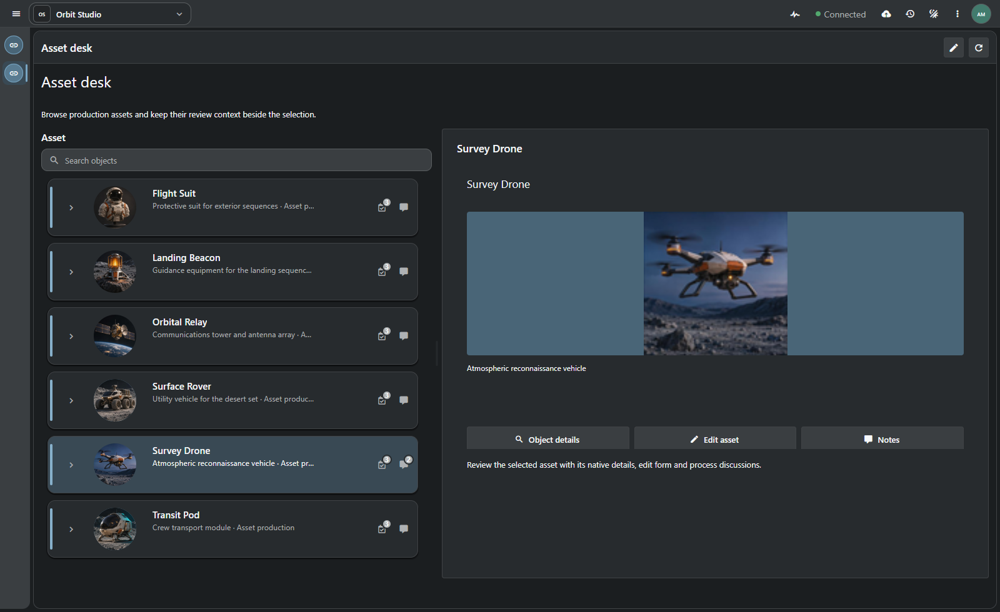
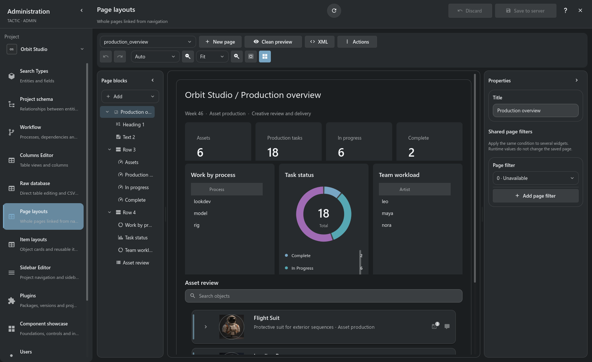

# Custom dashboards

**A project page designed around the work your team actually does.**

[TACTIC Handler](../../README.md) · [Русский](dashboards.ru.md) · [Project assistant](assistant.en.md)

The overview and editor below run in **native Qt Quick in Handler**, connected to Stream. The Asset desk example is shown in Stream's browser. Saved page definitions belong to the server.

A dashboard combines information and action: a supervisor's production overview, an artist's asset desk or a review page with selected-object details. It lives in normal project navigation and uses the same records and permissions as the rest of the application.

*This page is saved in the disposable Orbit Studio project and opened through its regular sidebar. Counts and reports are computed from its records.*

## One page for the production overview

The example brings together **6 assets, 18 tasks, 6 in progress and 2 complete**. The status chart shows the distribution; grouped reports show work by process and planned hours by artist. Item View beneath them gives the overview an entrance into actual production objects.

Those numbers are data bindings, not manually typed labels. Change the underlying tasks and refresh the page to obtain a new report. Filtered metrics and aggregates retain the current user's data access.

## Another page for working with an asset

The **Asset desk** starts with the same records but organizes them differently: an object navigator on the left and a selection-driven detail area on the right. Pick an asset, inspect its preview and description, then open native details, editing or notes.

The details region follows the selected identity. Its buttons act on that record through existing operations; the page does not reconstruct an object from a visible label. Type-specific detail groups allow a mixed object tree to show the appropriate content for its selection.

## Compose the page in the visual editor

**Administration → Page layouts** combines the block tree, a preview using project data and the selected block's properties. Add and arrange blocks, tune size and spacing, inspect the page at another viewport width and use a clean preview before saving. Undo/redo, snapping and alignment tools support iterative layout work. The XML view exposes the saved definition for technical authors.

| Building blocks | What they add |
| --- | --- |
| **Row, column, grid** | Containers, weights, spans and structured composition. |
| **Heading, text, Markdown, icon, image** | Context, instructions, previews and visual hierarchy. |
| **Metric** | A number computed from the selected data source and filters. |
| **Chart** | Bar, line or donut presentation of supported grouped aggregates. |
| **Summary** | Grouped report with count, sum, average, minimum or maximum. |
| **Table** | An existing native table view with a configurable set of workspace controls. |
| **Items** | Item View with its object tree, previews, relationships and native actions. |
| **Details, field, form** | Selection-aware content and supported object editing. |
| **Action, button, link** | Native operations and navigation. |
| **Divider, spacer** | Separation and breathing room without empty data widgets. |

Header, content and footer regions establish a page hierarchy. Width/height rules, minimums and maximums, padding, gaps, fill, border, radius and shadow tune presentation. Theme tokens allow the page to fit the application's appearance.

## Connect the blocks to real data

Choose the Search Type, supported fields, filters and view for each data block. Reports can group by up to three fields and compute supported aggregates. Shared page filters map a common condition to participating blocks, so a project-wide selection can affect several reports without rewriting their definitions.

An embedded table reuses a configured table view. Item View reuses an item layout. The page editor can take an author to those editors and return to the page; the studio maintains reusable definitions rather than a separate copy of every component's settings.

There is currently **one Items workspace per dashboard**. Use it as the selection source for the page's details. Multiple metrics, reports and tables can accompany it. Reports read data; forms and native action blocks provide explicit write operations where permitted.

## From draft to a navigation entry

1. Create a page in Page layouts and give it a meaningful name and title.
2. Establish containers and the primary data source; choose views for object/table blocks.
3. Add metrics, reports and supporting text or actions.
4. Test the preview with real project records, selection and the intended viewport sizes.
5. Save the definition and open its project navigation entry.

The saved page uses native `config/widget_config` definitions, sidebar configuration and a project URL such as `/projects/orbit/dashboard/production_overview`. Saving checks the source revision. Supported command retries use operation identities and durable receipts to avoid duplicating an uncertain save.

## Visual editing and assistant authoring use the same page

Ask the [project assistant](assistant.en.md) to prepare a layout from supported blocks, then inspect its preview and open the saved result in the visual editor. An assistant-created page remains editable project configuration; it is not a generated screenshot or a separate application.

For example: “Create a production overview with task counts by status, planned hours by assignee and an asset navigator. Use existing project records.” The request still needs the corresponding project permissions and enabled change tools.

## Shared description, native workspace

The page document and shared Frame descriptions support **Vue in Stream and Qt Quick in Handler**. Handler renders native controls without embedding HTML. The server owns query permissions, validation and saved definitions; the client owns interaction and selection. Sharing the layout does not merge client and server execution environments.

Dashboard authoring belongs to project administration. A reader's access still determines which records and actions are available. Validate the saved page under the intended user roles, including empty data and narrower windows.

[Frame contracts](../frame/index.md) · [Administration](../administration.md)

> Dashboards are part of the development prototype. The examples demonstrate current configured pages; they do not guarantee layout parity or performance for every custom composition and data volume.
