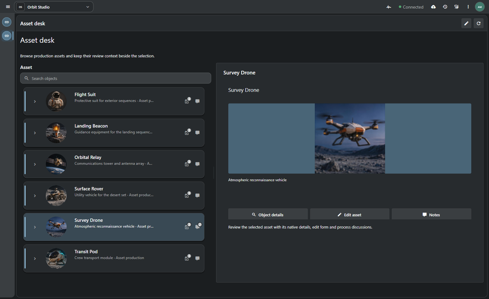
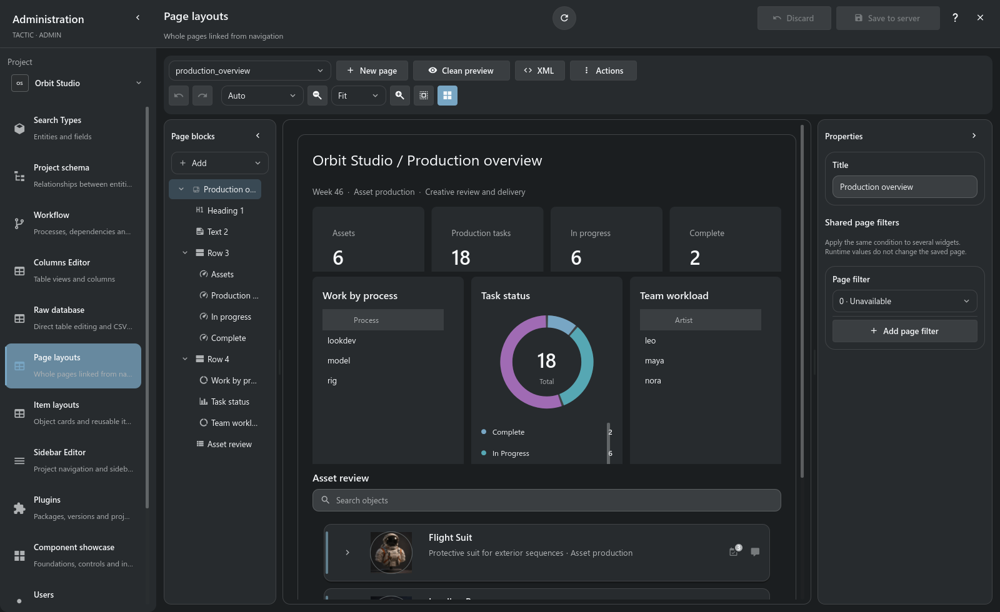

# Кастомные дашборды

**Страница, с которой вашей команде удобно начинать работу.**

[TACTIC Handler](../../README.ru.md) · [English](dashboards.en.md) · [Ассистент проекта](assistant.ru.md)

Обзор и редактор ниже работают в **нативном Qt Quick в Handler**, подключённом к Stream. Пример Asset desk показан в браузерном Stream. Сохранённые определения страниц принадлежат серверу.

У руководителя и художника разные вопросы к одним данным. Первому нужно увидеть загрузку и задержки, второму — открыть свой ассет и разобраться с замечаниями. Для каждого можно собрать собственную страницу: выбрать показатели, добавить объекты и действия. Она появится в обычной навигации проекта и будет работать с его записями и правами.

*Страница сохранена в изолированном Orbit Studio и открыта через обычный sidebar. Счётчики и отчёты вычислены по записям проекта.*

## Страница для обзора производства

На этой странице руководитель видит объём работы в проекте: **6 ассетов и 18 задач, из которых 6 в работе и 2 завершены**. Диаграмма показывает распределение статусов, отчёты — процессы и плановые часы по исполнителям. Ниже расположен Item View, поэтому из общей картины можно перейти к конкретному ассету.

Показатели вычисляются по записям проекта. Если задачи изменились, после обновления страницы отчёт отразит новое состояние. Метрики и агрегаты учитывают доступ текущего пользователя к данным.

## Другая страница — для работы с ассетом

Для художника полезнее **Asset desk**: слева список объектов, справа подробности выбранного. Можно посмотреть превью и описание, открыть редактирование или заметки. Данные остаются теми же, что в обзоре производства; меняется то, на чём сосредоточена страница.

Выберите другой объект — область подробностей переключится на него, и кнопки будут работать именно с этой записью. Если в дереве есть разные типы объектов, для каждого можно задать свою группу деталей.

## Сборка страницы в визуальном редакторе

Страницу собирают в **Administration → Page layouts**. Слева видно дерево блоков, рядом — результат на данных проекта и свойства выбранного элемента. Можно переставлять блоки, пробовать размеры и отступы, отменять изменения и смотреть, что получилось при другой ширине окна. Привязки и выравнивание помогают с компоновкой; XML-представление открывает само сохранённое описание.

| Блоки | Назначение |
| --- | --- |
| **Row, column, grid** | Контейнеры, веса, spans и структурная компоновка. |
| **Heading, text, Markdown, icon, image** | Контекст, инструкции, изображения и визуальная иерархия. |
| **Metric** | Число по выбранному источнику данных и фильтрам. |
| **Chart** | Столбчатые, линейные и кольцевые диаграммы поддерживаемых агрегатов. |
| **Summary** | Групповой отчёт: количество, сумма, среднее, минимум или максимум. |
| **Table** | Существующее нативное табличное представление с настраиваемыми инструментами. |
| **Items** | Item View с деревом, изображениями, связями и действиями объектов. |
| **Details, field, form** | Содержимое по выделению и поддерживаемое редактирование объекта. |
| **Action, button, link** | Штатные операции и навигация. |
| **Divider, spacer** | Разделение и свободное пространство без пустых виджетов данных. |

Области header, content и footer задают иерархию страницы. Ширина и высота, их пределы, padding, gaps, заливка, границы, скругления и тени управляют оформлением. Токены темы позволяют странице вписываться в выбранный стиль приложения.

## Подключение к данным

Для каждого блока задаётся, откуда брать данные: Search Type, поля, фильтры и представление. Например, несколько отчётов могут подчиняться общему фильтру страницы — тогда их можно переключать вместе. Группировка поддерживает до трёх полей и доступные агрегатные вычисления.

Если в проекте уже настроена удобная таблица или карточка объекта, её можно использовать на странице: Table берёт табличное представление, Item View — item layout. Из редактора страницы можно перейти к их настройке и вернуться. Так привычное представление объекта сохраняется и на дашборде.

Сейчас на дашборде поддерживается **одно рабочее пространство Items**. Оно служит источником выделения для деталей страницы. Рядом могут находиться несколько метрик, отчётов и таблиц. Отчёты читают данные; формы и нативные действия явно выполняют разрешённые изменения.

## От черновика к пункту навигации

1. Создайте страницу в Page layouts и задайте понятные имя и заголовок.
2. Определите контейнеры, основной источник данных и представления блоков объектов/таблиц.
3. Добавьте метрики, отчёты, пояснения и действия.
4. Проверьте предпросмотр на записях проекта, с выделением и нужными размерами окна.
5. Сохраните определение и откройте страницу через навигацию проекта.

Сохранённая страница использует штатные определения `config/widget_config`, sidebar и адрес вида `/projects/orbit/dashboard/production_overview`. При записи проверяется исходная ревизия. Поддерживаемые повторные вызовы используют идентификатор операции и сохранённый результат, чтобы неопределённый ответ не приводил к дублированию сохранения.

## Визуальный редактор и ассистент работают с одной страницей

Можно попросить [ассистента проекта](assistant.ru.md) подготовить компоновку из поддерживаемых блоков, проверить предпросмотр и открыть сохранённый результат в редакторе. Созданный ассистентом дашборд остаётся редактируемой конфигурацией проекта.

Например: «Собери обзор производства: количество задач по статусам, плановые часы по исполнителям и навигатор ассетов. Используй существующие записи проекта». Для этого по-прежнему требуются проектные права и разрешённые инструменты изменения.

## Общее описание и нативное рабочее пространство

Документ страницы и общие описания Frame поддерживают **Vue в Stream и Qt Quick в Handler**. Handler отображает нативные компоненты без встраивания HTML. Сервер отвечает за права запросов, валидацию и сохранённые определения; клиент — за взаимодействие и выделение. Общее описание не объединяет среды исполнения клиента и сервера.

Создание дашбордов относится к администрированию проекта. Права читателя определяют доступные записи и действия. Проверяйте страницу под нужными ролями, включая пустые данные и узкие окна.

[Frame contracts](../frame/index.md) · [Administration](../administration.md)

> Дашборды входят в разрабатываемый прототип. Примеры показывают текущие настроенные страницы, но не гарантируют одинаковую компоновку и производительность для любого документа и объёма данных.
