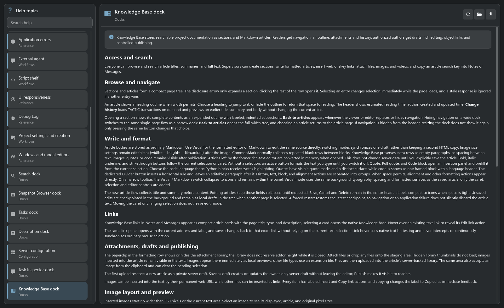

# Help where you work

**A guide to the tool you are using, available while you work.**

[TACTIC Handler](../../README.md) · [Русский](help.ru.md) · [Knowledge Base](knowledge-base.en.md) · [Full feature tour](product-tour.en.md)

What happens after check-in? Where do you change a naming rule? How do you bring a panel back? These questions come up while you are working. Open Help from the main menu, or use a tool’s Help action to go straight to its article.

## Open the guide for the current tool

Start with the immediate task, such as understanding the publication queue, then follow the article’s links to the surrounding workflow. The catalog gives you the bigger picture; search finds explanations by words in their titles or text. Search, configuration, administration, scripting and workspace panels have their own topics.

| When you need to… | Help provides… |
| --- | --- |
| Find an unfamiliar action | Search across article titles, groups and text. |
| Follow a procedure | A formatted article with headings, examples and links to related topics. |
| Move between topics | A searchable catalog, keyboard navigation and remembered article scroll positions. |
| Read in your working language | English and Russian articles, selected with the interface language; English fallback when needed. |
| Keep a reference | Download a Markdown copy of the current article. |

## Application Help and your studio’s own guides

Handler ships its Help articles as local Markdown files and displays them in a native Qt reader. Reading these bundled instructions does not require a server connection. You can also open the current source file externally or reload the catalog.

Help explains application behavior: what a command does and how to use a tool. The team’s own agreements—such as which views to include in a review—belong in **Knowledge Base**. That keeps product instructions and project requirements in places where people can find them.

[Explore the Knowledge Base →](knowledge-base.en.md)

## Find the answer and get back to work

1. Open a working tool, such as Configuration or Commit Queue.
2. Use its Help action to open the matching article.
3. Search for another topic, follow a related link, or download the article for later.

[Getting started](../../thlib/ui/help_articles/getting_started.en.md) · [Search guide](../../thlib/ui/help_articles/search.en.md) · [Knowledge Base guide](../../thlib/ui/help_articles/dock.knowledge.en.md)

*Fresh capture of the native Handler application. The presentation shows the current development prototype.*
