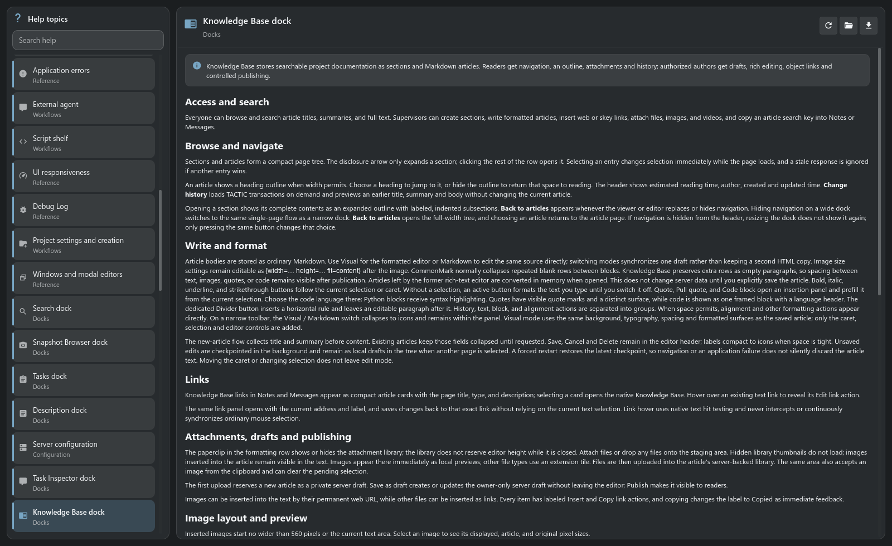

# Встроенная справка

**Нужная инструкция — рядом с рабочим инструментом.**

[TACTIC Handler](../../README.ru.md) · [English](help.en.md) · [База знаний](knowledge-base.ru.md) · [Полный обзор](product-tour.ru.md)

Справка объясняет поведение панелей, назначение настроек и порядок рабочих действий прямо в приложении. Откройте её из главного меню или нажмите кнопку справки в рабочем окне, чтобы сразу перейти к теме этого инструмента.

## Начните с инструмента, в котором работаете

Вопрос о публикации файлов ведёт к инструкции по чекину. Контекстные кнопки справки выбирают подходящую статью, а каталог тем позволяет разобраться в процессе целиком. У конфигурации, администрирования, поиска, публикации, скриптов и рабочих панелей есть собственные объяснения.

| Что нужно сделать | Что предлагает справка |
| --- | --- |
| Найти незнакомую функцию | Поиск по заголовкам, группам и тексту статей. |
| Пройти рабочую процедуру | Оформленную статью с заголовками, примерами и ссылками на связанные темы. |
| Переключаться между темами | Каталог с поиском, навигацию с клавиатуры и запоминание позиции чтения. |
| Читать на привычном языке | Статьи EN/RU следуют языку интерфейса; при отсутствии перевода открывается английская версия. |
| Сохранить инструкцию | Выгрузку текущей статьи в Markdown. |

## Документация, которая поставляется с приложением

Статьи Handler поставляются локально в Markdown и открываются в нативном Qt-интерфейсе. Для чтения этих материалов подключение к серверу не требуется. Текущий исходный файл можно открыть внешним приложением, а каталог — перечитать.

Справка содержит инструкции к продукту. В **базе знаний** команда пишет собственные материалы: вводные для новых сотрудников, правила нейминга, требования к сдаче и технические решения, связанные с объектами проекта.

[Посмотреть базу знаний →](knowledge-base.ru.md)

## Попробуйте в рабочем сценарии

1. Откройте инструмент — например, Configuration или Commit Queue.
2. Нажмите его кнопку справки и прочитайте соответствующую статью.
3. Найдите следующую тему поиском, перейдите по связанной ссылке или сохраните инструкцию.

[Начало работы](../../thlib/ui/help_articles/getting_started.ru.md) · [Поиск](../../thlib/ui/help_articles/search.ru.md) · [Руководство по базе знаний](../../thlib/ui/help_articles/dock.knowledge.ru.md)

*Свежий снимок настольного Handler. Показан текущий прототип продукта.*
