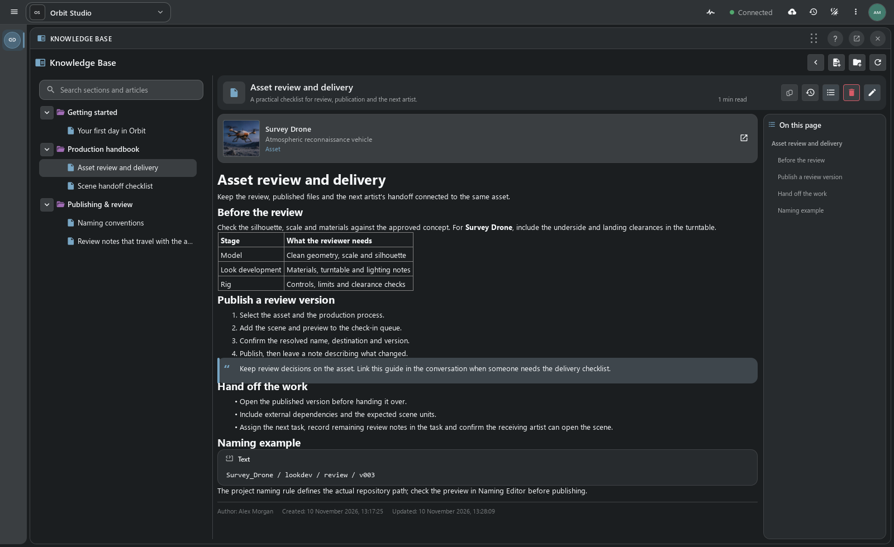
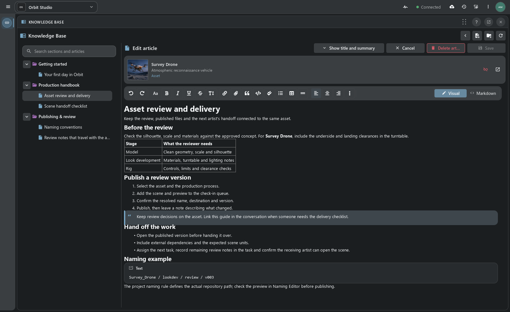
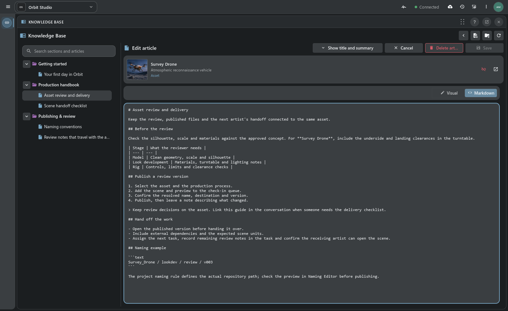
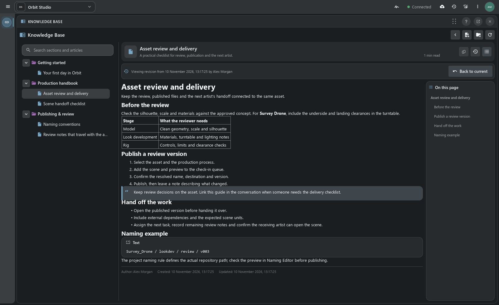

# Project Knowledge Base

[TACTIC Handler](../../README.md) · [Русский](knowledge-base.ru.md) · [Built-in Help](help.en.md) · [Full feature tour](product-tour.en.md)

Knowledge Base stores project articles: instructions, technical notes and delivery requirements. Articles have permanent links, attachments and links to project objects. Its panel can sit beside Item View.

## Links to project objects

Survey Drone is linked to the **Asset review and delivery** article. It opens from the object, and its link can be shared in Notes or Messages. One guide can be linked to several assets or shots.

| Material | Where it helps |
| --- | --- |
| Artist onboarding | A first-day checklist, project conventions and links to the working tools. |
| Delivery standards | A checklist attached to the assets or shots it governs. |
| Department handbook | Nested sections for modeling, look development, rigging and review. |
| Technical notes | Code examples, supporting files and decisions that remain easy to find. |

## Sections and search

Articles are organized in a section tree. Search covers titles, summaries and body text; an outline links to headings within an article. Each article shows its author, creation and update dates, and estimated reading time.

Move articles between sections or change their order. Readers see the new structure after it is saved; before that, the changes can be discarded.

## Visual and Markdown

**Visual** mode formats text using editor controls. **Markdown** opens the same article’s source. Both support headings, lists, tables, quotes, images, links and code blocks.

Files upload to the article’s library and use the publication system for storage. Insert them in the text or share a permanent link. Asset links return to the project objects themselves.

## Drafts and publication

1. Create an article in the appropriate section and add the instructions.
2. Link the relevant objects and upload supporting files.
3. Continue locally or **Save as draft** to keep an unpublished server copy owned by the author.
4. **Publish** when readers should see it; use **Save** to update an existing publication.

Unfinished text is kept locally while switching articles. **Save as draft** stores a private server draft; publication makes it available to readers with access. Concurrent edits by another author are reported as a revision conflict when saving.

Local checkpoints are stored in the Handler profile on this computer. Server drafts are stored in the project.

## Revision history

**Change history** lists authors, dates and changed fields. Open a revision to read its title, summary and body. Historical viewing does not restore or republish an earlier version.

## Setup and permissions

A project administrator initializes Knowledge Base. Administrators and supervisors write articles and organize sections within their permissions; readers access published material. Open the Knowledge Base panel alongside the other docks.

A project article can supplement Help: the check-in guide describes the commands, while a department’s delivery requirements specify which files to submit.

[Complete Knowledge Base guide](../../thlib/ui/help_articles/dock.knowledge.en.md) · [Built-in Help](help.en.md) · [Docks and workspace layouts](product-tour.en.md#docks-and-layouts)

*Orbit Studio handbook in the Handler prototype.*