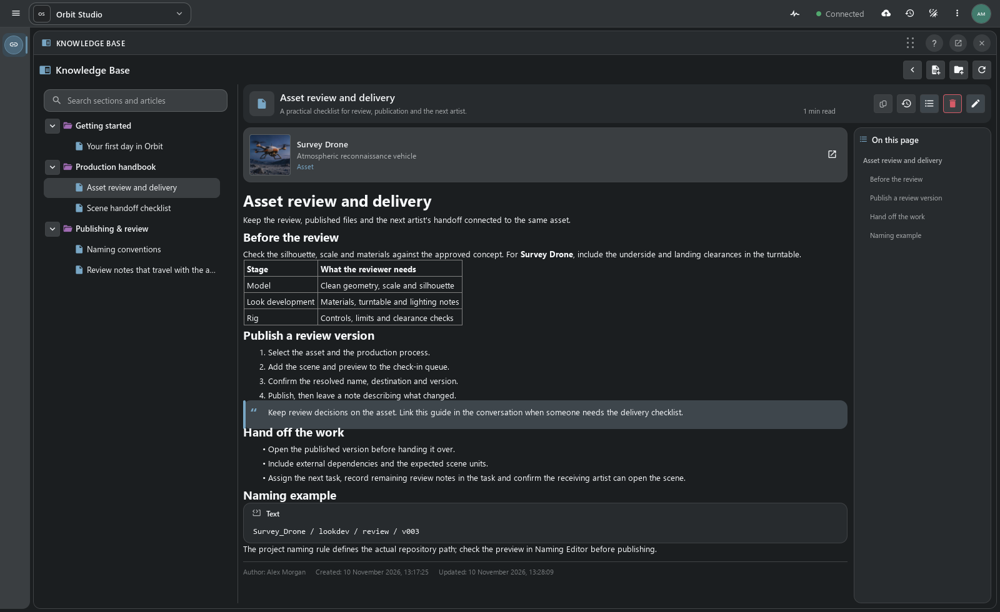
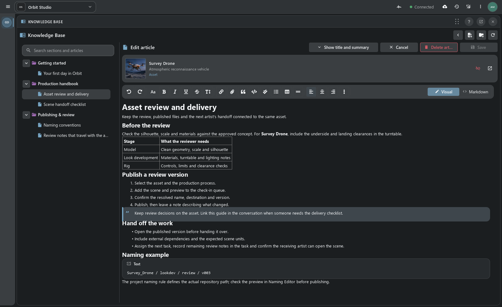
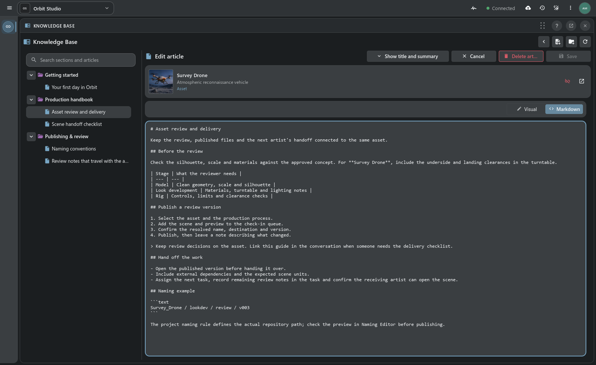
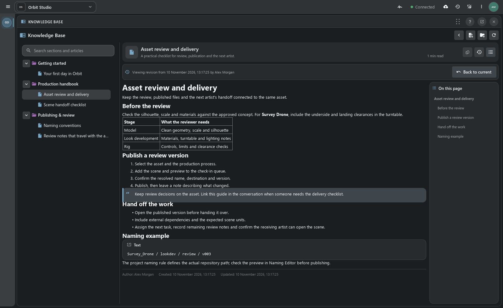

# Встроенная база знаний

**Опыт команды — рядом с работой, к которой он относится.**

[TACTIC Handler](../../README.ru.md) · [English](knowledge-base.en.md) · [Встроенная справка](help.ru.md) · [Полный обзор](product-tour.ru.md)

Храните вводные для сотрудников, требования к сдаче и технические решения внутри проекта. База знаний объединяет дерево статей с поиском, режим чтения, редактор Visual / Markdown, вложения и связи с объектами. Откройте её доком рядом с Item View или разверните для чтения и подготовки материалов.

## Инструкция открывается там, где нужна

На снимке **Asset review and delivery** связана с Survey Drone. Художник может перейти от инструкции к объекту, держать статью рядом с ассетом и отправить ссылку на неё в Notes или Messages. Связанные опубликованные статьи доступны со стороны объектов; одна инструкция может относиться сразу к нескольким записям.

| Материал | Где пригодится |
| --- | --- |
| Введение в проект | Чеклист первого дня, соглашения команды и ссылки на рабочие инструменты. |
| Требования к сдаче | Инструкция, прикреплённая к соответствующим ассетам или шотам. |
| Справочник отдела | Вложенные разделы по моделингу, lookdev, ригу и ревью. |
| Технические заметки | Примеры кода, вспомогательные файлы и решения, которые легко найти снова. |

## Читать, искать, переходить

Разделы и статьи образуют компактное дерево. Поиск охватывает названия, краткие описания и основной текст. В режиме чтения доступны оглавление по заголовкам, оценка времени чтения, автор и даты создания и изменения. Можно открыть содержимое раздела или перейти из статьи к связанному объекту проекта.

Авторы перемещают страницы между разделами и меняют порядок дерева. Изменения структуры сохраняются или отменяются отдельными действиями — общий каталог обновляется явно.

## Пишите визуально. Сохраняйте в Markdown.

Начните с заголовка и краткого описания, затем переходите к тексту. **Visual** предлагает инструменты форматирования, **Markdown** позволяет править тот же документ напрямую. Заголовки, выделения, списки, ссылки, изображения, цитаты, таблицы и блоки кода помогают превратить рабочую процедуру в понятную инструкцию. У двух режимов один исходный Markdown.

Прикрепляйте файлы и медиа, вставляйте изображения или файловые ссылки в текст, копируйте постоянный URL вложения. Библиотека принадлежит статье и использует хранилище публикаций проекта. Связь с объектом добавляет рабочий контекст, сохраняя сам объект самостоятельной записью.

## От черновика до общей инструкции

1. Создайте статью в подходящем разделе и опишите процедуру.
2. Свяжите нужные объекты и загрузите вспомогательные файлы.
3. Продолжайте локально или нажмите **Save as draft**, чтобы сохранить личный неопубликованный черновик на сервере.
4. Нажмите **Publish**, когда материал готов для читателей; **Save** обновляет уже опубликованную статью.

Локальные контрольные сохранения удерживают незаконченный текст при переходах между статьями. Серверный черновик доступен его автору, а опубликованные страницы подчиняются правам проекта и записей. При сохранении проверяется серверная ревизия: конфликт параллельных изменений показывается пользователю.

Handler хранит локальные контрольные копии статьи в профиле приложения. Локальная копия помогает продолжить работу на этой машине, а серверный черновик хранит неопубликованную статью на сервере проекта.

## Посмотреть, как менялась инструкция

**Change history** показывает события штатных транзакций, авторов, даты и изменённые поля. Выберите предыдущую редакцию, чтобы прочитать её заголовок, описание и текст, затем вернитесь к текущей. Это просмотр истории: он сам по себе не восстанавливает и не публикует старую версию.

## Подключить один раз — использовать во всём проекте

Администратор явно инициализирует базу знаний в проекте. Администраторы и супервайзеры создают материалы и управляют структурой с учётом серверных прав; читатели с доступом открывают опубликованные страницы. В TACTIC Handler покажите рабочую панель Knowledge Base и разместите её вместе с другими доками.

**Справка** объясняет инструменты приложения, **база знаний** хранит опыт команды. Они дополняют друг друга: справка расскажет, как работает чекин, а статья проекта — что именно команда ожидает получить при сдаче.

[Полное руководство по базе знаний](../../thlib/ui/help_articles/dock.knowledge.ru.md) · [Встроенная справка](help.ru.md) · [Доки и рабочие пространства](product-tour.ru.md#доки-собрать-интерфейс-под-конкретную-работу)

*Свежие снимки настольного Handler на изолированном проекте Orbit Studio. Тексты справочника и ассеты демонстрационные; чтение, редактор и история показаны в настоящем приложении.*
