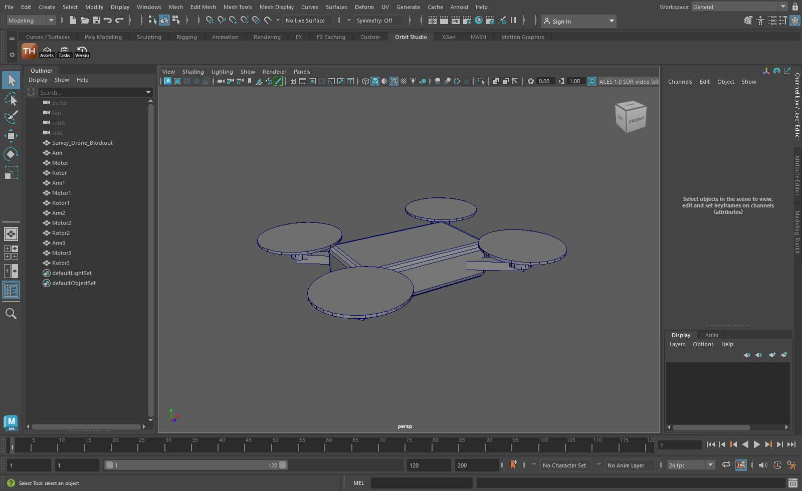
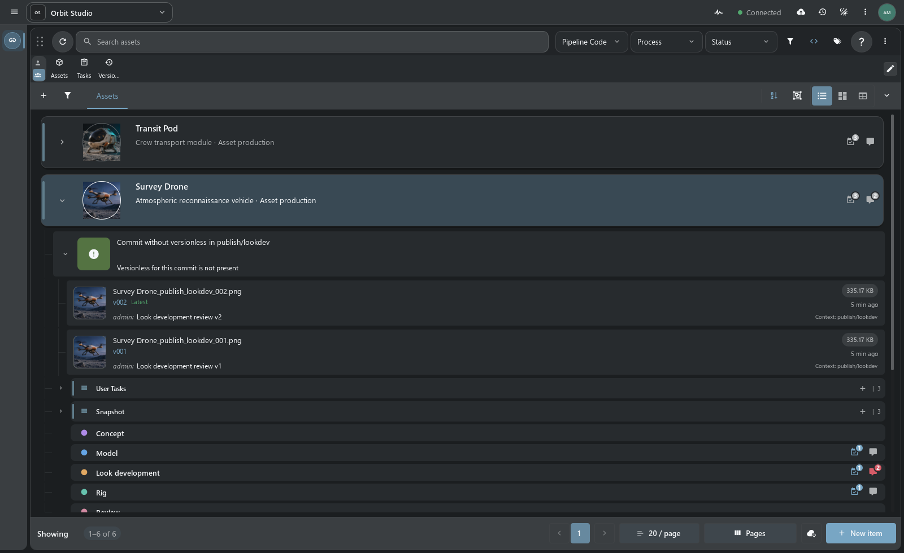
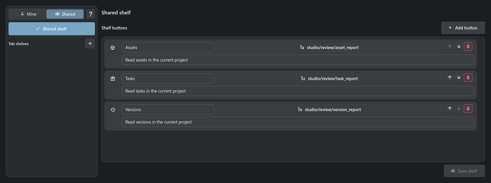
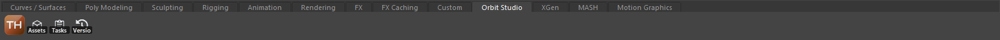

# Maya plugin and Script Shelf

[TACTIC Handler](../../README.md) · [Русский](maya.ru.md) · [Full feature tour](product-tour.en.md)

The Maya plugin runs Handler commands in an open Maya session. It opens, imports and references files and prepares scenes for check-in. The connection uses the local Handler Server.

*Maya 2023 with the Orbit Studio shelf created by the Handler connector. The scene is a demonstration blockout.*

## Open, import and reference

Select a publication in Item View or Snapshot Browser and choose a file action. Handler resolves the local repository path and sends the command to the selected Maya session.

| Action | Result |
| --- | --- |
| **Open** | Opens the scene; an option sets its directory as the Maya workspace. |
| **Import** | Imports a file into the current scene, with the supported action's options. |
| **Reference** | Creates a file reference in the current scene. |
| **Save / check-in preparation** | Maya prepares the scene; Handler continues publication through Commit Queue. |

With several Maya sessions open, select the one that should receive the action.

## Scene check-in

1. Select the object and publication context in Handler.
2. Prepare the scene through connected Maya; choose ASCII or Binary where needed.
3. Review the description, version, file roles and resolved paths in Commit Queue.
4. Submit check-in and return to the result through the object's snapshots.

Maya owns its native scene operations. TACTIC authentication, naming, repository work, transfers and publication records remain with Handler and the server. Maya Scene settings control the format, project-directory creation, playblast preparation where supported, and focus after native actions.

[Publishing and files](product-tour.en.md#check-in-and-check-out) · [Maya Scene Help](../../thlib/ui/help_articles/configuration.maya.en.md)

## Script Shelf

Script Shelf runs saved scripts from buttons beside Search. Each button has a label, icon and tooltip; the script receives the project and current selection.

A **personal shelf** belongs to the signed-in user. A **shared shelf** provides team tools and requires the appropriate authoring permissions. Either owner can have a common set or a shelf assigned to a specific sidebar tab. Editing a personal shelf does not rewrite the shared definition.

Save a script in Script Editor, then add it to the shelf. Choose its execution environment: local Python, the server or a DCC session. The script’s own execution permissions apply.

### Maya shelf

When a connected Maya client advertises `create_script_shelf`, the editor can create or update a native shelf. Enter its name and confirm replacement when it already exists. The first button starts or reveals Handler. The remaining buttons preserve order, labels, tooltips, rendered icons and project-script references. Maya persists the tab through its native shelf mechanism.

An exported shelf is saved in Maya. Update it from Handler’s editor after changing its buttons or permissions.

[Complete Script Shelf Help](../../thlib/ui/help_articles/script_shelf.en.md) · [Script Editor](../../thlib/ui/help_articles/script_editor.en.md)

## Connector installation

1. Enable the Maya plugin in **Configuration → DCC plugins**. Restart Handler if the plugin selection changed.
2. Open **Configuration → Maya Scene → Maya integration** and select **Find Maya**.
3. Choose the version/profile and select **Integrate into Maya**.
4. Restart Maya. Its **TACTIC_Stream** shelf provides the Handler button; the connector waits for this exact application installation.

Managed integration supports Windows and Python 3 Maya, starting with Maya 2022. It adds its own module and separate shelf while preserving existing user startup scripts and shelves. Register again after moving Handler. Use **Remove integration** with Maya closed; modified and foreign files are protected.

[Installation and legacy drag-and-drop installer](../../installer/README.md) · [DCC API](../dcc_api.md) · [Connection protocol](../thin_client_protocol.md)

Local Maya access is provided by Handler. Stream’s browser uses the same server objects and publications. The integration remains a prototype; check it on a copy of a working scene before using it in a project.
