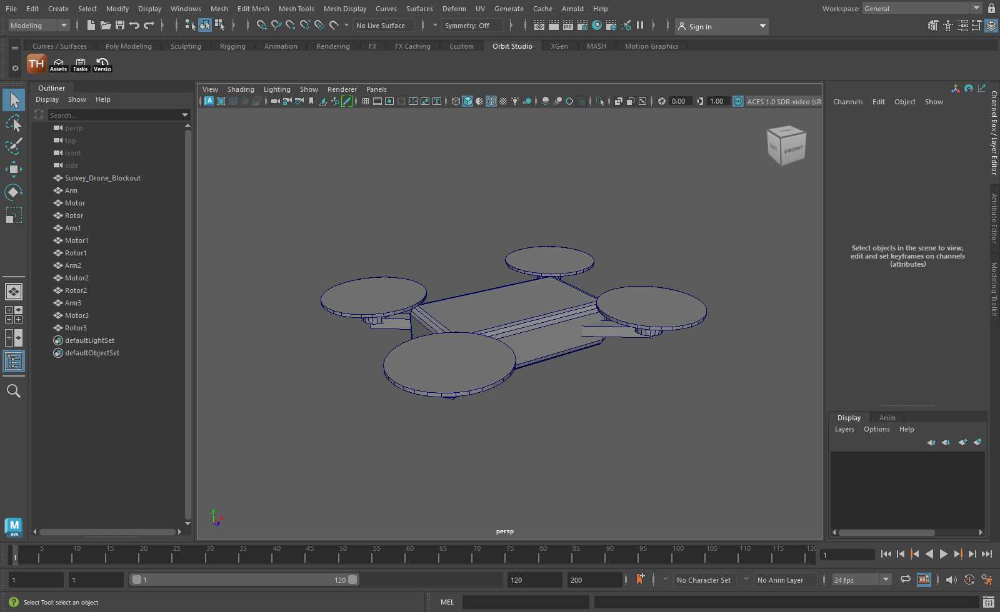
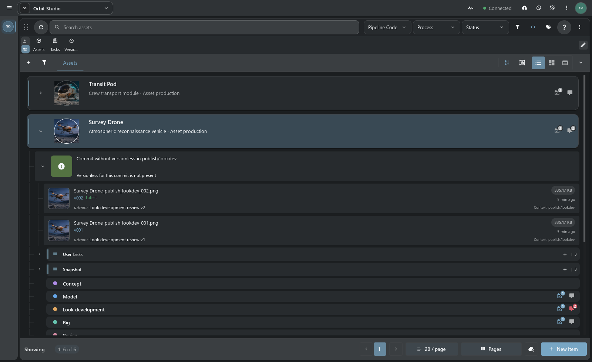
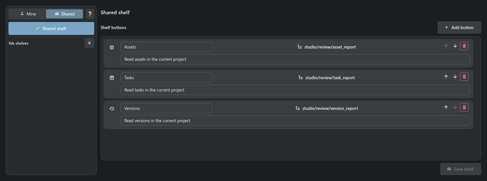
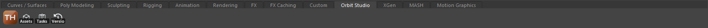

# Maya-плагин и Script Shelf

[TACTIC Handler](../../README.ru.md) · [English](maya.en.md) · [Полный обзор](product-tour.ru.md)

Maya-плагин выполняет команды Handler в открытой сессии Maya. Через него можно открыть файл, импортировать содержимое, создать reference и подготовить сцену к чекину. Подключение идёт через локальный Handler Server.

*Maya 2023 с полкой Orbit Studio, созданной коннектором Handler. Сцена — демонстрационный блокинг.*

## Открытие, импорт и reference

Выберите публикацию в Item View или Snapshot Browser и действие с файлом. Handler разрешит путь через локальный репозиторий и отправит команду выбранной Maya.

| Действие | Результат |
| --- | --- |
| **Open** | Открывает сцену; настройка позволяет назначить её каталог рабочим проектом Maya. |
| **Import** | Импортирует файл в текущую сцену; доступны параметры поддерживаемого действия. |
| **Reference** | Создаёт ссылку на файл в текущей сцене. |
| **Save / подготовка check-in** | Maya готовит сцену; Handler продолжает публикацию через Commit Queue. |

При нескольких открытых Maya нужно выбрать сессию, которой адресовано действие.

## Чекин сцены

1. Выберите в Handler объект и контекст публикации.
2. Подготовьте сцену через подключённую Maya; при необходимости задайте ASCII или Binary.
3. Проверьте описание, версию, файловые роли и разрешённые пути в Commit Queue.
4. Выполните check-in и вернитесь к результату через snapshots объекта.

Maya отвечает за собственные операции со сценой. Авторизация TACTIC, naming, репозиторий, передача файлов и запись публикации остаются в Handler и сервере. Настройки Maya Scene управляют форматом, созданием проектных каталогов, подготовкой playblast там, где он поддерживается, и возвратом фокуса после действий.

[Публикация и файлы](product-tour.ru.md#чекин-и-чекаут) · [Справка Maya Scene](../../thlib/ui/help_articles/configuration.maya.ru.md)

## Script Shelf

Script Shelf запускает сохранённые скрипты из кнопок рядом с поиском. У кнопки есть подпись, иконка и подсказка; скрипт получает проект и текущее выделение.

**Личная полка** принадлежит текущему пользователю. **Общая полка** задаёт инструменты команды; её настройка требует соответствующих прав. В обоих случаях можно использовать общий набор или отдельную полку для конкретной вкладки sidebar. Изменение личной полки не переписывает общую.

Скрипт сохраняется в Script Editor, затем добавляется на полку. При настройке выбирается среда исполнения: локальный Python, сервер или DCC-сессия. Права на запуск остаются правами самого скрипта.

### Полка в Maya

При подключённом клиенте Maya с возможностью `create_script_shelf` редактор предлагает создать или обновить нативную полку. Укажите её имя и подтвердите замену существующей. Первая кнопка запускает или показывает Handler; остальные сохраняют порядок, подписи, подсказки, иконки и ссылки на проектные скрипты. Maya сохраняет вкладку штатным механизмом shelves.

Экспортированная полка сохраняется в Maya. После изменения кнопок или прав её нужно обновить из редактора Handler.

[Полная справка Script Shelf](../../thlib/ui/help_articles/script_shelf.ru.md) · [Script Editor](../../thlib/ui/help_articles/script_editor.ru.md)

## Установка коннектора

1. В **Configuration → DCC plugins** включите Maya-плагин и перезапустите Handler, если меняли выбор плагинов.
2. Откройте **Configuration → Maya Scene → Maya integration** и нажмите **Find Maya**.
3. Выберите версию/профиль и выполните **Integrate into Maya**.
4. Перезапустите Maya. На полке **TACTIC_Stream** появится кнопка Handler; коннектор будет ждать именно эту установку приложения.

Управляемая интеграция работает в Windows с Maya на Python 3, начиная с Maya 2022. Она добавляет собственный модуль и отдельную полку, сохраняя существующие startup-скрипты и полки пользователя. После переноса Handler интеграцию нужно зарегистрировать заново. Удаление выполняется через **Remove integration** при закрытой Maya; изменённые или чужие файлы защищены.

[Установка и legacy drag-and-drop installer](../../installer/README.md) · [DCC API](../dcc_api.md) · [Протокол подключения](../thin_client_protocol.md)

Работа с локальной Maya доступна через Handler. Браузер Stream использует те же серверные объекты и публикации. Интеграция остаётся прототипом; её стоит проверить на копии рабочей сцены перед использованием в проекте.
