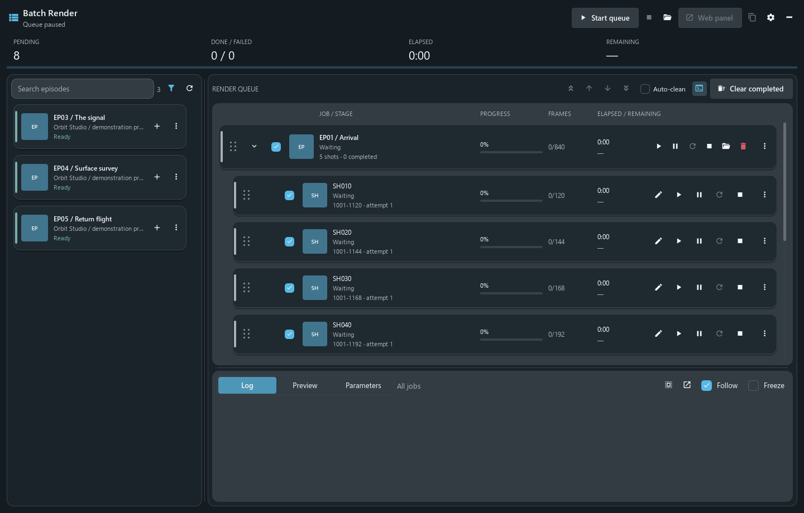
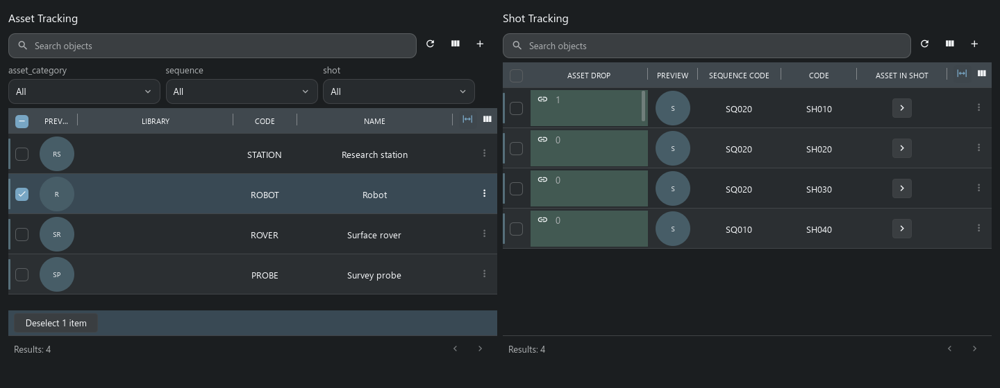
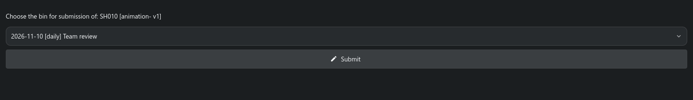

# Handler plugins: Batch Render and VFX

[Back to Handler](../../README.md) · [Русский](plugins.ru.md) · [Batch Render](#batch-render) · [VFX](#vfx-project-template) · [Build your own](#building-your-own-tools)

Handler can run tools written for an artist’s workstation and display the interfaces supplied by a project template. These two examples show how much of a studio workflow can live outside the application’s core.

| Example | What it adds | Where it runs |
| --- | --- | --- |
| **Batch Render** | A Maya render queue with dependency preparation, logs and remote control. | A desktop plugin in Handler; Maya runs on the same workstation. |
| **VFX** | Project types, relationships, planners, shot sheets and review pages from the original TACTIC template. | Project configuration and commands on the server, native views in Handler. The adapted example here uses TACTIC Stream. |

## Batch Render

Batch Render was written for Handler around the Niki production workflow. An operator can prepare a set of episodes, choose which shots to render and leave the queue to process them in order. The plugin knows which published scene belongs to a shot and uses the project’s repository presets to collect its dependencies.

*Fresh capture of the current native plugin with an offline demonstration queue. The queue is paused; no frames were rendered for this presentation.*

### From episode to render

1. **Choose the work.** Search the episode catalogue and filter by render status. Adding an episode discovers its shots; it does not start Maya or change the server task status.
2. **Prepare the queue.** Include or exclude shots, reorder them and edit frame ranges. A range can contain separate spans, such as `1001-1012, 1080`, within the shot’s bounds. Selection supports Shift/Ctrl and keyboard navigation.
3. **Start explicitly.** Start the queue, run one item or use the test-render action. Preparation downloads the published Maya scene and the configured repository dependencies, including the Niki cache and Alembic paths.
4. **Follow the run.** The window shows the current stage, frame progress, elapsed time, logs and available frame previews. Queue pause and render pause are separate actions; the running render pauses at a frame boundary.
5. **Handle the result.** Retry failed work or stop a job. The plugin records the configured completion state and can check logs into TACTIC. Render images stay in the configured output directory; log check-in is not an automatic publication of every rendered image.

The queue is saved separately from plugin code and reopens paused. A plugin update therefore does not imply an unattended render restart.

### Control it from another computer

**Web panel** opens the plugin’s own HTTP interface. It controls the queue already running in Handler; rendering still happens on that workstation. The settings provide a port and secret-link protection. The protected LAN link can be copied to another computer, and closing the plugin stops its web listener.

This arrangement is useful when a machine is busy rendering and the operator wants to check or manage it from elsewhere. It is a single workstation queue, rather than a distributed render-farm scheduler.

### Configure and distribute it

Open Batch Render from the film button beside the project selector or from the account menu. **Configuration → Client plugins** manages availability, launch, optional startup and published versions. It works with the original TACTIC plugin registry as well as a compatible Stream server.

Before using it on another project, match the episode and shot Search Types, scene/cache/render processes, task statuses, repository presets, cache directories, Maya executable, camera and output directory to that project. The included defaults describe Niki. Maya and the scene’s renderer, including Redshift when used, must be installed on the render workstation.

Administrators build a versioned ZIP from `plugins/batch_render` and publish it through Client plugins. Users receive the selected release on their next launch; an open queue keeps its running code. Republishing an older package selects that version for the next launch. It does not undo completed renders or data changes.

[Source](../../plugins/batch_render) · [Build, publish and roll back](../../thlib/ui/help_articles/client_plugins.en.md) · [Desktop plugin contract](../client_plugins.md)

## VFX project template

The VFX example comes from Southpaw TACTIC’s original project template. It brings a model of production — assets, sequences, shots, plates, cameras, references and review records — together with the views that use those records. Handler’s work on legacy compatibility restored the retained planners, Shot Sheet and Review using native controls and the server’s existing object relationships.

### Plan assets and shots together

**Shot Planner** places the asset list and shot list side by side. Filters narrow the assets by category, sequence or shot. The link controls assign assets to shots; **Sequence Planner** uses the equivalent relationship at sequence level. The saved links can then be opened from the object views.

### Open the shot’s working sheet

**Shot Sheet** collects the shot’s preview, frame ranges, plates, tasks and notes into one page. Its task notes keep the correct object and process context, and the print action produces a report. This is an example of a project-authored page combining several native views.

### Submit a particular version for review

The retained Review flow starts with a snapshot. Choose a review session and submit that snapshot; the server checks that its context and version still match. Review submissions remain linked to the publication being discussed.

### What was restored

The adapted template corrects frame fields, the camera’s shot selector, planner view references and supported review actions. Forms, linked objects, nested tables and task notes use the current native implementations. Existing installations need the relevant configuration repairs applied explicitly; updating Handler alone does not rewrite project XML.

The original production Submit/Bin chain, `pyasm.prod` detail panels, old loaders, applets and historical Maya/RV integrations remain outside this adaptation. Handler’s current Maya connector is a separate integration.

The captures above were made with current Handler controls and a freshly installed, adapted VFX template in a disposable Stream/SQLite project. They show the retained native pages, not a claim that every historical VFX feature is supported.

[VFX widgets and composition](../../thlib/ui/help_articles/table_widgets_b07.en.md) · [Project package manager](../../thlib/ui/help_articles/plugins.en.md) · [Compatibility map](../tactic_compatibility/README.md)

## Building your own tools

Choose an extension according to the work it needs to do:

| Need | Starting point |
| --- | --- |
| A department’s workspace | Saved searches, Sidebar Editor, docks, Item Layouts and [dashboards](dashboards.en.md). |
| A repeatable command | A local or server script in [Script Editor](product-tour.en.md#script-editor-and-automation), exposed on a [shelf](maya.en.md). |
| A window that works with local files or processes | A trusted Python desktop plugin with `plugin.json` and an `open_plugin(context)` entry point. Batch Render is the working source example. |
| A reusable project setup | A server package containing selected schema, workflow, naming, navigation, scripts and widgets. VFX illustrates how those pieces form a working project. |
| Another DCC application | A connector with explicitly registered native actions through the [DCC API](../dcc_api.md#adding-another-dcc). |

The [Handler API](../handler_api.md) provides object queries, snapshots, repository files, background operations and check-in for these tools. [Tactic Frame](../frame/index.md) describes shared interfaces. Desktop plugins execute trusted Python with the workstation user’s permissions; project packages use the server’s own installation and access rules.
