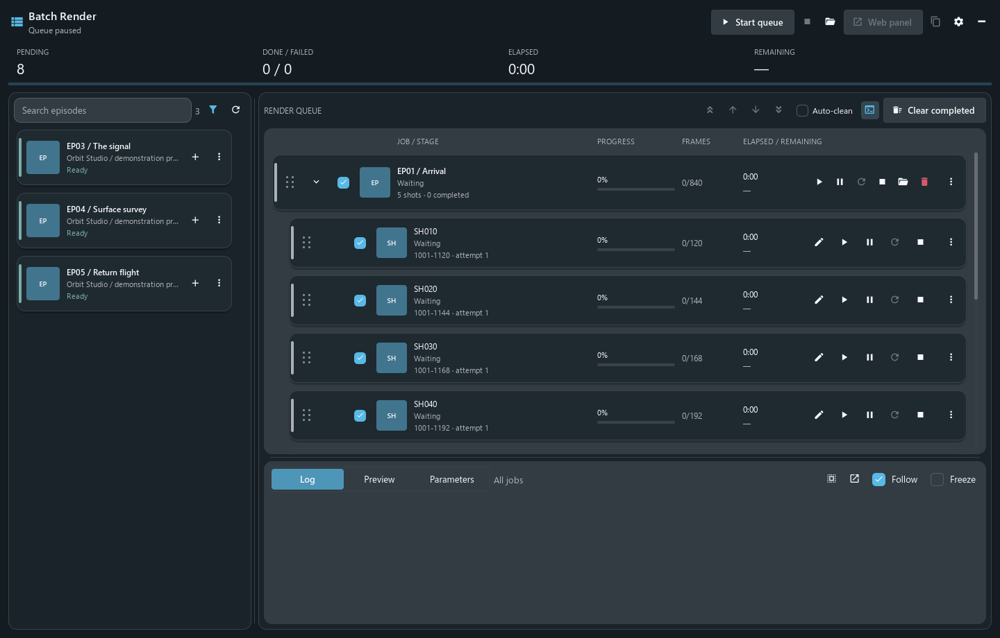
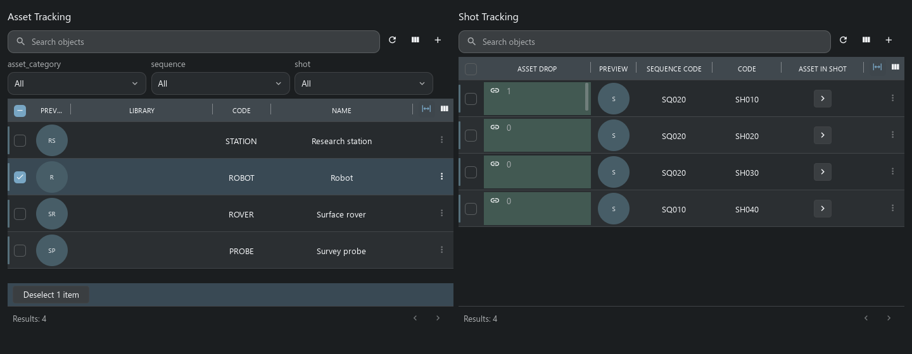
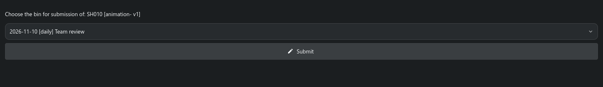

# Плагины Handler: Batch Render и VFX

[На главную Handler](../../README.ru.md) · [English](plugins.en.md) · [Batch Render](#batch-render) · [VFX](#шаблон-проекта-vfx) · [Свои инструменты](#свои-инструменты)

Handler может запускать инструменты для рабочего компьютера художника и показывать интерфейсы, заданные шаблоном проекта. Эти два примера показывают, как задачи студии решаются расширениями приложения.

| Пример | Что добавляет | Где работает |
| --- | --- | --- |
| **Batch Render** | Очередь рендера Maya с подготовкой зависимостей, логами и удалённым управлением. | Клиентский плагин в Handler; Maya запускается на том же компьютере. |
| **VFX** | Типы объектов, связи, планировщики, листы шотов и страницы ревью из оригинального шаблона TACTIC. | Конфигурации и команды проекта на сервере, нативные представления в Handler. Адаптированный пример здесь работает с TACTIC Stream. |

## Batch Render

Batch Render написан для Handler под производственный процесс Niki. Оператор собирает эпизоды, выбирает шоты и запускает их последовательно. Плагин находит опубликованную сцену шота и собирает зависимости по пресетам репозитория проекта.

*Свежий снимок текущего нативного плагина с демонстрационной очередью без подключения к серверу. Очередь на паузе; для этой презентации кадры не рендерились.*

### От эпизода до рендера

1. **Выберите работу.** Найдите эпизоды в каталоге и отфильтруйте их по статусу рендера. Добавление эпизода загружает список шотов, но не запускает Maya и не меняет статус задачи на сервере.
2. **Подготовьте очередь.** Включите нужные шоты, поменяйте порядок, отредактируйте диапазоны кадров. Можно указать несколько отрезков, например `1001-1012, 1080`, в пределах шота. Для выделения есть Shift/Ctrl и клавиатурная навигация.
3. **Запустите рендер.** Можно запустить всю очередь, отдельный пункт или тестовый рендер. На этапе подготовки скачиваются опубликованная сцена Maya и настроенные зависимости репозитория, включая кеши Niki и Alembic.
4. **Следите за выполнением.** В окне видны текущий этап, прогресс по кадрам, затраченное время, логи и доступные превью кадров. Пауза очереди и пауза текущего рендера — отдельные действия; рендер останавливается на границе кадра.
5. **Обработайте результат.** Неудачное задание можно повторить или остановить. Плагин записывает настроенный признак завершения и может чекинить логи в TACTIC. Изображения остаются в заданном выходном каталоге; чекин логов сам по себе не публикует все отрендеренные кадры.

Очередь сохраняется отдельно от кода плагина и после открытия остаётся на паузе. Обновление плагина не запускает сохранённые задания автоматически.

### Управление с другого компьютера

Кнопка **Web panel** открывает собственный HTTP-интерфейс плагина. Он управляет очередью, которая уже работает в Handler; рендер продолжает выполняться на том же компьютере. В настройках задаются порт и защита секретной ссылкой. Защищённую LAN-ссылку можно скопировать на другой компьютер. При закрытии плагина его веб-сервис останавливается.

Это удобно, когда рендерящая машина занята, а оператору нужно проверить или изменить очередь с другого рабочего места. Очередь обслуживает один компьютер; распределённый планировщик рендер-фермы в неё не входит.

### Настройка и распространение

Batch Render открывается кнопкой с киноплёнкой рядом с выбором проекта или из меню учётной записи. **Configuration → Client plugins** управляет доступностью, запуском, необязательным автозапуском и опубликованными версиями. Для распространения используется реестр плагинов оригинального TACTIC; совместимый Stream-сервер тоже подходит.

Для другого проекта нужно согласовать Search Types эпизодов и шотов, процессы сцен, кешей и рендера, статусы задач, пресеты репозитория, каталоги кешей, путь к Maya, камеру и выходной каталог. Исходные значения описывают Niki. На рендерящем компьютере должны быть установлены Maya и используемый сценой рендерер, в том числе Redshift, если сцена рассчитана на него.

Администратор собирает ZIP с отдельной версией из `plugins/batch_render` и публикует его через Client plugins. Пользователи получают выбранную версию при следующем запуске плагина; открытая очередь продолжает работать со своим кодом. Повторная публикация прежнего пакета выбирает его для следующего запуска. Уже выполненные рендеры и изменения данных при этом не отменяются.

[Исходники](../../plugins/batch_render) · [Сборка, публикация и откат](../../thlib/ui/help_articles/client_plugins.ru.md) · [Контракт клиентских плагинов](../client_plugins.md)

## Шаблон проекта VFX

VFX взят из оригинального шаблона Southpaw TACTIC. В нём уже есть модель производства — ассеты, секвенции, шоты, плейты, камеры, референсы и записи ревью — и представления для работы с ними. При восстановлении legacy-совместимости в Handler сохранённые планировщики, Shot Sheet и Review были подключены к нативным контролам и существующим связям объектов на сервере.

### Планирование ассетов и шотов

В **Shot Planner** список ассетов расположен рядом со списком шотов. Фильтры позволяют отобрать ассеты по категории, секвенции или шоту. Через элементы управления связями ассеты назначаются шотам; **Sequence Planner** работает с аналогичной связью на уровне секвенции. Сохранённые связи затем доступны в представлениях объектов.

### Рабочий лист шота

**Shot Sheet** собирает превью, диапазоны кадров, плейты, задачи и заметки на одной странице. Заметки задач сохраняют привязку к нужному объекту и процессу; действие печати формирует отчёт. Это пример страницы проекта, собранной из нескольких нативных представлений.

### Конкретная версия на ревью

Сохранённый сценарий Review начинается со snapshot. Пользователь выбирает сессию просмотра и отправляет туда эту публикацию; сервер проверяет, что её контекст и версия всё ещё совпадают. Запись ревью остаётся связана с обсуждаемой версией.

### Что восстановлено

В адаптированном шаблоне исправлены поля кадров, выбор шота в форме камеры, ссылки на представления планировщиков и поддерживаемые действия ревью. Формы, связанные объекты, вложенные таблицы и заметки задач работают через текущие нативные реализации. В существующий проект соответствующие исправления конфигурации нужно вносить явно: обновление Handler само по себе не переписывает XML проекта.

Старая производственная цепочка Submit/Bin, панели `pyasm.prod`, прежние загрузчики, апплеты и исторические интеграции Maya/RV остаются за рамками этой адаптации. Нынешний Maya-коннектор Handler — отдельная интеграция.

Снимки сделаны текущими контролами Handler на заново установленном адаптированном VFX-шаблоне в одноразовом проекте Stream/SQLite. Они показывают сохранённые нативные страницы; поддержка всех исторических возможностей VFX из этого не следует.

[Виджеты и композиции VFX](../../thlib/ui/help_articles/table_widgets_b07.ru.md) · [Менеджер пакетов проекта](../../thlib/ui/help_articles/plugins.ru.md) · [Карта совместимости](../tactic_compatibility/README.md)

## Свои инструменты

Способ расширения зависит от задачи:

| Что нужно | С чего начать |
| --- | --- |
| Рабочее место отдела | Сохранённые поиски, Sidebar Editor, доки, Item Layouts и [дашборды](dashboards.ru.md). |
| Повторяемая команда | Локальный или серверный скрипт в [Script Editor](product-tour.ru.md#script-editor-и-автоматизация), вынесенный на [полку](maya.ru.md). |
| Окно для работы с локальными файлами или процессами | Доверенный Python-плагин с `plugin.json` и точкой входа `open_plugin(context)`. Batch Render — готовый пример исходников. |
| Переносимая настройка проекта | Серверный пакет с выбранной схемой, workflow, неймингом, навигацией, скриптами и виджетами. VFX показывает, как из этих частей складывается рабочий проект. |
| Подключение другой DCC | Коннектор с явно зарегистрированными нативными действиями через [DCC API](../dcc_api.md#adding-another-dcc). |

[API Handler](../handler_api.md) даёт инструментам доступ к объектам, snapshots, файлам репозитория, фоновым операциям и чекину. [Tactic Frame](../frame/index.md) описывает общие интерфейсы. Клиентские плагины исполняют доверенный Python с правами пользователя компьютера; пакеты проекта устанавливаются по правилам и с проверками доступа сервера.
