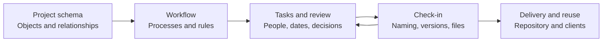
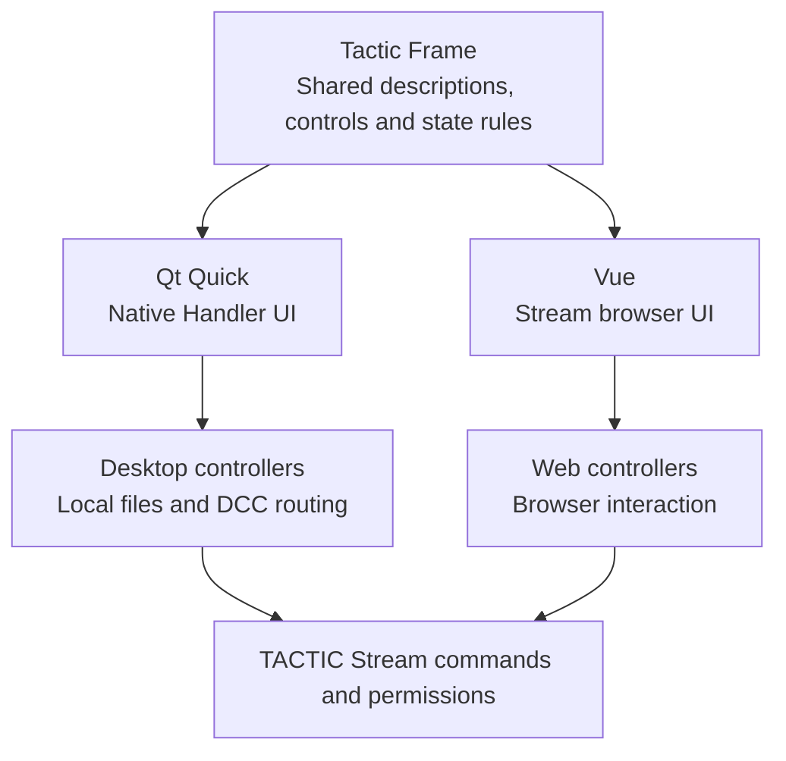
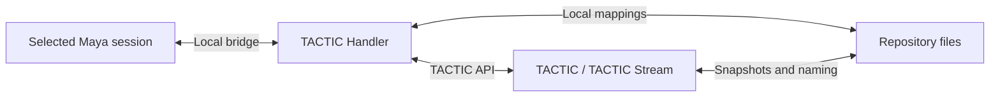

# TACTIC Handler — Full product tour

[Visual presentation](../../README.md)

**The native production workspace for TACTIC and TACTIC Stream.** Browse visual assets, plan tasks, review versions and publish local files from a standalone Python and Qt Quick application.

**Objects, people, processes and published files — one production context.**

[Русский](product-tour.ru.md) · [Workflow](#workflow-is-an-execution-engine) · [Tasks & Gantt](#plan-the-work-then-follow-it-through) · [Files & naming](#from-working-file-to-traceable-publication) · [Tactic Frame](#tactic-frame-one-ui-description-two-native-renderers) · [Administration](#administration-shape-the-project-itself) · [Get started](#run-it-and-extend-it)

[Docks](#docks-assemble-the-interface-around-a-job) · [Sidebar Editor](#sidebar-editor-turn-navigation-into-a-workflow) · [Object overview](#object-overview-the-complete-production-record) · [Server history](#server-activity-understand-what-happened) · [Users & access](#users-groups-and-effective-access)

| Explore the assistant | Build your own workspace |
| --- | --- |
| [**The built-in project assistant →**](assistant.en.md) — Ask about real records, prepare changes and inspect the operations behind an answer. | [**Custom dashboards →**](dashboards.en.md) — Combine metrics, charts, Item View and selection-driven tools into a project page. |


*Fresh captures of the current application in Orbit Studio, a disposable demonstration project with fictional people and concept artwork. The interfaces and records are real; the artwork is illustrative.*

> **Development prototype.** The product is under active development. The Perforce-like File Workspace is also a prototype. Evaluate your actual schema, permissions, scripts and file workflows on isolated data before production use.

## Why this project exists

Handler brings TACTIC production work to the artist's desktop: local files, repository mappings, application integration and a persistent workspace. Connected to **TACTIC Stream**, it also exposes the modern workflow, project-authoring, dashboard and assistant capabilities shown here.

The server and client have distinct jobs. TACTIC owns project records, permissions, workflows and publications. Handler owns desktop interaction, local file handling, its queues and the selected DCC connection. A native interface is useful precisely where a workflow needs to cross from project data into a working directory or Maya scene.

Stream is the server fork of [Southpaw TACTIC](https://github.com/Southpaw-TACTIC/TACTIC); Handler is its independent desktop companion and also connects to original TACTIC within the verified compatibility scope. Stream retains TACTIC's configurable model and workflow foundation while developing a current Python core, visual authoring and a Vue interface sharing Frame descriptions with Handler.

The practical focus is the handoff: a record describes the work, a pipeline describes its route, tasks identify who does it, discussions preserve decisions, and snapshots identify exactly what was delivered. A status, a chat message and a filename can then be understood in the context of the same object.



## A workspace built around the item

An asset, shot, document or custom entity is the entry point. **Item View** gives it a visual identity, useful fields and direct actions. The continuous tree reveals related objects, processes and publications. The table exposes structured fields for sorting, filtering, selection and editing. These are different ways to work with the same project records.

Search tabs retain their context. Filters narrow the server query; tags and quick filters make recurring selections accessible. Docks place tasks, notes, snapshots, details or a calendar next to the working selection. Saved workspace arrangements let departments start with a useful set of panels.

### Standard Item View

The standard continuous tree exposes object previews, related records, processes, tasks and snapshot versions inline. Expand a publication to inspect the actual versions, descriptions and file previews. Compact rows and versions-right/versions-bottom modes reorganize the same native object view; custom Item Layouts are an additional authoring option.


### Design the cards your team needs

The **Item Layouts** editor binds images and text to object data and places supported native actions inside the card. Build a compact production row, a large review card or a reusable detail layout. Preview with actual project records and save the view as project configuration.


**Page layouts, item layouts and columns have distinct jobs:** a page composes a workspace, an item layout composes one object, and a table view chooses its fields and widgets. The sidebar connects these definitions to project navigation. [Item Layouts Help](../../thlib/ui/help_articles/item_layouts.en.md)


## Docks: assemble the interface around a job

The workspace is a **composition of functional panels**. Put search results next to a large file preview, stack reference panels into tabs, reserve the lower half for tasks, or move a utility out of the way. The same project can have a review workspace, a planning workspace and a publishing workspace assembled from the available docks.


### Split, stack, float and restore

Drag a panel's grip toward an edge to split the target, toward its center to create a tab stack, or toward the title to exchange positions. Resize the dividers, reorder stack tabs, maximize a panel temporarily or hide it and recover its space. A cancelled drag restores the previous arrangement.

Handler supports floating panels and detached native dock windows, including a second-monitor arrangement. Panel geometry is restored within available screens.


| Workspace | A useful composition |
| --- | --- |
| **Review** | Item View + Snapshot Browser + Description/Notes: choose a record, inspect the publication, keep its discussion visible. |
| **Planning** | Results + Task Manager/Gantt + task details or calendar where supported: connect assignments and dates to production objects. |
| **Publishing** | Results + Drop Plate + Commit Queue: identify the destination, prepare files and inspect the pending publication. |
| **Documentation** | Results + Knowledge Base: keep project records beside the team's reference material. |

The selection connects the panels. An object, process or snapshot chosen in Search becomes the context of following panels; opening a task keeps its exact identity. A layout changes where tools live without changing their data ownership or permissions.

### Personal arrangement and shared starting point

Personal workspace state retains placement, sizes, visibility and stacks in its owning client/tab. **Layout presets** save named project arrangements on the server: apply, refresh, save, replace and delete are separate operations. Assign a preset to a sidebar entry so a department opens into a useful default; later personal tab state can retain that user's arrangement.

A preset describes panels and their layout. It does not save credentials, commit an editor draft or become a saved search. Reset restores workspace geometry without deleting project records or saved searches. In combination with Item Layouts, Columns Editor, page layouts and script shelves, docks let a studio compose a wide range of working interfaces from implemented tools. [Docks and windows](../../thlib/ui/help_articles/windows.en.md)


## Sidebar Editor: turn navigation into a workflow

A sidebar item can define much more than a label. It connects a Search Type, initial search, presentation, workspace layout and script shelf. “Asset review” and “Asset planning” can open the same underlying records with different starting filters and tools.


| Editor area | What you build |
| --- | --- |
| **Navigation tree** | Links, sections and separators; order, nesting and visible entries. |
| **Item** | Display title, icon, Search Type, predefined search, initial item presentation, assigned dock preset and shelf. |
| **Configure search** | Prepare the actual search workspace, including saved search, quick filters, process visibility, sorting and grouping. |
| **Access** | Groups allowed to see an item; preview the draft for a selected group. Hidden entries remain editable. |
| **Technical / XML** | Stable internal identity, child views and the supported widget/view configuration. |

Handler's `tactic_handler` sidebar and TACTIC's `project_view` are independent definitions. The editor chooses the target explicitly. Its project selector controls the authoring scope, even if another project is open in the main workspace.

Rename the display title to change the label while retaining the internal identity. A configured Saved Search initializes the entry's first tab; reopening retains its working state instead of adding a duplicate tab. XML Apply updates the draft, and Save publishes the sidebar. Group preview changes what the editor shows; it does not impersonate that group or replace server data permissions. [Sidebar Editor Help](../../thlib/ui/help_articles/sidebar_editor.en.md)


## Object overview: the complete production record

Open **Details / SObject Report** for a record to move from a result card to its production overview. The profile-style header combines preview, identity, description and metrics; the section switcher leads into work associated with that exact object.


| Section | What it answers |
| --- | --- |
| **Tasks and participants** | Who is involved, what statuses/processes exist, and how much work has been logged? Participants are gathered from tasks, notes, publications and work entries. |
| **Notes** | Which decisions and comments belong to the object or its processes? Open a note in its original context. |
| **Children and relations** | What related production objects sit underneath or alongside this record? |
| **Snapshots and files** | Which processes have publications, how many files do they contain, and what is their total size? Expand the process tree for versions and previews. |
| **Activity** | Who created or changed the object, tasks, notes, publications, work entries and supported relationships? |

A task opens the matching Task Manager scope and selects the exact task in Inspector. A note returns to its process discussion. Publications retain their source project. Cost information is shown only with the corresponding permission. This report provides the context behind a status rather than forcing a user to reconstruct it from unrelated screens. [SObject Report Help](../../thlib/ui/help_articles/sobject_info.en.md)


## Workflow is an execution engine

The pipeline graph is backed by server operations. Each object can follow a configured pipeline; process events drive task state, dependencies, scripts and notifications. The object pipeline and a task's status pipeline serve different purposes, so an asset's production route need not be reduced to the task's Pending / In Progress / Complete statuses.


*A configured production graph with parallel look development and rigging, an approval stage and an automatic action. The screenshot demonstrates the definition; it is not evidence that every branch has executed.*

| Node or rule | What it contributes |
| --- | --- |
| Manual and approval | Work assigned to people; review and sign-off stages. |
| Action and condition | Run configured server behavior or choose a route from a condition. |
| Hierarchy, input and output | Organize nested pipelines and their entry/exit points. |
| Dependency and progress | Coordinate related work and process completion. |
| Status and process events | React to pending, action, complete, revise, reject or error transitions. |
| Process rules | Update task or parent status, create downstream tasks, record actual dates, invoke a saved script or class, and configure notifications. |

Author in **Administration → Workflow**: choose a pipeline, arrange its graph, inspect the selected process, edit its type-specific settings, and save the draft. Technical views expose XML and advanced configuration when a studio needs precise control. Dependencies, triggers, notification rules and naming are related configuration, not interchangeable concepts. Saving a graph does not execute its actions or send mail.

Pipeline definitions and transitions are server-owned. Handler provides native authoring and production views; it does not run a separate competing workflow engine on the workstation.

## Plan the work, then follow it through

### Task Manager

Move between selected-object work, a Search Type, the project, personal work and team scopes. Table and compact presentations expose status, assignee, supervisor, dates, progress and effort. Search, filters, grouping and sorting make the same workspace useful to an artist checking today's work and a supervisor preparing the next handoff.

Edits remain explicit drafts until saved. Bulk changes apply to the selected tasks; the inspector keeps a task's object and discussion accessible. Server permissions determine the readable fields and available edits.


### Gantt, calendar and effort

The Gantt view adds a time axis to the task set. Move or resize task bars, adjust progress, change scale and group by assignee. Existing dependencies and scheduling warnings help expose conflicts. Unscheduled work remains visible rather than being lost outside the date range.


*Orbit's sample schedule deliberately contains overlaps. The warnings are part of the real interface. Dependency visualization does not imply automatic cascading rescheduling.*

The task calendar and agenda provide a date-oriented view; milestones represent project checkpoints. Work-hour entries and cost reports connect effort to people and work where the account has access. [Task Manager Help](../../thlib/ui/help_articles/dock.tasks.en.md) · [Calendar Help](../../thlib/ui/help_articles/dock.task_calendar.en.md)

## Conversations that retain production context

**Messages** handles direct conversations, group discussions and Favorites across projects. Replies, mentions, reactions, pins, forwarding, member management and conversation search support ongoing coordination. Attach files through the picker, drag and drop or the clipboard; drafts preserve unfinished messages.


Use **Notes** for decisions that belong to an object, process or task. Use notifications and the activity journal to follow changes and return to the affected records. The **Knowledge Base** gives longer-lived documentation a tree of Markdown articles, attachments and revision history. A chat can organize a review; the resulting decision can stay attached to the thing being reviewed.

[Built-in Help: search and contextual instructions →](help.en.md) · [Knowledge Base: articles, editor and history →](knowledge-base.en.md)


## Server activity: understand what happened

The **Activity Feed** is a project journal of supported record changes: notes, publications, tasks, status changes, object edits and work hours. Entries identify the actor and time, show readable change details and link back to the affected object or task. The object's Activity section provides the narrower history for one production record, including supported child and relation events.


Filter by people and activity category, exclude your own actions, search loaded events or choose a day from the calendar. Older events load while scrolling; calendar counts cover accessible history beyond the currently loaded list. Dates follow the user's local timezone, while relative ages use synchronized server time.

Three histories serve different purposes. **Activity Feed** explains project changes. **Notifications** records notices from the current client session and links to their sources. **System Activity / Debug Log** exposes runtime work and diagnostics. Clearing a notification list does not erase the server journal, messages or file versions. The journal is not a promise of unrestricted, immutable audit coverage for every legacy extension.


## From working file to traceable publication

1. Select an object and its process/context. Add local files or folders through **Drop Plate**, or prepare a scene through the selected DCC connection.
2. Match and group files or sequences. Review the prepared publication in **Commit Queue**: description, version options, resolved paths and file roles.
3. Submit the operation. Each queue item reports its progress and result; the queue is not one atomic transaction for every item.
4. Browse the resulting snapshots, compare image versions, and open or check out the files needed for the next task.


Check-in supports grouped or separate publications and native ingest relationships. Destination collisions preserve existing files. Move removes its source only after confirmed success; uncertain completion must be reconciled rather than blindly repeated. Local preparation and transfer remain visible instead of being hidden behind the final snapshot record.

A snapshot ties a version to its object, process/context, author, description and files. New versions and revisions are different operations. `latest` and `current` naming rules are separate from versioned storage. File sequences retain their range information so checkout can resolve the published frames.

### Naming is a configurable production rule

The naming editor brings matching rules, paths and examples into one place. Choose context patterns, directory and filename expressions, sandbox locations and repository aliases. Combine object/snapshot/file tokens with TSQL conditions or a trusted saved script when a project needs more than a template. Preview a rule against sample data before saving it.


For example, a rule can derive a filename from the object's name, version and extension: `{sobject.name}_v{version}.{ext}`. The native naming engine resolves the actual paths at publication time. A preview is not a reservation: the final check-in still validates the version and collisions. Script-based naming executes trusted project code.

### Repository Sync and Watch Folders

Synchronize the scope you need: selected objects, processes, versions or related children. Presets retain recurring choices; full/partial synchronization and update-only discovery support different working sets. The queue exposes discovery, transfer, cancellation, retry and conflict policy.


**Watch Folders** bind a project and a local path to matching/check-in rules and feed discovered work into Commit Queue. They do not turn saving a repository setting into an implicit move or deletion. These are Handler desktop capabilities; they are distinct from Stream's browser upload/download workflow.

## Tactic Frame: one UI description, two native renderers

**Tactic Frame is the shared language for describing interfaces in Handler and Stream.** A Frame module describes nodes, geometry, state and actions; Qt Quick and Vue render that description with their respective house controls. Handler's interface remains native Qt rather than an embedded web page.

Frame uses standard JavaScript modules (`.mjs`) and ordinary data structures. A feature's `describe(model, width, height, language)` builds its visible structure from state. Controllers handle actions and domain operations; the description does not become a second server API.



A small description module saved beside this document illustrates the contract. The host supplies `model` and handles the `name` action; production modules also use the shared translation helpers.

```javascript
import { label, node, rect } from "../../thlib/ui/qml/tactic_frame/core/frame.mjs";

export function describe(model, width, height, language) {
    return { nodes: [
        label("title", rect(16, 12, width - 32, 28), "Review"),
        node("Field", "assetName", rect(16, 48, width - 32, 38), {
            label: "Asset", text: model.name, action: { type: "name" }
        })
    ] };
}
```

Shared building blocks cover fields, buttons, selectors, virtualized lists, tables, graphs, editors and window structure. Themes, translations, focus and input behavior belong to the contract as well as geometry. **Component showcase** makes those building blocks inspectable inside the application.


Project XML views and visual layout documents configure content above this layer. They are not a replacement file syntax for Frame modules. Both products ship independently and carry their own shared-description copy; supported behavior must be checked in both renderers. [Frame contracts](../frame/index.md)

## Script Editor, shelves and production automation

The Script Editor combines a project script library with tabs, drafts, undo, syntax highlighting, completion, search/replace and outline navigation. Run the current script or selected text, then inspect its result and errors in the output area. Named folders turn one-off tools into a discoverable studio library.


| Runtime | Owner and context |
| --- | --- |
| **Local Python / QML tools** | Handler's native objects and UI; GUI operations obey the Qt thread boundary. |
| **Server Python** | The connected TACTIC server and its project/permission context. |
| **Selected DCC** | The explicitly selected registered session and its supported capabilities. |

The editor makes the execution target visible. Local/DCC output can return to the tab; server Python exposes its returned result while process stdout stays in the server log. A script's language alone does not identify the machine or objects it will run against.

**Script shelves** put saved actions beside the work: shared studio tools, personal tools and tools attached to a search tab. **Before/After hooks** bind automation to selected events with process, context and Search Type filters. A Before failure can block its operation; an After failure cannot undo an operation that has already completed. Code execution is a trusted capability, separate from merely viewing a script.

[Script Editor Help](../../thlib/ui/help_articles/script_editor.en.md) · [Script Shelf Help](../../thlib/ui/help_articles/script_shelf.en.md)

## Administration: shape the project itself

Create the entities and relationships the studio actually uses, then define how people see and act on them. Search Types are configurable data types, not a fixed Asset/Shot-only product model. Schema diagrams make their relationships visible.


| Section | What you configure |
| --- | --- |
| **Search Types** | Entity definitions, fields and their naming rules. |
| **Project schema** | Relationships between entities and the project graph. |
| **Workflow** | Pipelines, process properties, dependencies and automation. |
| **Columns Editor** | Table views, columns and native field widgets. |
| **Raw database** | Direct authorized table inspection/editing and CSV work, with protected-table restrictions. |
| **Page layouts** | Whole dashboard pages, their blocks, data sources and navigation. |
| **Item layouts** | Reusable cards, rows and object presentations. |
| **Sidebar Editor** | Navigation groups, entries, views and workspace entry points. |
| **Plugins** | Packages, versions and project activation. |
| **Component showcase** | The control vocabulary used by the interfaces. |
| **Users** | Accounts and their project access. |
| **Groups** | Membership and shared access configuration. |
| **Access rules** | Inherited and explicit allow/deny rules; effective access checks for a user. |


Authoring sections keep their own drafts. Save/discard controls and revision checks make changes explicit; permissions remain enforced by server operations. A visual editor does not grant its user unrestricted database access. [Administration Help](../../thlib/ui/help_articles/administration.en.md)


## Users, groups and effective access

User management is a server-wide directory, not a list of assignee names copied into a project. Accounts have identity, profile/contact fields, account settings and group memberships. The same identities appear in assignments, conversations, activity and participant lists.


### Account lifecycle

Create an account, set its initial password and profile, and assign the required groups. Edit existing profile/account fields without reading back a password. Retire an account when access should stop and reactivate it when appropriate; the existing production history retains its author identity. A retired account and a deleted project object are different operations.

### Group membership and permission policy

Groups manage membership and descriptions. Access rules manage the policy: access level, project scope, supported object/process/status/action rules, inheritance and explicit allow/deny. Sidebar visibility is a separate part of the interface policy; hiding a link is not the same as denying access to its records.


Use effective-access checks for a particular user to inspect the outcome of membership and inheritance. A group matrix explains configured rules; it does not by itself prove what a user can read or edit after all rules are combined.

A practical onboarding sequence is **account → groups → project/data permissions → sidebar visibility → check the resulting user access**. Administration's selected project scopes project definitions; it does not turn server-wide users into project-local accounts. Drafts, confirmation and native server checks remain in force throughout.

## Configuration: connection, storage and daily behavior

Configuration separates deployment and personal preferences from project authoring. Each page owns its draft: Apply affects the current page, Save handles pending changes, and leaving dirty settings is guarded. Appearance can be previewed and reverted.


| Area | Purpose |
| --- | --- |
| **AI providers** | Provider profiles, model discovery and executor selection for the assistant. |
| **Server** | Connection and supported server options, live service information and explicit lifecycle actions. |
| **Database resources** | Configure/test resources and bind existing schemas; this does not migrate data. |
| **Repositories** | Repository names, colors, mappings and supported server storage settings. Saving a path does not move files. |
| **Projects** | Project creation, templates and project-level setup. |
| **Check-in Options** | Defaults for file preparation, naming and publishing behavior. |
| **Global** | General interaction and update preferences applicable to the current client. |
| **Appearance** | Light/dark themes, palettes, icon choices and English/Russian interface language. |
| **Cache** | Cache policy, visibility and maintenance. |
| **Tasks** | Task defaults and effort/time preferences. |
| **DCC plugins** | Install/configure supported application integration. |
| **Client plugins** | Desktop extension discovery and configuration. |
| **Application-specific pages** | Settings supplied by the active integration, such as Maya scene behavior. |

Supported server XML settings expose service, network, security, directory and scheduling controls with validation and restart requirements. Changing configuration and restarting a service are separate actions. Repository and database migration require their own procedure. [Configuration Help](../../thlib/ui/help_articles/configuration.en.md)

## A project assistant with actual context

Ask what is ready for review, which version is published or what is missing from a handoff. The built-in **External agent** window captures the project, page, Search Type and selected objects. Its executor reads or changes data through scoped native tools.


In this demonstration it found a useful discrepancy: modeling was marked Complete, but no model publication existed. It distinguished review comments from proof of approval. The full presentation covers conversations, attachments, provider choices, project configuration, task changes, script trials and the limits of undo.

**[Explore the built-in assistant →](assistant.en.md)**

## Custom dashboards that are working pages

Compose metrics, reports, charts, Item View, forms and native actions around a team's job. A production overview can lead directly into an asset; a review desk can keep selected-object details next to its tree. The page remains connected to project data and permissions.


**[Explore custom dashboards and their visual editor →](dashboards.en.md)**

## Run it and extend it

### Connect a Maya session

The shipped Maya connector registers with **Handler Server**, the local bridge. Select the intended session before sending a native open, import, reference or scene-save action. Maya prepares the scene; Handler performs TACTIC check-in and file transfer. Other applications require a connector with explicitly registered native capabilities.



[Maya installation](../../installer/README.md) · [DCC API](../dcc_api.md) · [Thin-client protocol](../thin_client_protocol.md)

### Start on Windows

Use a modern source checkout with Python 3.14 and a running TACTIC server.

```powershell
py -3.14 -m venv .venv
.\.venv\Scripts\python.exe -m pip install -r requirements.txt
.\.venv\Scripts\python.exe launch.py
```

Open **Configuration → Server**, test the server preset and generate a ticket. Select a project and configure repository mappings before file operations. [First connection](../handbook.en.md#first-connection) · [Getting started](../../thlib/ui/help_articles/getting_started.en.md)

### Extend the desktop

The public `tactic_handler_api` exposes client objects, file operations and supported UI actions. Its standalone, Script Editor and DCC entry points preserve their execution context.

```python
from tactic_handler_api import local

with local() as handler:
    assets = handler.project("orbit").stype("orbit/asset")
    result = assets.query(limit=12, order_by=["name asc"])
    for asset in result.items:
        print(asset.get_code(), asset.get_value("name"))
```

Replace the demo project and Search Type with your own. [API and examples](../handler_api.md) · [Architecture](../application_architecture.md) · [Handbook](../handbook.en.md)

## Scope and provenance

The presentation shows Handler connected to Stream. Stream-specific project authoring, dashboards and the assistant require that server; their presence here does not imply the same service exists in every original TACTIC deployment. Consult the [compatibility map](../tactic_compatibility/README.md) for an existing installation.

The Perforce-like File Workspace remains a prototype. The implemented check-in queue and Repository Sync do not establish full Perforce behavior. Maya is the connector shipped here; other DCC applications are extension work unless their connector is present and verified. [Documentation index](../index.md)

The screenshots illustrate configured workflows on a small demo project. They are not a performance benchmark or a claim of release acceptance. Studio-specific scripts, schemas, integrations and permissions need validation against the deployed version.

TACTIC Handler is distributed under the [Eclipse Public License 1.0](../../LICENSE). Its server integration builds on [Southpaw TACTIC](https://github.com/Southpaw-TACTIC/TACTIC).

[Maya plugin and shelves](maya.en.md)
