# TACTIC Handler: tools and configuration

[Visual presentation](../../README.md)

[Русский](product-tour.ru.md) · [Workflow](#workflow-graph-and-execution) · [Tasks & Gantt](#planning) · [Files & naming](#check-in-and-check-out) · [Tactic Frame](#tactic-frame) · [Administration](#project-administration) · [Get started](#installation-and-integrations)

[Docks](#docks-and-layouts) · [Sidebar Editor](#sidebar-editor) · [Object overview](#object-overview) · [Server history](#activity-feed-and-project-history) · [Users & access](#users-and-permissions)

| Explore the assistant | Build your own workspace |
| --- | --- |
| [**The built-in project assistant →**](assistant.en.md) — Query project data, prepare changes and inspect the operation log. | [**Custom dashboards →**](dashboards.en.md) — Combine metrics, charts, Item View and selection-driven tools into a project page. |

[Plugin examples: Batch Render and the restored VFX template →](plugins.en.md)

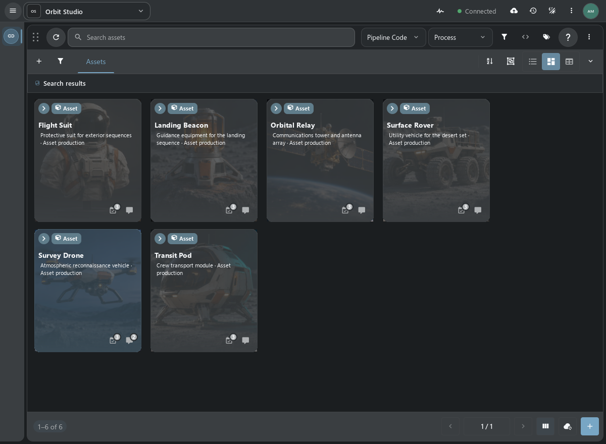

*Current application screenshots. Orbit Studio, its people and materials are demonstration data.*

> **Development prototype**, including the Perforce-like File Workspace.

## The TACTIC desktop client

Handler works with local directories, repositories and Maya and connects files to TACTIC records. With a **TACTIC Stream** server, it also provides project editors, workflow, dashboards and the assistant.

The server stores data and publications, checks permissions and executes workflow. Handler handles the interface, local files, queues and the selected DCC connection.

Stream is the server fork of [Southpaw TACTIC](https://github.com/Southpaw-TACTIC/TACTIC); Handler is its independent desktop companion and also connects to original TACTIC within the verified compatibility scope. Stream retains TACTIC's configurable model and workflow foundation while developing a current Python core, visual authoring and a Vue interface sharing Frame descriptions with Handler.

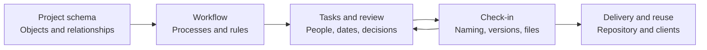

## Item View and search

**Item View** displays project objects with previews, fields and actions. Its tree expands related records, processes and publications. Table mode supports comparing and editing fields, with sorting, filters and selection.

Search tabs retain their state. Filters define the server query; tags and quick filters provide frequently used selections. Tasks, notes, snapshots, details and a calendar can sit beside the results.

### The object, process and version tree

The standard continuous tree exposes object previews, related records, processes, tasks and snapshot versions inline. Expand a publication to inspect the actual versions, descriptions and file previews. Compact rows and versions-right/versions-bottom modes reorganize the same native object view; custom Item Layouts are an additional authoring option.

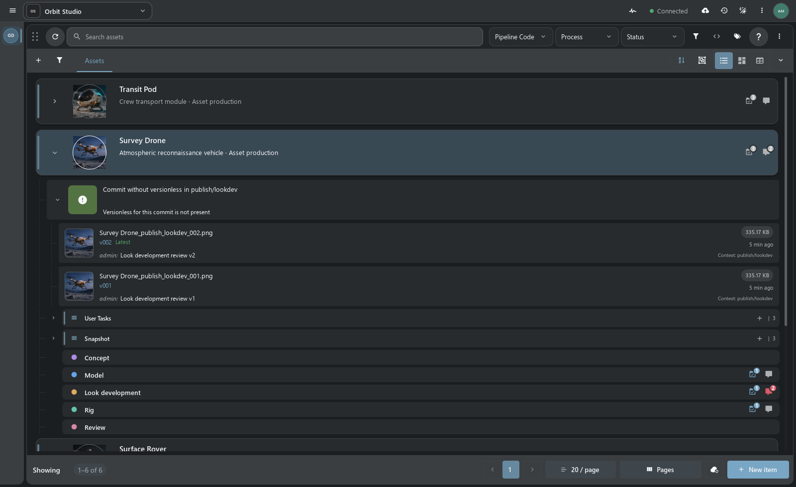

### Item Layouts

**Item Layouts** configures cards and rows: text, images, fields and actions. The editor binds elements to object data and previews project records. A saved layout can be assigned to a view.

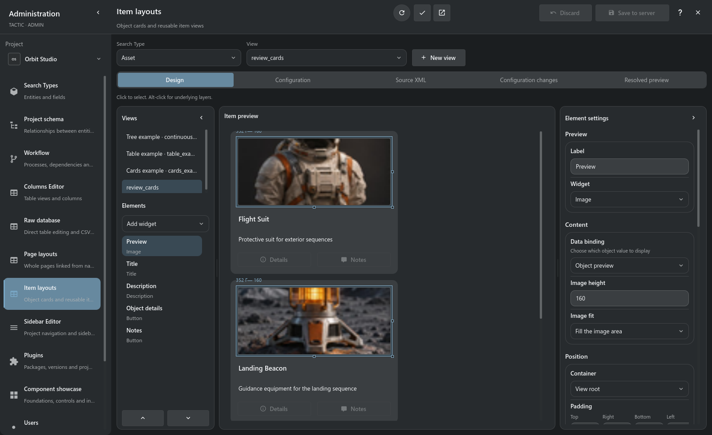

**Page layouts, item layouts and columns have distinct jobs:** a page composes a workspace, an item layout composes one object, and a table view chooses its fields and widgets. The sidebar connects these definitions to project navigation. [Item Layouts Help](../../thlib/ui/help_articles/item_layouts.en.md)

## Docks and layouts

**Docks** are the panels that make up the workspace. Place them side by side, combine them into tabs or hide them. A review layout can give most of the space to a preview and notes; planning can put objects beside tasks.

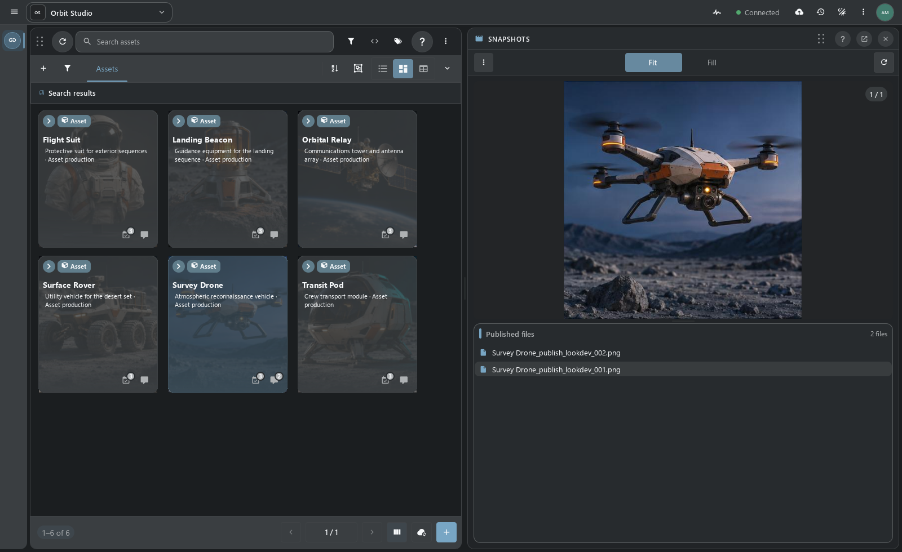

### Panel arrangement

Drag a panel's grip toward an edge to split the target, toward its center to create a tab stack, or toward the title to exchange positions. Resize the dividers, reorder stack tabs, maximize a panel temporarily or hide it and recover its space. A cancelled drag restores the previous arrangement.

Handler supports floating panels and detached native dock windows, including a second-monitor arrangement. Panel geometry is restored within available screens.

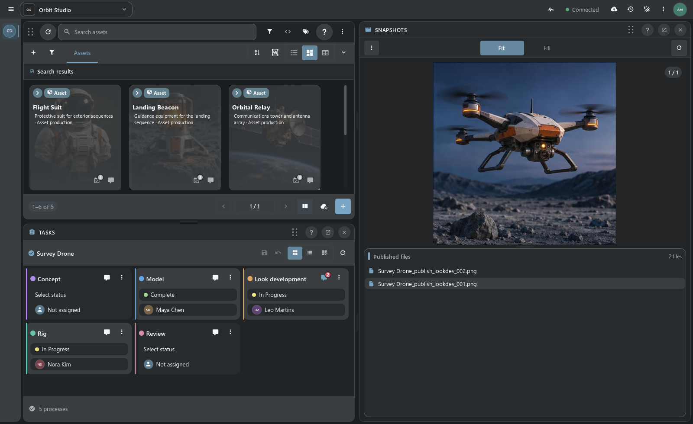

| Workspace | A useful composition |
| --- | --- |
| **Review** | Item View + Snapshot Browser + Description/Notes: choose a record, inspect the publication, keep its discussion visible. |
| **Planning** | Results + Task Manager/Gantt + task details or calendar where supported: connect assignments and dates to production objects. |
| **Publishing** | Results + Drop Plate + Commit Queue: identify the destination, prepare files and inspect the pending publication. |
| **Documentation** | Results + Knowledge Base: keep project records beside the team's reference material. |

Panels can follow the object, process or snapshot selected in Search. Opening a task selects its record in Inspector. Rearranging panels leaves that connection intact.

### Personal and project layouts

Personal layouts are kept in tab state. **Layout presets** are named project layouts stored on the server; apply, save, replace or delete them as needed. A sidebar entry can use a preset as its starting layout, which users can then rearrange.

A preset stores panels and their arrangement. Saved searches and editor drafts are separate, and credentials are not part of a preset. Reset restores geometry while retaining records and queries. Docks work alongside Item Layouts, Columns Editor, pages and script shelves. [Docks and windows](../../thlib/ui/help_articles/windows.en.md)

## Sidebar Editor

Sidebar Editor assigns a Search Type, initial search, view, dock preset and script shelf to each navigation entry. Asset review might open cards and review panels; Asset planning might open a search and tasks. Entry visibility is configured by group.

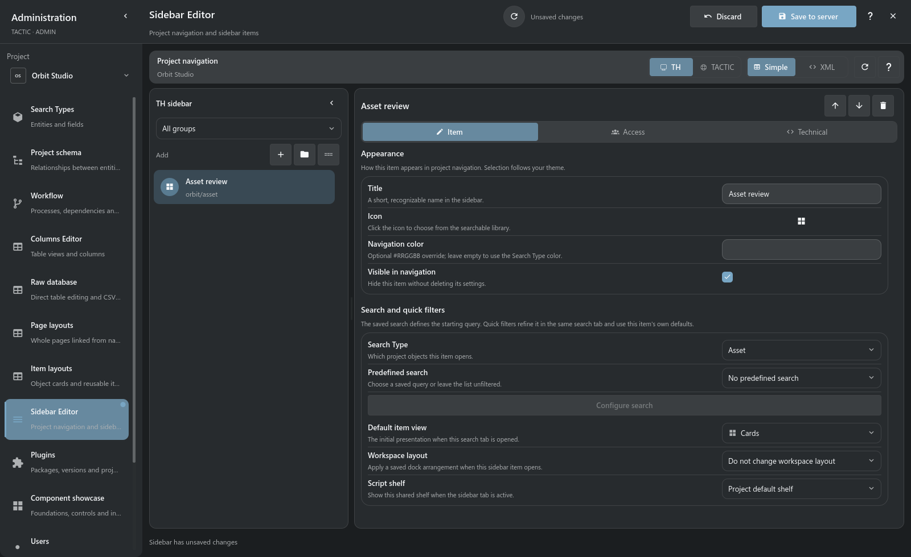

| Editor area | What you build |
| --- | --- |
| **Navigation tree** | Links, sections and separators; order, nesting and visible entries. |
| **Item** | Display title, icon, Search Type, predefined search, initial item presentation, assigned dock preset and shelf. |
| **Configure search** | Prepare the actual search workspace, including saved search, quick filters, process visibility, sorting and grouping. |
| **Access** | Groups allowed to see an item; preview the draft for a selected group. Hidden entries remain editable. |
| **Technical / XML** | Stable internal identity, child views and the supported widget/view configuration. |

Handler's `tactic_handler` sidebar and TACTIC's `project_view` are independent definitions. The editor chooses the target explicitly. Its project selector controls the authoring scope, even if another project is open in the main workspace.

Rename the display title to change the label while retaining the internal identity. A configured Saved Search initializes the entry's first tab; reopening retains its working state instead of adding a duplicate tab. XML Apply updates the draft, and Save publishes the sidebar. Group preview changes what the editor shows; it does not impersonate that group or replace server data permissions. [Sidebar Editor Help](../../thlib/ui/help_articles/sidebar_editor.en.md)

## Object overview

**Details / SObject Report** collects an object’s description, participants, tasks, notes, files and history. Its header shows the preview and summary figures; sections below link to the underlying records.

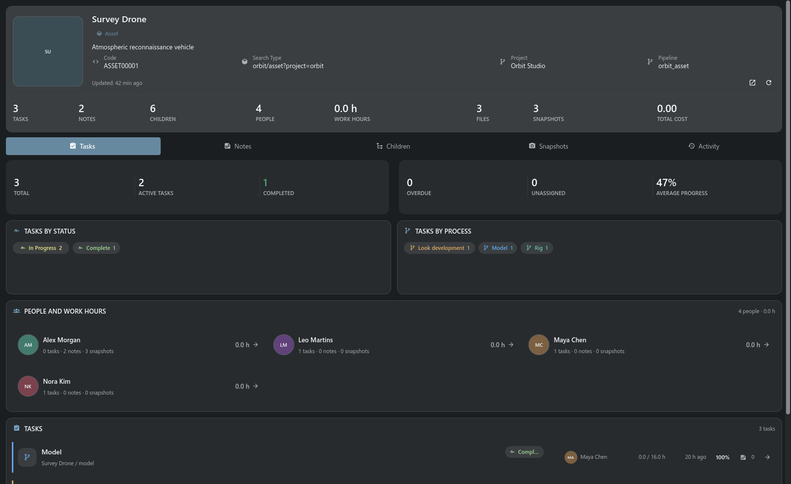

| Section | Contents |
| --- | --- |
| **Tasks and participants** | Statuses, processes and logged time. Participants come from tasks, notes, publications and time entries. |
| **Notes** | Object and process notes with links to their discussions. |
| **Children and relations** | Related production records. |
| **Snapshots and files** | Publications by process, versions, previews, file counts and total size. |
| **Activity** | Changes to the object, tasks, notes, publications, time entries and supported relationships, with their authors. |

From the overview, a task opens in Task Manager and Inspector, a note in its process discussion, and a publication in its source project. Cost figures require the corresponding permission. [SObject Report Help](../../thlib/ui/help_articles/sobject_info.en.md)

## Workflow: graph and execution

Workflow executes pipeline rules on the server: updating tasks, handling dependencies, calling scripts and sending notifications. A graph can contain parallel branches and approvals. The object’s production pipeline and a task’s status pipeline are configured separately.

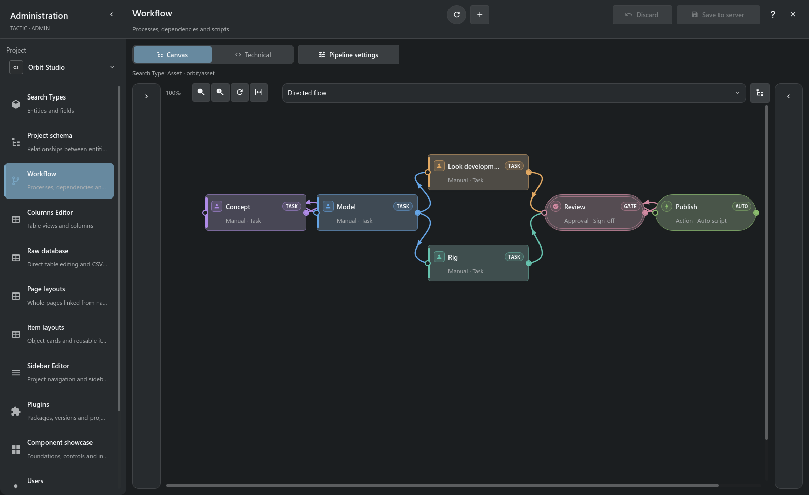

*Pipeline with parallel look development and rigging, an approval and an automatic action.*

| Node or rule | What it contributes |
| --- | --- |
| Manual and approval | Work assigned to people; review and sign-off stages. |
| Action and condition | Run configured server behavior or choose a route from a condition. |
| Hierarchy, input and output | Organize nested pipelines and their entry/exit points. |
| Dependency and progress | Coordinate related work and process completion. |
| Status and process events | React to pending, action, complete, revise, reject or error transitions. |
| Process rules | Update task or parent status, create downstream tasks, record actual dates, invoke a saved script or class, and configure notifications. |

In **Administration → Workflow**, select a pipeline and edit its graph and node settings. Options depend on the process type; technical views expose XML and advanced configuration. Triggers, notifications, dependencies and naming have separate settings. Saving the graph does not run its actions.

The server stores and executes the pipeline. Handler provides a native editor and views for working with its tasks, so the team uses the same rules from either client.

## Planning

### Task Manager

**Task Manager** works with selected objects, a Search Type, personal tasks or team tasks. Table and compact views show assignees, supervisors, statuses, dates, progress and effort. Search, filters, grouping and sorting are available.

Edits remain explicit drafts until saved. Bulk changes apply to the selected tasks; the inspector keeps a task's object and discussion accessible. Server permissions determine the readable fields and available edits.

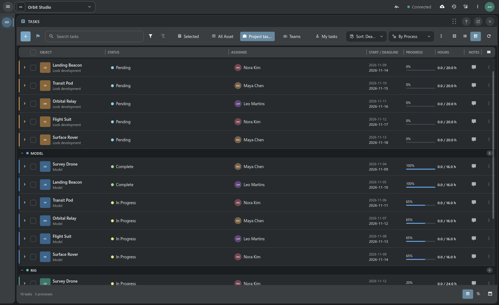

### Gantt, calendar and time tracking

Gantt places tasks on a timeline. Move or resize bars, edit progress, change scale or group the rows. Dependencies, overlapping assignments and scheduling warnings are displayed; undated tasks remain accessible.

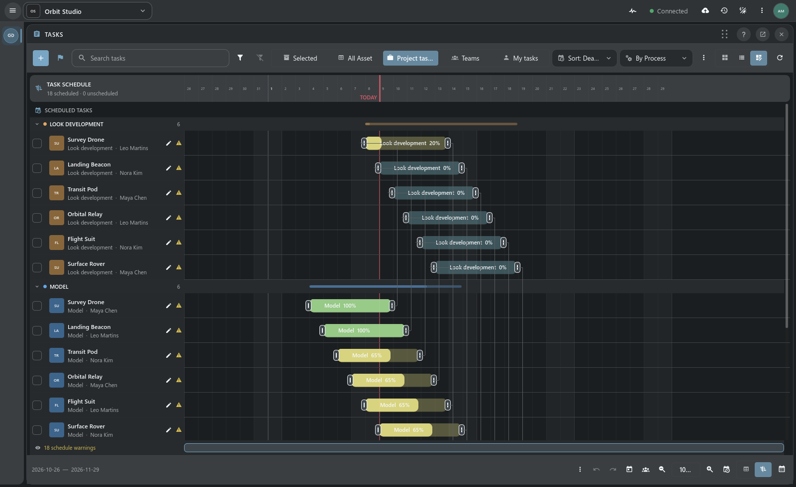

*Gantt displays dependencies but does not automatically reschedule related tasks.*

The task calendar and agenda provide a date-oriented view; milestones represent project checkpoints. Work-hour entries and cost reports connect effort to people and work where the account has access. [Task Manager Help](../../thlib/ui/help_articles/dock.tasks.en.md) · [Calendar Help](../../thlib/ui/help_articles/dock.task_calendar.en.md)

## Messages and Notes

**Messages** supports direct and group conversations, including people from different projects. It has Favorites, replies, mentions, reactions, pins, forwarding, search and member management. Files can be picked, dragged in or pasted; unfinished messages remain in drafts.

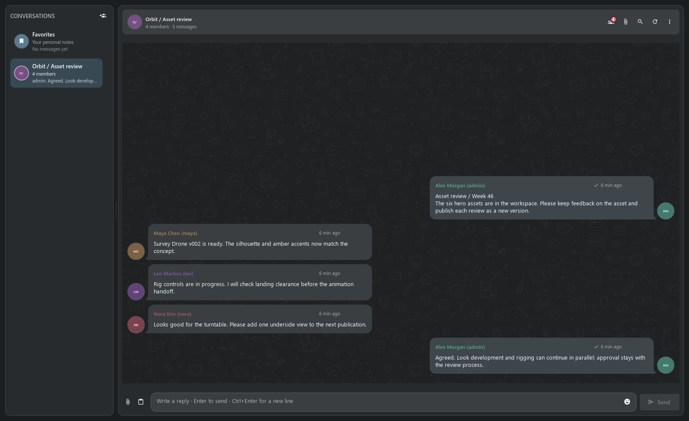

**Notes** belong to an object, process or task and store feedback and review decisions. **Knowledge Base** holds articles and instructions with attachments and revision history. Notifications and activity entries link to changed records.

[Built-in Help: search and contextual instructions →](help.en.md) · [Knowledge Base: articles, editor and history →](knowledge-base.en.md)

## Activity Feed and project history

**Activity Feed** shows project events: notes, publications, tasks, field changes and time entries. Each event includes its author, time, details and a link to the object or task. An object’s Activity section shows its history and available events from related records.

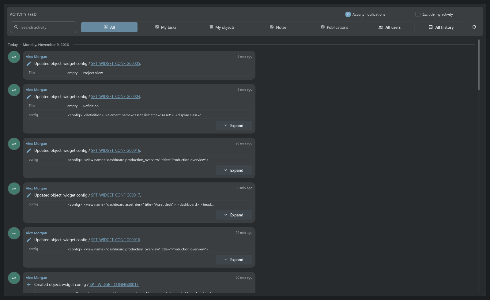

Filter by people and activity category, exclude your own actions, search loaded events or choose a day from the calendar. Older events load while scrolling; calendar counts cover accessible history beyond the currently loaded list. Dates follow the user's local timezone, while relative ages use synchronized server time.

**Notifications** stores notices from the current client session; **System Activity / Debug Log** covers application work and diagnostics. Clearing notifications leaves project history intact. Activity Feed coverage depends on the events recorded by operations and extensions.

## Check-in and check-out

Check-in registers files against an object and process. In Handler, preparation uses Drop Plate and Commit Queue:

1. Select an object and its process/context. Add local files or folders through **Drop Plate**, or prepare a scene through the selected DCC connection.
2. Match and group files or sequences. Review the prepared publication in **Commit Queue**: description, version options, resolved paths and file roles.
3. Submit the operation. Each queue item reports its progress and result; the queue is not one atomic transaction for every item.
4. Browse the resulting snapshots, compare image versions, and open or check out the files needed for the next task.

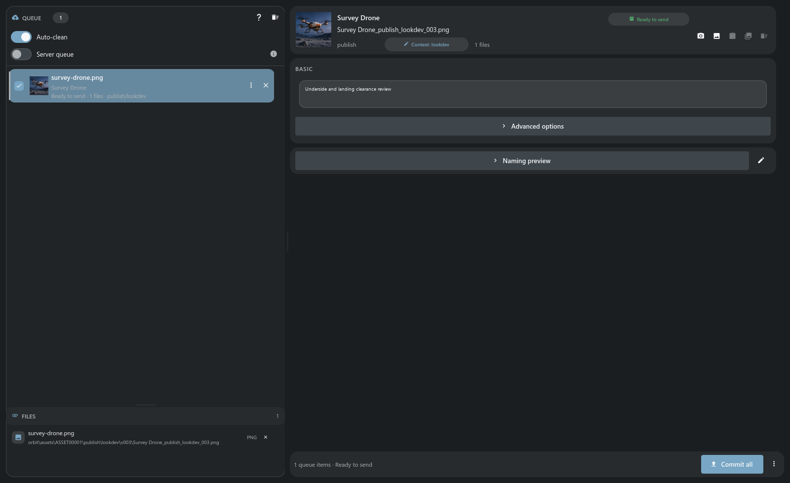

Check-in supports grouped or separate publications and native ingest relationships. Destination collisions preserve existing files. Move removes its source only after confirmed success; uncertain completion must be reconciled rather than blindly repeated. Local preparation and transfer remain visible instead of being hidden behind the final snapshot record.

A snapshot ties a version to its object, process/context, author, description and files. New versions and revisions are different operations. `latest` and `current` naming rules are separate from versioned storage. File sequences retain their range information so checkout can resolve the published frames.

### Naming Editor

**Naming Editor** defines rule conditions, contexts, filename and directory patterns, sandbox paths and repository aliases. Patterns use object, snapshot and file data, with TSQL conditions and trusted saved scripts where needed. The editor previews the rule’s result.

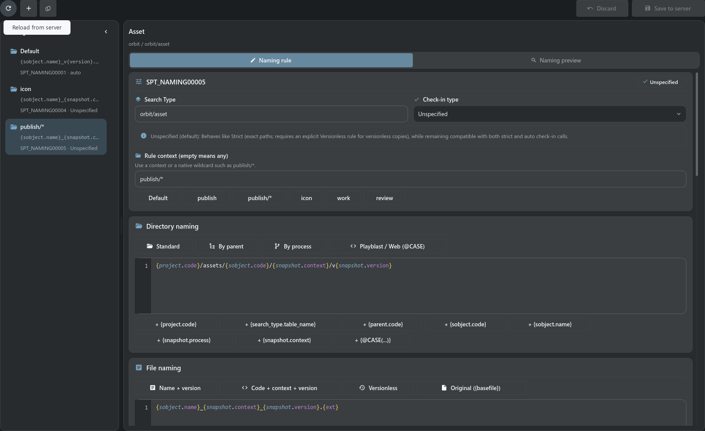

For example, a rule can derive a filename from the object's name, version and extension: `{sobject.name}_v{version}.{ext}`. The native naming engine resolves the actual paths at publication time. A preview is not a reservation: the final check-in still validates the version and collisions. Script-based naming executes trusted project code.

### Repository Sync and Watch Folders

Synchronize the scope you need: selected objects, processes, versions or related children. Presets retain recurring choices; full/partial synchronization and update-only discovery support different working sets. The queue exposes discovery, transfer, cancellation, retry and conflict policy.

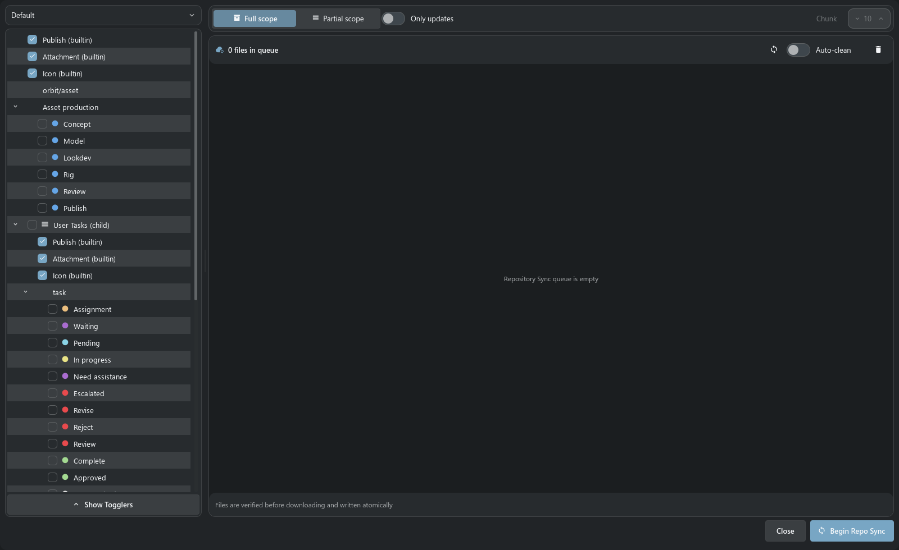

**Watch Folders** bind a project and a local path to matching/check-in rules and feed discovered work into Commit Queue. They do not turn saving a repository setting into an implicit move or deletion. These are Handler desktop capabilities; they are distinct from Stream's browser upload/download workflow.

## Tactic Frame

**Tactic Frame** is the shared interface description language used by Handler and Stream. A module defines elements, geometry, state and actions. Qt Quick and Vue render it with their own controls, so the window’s structure can be changed in one place.

Frame consists of JavaScript modules (`.mjs`). The `describe(model, width, height, language)` function builds the visible structure from state. Actions are handled by the client’s controllers.

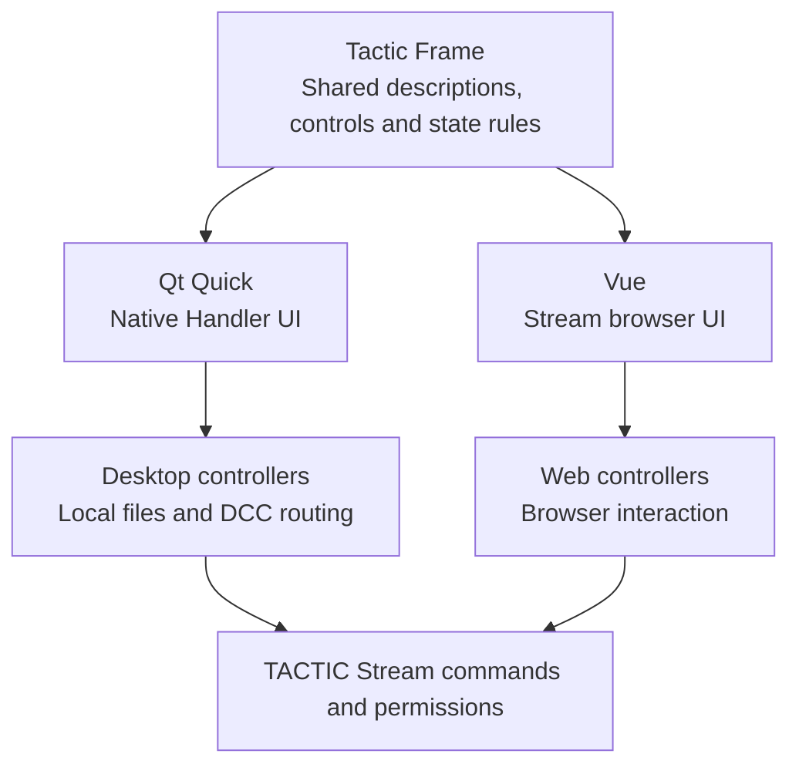

A small description module saved beside this document illustrates the contract. The host supplies `model` and handles the `name` action; production modules also use the shared translation helpers.

```javascript
import { label, node, rect } from "../../thlib/ui/qml/tactic_frame/core/frame.mjs";

export function describe(model, width, height, language) {
    return { nodes: [
        label("title", rect(16, 12, width - 32, 28), "Review"),
        node("Field", "assetName", rect(16, 48, width - 32, 38), {
            label: "Asset", text: model.name, action: { type: "name" }
        })
    ] };
}
```

Shared building blocks cover fields, buttons, selectors, virtualized lists, tables, graphs, editors and window structure. Themes, translations, focus and input behavior belong to the contract as well as geometry. **Component showcase** makes those building blocks inspectable inside the application.

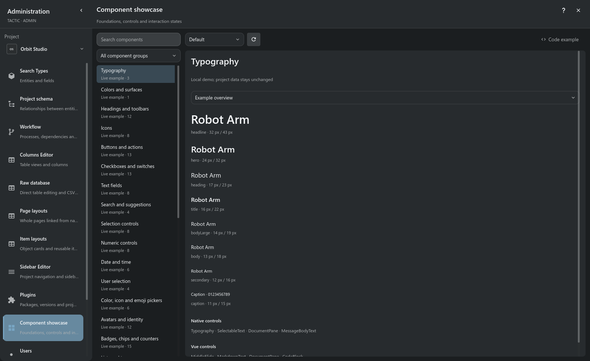

XML views and visual editor documents store project configuration. Frame modules define interface components. Stream and Handler ship separately, each with a copy of the shared descriptions. [Frame contracts](../frame/index.md)

## Script Editor and automation

**Script Editor** runs a script or a selection, displays results and errors and saves scripts to the project library. It has tabs, drafts, undo, highlighting, completion, search and replace, and an outline. Folders organize the library.

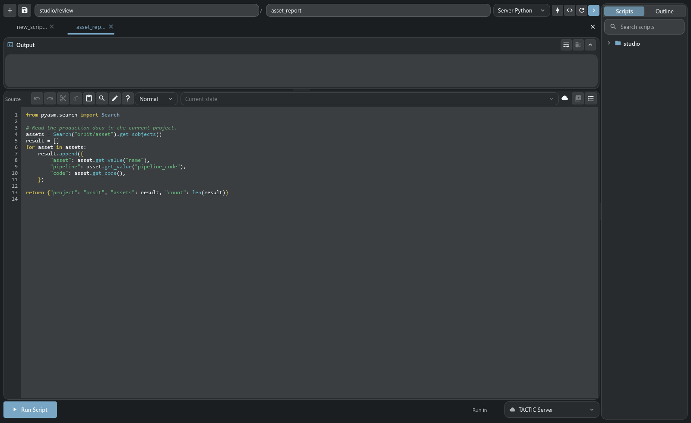

| Runtime | Owner and context |
| --- | --- |
| **Local Python / QML tools** | Handler's native objects and UI; GUI operations obey the Qt thread boundary. |
| **Server Python** | The connected TACTIC server and its project/permission context. |
| **Selected DCC** | The explicitly selected registered session and its supported capabilities. |

The editor shows the execution target. Local Python and DCC output return to the tab. Server Python shows the returned result; process stdout stays in the server log.

**Script shelves** put saved actions beside the work: shared studio tools, personal tools and tools attached to a search tab. **Before/After hooks** bind automation to selected events with process, context and Search Type filters. A Before failure can block its operation; an After failure cannot undo an operation that has already completed. Code execution is a trusted capability, separate from merely viewing a script.

[Script Editor Help](../../thlib/ui/help_articles/script_editor.en.md) · [Script Shelf Help](../../thlib/ui/help_articles/script_shelf.en.md)

## Project administration

**Administration** defines the project model: Search Types, fields, relationships, views and actions. Asset and Shot are example types; studios can create their own. The schema graph shows the relationships between them.

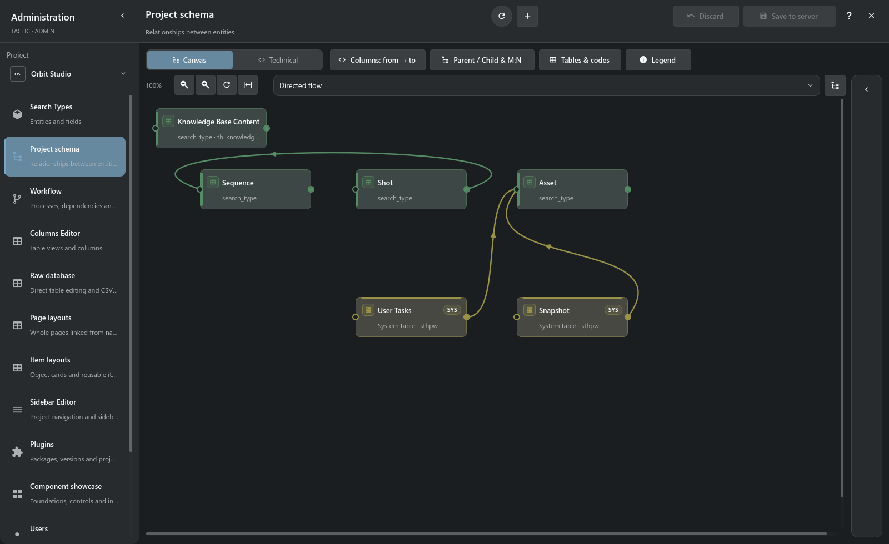

| Section | What you configure |
| --- | --- |
| **Search Types** | Entity definitions, fields and their naming rules. |
| **Project schema** | Relationships between entities and the project graph. |
| **Workflow** | Pipelines, process properties, dependencies and automation. |
| **Columns Editor** | Table views, columns and native field widgets. |
| **Raw database** | Direct authorized table inspection/editing and CSV work, with protected-table restrictions. |
| **Page layouts** | Whole dashboard pages, their blocks, data sources and navigation. |
| **Item layouts** | Reusable cards, rows and object presentations. |
| **Sidebar Editor** | Navigation groups, entries, views and workspace entry points. |
| **Plugins** | Packages, versions and project activation. |
| **Component showcase** | The control vocabulary used by the interfaces. |
| **Users** | Accounts and their project access. |
| **Groups** | Membership and shared access configuration. |
| **Access rules** | Inherited and explicit allow/deny rules; effective access checks for a user. |

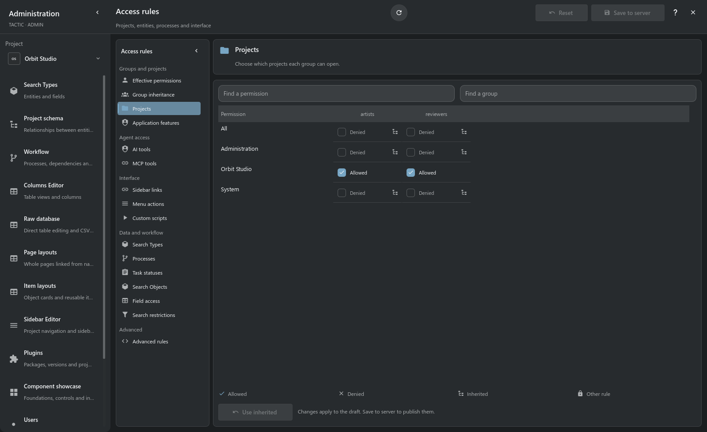

Editors keep drafts until Save or Discard. Saving checks the revision and server permissions. [Administration Help](../../thlib/ui/help_articles/administration.en.md)

## Users and permissions

A server account is shared across projects. It holds the profile, contact details, settings and group memberships. Tasks, messages, publications and activity records refer to that account as their author.

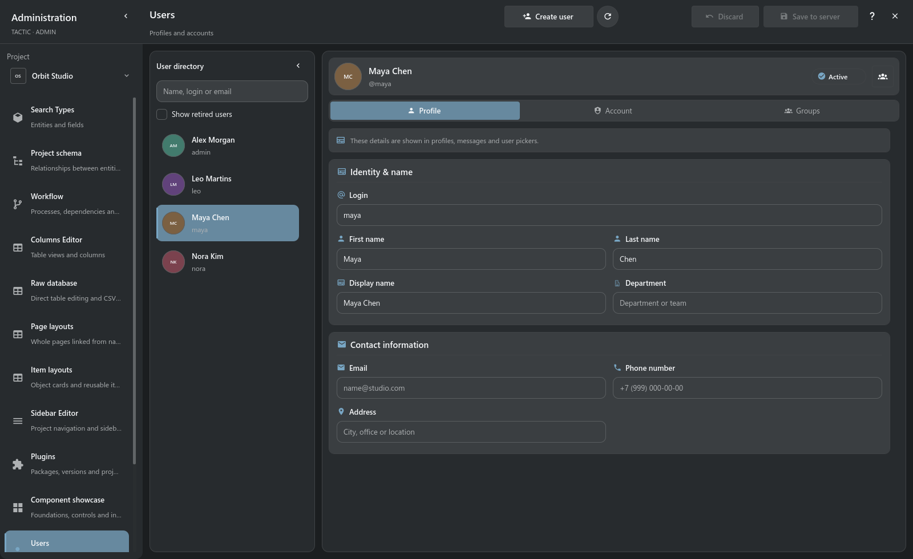

### Accounts

New accounts receive an initial password, profile and groups. Stored passwords are not displayed. Retire disables the account and Reactivate enables it again; existing project history retains the author’s identity.

### Groups and access checks

Groups manage membership and descriptions. Access rules manage the policy: access level, project scope, supported object/process/status/action rules, inheritance and explicit allow/deny. Sidebar visibility is a separate part of the interface policy; hiding a link is not the same as denying access to its records.

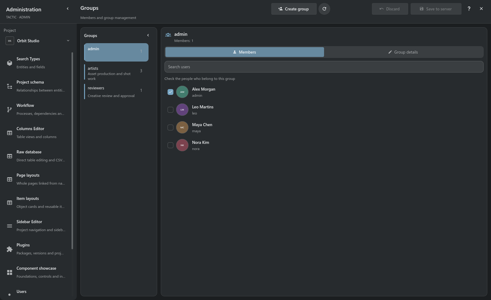

Effective access combines all of the user’s groups, inheritance and explicit rules. Check the result for a specific account after configuration. A single group’s matrix shows only that part of the policy.

Onboarding includes the account, group membership, project permissions and sidebar visibility, followed by an effective-access check. The project selected in Administration limits project settings; accounts remain shared across the server.

## Configuration

**Configuration** contains connection, storage and client settings. Each page keeps a draft: Apply affects the current page, while Save handles pending changes. Leaving unsaved settings prompts a warning. Appearance changes can be previewed and reverted.

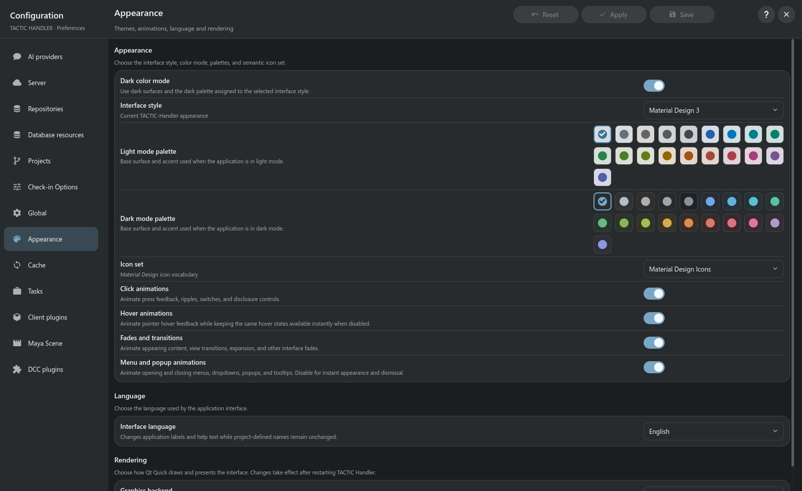

| Area | Purpose |
| --- | --- |
| **AI providers** | Provider profiles, model discovery and executor selection for the assistant. |
| **Server** | Connection and supported server options, live service information and explicit lifecycle actions. |
| **Database resources** | Configure/test resources and bind existing schemas; this does not migrate data. |
| **Repositories** | Repository names, colors, mappings and supported server storage settings. Saving a path does not move files. |
| **Projects** | Project creation, templates and project-level setup. |
| **Check-in Options** | Defaults for file preparation, naming and publishing behavior. |
| **Global** | General interaction and update preferences applicable to the current client. |
| **Appearance** | Light/dark themes, palettes, icon choices and English/Russian interface language. |
| **Cache** | Cache policy, visibility and maintenance. |
| **Tasks** | Task defaults and effort/time preferences. |
| **DCC plugins** | Install/configure supported application integration. |
| **Client plugins** | Desktop extension discovery and configuration. |
| **Application-specific pages** | Settings supplied by the active integration, such as Maya scene behavior. |

Supported server XML settings expose service, network, security, directory and scheduling controls with validation and restart requirements. Changing configuration and restarting a service are separate actions. Repository and database migration require their own procedure. [Configuration Help](../../thlib/ui/help_articles/configuration.en.md)

## Project assistant

**External agent** reads tasks, notes and publications for selected objects. Conversation context includes the project, page, Search Type and selection. Writing requires separate permission.


In this request, the assistant found a completed modeling task without a model publication. The separate presentation covers conversations, providers, attachments, changes and scripts.

**[Explore the built-in assistant →](assistant.en.md)**

## Dashboards

A dashboard combines metrics, reports, charts, Item View, forms and actions. Detail blocks can follow the selected object. Pages are saved in the project and opened from the sidebar; user permissions determine data access.


**[Explore custom dashboards and their visual editor →](dashboards.en.md)**

## Installation and integrations

### Maya connector

The shipped Maya connector registers with **Handler Server**, the local bridge. Select the intended session before sending a native open, import, reference or scene-save action. Maya prepares the scene; Handler performs TACTIC check-in and file transfer. Other applications require a connector with explicitly registered native capabilities.

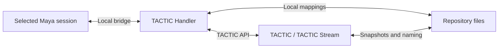

[Maya installation](../../installer/README.md) · [DCC API](../dcc_api.md) · [Thin-client protocol](../thin_client_protocol.md)

### Install Handler from source on Windows

Use a modern source checkout with Python 3.14 and a running TACTIC server.

```powershell
py -3.14 -m venv .venv
.\.venv\Scripts\python.exe -m pip install -r requirements.txt
.\.venv\Scripts\python.exe launch.py
```

Open **Configuration → Server**, test the server preset and generate a ticket. Select a project and configure repository mappings before file operations. [First connection](../handbook.en.md#first-connection) · [Getting started](../../thlib/ui/help_articles/getting_started.en.md)

### Handler API

The public `tactic_handler_api` exposes client objects, file operations and supported UI actions. Its standalone, Script Editor and DCC entry points preserve their execution context.

```python
from tactic_handler_api import local

with local() as handler:
    assets = handler.project("orbit").stype("orbit/asset")
    result = assets.query(limit=12, order_by=["name asc"])
    for asset in result.items:
        print(asset.get_code(), asset.get_value("name"))
```

Replace the demo project and Search Type with your own. [API and examples](../handler_api.md) · [Architecture](../application_architecture.md) · [Handbook](../handbook.en.md)

## Compatibility, limitations and licenses

The presentation shows Handler connected to Stream. Stream-specific project authoring, dashboards and the assistant require that server; their presence here does not imply the same service exists in every original TACTIC deployment. Consult the [compatibility map](../tactic_compatibility/README.md) for an existing installation.

The Perforce-like File Workspace remains a prototype. The implemented check-in queue and Repository Sync do not establish full Perforce behavior. Maya is the connector shipped here; other DCC applications are extension work unless their connector is present and verified. [Documentation index](../index.md)

Screenshots use a small demonstration project. Production deployment requires checks of the studio’s schema, scripts, integrations and permissions against the deployed version.

TACTIC Handler is distributed under the [Eclipse Public License 1.0](../../LICENSE). Its server integration builds on [Southpaw TACTIC](https://github.com/Southpaw-TACTIC/TACTIC).

[Maya plugin and shelves](maya.en.md)
