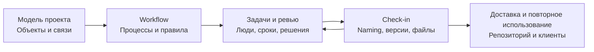
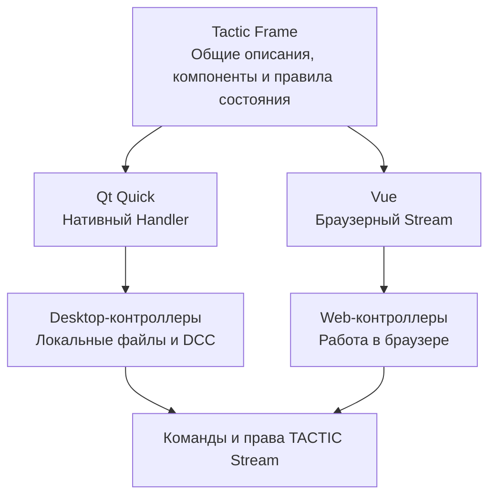
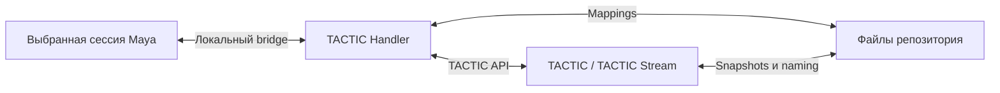

# TACTIC Handler — Подробный обзор продукта

[Визуальная презентация](../../README.ru.md)

**Нативное рабочее пространство для TACTIC и TACTIC Stream.** Визуальный поиск ассетов, задачи, ревью версий и публикация локальных файлов в самостоятельном приложении на Python и Qt Quick.

**Объекты, люди, процессы и опубликованные файлы — в едином контексте производства.**

[English](product-tour.en.md) · [Workflow](#workflow--исполняемый-движок-процессов) · [Задачи и Gantt](#планирование-и-ежедневная-работа) · [Файлы и naming](#от-рабочего-файла-к-отслеживаемой-публикации) · [Tactic Frame](#tactic-frame-единое-описание-два-нативных-интерфейса) · [Администрирование](#administration-настройка-самого-проекта) · [Запуск](#запуск-и-расширение)

[Доки](#доки-собрать-интерфейс-под-конкретную-работу) · [Sidebar Editor](#sidebar-editor-навигация-как-часть-рабочего-процесса) · [Обзор объекта](#обзор-объекта-целостная-производственная-запись) · [История сервера](#история-на-сервере-понять-что-произошло) · [Пользователи и права](#пользователи-группы-и-итоговые-права)

| Ассистент проекта | Собственное рабочее пространство |
| --- | --- |
| [**Встроенный чат-бот →**](assistant.ru.md) — Вопросы по реальным данным, подготовка изменений и журнал операций за каждым ответом. | [**Кастомные дашборды →**](dashboards.ru.md) — Метрики, диаграммы, Item View и инструменты выбранного объекта на одной странице. |


*Свежие снимки текущего приложения в изолированном демопроекте Orbit Studio. Участники вымышлены, концепт-арты служат иллюстрациями; интерфейсы и записи проекта настоящие.*

> **Прототип в активной разработке.** Perforce-like File Workspace также остаётся прототипом. Перед использованием в производстве проверяйте свою схему, права, скрипты и файловые операции на изолированных данных.

## Зачем существует проект

Handler переносит производственную работу с TACTIC на компьютер художника: локальные файлы, mappings репозитория, интеграцию с рабочими приложениями и постоянное рабочее пространство. При подключении к **TACTIC Stream** он также открывает показанные здесь современные инструменты workflow, настройки проекта, дашбордов и ассистента.

У сервера и клиента разные задачи. TACTIC владеет записями проекта, правами, workflow и публикациями. Handler отвечает за desktop-интерфейс, локальные файлы, очереди и выбранное подключение DCC. Нативный клиент особенно полезен там, где нужно перейти от данных проекта к рабочему каталогу или сцене Maya.

Stream — серверный форк [Southpaw TACTIC](https://github.com/Southpaw-TACTIC/TACTIC); Handler — самостоятельный desktop-клиент, который также подключается к исходному TACTIC в пределах проверенной совместимости. Stream сохраняет настраиваемую модель и workflow-основу TACTIC, развивая актуальное Python-ядро, визуальные редакторы и Vue-интерфейс с общими для Handler описаниями Frame.

В центре системы — передача работы между участниками. Объект описывает результат, pipeline задаёт его маршрут, задачи определяют исполнителей, обсуждения сохраняют решения, snapshots фиксируют переданные файлы. Статус задачи, сообщение ревьюера и версия публикации становятся частями одного контекста.



## Рабочее пространство начинается с объекта

Ассет, шот, документ или собственная сущность проекта — точка входа в работу. **Item View** показывает изображение, нужные поля и действия непосредственно в карточке. Непрерывное дерево раскрывает связанные объекты, процессы и публикации. Таблица даёт доступ к полям, сортировке, фильтрам, выделению и редактированию. Это разные представления одних и тех же записей.

Поисковые вкладки сохраняют свой контекст. Фильтры ограничивают серверную выборку, теги и быстрые фильтры упрощают повторяющиеся запросы. Рядом с результатами можно разместить доки задач, заметок, снимков, деталей или календаря. Сохранённая компоновка позволяет отделу начинать работу с подходящего набора панелей.

### Обычный Item View

Стандартное непрерывное дерево показывает превью объекта, связанные записи, процессы, задачи и версии snapshots прямо в результатах. Раскройте публикацию, чтобы увидеть версии, описания и превью файлов. Компактные строки и режимы версий справа/снизу меняют размещение того же нативного представления; настраиваемые Item Layouts — отдельная возможность оформления.


### Карточки под конкретный рабочий процесс

В **Item Layouts** изображения и текст связываются с полями объекта, а поддерживаемые действия становятся частью карточки. Можно собрать компактную производственную строку, крупную карточку для ревью или переиспользуемое представление деталей. Предпросмотр работает на записях проекта; результат сохраняется как конфигурация представления.


**У Page layouts, Item layouts и Columns Editor разные задачи:** страница собирает рабочее место, item layout оформляет отдельный объект, табличное представление задаёт поля и виджеты. Sidebar связывает эти определения с навигацией проекта. [Справка по Item Layouts](../../thlib/ui/help_articles/item_layouts.ru.md)


## Доки: собрать интерфейс под конкретную работу

Рабочее пространство — **композиция функциональных панелей**. Разместите поиск рядом с крупным превью файлов, объедините вспомогательные панели во вкладки, отдайте нижнюю часть задачам или вынесите инструмент из основной области. Для одного проекта можно собрать рабочее место ревьюера, планировщика и специалиста по публикации из доступных доков.


### Разделить, объединить, вынести и восстановить

Перетащите grip панели к краю, чтобы разделить область, в центр — чтобы создать стек вкладок, к заголовку — чтобы поменять панели местами. Двигайте разделители, меняйте порядок вкладок, временно разворачивайте док или скрывайте его, освобождая место. Отменённое перетаскивание возвращает прежнюю компоновку.

Handler поддерживает плавающие панели и отдельные нативные окна доков, в том числе для второго монитора. При восстановлении геометрия учитывает доступные экраны.


| Рабочее место | Возможная композиция |
| --- | --- |
| **Ревью** | Item View + Snapshot Browser + Description/Notes: выбор объекта, просмотр публикации и её обсуждение. |
| **Планирование** | Results + Task Manager/Gantt + детали задачи или календарь там, где доступны: назначения и даты рядом с объектами производства. |
| **Публикация** | Results + Drop Plate + Commit Queue: выбор назначения, подготовка файлов и проверка ожидающей операции. |
| **Документация** | Results + Knowledge Base: записи проекта рядом со справочными материалами команды. |

Панели соединяет выделение. Объект, процесс или snapshot из Search становится контекстом следующих за ним панелей; открытая задача сохраняет точную идентичность. Компоновка меняет расположение инструментов, сохраняя их данные, права и назначение.

### Личная компоновка и общий старт отдела

Клиент и вкладка сохраняют своё состояние: размещение, размеры, видимость и стеки. **Layout presets** хранят именованные проектные компоновки на сервере: применение, обновление списка, сохранение, замена и удаление — отдельные действия. Назначьте пресет пункту sidebar, чтобы отдел получал подходящий стартовый интерфейс; последующая личная компоновка вкладки может сохранять изменения пользователя.

Пресет описывает панели и их расположение. Он не сохраняет авторизацию, не применяет черновик редактора и не заменяет Saved Search. Reset восстанавливает геометрию без удаления записей проекта и сохранённых запросов. Вместе с Item Layouts, Columns Editor, страницами дашбордов и полками скриптов доки позволяют собирать множество рабочих интерфейсов из реализованных инструментов. [Доки и окна](../../thlib/ui/help_articles/windows.ru.md)


## Sidebar Editor: навигация как часть рабочего процесса

Пункт sidebar задаёт гораздо больше, чем название. Он соединяет Search Type, начальный поиск, представление, компоновку доков и полку скриптов. «Asset review» и «Asset planning» могут открывать одни и те же записи с разными исходными фильтрами и инструментами.


| Область редактора | Что собирается |
| --- | --- |
| **Дерево навигации** | Ссылки, разделы и разделители, порядок, вложенность и видимость. |
| **Item** | Заголовок, иконка, Search Type, исходный сохранённый поиск, вид объектов, пресет доков и shelf. |
| **Configure search** | Настройка настоящего поиска: сохранённый запрос, quick filters, видимость процессов, сортировка и группировка. |
| **Access** | Группы, которым виден пункт, и предпросмотр черновика для выбранной группы. Скрытые пункты остаются доступны для редактирования. |
| **Technical / XML** | Постоянный внутренний идентификатор, дочерние представления и поддерживаемая конфигурация виджета/view. |

Sidebar Handler `tactic_handler` и TACTIC `project_view` — независимые определения. Цель выбирается явно. Проект в редакторе задаёт область изменений, даже если в основном рабочем пространстве открыт другой проект.

Для переименования подписи меняется Title, сохраняя внутреннюю идентичность пункта. Назначенный Saved Search инициализирует первую вкладку; повторное открытие сохраняет рабочее состояние вместо создания дубликата. Apply XML меняет черновик, Save публикует sidebar. Предпросмотр группы не выполняет вход от её имени и не заменяет серверные права на данные. [Справка Sidebar Editor](../../thlib/ui/help_articles/sidebar_editor.ru.md)


## Обзор объекта: целостная производственная запись

Откройте **Details / SObject Report**, чтобы перейти от карточки результата к обзору его производства. Профиль объекта объединяет превью, идентичность, описание и метрики; переключатель разделов открывает работу, связанную именно с этой записью.


| Раздел | На какой вопрос отвечает |
| --- | --- |
| **Задачи и участники** | Кто вовлечён, какие есть статусы и процессы, сколько работы учтено? Участники собираются из задач, заметок, публикаций и записей времени. |
| **Notes** | Какие решения и замечания относятся к объекту и его процессам? Заметка открывается в исходном контексте. |
| **Дочерние объекты и связи** | Какие связанные производственные записи находятся под объектом или рядом с ним? |
| **Snapshots и файлы** | В каких процессах есть публикации, сколько в них файлов и каков общий размер? Дерево процесса раскрывает версии и превью. |
| **Activity** | Кто создавал или менял объект, задачи, заметки, публикации, записи времени и поддерживаемые связи? |

Задача открывает соответствующую область Task Manager и точную запись в Inspector. Заметка возвращает к обсуждению процесса. Публикация сохраняет исходный проект. Стоимость показывается только при наличии соответствующего права. Обзор даёт основания за статусом, избавляя от необходимости собирать картину по несвязанным экранам. [SObject Report](../../thlib/ui/help_articles/sobject_info.ru.md)


## Workflow — исполняемый движок процессов

За графом pipeline стоят серверные операции. Объект проходит назначенный маршрут; события процессов управляют задачами, зависимостями, скриптами и уведомлениями. Pipeline объекта и pipeline статусов задачи выполняют разные роли: производственный путь ассета не обязан сводиться к Pending / In Progress / Complete.


*Настроенный граф с параллельными lookdev и rig, этапом согласования и автоматическим действием. Снимок показывает определение процесса, а не подтверждает выполнение каждой его ветки.*

| Узел или правило | Для чего используется |
| --- | --- |
| Manual и approval | Работа исполнителей, ревью и согласование результата. |
| Action и condition | Настроенное серверное действие или выбор ветки по условию. |
| Hierarchy, input и output | Вложенные pipelines, точки входа и выхода. |
| Dependency и progress | Согласование зависимой работы и завершения процессов. |
| Status и события процесса | Реакции на pending, action, complete, revise, reject и error. |
| Правила процесса | Смена статуса задачи или родителя, создание следующих задач, запись фактических дат, вызов сохранённого скрипта или класса, настройка уведомлений. |

В **Administration → Workflow** выбирают pipeline, компонуют граф и редактируют параметры выбранного процесса. Набор настроек зависит от типа узла. Технические представления открывают XML и расширенную конфигурацию. Зависимости, триггеры, уведомления и naming связаны с workflow, но имеют собственные настройки. Сохранение графа само по себе не запускает его действия и не отправляет письма.

Определения pipelines и переходы принадлежат серверу. Handler предоставляет нативные редакторы и рабочие представления, а не запускает отдельный конкурирующий workflow engine на компьютере пользователя.

## Планирование и ежедневная работа

### Task Manager

Переключайтесь между задачами выбранных объектов, Search Type, проекта, своими задачами и работой команды. Таблица и компактные представления показывают статус, исполнителя, супервайзера, даты, прогресс и трудозатраты. Поиск, фильтрация, группировка и сортировка помогают и художнику с сегодняшним списком, и руководителю со следующим этапом производства.

Изменения остаются черновиком до сохранения. Массовое редактирование применяется к выбранным задачам; инспектор сохраняет доступ к объекту и обсуждению. Доступные поля и операции определяются серверными правами.


### Gantt, календарь и трудозатраты

Gantt раскладывает задачи по времени. Можно двигать и растягивать полосы, менять прогресс, масштаб и группировку по исполнителю. Существующие зависимости и предупреждения помогают увидеть конфликты расписания. Задачи без дат остаются доступными.


*В демонстрационном расписании есть пересечения, и интерфейс действительно показывает предупреждения. Отображение зависимостей не означает автоматического каскадного переноса задач.*

Календарь задач и agenda дают представление по датам, milestones обозначают контрольные точки проекта. Учёт часов и отчёты по стоимости связывают затраты с людьми и работой в пределах доступных пользователю прав. [Task Manager](../../thlib/ui/help_articles/dock.tasks.ru.md) · [Календарь](../../thlib/ui/help_articles/dock.task_calendar.ru.md)

## Общение с сохранением контекста

**Messages** объединяет личные диалоги, группы и Избранное между проектами. Ответы, упоминания, реакции, закрепления, пересылка, управление участниками и поиск поддерживают текущую координацию. Файлы добавляются через выбор, перетаскивание и буфер обмена; незавершённые сообщения сохраняются в черновиках.


**Notes** сохраняют решения у конкретного объекта, процесса или задачи. Уведомления и журнал активности помогают следить за изменениями и переходить к затронутым записям. **Knowledge Base** предназначена для документации: дерево Markdown-статей, вложения и история редакций. Ревью можно организовать в чате, а его решение оставить рядом с самим результатом работы.


## История на сервере: понять, что произошло

**Activity Feed** — проектный журнал поддерживаемых изменений: заметок, публикаций, задач, статусов, полей объектов и трудозатрат. Событие показывает автора, время, читаемые детали и ссылку на затронутый объект или задачу. Раздел Activity в обзоре объекта даёт более узкую историю одной производственной записи, включая поддерживаемые события дочерних объектов и связей.


Фильтруйте людей и категории, исключайте собственные действия, ищите по загруженным событиям или выбирайте день в календаре. Прокрутка подгружает прошлые события; счётчики календаря охватывают доступную историю за пределами текущего списка. Даты показываются в локальном часовом поясе, относительное время учитывает синхронизацию с сервером.

У трёх историй разные задачи. **Activity Feed** объясняет изменения проекта. **Notifications** хранит уведомления текущей сессии клиента и переходы к их источникам. **System Activity / Debug Log** показывают текущую работу и диагностику приложения. Очистка уведомлений не удаляет серверный журнал, переписку или версии файлов. Журнал не является обещанием неизменяемого аудита любых действий всех legacy-расширений.


## От рабочего файла к отслеживаемой публикации

1. Выберите объект и процесс/контекст. Добавьте локальные файлы или каталоги через **Drop Plate** либо подготовьте сцену в выбранном подключении DCC.
2. Сопоставьте и сгруппируйте файлы/последовательности. В **Commit Queue** проверьте описание, параметры версии, разрешённые пути и роли файлов.
3. Отправьте операцию. У каждого элемента очереди свой прогресс и результат; вся очередь не является одной атомарной транзакцией.
4. Просмотрите snapshots, сравните версии изображений, откройте или выполните checkout нужных файлов.


Check-in поддерживает общую или раздельную публикацию групп и штатные ingest-связи. При коллизии существующий файл сохраняется. Move удаляет источник только после подтверждённого успеха; неопределённый результат нужно сверить, а не слепо повторить. Подготовка и передача видны отдельно от итоговой записи snapshot.

Snapshot связывает версию с объектом, процессом/контекстом, автором, описанием и файлами. Новая версия и ревизия — разные операции. Правила `latest` и `current` отделены от версионного хранения. Файловые последовательности сохраняют информацию о диапазоне, чтобы checkout мог разрешить опубликованные кадры.

### Naming как правило производства

Редактор нейминга объединяет условия выбора правила, пути и примеры. Настраиваются контексты, шаблоны каталогов и имён, sandbox-пути и алиасы репозиториев. Токены объекта, snapshot и файла можно дополнить условиями TSQL или доверенным сохранённым скриптом. Результат проверяется на примере до сохранения правила.


Например, имя может собираться из названия объекта, версии и расширения: `{sobject.name}_v{version}.{ext}`. При публикации путь заново разрешает нативный naming engine. Предпросмотр не резервирует имя: финальный check-in проверяет версию и коллизии. Скриптовые правила выполняют доверенный код проекта.

### Repository Sync и Watch Folders

Синхронизируйте нужную область: выбранные объекты, процессы, версии или связанных потомков. Пресеты сохраняют повторяющийся выбор; полная/частичная синхронизация и поиск только обновлений поддерживают разные рабочие наборы. Очередь показывает обнаружение файлов, передачу, отмену, повтор и политику конфликтов.


**Watch Folders** связывают проект и локальный каталог с правилами сопоставления/check-in и направляют найденную работу в Commit Queue. Сохранение настройки репозитория не запускает неявный перенос или удаление файлов. Это desktop-возможности Handler, отдельные от браузерной загрузки и скачивания Stream.

## Tactic Frame: единое описание, два нативных интерфейса

**Tactic Frame — универсальный язык описания интерфейсов Handler и Stream.** Модуль Frame описывает узлы, геометрию, состояние и действия; Qt Quick и Vue отображают их собственными компонентами приложения. Интерфейс Handler остаётся нативным Qt.

Frame использует обычные JavaScript-модули `.mjs` и структуры данных. Функция `describe(model, width, height, language)` формирует видимую структуру из состояния. Контроллеры обрабатывают действия и обращаются к предметным операциям; описание интерфейса не становится отдельным серверным API.



Небольшой модуль рядом с этим документом иллюстрирует контракт. Host передаёт `model` и обрабатывает действие `name`; рабочие модули также используют общие функции перевода.

```javascript
import { label, node, rect } from "../../thlib/ui/qml/tactic_frame/core/frame.mjs";

export function describe(model, width, height, language) {
    return { nodes: [
        label("title", rect(16, 12, width - 32, 28), "Review"),
        node("Field", "assetName", rect(16, 48, width - 32, 38), {
            label: "Asset", text: model.name, action: { type: "name" }
        })
    ] };
}
```

Общая библиотека включает поля, кнопки, селекторы, виртуализированные списки, таблицы, графы, редакторы и структуру окон. Контракт охватывает не только геометрию, но и темы, перевод, фокус и ввод. **Component showcase** показывает этот набор компонентов внутри приложения.


XML-представления проекта и документы визуальных редакторов настраивают содержимое поверх этого слоя. Это отдельные форматы конфигурации, а не новый синтаксис файлов Frame. Продукты собираются независимо и содержат собственные копии общих описаний; поведение проверяется в обоих рендерах. [Контракты Frame](../frame/index.md)

## Script Editor, полки и автоматизация

Script Editor соединяет проектную библиотеку скриптов с вкладками, черновиками, undo, подсветкой, автодополнением, поиском/заменой и навигацией по структуре. Можно выполнить скрипт или выделенный фрагмент, затем прочитать результат и ошибки в области вывода. Папки и именованные инструменты превращают разовые команды в библиотеку студии.


| Среда | Владелец и контекст |
| --- | --- |
| **Local Python / QML-инструменты** | Нативные объекты и UI Handler; операции интерфейса учитывают границу GUI-потока Qt. |
| **Server Python** | Подключённый сервер TACTIC с проектным контекстом и правами. |
| **Selected DCC** | Явно выбранная зарегистрированная сессия и поддерживаемые ею возможности. |

Редактор показывает цель исполнения. Локальный/DCC-вывод возвращается во вкладку; Server Python показывает возвращаемый результат, а stdout процесса остаётся в журнале сервера. Одного названия языка недостаточно, чтобы определить компьютер и объекты исполнения.

**Script Shelf** размещает действия рядом с работой: общая полка студии, личные инструменты и полки конкретных поисковых вкладок. **Before/After hooks** привязывают автоматизацию к событиям с фильтрами по процессу, контексту и Search Type. Ошибка Before может остановить операцию; ошибка After не отменяет уже завершённое действие. Право выполнять доверенный код отделено от возможности просматривать скрипт.

[Script Editor](../../thlib/ui/help_articles/script_editor.ru.md) · [Script Shelf](../../thlib/ui/help_articles/script_shelf.ru.md)

## Administration: настройка самого проекта

Создавайте сущности и связи, нужные студии, затем определяйте, как люди видят и используют эти данные. Search Types — настраиваемые типы объектов; модель не ограничивается заранее заданными Asset и Shot. Граф схемы делает отношения между сущностями наглядными.


| Раздел | Что настраивается |
| --- | --- |
| **Search Types** | Типы сущностей, поля и правила нейминга. |
| **Project schema** | Связи между сущностями и граф проекта. |
| **Workflow** | Pipelines, свойства процессов, зависимости и автоматизация. |
| **Columns Editor** | Табличные представления, столбцы и нативные виджеты полей. |
| **Raw database** | Разрешённый просмотр/редактирование таблиц и CSV с ограничениями для защищённых таблиц. |
| **Page layouts** | Страницы дашбордов, блоки, источники данных и навигация. |
| **Item layouts** | Переиспользуемые карточки, строки и представления объектов. |
| **Sidebar Editor** | Группы навигации, пункты, представления и входы в рабочие пространства. |
| **Plugins** | Пакеты, версии и активация в проекте. |
| **Component showcase** | Набор компонентов, из которых построены интерфейсы. |
| **Users** | Учётные записи и доступ к проектам. |
| **Groups** | Участники групп и общие настройки доступа. |
| **Access rules** | Наследуемые и явные allow/deny, проверка эффективных прав пользователя. |


Разделы редактирования сохраняют собственные черновики. Save/Discard и проверка ревизии делают изменение явным; серверные операции продолжают проверять права. Наличие визуального редактора не даёт неограниченного доступа к базе. [Справка по Administration](../../thlib/ui/help_articles/administration.ru.md)


## Пользователи, группы и итоговые права

Управление пользователями — общий серверный каталог, а не копия имён исполнителей внутри проекта. Учётная запись содержит идентичность, профиль и контакты, параметры аккаунта и членство в группах. Те же люди отображаются в назначениях, чатах, истории и списках участников.


### Жизненный цикл аккаунта

Создайте пользователя, задайте начальный пароль и профиль, назначьте нужные группы. Существующие профиль и аккаунт редактируются без чтения сохранённого пароля. Retire прекращает активное использование учётной записи, Reactivate возвращает её; производственная история сохраняет идентичность автора. Архивация аккаунта и удаление объекта проекта — разные операции.

### Членство и политика доступа

Groups управляет участниками и описаниями групп. Access rules задаёт политику: уровень доступа, область проектов, поддерживаемые правила объектов/процессов/статусов/действий, наследование и явные allow/deny. Видимость sidebar — отдельная часть интерфейсной политики: скрыть ссылку не означает запретить доступ к её данным.


Проверка эффективного доступа конкретного пользователя показывает результат сочетания членства и наследования. Матрица группы объясняет заданные правила, но сама по себе ещё не доказывает, что сможет прочитать или изменить человек после применения всей политики.

Практический порядок подключения сотрудника: **аккаунт → группы → права на проект и данные → видимость sidebar → проверка итогового доступа**. Выбранный проект Administration ограничивает проектные определения, но не превращает общие учётные записи в локальные аккаунты проекта. Черновики, подтверждения и нативные серверные проверки продолжают действовать.

## Configuration: подключение, хранение и ежедневные настройки

Configuration отделяет параметры установки и личные предпочтения от проектного моделирования. У каждой страницы свой черновик: Apply применяет текущую страницу, Save сохраняет ожидающие изменения, уход с несохранёнными настройками проверяется. Оформление можно предварительно посмотреть и отменить.


| Область | Назначение |
| --- | --- |
| **AI providers** | Профили провайдеров, получение моделей и выбор исполнителя ассистента. |
| **Server** | Подключение, поддерживаемые серверные параметры, состояние служб и явные команды управления. |
| **Database resources** | Настройка и проверка ресурсов, привязка существующих схем; без переноса данных. |
| **Repositories** | Имена, цвета, пути репозиториев и поддерживаемые настройки серверного хранения. Сохранение пути не перемещает файлы. |
| **Projects** | Создание проектов, шаблоны и проектные настройки. |
| **Check-in Options** | Параметры подготовки файлов, naming и публикации по умолчанию. |
| **Global** | Общие настройки взаимодействия и обновления данных, доступные данному клиенту. |
| **Appearance** | Светлые/тёмные темы, палитры, иконки, английский и русский интерфейс. |
| **Cache** | Политика, состояние и обслуживание кэша. |
| **Tasks** | Настройки задач, времени и трудозатрат. |
| **DCC plugins** | Установка и настройка поддерживаемых интеграций. |
| **Client plugins** | Поиск и настройка desktop-расширений. |
| **Страницы интеграций** | Параметры активного приложения, например поведение сцен Maya. |

Поддерживаемые параметры серверного XML охватывают службы, сеть, безопасность, каталоги и расписание, с валидацией и указанием необходимости перезапуска. Сохранение конфигурации и рестарт службы — отдельные действия. Перенос базы или репозитория требует отдельной процедуры. [Справка по Configuration](../../thlib/ui/help_articles/configuration.ru.md)

## Чат-бот с контекстом реального проекта

Спросите, что готово к ревью, какая версия опубликована или чего не хватает для передачи работы. Встроенное окно **External agent** фиксирует проект, страницу, Search Type и выбранные объекты. Исполнитель читает и изменяет данные через ограниченные нативные инструменты.


В этом примере ассистент обнаружил полезное расхождение: моделинг отмечен Complete, но публикации модели нет. Он также отделил замечания ревьюера от подтверждения согласования. Отдельная презентация разбирает диалоги, вложения, провайдеров, конфигурацию проекта, изменение задач, испытания скриптов и границы отмены.

**[Подробная презентация встроенного ассистента →](assistant.ru.md)**

## Кастомные дашборды как рабочие страницы

Соберите метрики, отчёты, диаграммы, Item View, формы и нативные действия вокруг задачи команды. Из обзора производства можно перейти к ассету; на рабочем месте ревьюера — держать детали выбранного объекта рядом с деревом. Страница использует проектные данные и действующие права доступа.


**[Подробная презентация дашбордов и визуального редактора →](dashboards.ru.md)**

## Запуск и расширение

### Подключение Maya

Поставляемый коннектор Maya регистрируется в локальном **Handler Server**. Перед open, import, reference или сохранением сцены выбирается нужная сессия. Maya подготавливает сцену; Handler выполняет TACTIC check-in и передачу файлов. Другим приложениям нужен коннектор с явно зарегистрированными нативными возможностями.



[Установка Maya](../../installer/README.md) · [DCC API](../dcc_api.md) · [Протокол thin client](../thin_client_protocol.md)

### Запуск на Windows

Нужны современный checkout, Python 3.14 и работающий сервер TACTIC.

```powershell
py -3.14 -m venv .venv
.\.venv\Scripts\python.exe -m pip install -r requirements.txt
.\.venv\Scripts\python.exe launch.py
```

В **Configuration → Server** проверьте пресет подключения и получите ticket. Выберите проект и настройте mappings репозитория до файловых операций. [Первое подключение](../handbook.ru.md) · [Начало работы](../../thlib/ui/help_articles/getting_started.ru.md)

### Расширение desktop-клиента

Публичный `tactic_handler_api` открывает клиентские объекты, файловые операции и поддерживаемые действия UI. Точки входа для standalone, Script Editor и DCC сохраняют собственный контекст исполнения.

```python
from tactic_handler_api import local

with local() as handler:
    assets = handler.project("orbit").stype("orbit/asset")
    result = assets.query(limit=12, order_by=["name asc"])
    for asset in result.items:
        print(asset.get_code(), asset.get_value("name"))
```

Замените демонстрационный проект и Search Type своими. [API и примеры](../handler_api.md) · [Архитектура](../application_architecture.md) · [Руководство](../handbook.ru.md)

## Границы и происхождение

Здесь Handler показан с сервером Stream. Специфичные для Stream редакторы проекта, дашборды и ассистент требуют именно этого сервера; их наличие в презентации не обещает такие же службы в любой установке исходного TACTIC. Для существующей установки проверьте [карту совместимости](../tactic_compatibility/README.md).

Perforce-like File Workspace остаётся прототипом. Реализованные Commit Queue и Repository Sync не означают полного поведения Perforce. Здесь поставляется коннектор Maya; другие DCC требуют своего присутствующего и проверенного коннектора. [Индекс документации](../index.md)

Скриншоты иллюстрируют настроенную работу на небольшом демопроекте. Это не бенчмарк и не подтверждение релизной приёмки. Скрипты студии, схема, интеграции и права проверяются на используемой версии продукта.

TACTIC Handler распространяется под [Eclipse Public License 1.0](../../LICENSE). Серверная интеграция основана на [Southpaw TACTIC](https://github.com/Southpaw-TACTIC/TACTIC).

[Maya-плагин и shelf](maya.ru.md)
