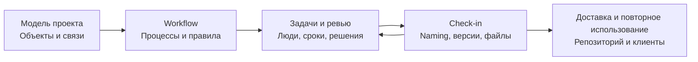
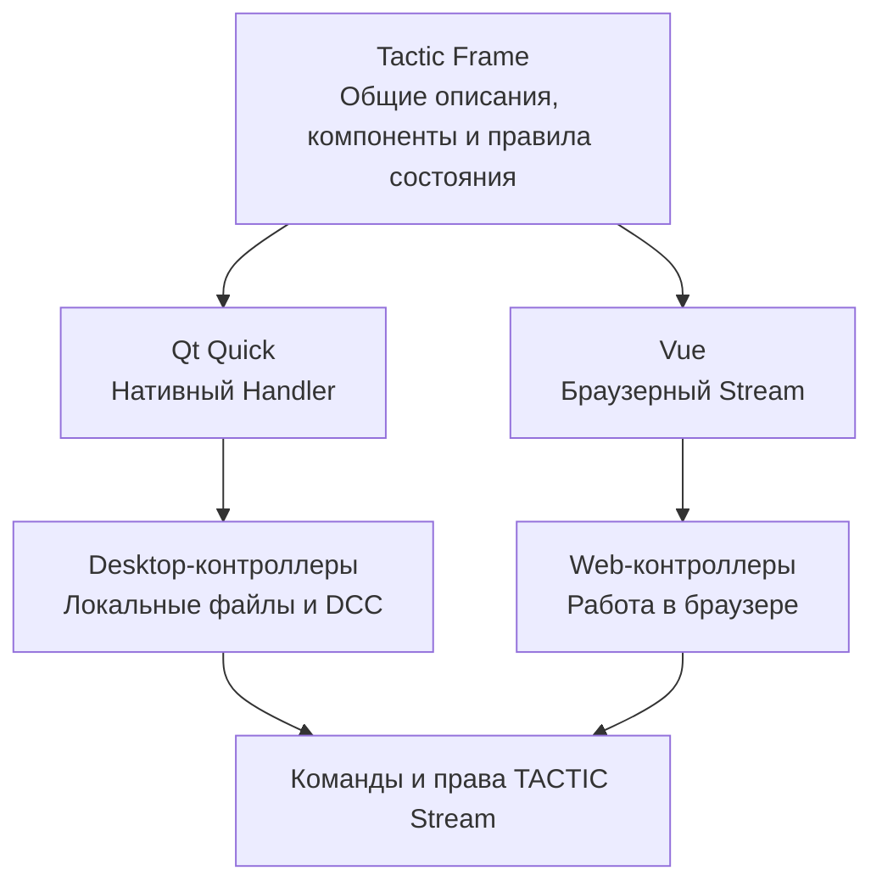
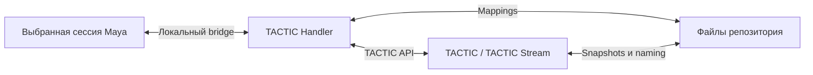

# TACTIC Handler: от ассета до сдачи

[Визуальная презентация](../../README.ru.md)

**Handler — настольный клиент для TACTIC и TACTIC Stream.** Этот обзор проходит через обычный рабочий день: найти ассет, разобраться в задачах и замечаниях, открыть нужную версию и опубликовать результат. По пути рассмотрим инструменты, которыми студия настраивает этот процесс.

**Начнём с ассета и посмотрим, как вокруг него устроена работа команды.**

[English](product-tour.en.md) · [Workflow](#workflow-что-запускается-после-завершения-этапа) · [Задачи и Gantt](#распределить-работу-и-следить-за-сроками) · [Файлы и naming](#чекин-и-чекаут-передать-файл-следующему-участнику) · [Tactic Frame](#tactic-frame-общий-язык-интерфейсов-handler-и-stream) · [Администрирование](#administration-описать-объекты-и-связи-вашего-проекта) · [Запуск](#установить-подключить-добавить-свои-инструменты)

[Доки](#доки-для-ревью-планирования-и-сдачи) · [Sidebar Editor](#sidebar-editor-каждый-отдел-начинает-со-своего-экрана) · [Обзор объекта](#всё-что-происходило-с-ассетом) · [История сервера](#activity-feed-кто-и-что-изменил-в-проекте) · [Пользователи и права](#подключить-людей-и-настроить-доступ)

| Ассистент проекта | Собственное рабочее пространство |
| --- | --- |
| [**Встроенный чат-бот →**](assistant.ru.md) — Вопросы по реальным данным, подготовка изменений и журнал операций за каждым ответом. | [**Кастомные дашборды →**](dashboards.ru.md) — Метрики, диаграммы, Item View и инструменты выбранного объекта на одной странице. |


*Свежие снимки текущего приложения в изолированном демопроекте Orbit Studio. Участники вымышлены, концепт-арты служат иллюстрациями; интерфейсы и записи проекта настоящие.*

> **Прототип в активной разработке.** Perforce-like File Workspace также остаётся прототипом. Перед использованием в производстве проверяйте свою схему, права, скрипты и файловые операции на изолированных данных.

## Зачем художнику отдельный клиент

Работа художника постоянно переходит от записи проекта к файлам на диске и открытой сцене. Handler нужен на этой границе: он работает с локальными каталогами, репозиторием и подключённой Maya, сохраняя связь с серверными объектами. При подключении к **TACTIC Stream** в том же клиенте доступны показанные здесь современные редакторы проекта, workflow, дашборды и помощник.

Сервер хранит записи проекта и публикации, проверяет права и исполняет workflow. Handler отвечает за взаимодействие с пользователем, локальные файлы, очереди и выбранное подключение DCC. Так у студии остаётся общая история работы, а художники пользуются своими компьютерами и приложениями.

Stream — серверный форк [Southpaw TACTIC](https://github.com/Southpaw-TACTIC/TACTIC); Handler — самостоятельный desktop-клиент, который также подключается к исходному TACTIC в пределах проверенной совместимости. Stream сохраняет настраиваемую модель и workflow-основу TACTIC, развивая актуальное Python-ядро, визуальные редакторы и Vue-интерфейс с общими для Handler описаниями Frame.

Возьмём передачу ассета из моделинга в риг. Завершённая задача сообщает о прогрессе, заметки содержат решения ревью, а snapshot указывает на конкретные сданные файлы. Для следующего участника важны все три вещи. Поэтому объект, pipeline, задачи, обсуждения и публикации связаны: по ним можно восстановить, что сделано и с чего продолжать.



## Item View: найти ассет и увидеть его содержимое

Обычно работа начинается с конкретной вещи: ассета, шота, документа или другого объекта проекта. В **Item View** можно узнать его по изображению, прочитать важные поля и перейти к действиям. Дерево раскрывает связанные записи, процессы и публикации. Когда нужно сравнить или поправить много полей, удобнее таблица с сортировкой, фильтрами и выделением.

При переходе между поисковыми вкладками сохраняется их рабочее состояние. Фильтры ограничивают серверную выборку, а теги и быстрые фильтры помогают возвращаться к привычным наборам. Задачи, заметки, snapshots, детали и календарь можно разместить рядом с результатами. Сохранённая раскладка избавляет отдел от необходимости каждый раз собирать это рабочее место заново.

### Обычный Item View: процессы и версии в одном дереве

Стандартное непрерывное дерево показывает превью объекта, связанные записи, процессы, задачи и версии snapshots прямо в результатах. Раскройте публикацию, чтобы увидеть версии, описания и превью файлов. Компактные строки и режимы версий справа/снизу меняют размещение того же нативного представления; настраиваемые Item Layouts — отдельная возможность оформления.


### Item Layouts: нужные поля и действия в карточке

Для ревью важны изображение и нужные действия; для плотного списка — несколько коротких полей. В **Item Layouts** можно собрать оба варианта, связав текст и изображения с данными объекта. Поддерживаемые действия добавляются прямо в карточку. Результат виден на записях проекта и сохраняется как представление, которое можно использовать снова.


**У Page layouts, Item layouts и Columns Editor разные задачи:** страница собирает рабочее место, item layout оформляет отдельный объект, табличное представление задаёт поля и виджеты. Sidebar связывает эти определения с навигацией проекта. [Справка по Item Layouts](../../thlib/ui/help_articles/item_layouts.ru.md)


## Доки для ревью, планирования и сдачи

Во время ревью превью стоит отдать большую часть экрана, а заметки оставить рядом. Для планирования ту же область полезнее разделить между объектами и задачами. **Доки** позволяют собрать такие рабочие места из готовых функциональных панелей: расположить их рядом, объединить во вкладки или временно убрать лишнее.


### Расставить панели и освободить место

Перетащите grip панели к краю, чтобы разделить область, в центр — чтобы создать стек вкладок, к заголовку — чтобы поменять панели местами. Двигайте разделители, меняйте порядок вкладок, временно разворачивайте док или скрывайте его, освобождая место. Отменённое перетаскивание возвращает прежнюю компоновку.

Handler поддерживает плавающие панели и отдельные нативные окна доков, в том числе для второго монитора. При восстановлении геометрия учитывает доступные экраны.


| Рабочее место | Возможная композиция |
| --- | --- |
| **Ревью** | Item View + Snapshot Browser + Description/Notes: выбор объекта, просмотр публикации и её обсуждение. |
| **Планирование** | Results + Task Manager/Gantt + детали задачи или календарь там, где доступны: назначения и даты рядом с объектами производства. |
| **Публикация** | Results + Drop Plate + Commit Queue: выбор назначения, подготовка файлов и проверка ожидающей операции. |
| **Документация** | Results + Knowledge Base: записи проекта рядом со справочными материалами команды. |

Панели связаны через выделение: выберите объект, процесс или snapshot в Search, и следующие за ним инструменты покажут его данные. Откройте задачу — инспектор перейдёт именно к ней. Можно переставлять эти панели, сохраняя связь между выбором и содержимым.

### Сохранить раскладку для себя и команды

Клиент и вкладка сохраняют своё состояние: размещение, размеры, видимость и стеки. **Layout presets** хранят именованные проектные компоновки на сервере: применение, обновление списка, сохранение, замена и удаление — отдельные действия. Назначьте пресет пункту sidebar, чтобы отдел получал подходящий стартовый интерфейс; последующая личная компоновка вкладки может сохранять изменения пользователя.

Пресет описывает панели и их расположение. Он не сохраняет авторизацию, не применяет черновик редактора и не заменяет Saved Search. Reset восстанавливает геометрию без удаления записей проекта и сохранённых запросов. Вместе с Item Layouts, Columns Editor, страницами дашбордов и полками скриптов доки позволяют собирать множество рабочих интерфейсов из реализованных инструментов. [Доки и окна](../../thlib/ui/help_articles/windows.ru.md)


## Sidebar Editor: каждый отдел начинает со своего экрана

Два отдела могут работать с одними ассетами и начинать с разных экранов. Пункт «Asset review» можно связать с визуальным представлением и панелями ревью, а «Asset planning» — с нужным поиском и задачами. В Sidebar Editor у пункта задаются Search Type, начальный поиск, представление, раскладка доков и полка скриптов. Так навигация открывает уже подготовленное рабочее место.


| Область редактора | Что собирается |
| --- | --- |
| **Дерево навигации** | Ссылки, разделы и разделители, порядок, вложенность и видимость. |
| **Item** | Заголовок, иконка, Search Type, исходный сохранённый поиск, вид объектов, пресет доков и shelf. |
| **Configure search** | Настройка настоящего поиска: сохранённый запрос, quick filters, видимость процессов, сортировка и группировка. |
| **Access** | Группы, которым виден пункт, и предпросмотр черновика для выбранной группы. Скрытые пункты остаются доступны для редактирования. |
| **Technical / XML** | Постоянный внутренний идентификатор, дочерние представления и поддерживаемая конфигурация виджета/view. |

Sidebar Handler `tactic_handler` и TACTIC `project_view` — независимые определения. Цель выбирается явно. Проект в редакторе задаёт область изменений, даже если в основном рабочем пространстве открыт другой проект.

Для переименования подписи меняется Title, сохраняя внутреннюю идентичность пункта. Назначенный Saved Search инициализирует первую вкладку; повторное открытие сохраняет рабочее состояние вместо создания дубликата. Apply XML меняет черновик, Save публикует sidebar. Предпросмотр группы не выполняет вход от её имени и не заменяет серверные права на данные. [Справка Sidebar Editor](../../thlib/ui/help_articles/sidebar_editor.ru.md)


## Всё, что происходило с ассетом

Прежде чем брать ассет в работу, полезно посмотреть его историю: кто участвовал, какие замечания остались и что опубликовано. **Details / SObject Report** собирает это у одной записи. В заголовке видны превью, данные объекта, описание и показатели; дальше можно перейти к задачам, заметкам, связям, файлам и событиям.


| Раздел | На какой вопрос отвечает |
| --- | --- |
| **Задачи и участники** | Кто вовлечён, какие есть статусы и процессы, сколько работы учтено? Участники собираются из задач, заметок, публикаций и записей времени. |
| **Notes** | Какие решения и замечания относятся к объекту и его процессам? Заметка открывается в исходном контексте. |
| **Дочерние объекты и связи** | Какие связанные производственные записи находятся под объектом или рядом с ним? |
| **Snapshots и файлы** | В каких процессах есть публикации, сколько в них файлов и каков общий размер? Дерево процесса раскрывает версии и превью. |
| **Activity** | Кто создавал или менял объект, задачи, заметки, публикации, записи времени и поддерживаемые связи? |

Задача открывает соответствующую область Task Manager и точную запись в Inspector. Заметка возвращает к обсуждению процесса. Публикация сохраняет исходный проект. Стоимость показывается только при наличии соответствующего права. Так можно разобраться, что стоит за статусом объекта, и открыть нужную запись прямо из обзора. [SObject Report](../../thlib/ui/help_articles/sobject_info.ru.md)


## Workflow: что запускается после завершения этапа

После моделинга можно направить ассет в lookdev и риг параллельно, а затем дождаться согласования перед публикацией. Pipeline описывает такой маршрут, а сервер выполняет настроенные реакции на события: меняет задачи, учитывает зависимости, вызывает скрипты и уведомления. У самого ассета есть производственный путь; у задачи на отдельном этапе — свои статусы. Поэтому pipeline объекта и pipeline статусов задачи настраиваются отдельно.


*Настроенный граф с параллельными lookdev и rig, этапом согласования и автоматическим действием. Снимок показывает определение процесса, а не подтверждает выполнение каждой его ветки.*

| Узел или правило | Для чего используется |
| --- | --- |
| Manual и approval | Работа исполнителей, ревью и согласование результата. |
| Action и condition | Настроенное серверное действие или выбор ветки по условию. |
| Hierarchy, input и output | Вложенные pipelines, точки входа и выхода. |
| Dependency и progress | Согласование зависимой работы и завершения процессов. |
| Status и события процесса | Реакции на pending, action, complete, revise, reject и error. |
| Правила процесса | Смена статуса задачи или родителя, создание следующих задач, запись фактических дат, вызов сохранённого скрипта или класса, настройка уведомлений. |

В **Administration → Workflow** выбирают pipeline, компонуют граф и редактируют параметры выбранного процесса. Набор настроек зависит от типа узла. Технические представления открывают XML и расширенную конфигурацию. Зависимости, триггеры, уведомления и naming связаны с workflow, но имеют собственные настройки. Сохранение графа само по себе не запускает его действия и не отправляет письма.

Pipeline хранится и исполняется на сервере. В Handler его можно настроить через нативный редактор и работать с созданными задачами. Поэтому команда использует одни правила независимо от выбранного клиента.

## Распределить работу и следить за сроками

### Task Manager: свои задачи и работа отдела

Художнику нужен список своей работы, руководителю — задачи отдела или проекта. Task Manager позволяет менять этот охват: от выбранных объектов и Search Type до личных и командных задач. В таблице и компактных представлениях видны исполнители, супервайзеры, статусы, даты, прогресс и трудозатраты. Поиск, фильтры, группировка и сортировка помогают выделить нужную часть плана.

Изменения остаются черновиком до сохранения. Массовое редактирование применяется к выбранным задачам; инспектор сохраняет доступ к объекту и обсуждению. Доступные поля и операции определяются серверными правами.


### Gantt: сроки, пересечения и затраты времени

В списке трудно заметить, что одному человеку назначены две работы на один срок. Gantt показывает задачи на временной шкале и выводит предупреждения расписания. Полосы можно двигать и растягивать, менять прогресс, масштаб и группировку по исполнителю. Видны существующие зависимости; задачи без дат тоже остаются доступными.


*В демонстрационном расписании есть пересечения, и интерфейс действительно показывает предупреждения. Отображение зависимостей не означает автоматического каскадного переноса задач.*

Календарь задач и agenda дают представление по датам, milestones обозначают контрольные точки проекта. Учёт часов и отчёты по стоимости связывают затраты с людьми и работой в пределах доступных пользователю прав. [Task Manager](../../thlib/ui/help_articles/dock.tasks.ru.md) · [Календарь](../../thlib/ui/help_articles/dock.task_calendar.ru.md)

## Messages и Notes: обсудить работу и сохранить решения

В **Messages** можно собрать участников ревью, уточнить срок или передать вопрос коллеге из другого проекта. Есть личные и групповые разговоры, Избранное, ответы, упоминания, реакции, закрепления, пересылка, поиск и управление участниками. Файлы добавляются через выбор, перетаскивание или буфер обмена; незаконченные сообщения остаются в черновиках.


Когда в разговоре принято решение по ассету, его удобно оставить в **Notes** у объекта, процесса или задачи. Позже следующий участник найдёт его вместе с работой. Повторяющиеся инструкции лучше оформить в **Knowledge Base**, где есть дерево статей, вложения и история редакций. Уведомления и журнал активности помогают заметить изменения и вернуться к соответствующим записям.

[Встроенная справка: поиск и контекстные инструкции →](help.ru.md) · [База знаний: статьи, редактор и история →](knowledge-base.ru.md)


## Activity Feed: кто и что изменил в проекте

Если статус или файл изменился и нужно понять, что произошло, откройте **Activity Feed**. Журнал показывает поддерживаемые события проекта: заметки, публикации, задачи, изменения полей и трудозатраты. У события есть автор, время, детали и переход к объекту или задаче. Раздел Activity в обзоре объекта сужает эту историю до одной записи и поддерживаемых событий её потомков и связей.


Фильтруйте людей и категории, исключайте собственные действия, ищите по загруженным событиям или выбирайте день в календаре. Прокрутка подгружает прошлые события; счётчики календаря охватывают доступную историю за пределами текущего списка. Даты показываются в локальном часовом поясе, относительное время учитывает синхронизацию с сервером.

У трёх историй разные задачи. **Activity Feed** объясняет изменения проекта. **Notifications** хранит уведомления текущей сессии клиента и переходы к их источникам. **System Activity / Debug Log** показывают текущую работу и диагностику приложения. Очистка уведомлений не удаляет серверный журнал, переписку или версии файлов. Полнота истории зависит от того, какие события записывает конкретная операция или расширение.


## Чекин и чекаут: передать файл следующему участнику

Передача файла — момент, когда личная работа становится доступной другим. Вместе с ней нужно сохранить объект, процесс, версию и описание результата. Публикация проходит через подготовку, проверку очереди и запись snapshot:

1. Выберите объект и процесс/контекст. Добавьте локальные файлы или каталоги через **Drop Plate** либо подготовьте сцену в выбранном подключении DCC.
2. Сопоставьте и сгруппируйте файлы/последовательности. В **Commit Queue** проверьте описание, параметры версии, разрешённые пути и роли файлов.
3. Отправьте операцию. У каждого элемента очереди свой прогресс и результат; вся очередь не является одной атомарной транзакцией.
4. Просмотрите snapshots, сравните версии изображений, откройте или выполните checkout нужных файлов.


Check-in поддерживает общую или раздельную публикацию групп и штатные ingest-связи. При коллизии существующий файл сохраняется. Move удаляет источник только после подтверждённого успеха; неопределённый результат нужно сверить, а не слепо повторить. Подготовка и передача видны отдельно от итоговой записи snapshot.

Snapshot связывает версию с объектом, процессом/контекстом, автором, описанием и файлами. Новая версия и ревизия — разные операции. Правила `latest` и `current` отделены от версионного хранения. Файловые последовательности сохраняют информацию о диапазоне, чтобы checkout мог разрешить опубликованные кадры.

### Naming Editor: имя и путь по правилам студии

Соглашение об именах полезно, когда оно действует при каждой публикации. В Naming Editor задаются условия выбора правила, контексты, шаблоны имён и каталогов, sandbox-пути и алиасы репозиториев. Имя можно собрать из данных объекта, snapshot и файла, дополнить условиями TSQL или доверенным сохранённым скриптом. Прежде чем сохранить правило, его результат можно посмотреть на примере.


Например, имя может собираться из названия объекта, версии и расширения: `{sobject.name}_v{version}.{ext}`. При публикации путь заново разрешает нативный naming engine. Предпросмотр не резервирует имя: финальный check-in проверяет версию и коллизии. Скриптовые правила выполняют доверенный код проекта.

### Repository Sync: нужные версии на вашем компьютере

Синхронизируйте нужную область: выбранные объекты, процессы, версии или связанных потомков. Пресеты сохраняют повторяющийся выбор; полная/частичная синхронизация и поиск только обновлений поддерживают разные рабочие наборы. Очередь показывает обнаружение файлов, передачу, отмену, повтор и политику конфликтов.


**Watch Folders** связывают проект и локальный каталог с правилами сопоставления/check-in и направляют найденную работу в Commit Queue. Сохранение настройки репозитория не запускает неявный перенос или удаление файлов. Это desktop-возможности Handler, отдельные от браузерной загрузки и скачивания Stream.

## Tactic Frame: общий язык интерфейсов Handler и Stream

Handler и Stream работают в разных средах, но многие их окна решают одну задачу. **Tactic Frame** даёт общий язык для описания таких интерфейсов: их элементов, геометрии, состояния и действий. Qt Quick и Vue берут это описание и отображают его своими компонентами. Поэтому общее устройство окна можно развивать в одном описании, сохраняя нативный Qt-интерфейс Handler.

Frame использует обычные JavaScript-модули `.mjs` и структуры данных. Функция `describe(model, width, height, language)` формирует видимую структуру из состояния. Контроллеры обрабатывают действия и обращаются к предметным операциям; описание интерфейса не становится отдельным серверным API.



Небольшой модуль рядом с этим документом иллюстрирует контракт. Host передаёт `model` и обрабатывает действие `name`; рабочие модули также используют общие функции перевода.

```javascript
import { label, node, rect } from "../../thlib/ui/qml/tactic_frame/core/frame.mjs";

export function describe(model, width, height, language) {
    return { nodes: [
        label("title", rect(16, 12, width - 32, 28), "Review"),
        node("Field", "assetName", rect(16, 48, width - 32, 38), {
            label: "Asset", text: model.name, action: { type: "name" }
        })
    ] };
}
```

Общая библиотека включает поля, кнопки, селекторы, виртуализированные списки, таблицы, графы, редакторы и структуру окон. Контракт охватывает не только геометрию, но и темы, перевод, фокус и ввод. **Component showcase** показывает этот набор компонентов внутри приложения.


XML-представления проекта и документы визуальных редакторов настраивают содержимое поверх этого слоя. Это отдельные форматы конфигурации, а не новый синтаксис файлов Frame. Продукты собираются независимо и содержат собственные копии общих описаний; поведение проверяется в обоих рендерах. [Контракты Frame](../frame/index.md)

## Script Editor: написать скрипт и дать команде инструмент

Разовая команда со временем может стать инструментом отдела. В Script Editor её можно написать, выполнить целиком или по выделенному фрагменту, посмотреть результат и ошибки, затем сохранить в библиотеку проекта. Вкладки, черновики, undo, подсветка, автодополнение, поиск/замена и навигация по структуре помогают дорабатывать код. Папки и понятные имена позволяют коллегам находить готовые инструменты.


| Среда | Владелец и контекст |
| --- | --- |
| **Local Python / QML-инструменты** | Нативные объекты и UI Handler; операции интерфейса учитывают границу GUI-потока Qt. |
| **Server Python** | Подключённый сервер TACTIC с проектным контекстом и правами. |
| **Selected DCC** | Явно выбранная зарегистрированная сессия и поддерживаемые ею возможности. |

Редактор показывает цель исполнения. Локальный/DCC-вывод возвращается во вкладку; Server Python показывает возвращаемый результат, а stdout процесса остаётся в журнале сервера. Одного названия языка недостаточно, чтобы определить компьютер и объекты исполнения.

**Script Shelf** размещает действия рядом с работой: общая полка студии, личные инструменты и полки конкретных поисковых вкладок. **Before/After hooks** привязывают автоматизацию к событиям с фильтрами по процессу, контексту и Search Type. Ошибка Before может остановить операцию; ошибка After не отменяет уже завершённое действие. Право выполнять доверенный код отделено от возможности просматривать скрипт.

[Script Editor](../../thlib/ui/help_articles/script_editor.ru.md) · [Script Shelf](../../thlib/ui/help_articles/script_shelf.ru.md)

## Administration: описать объекты и связи вашего проекта

У разных проектов отличается само устройство работы: какие объекты есть, как они связаны и какие данные нужны людям. В Administration можно описать эту модель через Search Types и схему, затем настроить представления и действия. Asset и Shot — возможные типы объектов; проект может использовать собственные. Граф схемы помогает увидеть связи целиком.


| Раздел | Что настраивается |
| --- | --- |
| **Search Types** | Типы сущностей, поля и правила нейминга. |
| **Project schema** | Связи между сущностями и граф проекта. |
| **Workflow** | Pipelines, свойства процессов, зависимости и автоматизация. |
| **Columns Editor** | Табличные представления, столбцы и нативные виджеты полей. |
| **Raw database** | Разрешённый просмотр/редактирование таблиц и CSV с ограничениями для защищённых таблиц. |
| **Page layouts** | Страницы дашбордов, блоки, источники данных и навигация. |
| **Item layouts** | Переиспользуемые карточки, строки и представления объектов. |
| **Sidebar Editor** | Группы навигации, пункты, представления и входы в рабочие пространства. |
| **Plugins** | Пакеты, версии и активация в проекте. |
| **Component showcase** | Набор компонентов, из которых построены интерфейсы. |
| **Users** | Учётные записи и доступ к проектам. |
| **Groups** | Участники групп и общие настройки доступа. |
| **Access rules** | Наследуемые и явные allow/deny, проверка эффективных прав пользователя. |


Разделы редактирования сохраняют собственные черновики. Save/Discard и проверка ревизии делают изменение явным; серверные операции продолжают проверять права. Наличие визуального редактора не даёт неограниченного доступа к базе. [Справка по Administration](../../thlib/ui/help_articles/administration.ru.md)


## Подключить людей и настроить доступ

Один сотрудник может участвовать в нескольких проектах и появляться в задачах, разговорах, публикациях и журнале событий. Для этого используется единая серверная учётная запись с профилем, контактами, настройками и членством в группах. При переходе между проектами сохраняется понимание, кто выполнил действие.


### Создать аккаунт, приостановить доступ, вернуть сотрудника

Создайте пользователя, задайте начальный пароль и профиль, назначьте нужные группы. Существующие профиль и аккаунт редактируются без чтения сохранённого пароля. Retire прекращает активное использование учётной записи, Reactivate возвращает её; производственная история сохраняет идентичность автора. Архивация аккаунта и удаление объекта проекта — разные операции.

### Группы и правила: что разрешено конкретному человеку

Groups управляет участниками и описаниями групп. Access rules задаёт политику: уровень доступа, область проектов, поддерживаемые правила объектов/процессов/статусов/действий, наследование и явные allow/deny. Видимость sidebar — отдельная часть интерфейсной политики: скрыть ссылку не означает запретить доступ к её данным.


Человек может состоять в нескольких группах, а правила — наследоваться и переопределяться. Поэтому после настройки полезно проверить итоговый доступ конкретного пользователя. Матрица группы показывает отдельную часть политики; проверка эффективных прав помогает увидеть её результат для человека.

Практический порядок подключения сотрудника: **аккаунт → группы → права на проект и данные → видимость sidebar → проверка итогового доступа**. Выбранный проект Administration ограничивает проектные определения, но не превращает общие учётные записи в локальные аккаунты проекта. Черновики, подтверждения и нативные серверные проверки продолжают действовать.

## Configuration: сервер, репозитории и личные настройки

Адрес сервера, пути репозиториев и личная тема интерфейса меняются по другим причинам, чем схема проекта. Для них есть Configuration. У каждой страницы свой черновик: Apply применяет текущую страницу, Save сохраняет ожидающие изменения, а уход с несохранёнными настройками проверяется. Оформление можно сначала посмотреть, затем принять или отменить.


| Область | Назначение |
| --- | --- |
| **AI providers** | Профили провайдеров, получение моделей и выбор исполнителя ассистента. |
| **Server** | Подключение, поддерживаемые серверные параметры, состояние служб и явные команды управления. |
| **Database resources** | Настройка и проверка ресурсов, привязка существующих схем; без переноса данных. |
| **Repositories** | Имена, цвета, пути репозиториев и поддерживаемые настройки серверного хранения. Сохранение пути не перемещает файлы. |
| **Projects** | Создание проектов, шаблоны и проектные настройки. |
| **Check-in Options** | Параметры подготовки файлов, naming и публикации по умолчанию. |
| **Global** | Общие настройки взаимодействия и обновления данных, доступные данному клиенту. |
| **Appearance** | Светлые/тёмные темы, палитры, иконки, английский и русский интерфейс. |
| **Cache** | Политика, состояние и обслуживание кэша. |
| **Tasks** | Настройки задач, времени и трудозатрат. |
| **DCC plugins** | Установка и настройка поддерживаемых интеграций. |
| **Client plugins** | Поиск и настройка desktop-расширений. |
| **Страницы интеграций** | Параметры активного приложения, например поведение сцен Maya. |

Поддерживаемые параметры серверного XML охватывают службы, сеть, безопасность, каталоги и расписание, с валидацией и указанием необходимости перезапуска. Сохранение конфигурации и рестарт службы — отдельные действия. Перенос базы или репозитория требует отдельной процедуры. [Справка по Configuration](../../thlib/ui/help_articles/configuration.ru.md)

## Помощник проверяет готовность ассета по его записям

Спросите, что готово к ревью, какая версия опубликована или чего не хватает для передачи работы. Встроенное окно **External agent** фиксирует проект, страницу, Search Type и выбранные объекты. Исполнитель читает и изменяет данные через ограниченные нативные инструменты.


В этом примере ассистент обнаружил полезное расхождение: моделинг отмечен Complete, но публикации модели нет. Он также отделил замечания ревьюера от подтверждения согласования. Отдельная презентация разбирает диалоги, вложения, провайдеров, конфигурацию проекта, изменение задач, испытания скриптов и границы отмены.

**[Подробная презентация встроенного ассистента →](assistant.ru.md)**

## Дашборды для руководителя и ревьюера

Обзор производства должен помогать понять, куда смотреть дальше. На собственной странице можно собрать показатели, отчёты и диаграммы, а рядом разместить Item View, формы и действия. Руководитель может перейти от общей картины к отдельному ассету; ревьюер — страницу, где дерево и детали выбранного объекта находятся рядом. Все блоки работают с данными проекта и действующими правами.


**[Подробная презентация дашбордов и визуального редактора →](dashboards.ru.md)**

## Установить, подключить, добавить свои инструменты

### Связать Handler с выбранной Maya

Поставляемый коннектор Maya регистрируется в локальном **Handler Server**. Перед open, import, reference или сохранением сцены выбирается нужная сессия. Maya подготавливает сцену; Handler выполняет TACTIC check-in и передачу файлов. Другим приложениям нужен коннектор с явно зарегистрированными нативными возможностями.



[Установка Maya](../../installer/README.md) · [DCC API](../dcc_api.md) · [Протокол thin client](../thin_client_protocol.md)

### Установить Handler из исходников на Windows

Нужны современный checkout, Python 3.14 и работающий сервер TACTIC.

```powershell
py -3.14 -m venv .venv
.\.venv\Scripts\python.exe -m pip install -r requirements.txt
.\.venv\Scripts\python.exe launch.py
```

В **Configuration → Server** проверьте пресет подключения и получите ticket. Выберите проект и настройте mappings репозитория до файловых операций. [Первое подключение](../handbook.ru.md) · [Начало работы](../../thlib/ui/help_articles/getting_started.ru.md)

### Использовать API Handler в своих инструментах

Публичный `tactic_handler_api` открывает клиентские объекты, файловые операции и поддерживаемые действия UI. Точки входа для standalone, Script Editor и DCC сохраняют собственный контекст исполнения.

```python
from tactic_handler_api import local

with local() as handler:
    assets = handler.project("orbit").stype("orbit/asset")
    result = assets.query(limit=12, order_by=["name asc"])
    for asset in result.items:
        print(asset.get_code(), asset.get_value("name"))
```

Замените демонстрационный проект и Search Type своими. [API и примеры](../handler_api.md) · [Архитектура](../application_architecture.md) · [Руководство](../handbook.ru.md)

## Совместимость, ограничения и лицензии

Здесь Handler показан с сервером Stream. Специфичные для Stream редакторы проекта, дашборды и ассистент требуют именно этого сервера; их наличие в презентации не обещает такие же службы в любой установке исходного TACTIC. Для существующей установки проверьте [карту совместимости](../tactic_compatibility/README.md).

Perforce-like File Workspace остаётся прототипом. Реализованные Commit Queue и Repository Sync не означают полного поведения Perforce. Здесь поставляется коннектор Maya; другие DCC требуют своего присутствующего и проверенного коннектора. [Индекс документации](../index.md)

Скриншоты иллюстрируют настроенную работу на небольшом демопроекте. Это не бенчмарк и не подтверждение релизной приёмки. Скрипты студии, схема, интеграции и права проверяются на используемой версии продукта.

TACTIC Handler распространяется под [Eclipse Public License 1.0](../../LICENSE). Серверная интеграция основана на [Southpaw TACTIC](https://github.com/Southpaw-TACTIC/TACTIC).

[Maya-плагин и shelf](maya.ru.md)
