# TACTIC Handler: возможности и настройка

[Визуальная презентация](../../README.ru.md)

[English](product-tour.en.md) · [Workflow](#workflow-граф-и-исполнение) · [Задачи и Gantt](#планирование) · [Файлы и naming](#чекин-и-чекаут) · [Tactic Frame](#tactic-frame) · [Администрирование](#администрирование-проекта) · [Запуск](#установка-и-интеграции)

[Доки](#доки-и-раскладки) · [Sidebar Editor](#sidebar-editor) · [Обзор объекта](#обзор-объекта) · [История сервера](#activity-feed-и-история-проекта) · [Пользователи и права](#пользователи-и-права)

| Ассистент проекта | Собственное рабочее пространство |
| --- | --- |
| [**Встроенный чат-бот →**](assistant.ru.md) — Запросы к данным проекта, подготовка изменений и журнал операций. | [**Кастомные дашборды →**](dashboards.ru.md) — Метрики, диаграммы, Item View и инструменты выбранного объекта на одной странице. |

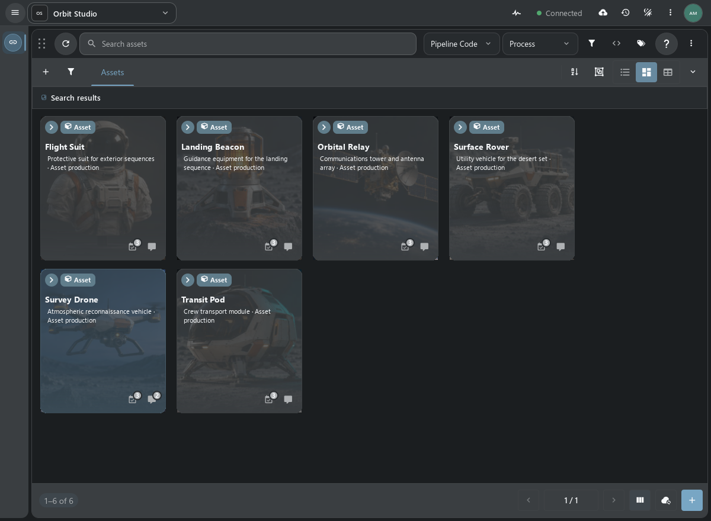

*Скриншоты текущего приложения. Orbit Studio, участники и материалы — демонстрационные.*

> **Прототип в разработке**, в том числе Perforce-like File Workspace.

## Настольный клиент TACTIC

Handler работает с локальными каталогами, репозиторием и Maya и связывает файлы с записями TACTIC. При подключении к **TACTIC Stream** доступны также редакторы проекта, workflow, дашборды и помощник.

Сервер хранит данные и публикации, проверяет права и исполняет workflow. Handler отвечает за интерфейс, локальные файлы, очереди и подключение к выбранной DCC-сессии.

Stream — серверный форк [Southpaw TACTIC](https://github.com/Southpaw-TACTIC/TACTIC); Handler — самостоятельный desktop-клиент, который также подключается к исходному TACTIC в пределах проверенной совместимости. Stream сохраняет настраиваемую модель и workflow-основу TACTIC, развивая актуальное Python-ядро, визуальные редакторы и Vue-интерфейс с общими для Handler описаниями Frame.

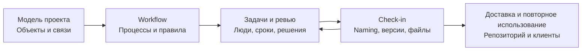

## Item View и поиск

**Item View** показывает объекты проекта с превью, полями и действиями. В дереве раскрываются связи, процессы и публикации. Табличный режим удобен для сравнения и редактирования полей: в нём есть сортировка, фильтры и выделение.

Поисковые вкладки сохраняют своё состояние. Серверную выборку задают фильтры; теги и быстрые фильтры дают доступ к часто используемым наборам. Рядом с результатами размещаются задачи, заметки, snapshots, детали и календарь.

### Дерево объектов, процессов и версий

Стандартное непрерывное дерево показывает превью объекта, связанные записи, процессы, задачи и версии snapshots прямо в результатах. Раскройте публикацию, чтобы увидеть версии, описания и превью файлов. Компактные строки и режимы версий справа/снизу меняют размещение того же нативного представления; настраиваемые Item Layouts — отдельная возможность оформления.

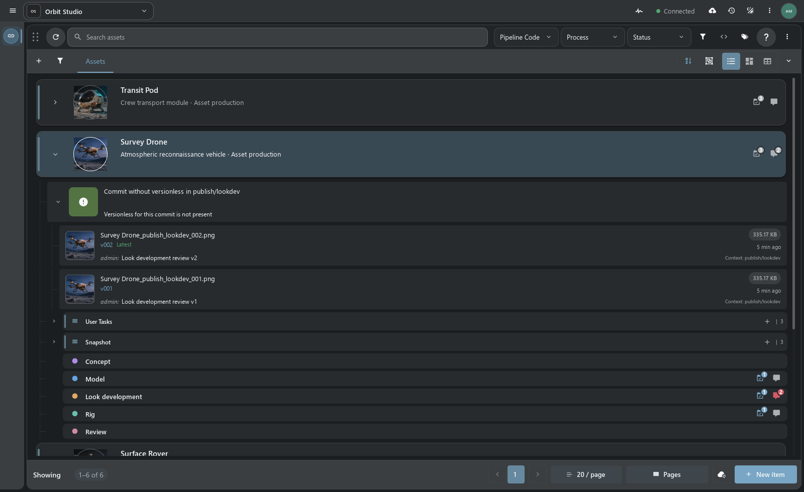

### Item Layouts

В **Item Layouts** настраиваются карточки и строки: текст, изображения, поля и действия. Редактор связывает элементы с данными объекта и показывает результат на записях проекта. Сохранённый layout можно назначить представлению.

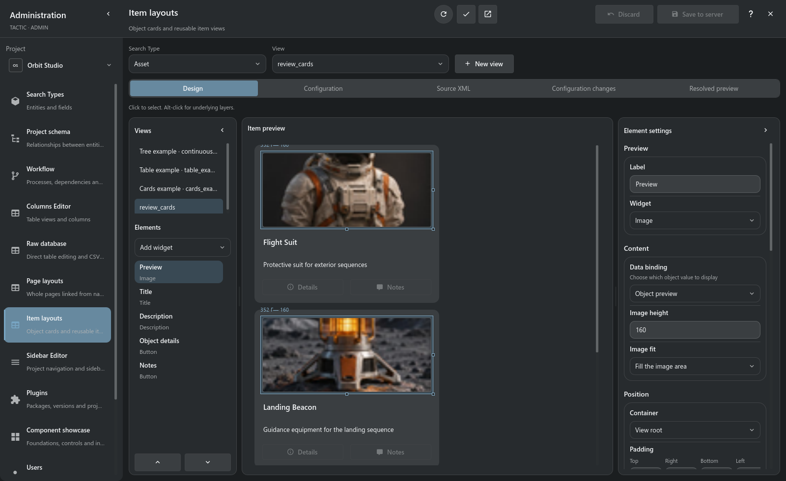

**У Page layouts, Item layouts и Columns Editor разные задачи:** страница собирает рабочее место, item layout оформляет отдельный объект, табличное представление задаёт поля и виджеты. Sidebar связывает эти определения с навигацией проекта. [Справка по Item Layouts](../../thlib/ui/help_articles/item_layouts.ru.md)

## Доки и раскладки

**Доки** — панели, из которых собирается рабочее окно. Их можно ставить рядом, объединять во вкладки и скрывать. Для ревью удобно оставить крупное превью с заметками, для планирования — список объектов и задачи.

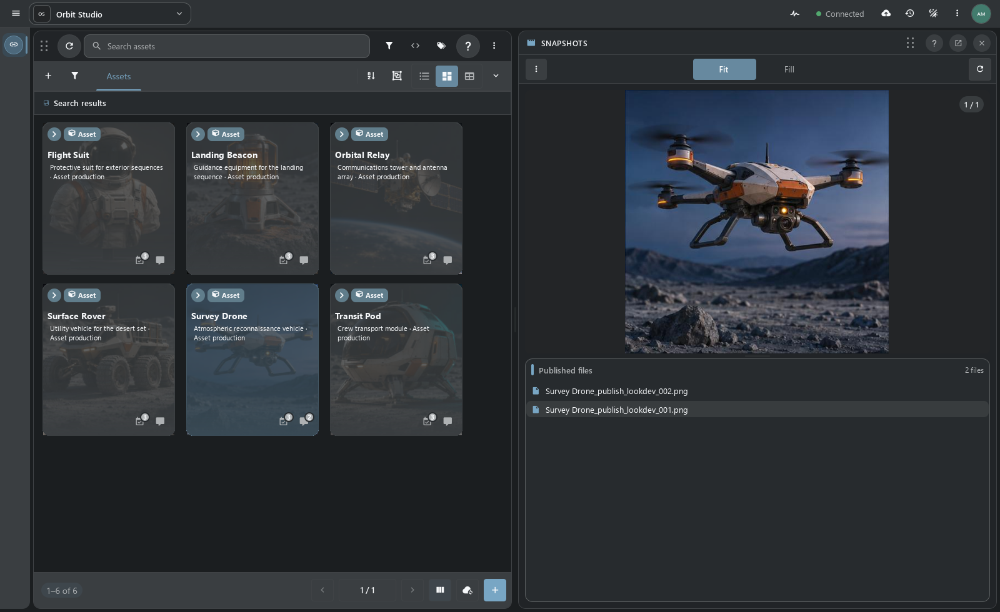

### Размещение панелей

Перетащите grip панели к краю, чтобы разделить область, в центр — чтобы создать стек вкладок, к заголовку — чтобы поменять панели местами. Двигайте разделители, меняйте порядок вкладок, временно разворачивайте док или скрывайте его, освобождая место. Отменённое перетаскивание возвращает прежнюю компоновку.

Handler поддерживает плавающие панели и отдельные нативные окна доков, в том числе для второго монитора. При восстановлении геометрия учитывает доступные экраны.

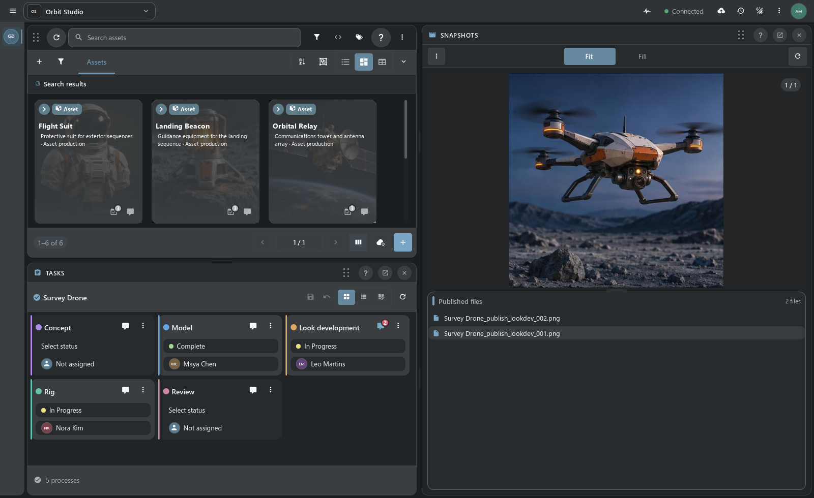

| Рабочее место | Возможная композиция |
| --- | --- |
| **Ревью** | Item View + Snapshot Browser + Description/Notes: выбор объекта, просмотр публикации и её обсуждение. |
| **Планирование** | Results + Task Manager/Gantt + детали задачи или календарь там, где доступны: назначения и даты рядом с объектами производства. |
| **Публикация** | Results + Drop Plate + Commit Queue: выбор назначения, подготовка файлов и проверка ожидающей операции. |
| **Документация** | Results + Knowledge Base: записи проекта рядом со справочными материалами команды. |

Панели могут следовать за выделением в Search: объектом, процессом или snapshot. При открытии задачи Inspector выбирает соответствующую запись. Перестановка панелей эту связь не меняет.

### Личные и проектные раскладки

Личная раскладка сохраняется в состоянии вкладки. **Layout presets** — именованные раскладки проекта на сервере; их можно применять, сохранять, заменять и удалять. Пресет назначается пункту sidebar как начальная компоновка, которую пользователь затем может изменить.

Пресет хранит панели и их расположение. Saved Search и черновики редакторов сохраняются отдельно; авторизация в пресет не входит. Reset сбрасывает геометрию, сохраняя записи и запросы. Доки работают вместе с Item Layouts, Columns Editor, страницами и полками скриптов. [Доки и окна](../../thlib/ui/help_articles/windows.ru.md)

## Sidebar Editor

В Sidebar Editor пункту навигации назначаются Search Type, начальный поиск, представление, пресет доков и полка скриптов. Например, Asset review открывает карточки с панелями ревью, а Asset planning — поиск и задачи. Видимость пункта задаётся для групп.

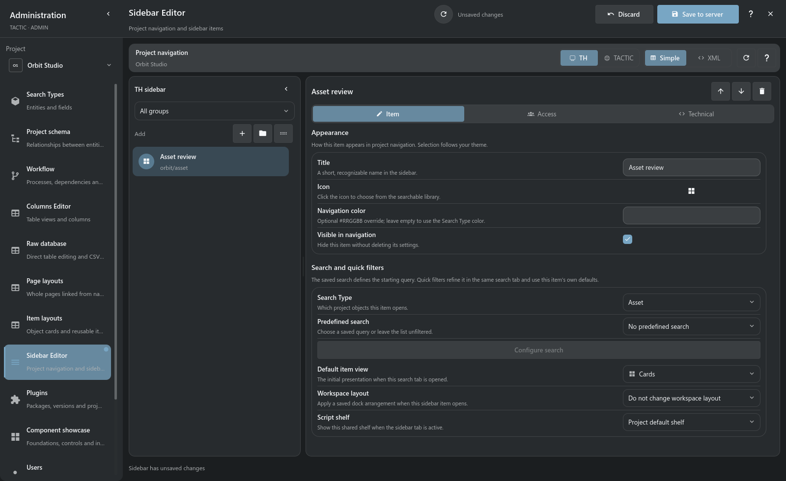

| Область редактора | Что собирается |
| --- | --- |
| **Дерево навигации** | Ссылки, разделы и разделители, порядок, вложенность и видимость. |
| **Item** | Заголовок, иконка, Search Type, исходный сохранённый поиск, вид объектов, пресет доков и shelf. |
| **Configure search** | Настройка настоящего поиска: сохранённый запрос, quick filters, видимость процессов, сортировка и группировка. |
| **Access** | Группы, которым виден пункт, и предпросмотр черновика для выбранной группы. Скрытые пункты остаются доступны для редактирования. |
| **Technical / XML** | Постоянный внутренний идентификатор, дочерние представления и поддерживаемая конфигурация виджета/view. |

Sidebar Handler `tactic_handler` и TACTIC `project_view` — независимые определения. Цель выбирается явно. Проект в редакторе задаёт область изменений, даже если в основном рабочем пространстве открыт другой проект.

Для переименования подписи меняется Title, сохраняя внутреннюю идентичность пункта. Назначенный Saved Search инициализирует первую вкладку; повторное открытие сохраняет рабочее состояние вместо создания дубликата. Apply XML меняет черновик, Save публикует sidebar. Предпросмотр группы не выполняет вход от её имени и не заменяет серверные права на данные. [Справка Sidebar Editor](../../thlib/ui/help_articles/sidebar_editor.ru.md)

## Обзор объекта

**Details / SObject Report** собирает сведения об объекте: описание, участников, задачи, замечания, файлы и историю. В заголовке находятся превью и сводные показатели, ниже — разделы с переходами к записям.

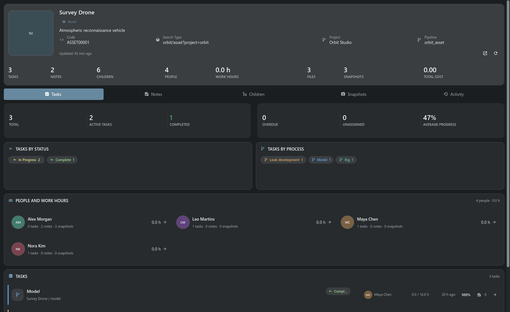

| Раздел | Содержимое |
| --- | --- |
| **Задачи и участники** | Статусы, процессы и учтённое время. Участники собраны из задач, заметок, публикаций и записей времени. |
| **Notes** | Заметки объекта и его процессов с переходом к обсуждению. |
| **Дочерние объекты и связи** | Связанные производственные записи. |
| **Snapshots и файлы** | Публикации по процессам, версии, превью, количество и общий размер файлов. |
| **Activity** | Изменения объекта, задач, заметок, публикаций, времени и поддерживаемых связей, с указанием автора. |

Из обзора задача открывается в Task Manager и Inspector, заметка — в обсуждении процесса, публикация — в своём проекте. Данные стоимости доступны только с соответствующим правом. [SObject Report](../../thlib/ui/help_articles/sobject_info.ru.md)

## Workflow: граф и исполнение

Workflow исполняет правила pipeline на сервере: меняет задачи, учитывает зависимости, вызывает скрипты и уведомления. Граф может содержать параллельные ветки и согласования. Производственный pipeline объекта и pipeline статусов задачи настраиваются отдельно.

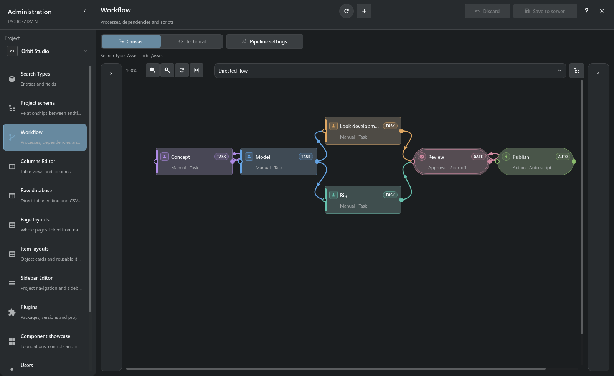

*Pipeline с параллельными lookdev и rig, согласованием и автоматическим действием.*

| Узел или правило | Для чего используется |
| --- | --- |
| Manual и approval | Работа исполнителей, ревью и согласование результата. |
| Action и condition | Настроенное серверное действие или выбор ветки по условию. |
| Hierarchy, input и output | Вложенные pipelines, точки входа и выхода. |
| Dependency и progress | Согласование зависимой работы и завершения процессов. |
| Status и события процесса | Реакции на pending, action, complete, revise, reject и error. |
| Правила процесса | Смена статуса задачи или родителя, создание следующих задач, запись фактических дат, вызов сохранённого скрипта или класса, настройка уведомлений. |

В **Administration → Workflow** выбирается pipeline, редактируются граф и параметры узлов. Настройки зависят от типа процесса; XML и расширенная конфигурация доступны в технических представлениях. Триггеры, уведомления, зависимости и naming настраиваются отдельно. Сохранение графа не запускает действия.

Pipeline хранится и исполняется на сервере. В Handler его можно настроить через нативный редактор и работать с созданными задачами. Поэтому команда использует одни правила независимо от выбранного клиента.

## Планирование

### Task Manager

**Task Manager** работает с выбранными объектами, Search Type, личными задачами или задачами команды. Таблица и компактные представления показывают исполнителей, супервайзеров, статусы, даты, прогресс и трудозатраты. Доступны поиск, фильтры, группировка и сортировка.

Изменения остаются черновиком до сохранения. Массовое редактирование применяется к выбранным задачам; инспектор сохраняет доступ к объекту и обсуждению. Доступные поля и операции определяются серверными правами.

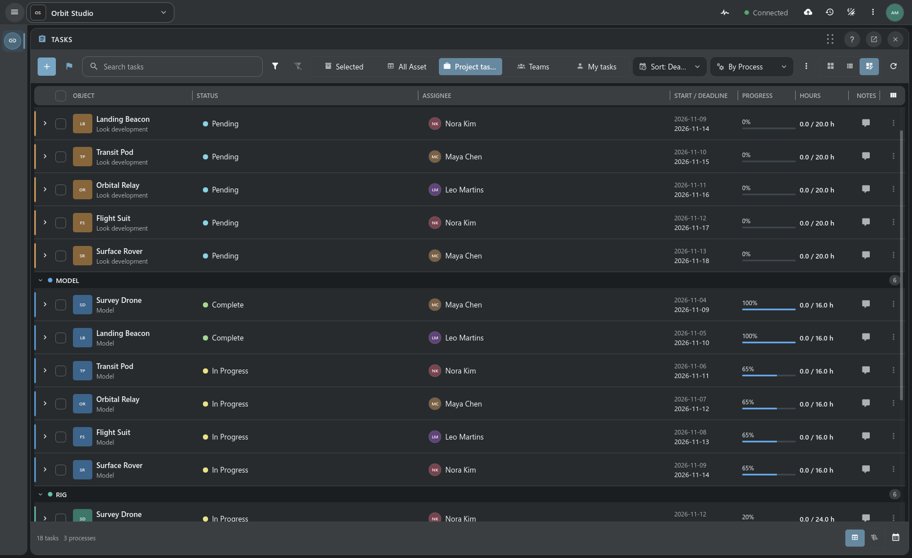

### Gantt, календарь и учёт времени

В Gantt задачи размещены на временной шкале. Полосы можно двигать и растягивать, менять прогресс, масштаб и группировку. Показаны зависимости, пересечения назначений и предупреждения расписания; задачи без дат доступны отдельно.

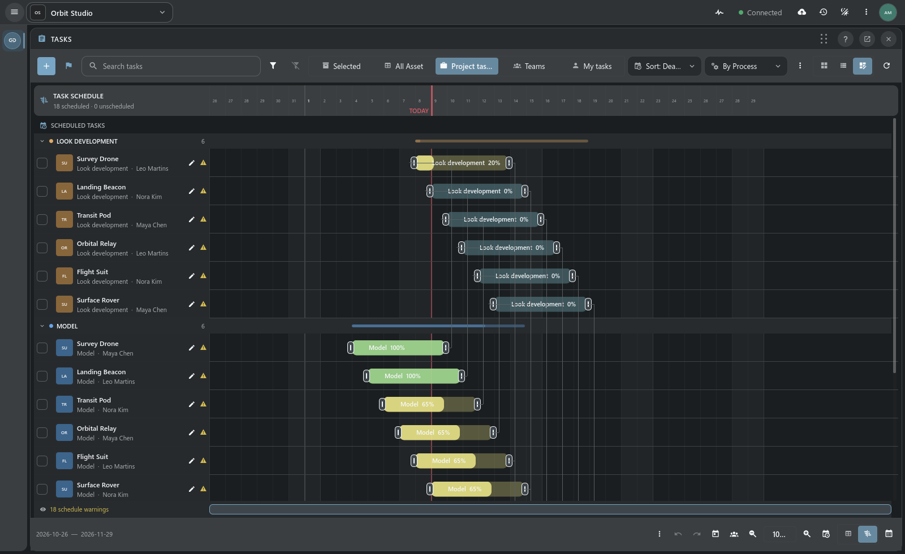

*Gantt показывает зависимости, но не переносит связанные задачи автоматически.*

Календарь задач и agenda дают представление по датам, milestones обозначают контрольные точки проекта. Учёт часов и отчёты по стоимости связывают затраты с людьми и работой в пределах доступных пользователю прав. [Task Manager](../../thlib/ui/help_articles/dock.tasks.ru.md) · [Календарь](../../thlib/ui/help_articles/dock.task_calendar.ru.md)

## Messages и Notes

**Messages** поддерживает личные и групповые разговоры, в том числе между участниками разных проектов. Есть Избранное, ответы, упоминания, реакции, закрепления, пересылка, поиск и управление участниками. Файлы добавляются через выбор, перетаскивание или буфер обмена; незаконченные сообщения сохраняются в черновиках.

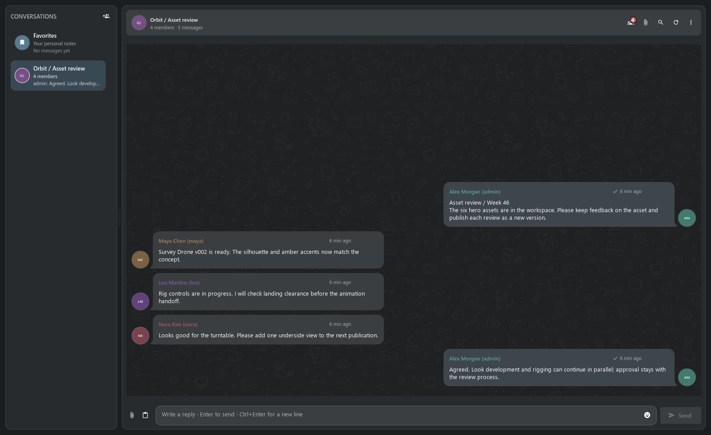

**Notes** привязаны к объекту, процессу или задаче. В них хранятся замечания и решения ревью. **Knowledge Base** предназначена для статей и инструкций с вложениями и историей редакций. Уведомления и журнал активности ведут к изменившимся записям.

[Встроенная справка: поиск и контекстные инструкции →](help.ru.md) · [База знаний: статьи, редактор и история →](knowledge-base.ru.md)

## Activity Feed и история проекта

**Activity Feed** показывает события проекта: заметки, публикации, задачи, изменения полей и учёт времени. Указаны автор, время и детали события, есть переход к объекту или задаче. Activity в обзоре объекта показывает его собственную историю и доступные события связанных записей.

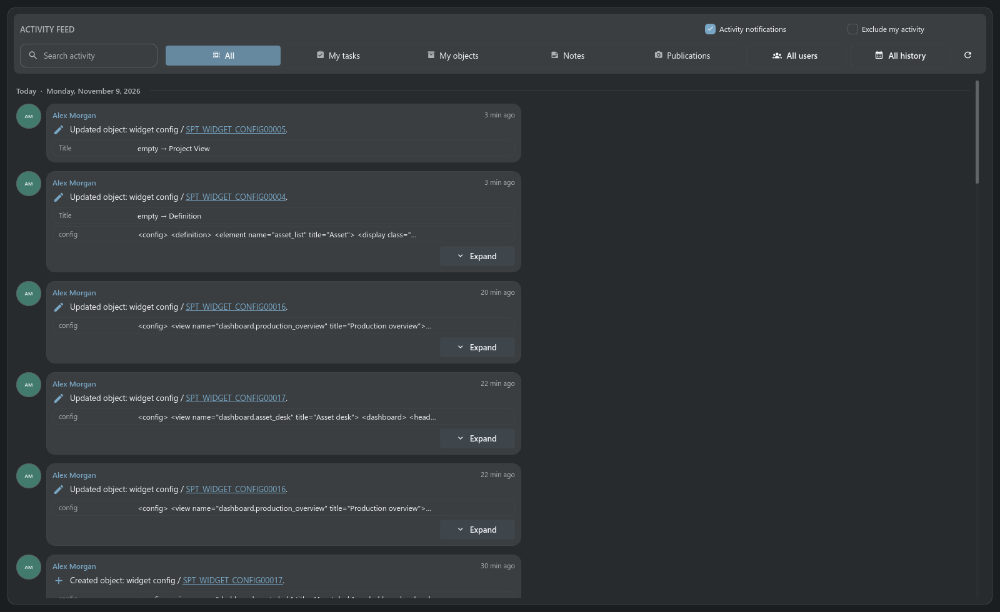

Фильтруйте людей и категории, исключайте собственные действия, ищите по загруженным событиям или выбирайте день в календаре. Прокрутка подгружает прошлые события; счётчики календаря охватывают доступную историю за пределами текущего списка. Даты показываются в локальном часовом поясе, относительное время учитывает синхронизацию с сервером.

**Notifications** хранит уведомления текущей сессии клиента, **System Activity / Debug Log** — работу и диагностику приложения. Очистка уведомлений не удаляет историю проекта. Состав Activity Feed зависит от событий, которые записывают операции и расширения.

## Чекин и чекаут

Чекин регистрирует файлы у объекта и процесса. В Handler подготовка проходит через Drop Plate и Commit Queue:

1. Выберите объект и процесс/контекст. Добавьте локальные файлы или каталоги через **Drop Plate** либо подготовьте сцену в выбранном подключении DCC.
2. Сопоставьте и сгруппируйте файлы/последовательности. В **Commit Queue** проверьте описание, параметры версии, разрешённые пути и роли файлов.
3. Отправьте операцию. У каждого элемента очереди свой прогресс и результат; вся очередь не является одной атомарной транзакцией.
4. Просмотрите snapshots, сравните версии изображений, откройте или выполните checkout нужных файлов.

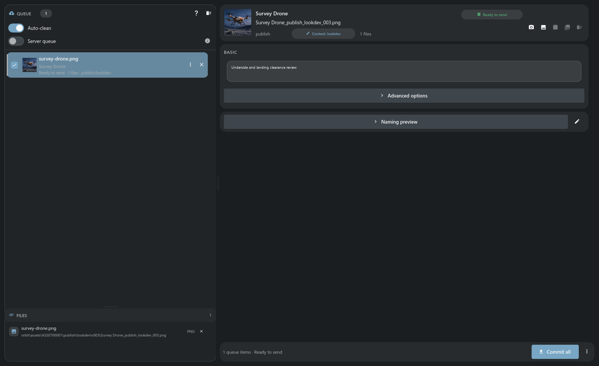

Check-in поддерживает общую или раздельную публикацию групп и штатные ingest-связи. При коллизии существующий файл сохраняется. Move удаляет источник только после подтверждённого успеха; неопределённый результат нужно сверить, а не слепо повторить. Подготовка и передача видны отдельно от итоговой записи snapshot.

Snapshot связывает версию с объектом, процессом/контекстом, автором, описанием и файлами. Новая версия и ревизия — разные операции. Правила `latest` и `current` отделены от версионного хранения. Файловые последовательности сохраняют информацию о диапазоне, чтобы checkout мог разрешить опубликованные кадры.

### Naming Editor

**Naming Editor** задаёт условия выбора правила, контексты, шаблоны имён и каталогов, sandbox-пути и алиасы репозиториев. В шаблоне используются данные объекта, snapshot и файла; доступны условия TSQL и доверенные сохранённые скрипты. Результат правила проверяется в предпросмотре.

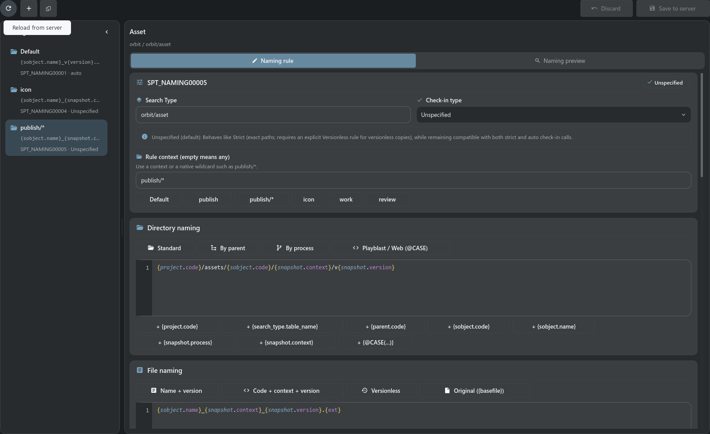

Например, имя может собираться из названия объекта, версии и расширения: `{sobject.name}_v{version}.{ext}`. При публикации путь заново разрешает нативный naming engine. Предпросмотр не резервирует имя: финальный check-in проверяет версию и коллизии. Скриптовые правила выполняют доверенный код проекта.

### Repository Sync и Watch Folders

Синхронизируйте нужную область: выбранные объекты, процессы, версии или связанных потомков. Пресеты сохраняют повторяющийся выбор; полная/частичная синхронизация и поиск только обновлений поддерживают разные рабочие наборы. Очередь показывает обнаружение файлов, передачу, отмену, повтор и политику конфликтов.

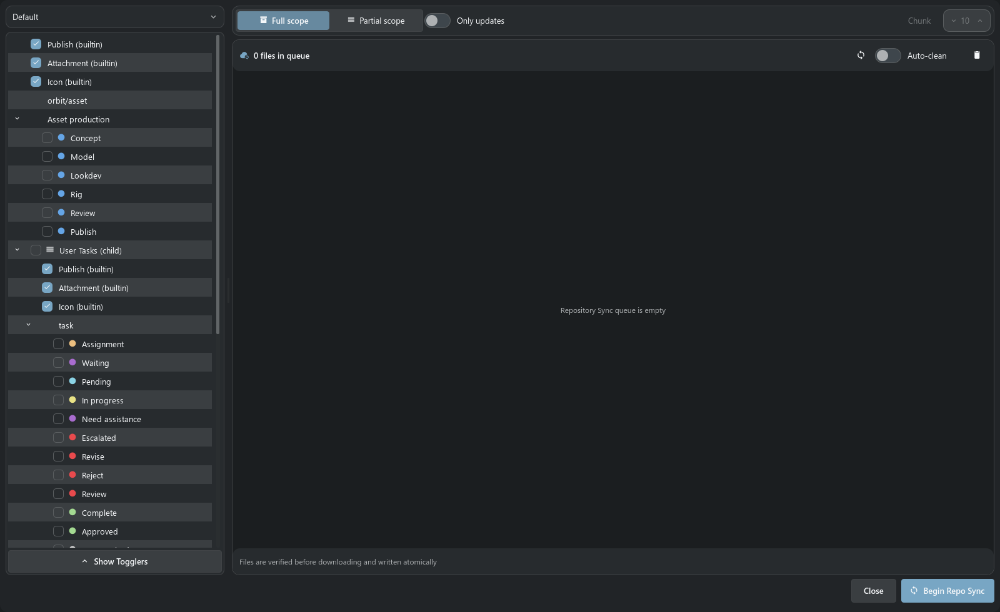

**Watch Folders** связывают проект и локальный каталог с правилами сопоставления/check-in и направляют найденную работу в Commit Queue. Сохранение настройки репозитория не запускает неявный перенос или удаление файлов. Это desktop-возможности Handler, отдельные от браузерной загрузки и скачивания Stream.

## Tactic Frame

**Tactic Frame** — общий язык описания интерфейсов Handler и Stream. Модуль задаёт элементы окна, геометрию, состояние и действия. Qt Quick и Vue отображают это описание своими компонентами, поэтому структуру окна можно менять в одном месте.

Frame состоит из JavaScript-модулей `.mjs`. Функция `describe(model, width, height, language)` строит видимую структуру по состоянию. Действия обрабатывают контроллеры соответствующего клиента.

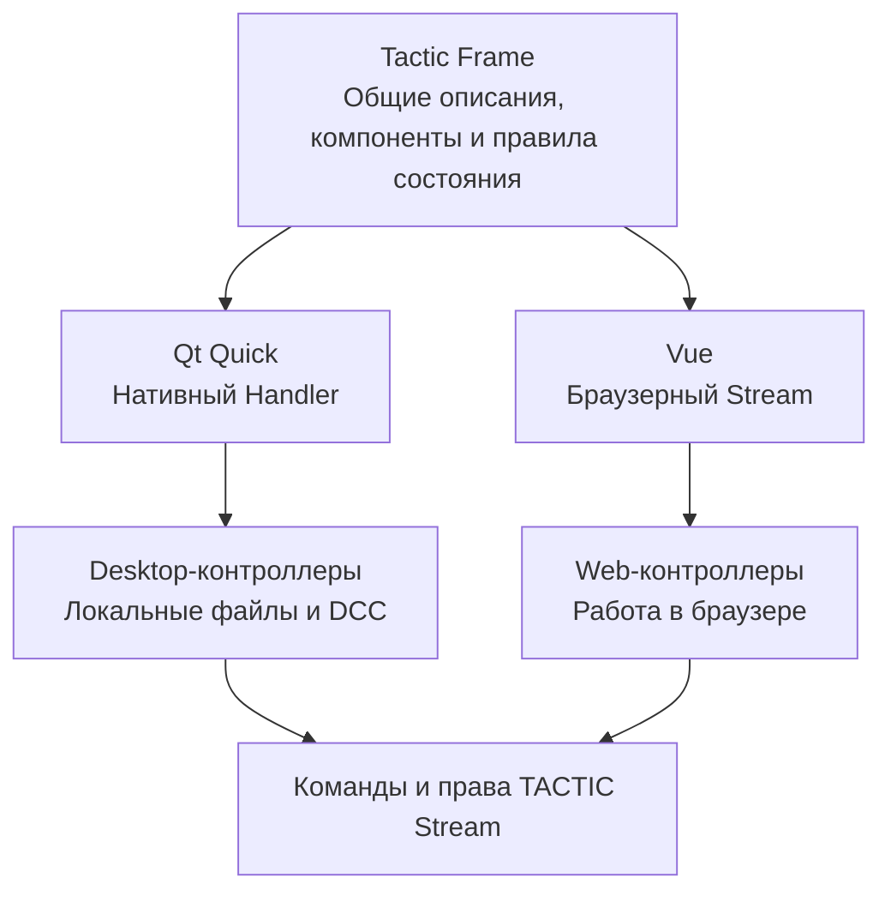

Небольшой модуль рядом с этим документом иллюстрирует контракт. Host передаёт `model` и обрабатывает действие `name`; рабочие модули также используют общие функции перевода.

```javascript
import { label, node, rect } from "../../thlib/ui/qml/tactic_frame/core/frame.mjs";

export function describe(model, width, height, language) {
    return { nodes: [
        label("title", rect(16, 12, width - 32, 28), "Review"),
        node("Field", "assetName", rect(16, 48, width - 32, 38), {
            label: "Asset", text: model.name, action: { type: "name" }
        })
    ] };
}
```

Общая библиотека включает поля, кнопки, селекторы, виртуализированные списки, таблицы, графы, редакторы и структуру окон. Контракт охватывает не только геометрию, но и темы, перевод, фокус и ввод. **Component showcase** показывает этот набор компонентов внутри приложения.

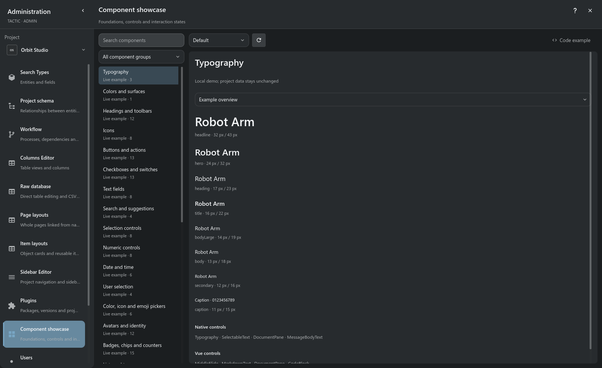

XML-представления и документы визуальных редакторов задают конфигурацию проекта. Модули Frame определяют компоненты интерфейса. Stream и Handler поставляются отдельно, каждый со своей копией общих описаний. [Контракты Frame](../frame/index.md)

## Script Editor и автоматизация

В **Script Editor** можно написать и выполнить скрипт целиком или по выделению, посмотреть результат и ошибки и сохранить его в библиотеку проекта. Есть вкладки, черновики, undo, подсветка, автодополнение, поиск и замена, навигация по структуре. Библиотека организована в папки.

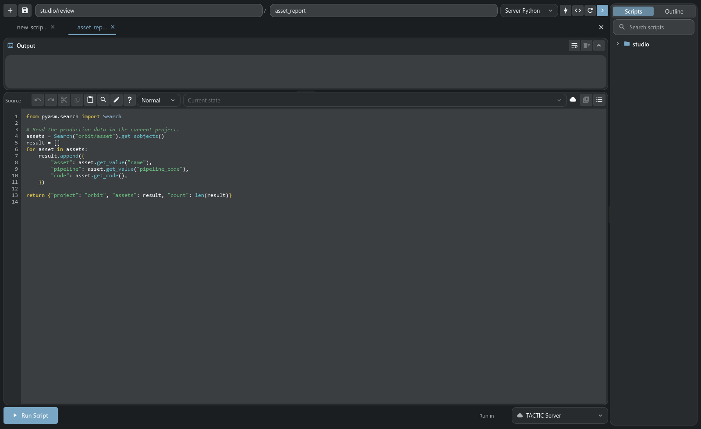

| Среда | Владелец и контекст |
| --- | --- |
| **Local Python / QML-инструменты** | Нативные объекты и UI Handler; операции интерфейса учитывают границу GUI-потока Qt. |
| **Server Python** | Подключённый сервер TACTIC с проектным контекстом и правами. |
| **Selected DCC** | Явно выбранная зарегистрированная сессия и поддерживаемые ею возможности. |

Цель исполнения указана в редакторе. Вывод локального Python и DCC возвращается во вкладку; Server Python показывает возвращаемый результат, а stdout остаётся в журнале сервера.

**Script Shelf** размещает действия рядом с работой: общая полка студии, личные инструменты и полки конкретных поисковых вкладок. **Before/After hooks** привязывают автоматизацию к событиям с фильтрами по процессу, контексту и Search Type. Ошибка Before может остановить операцию; ошибка After не отменяет уже завершённое действие. Право выполнять доверенный код отделено от возможности просматривать скрипт.

[Script Editor](../../thlib/ui/help_articles/script_editor.ru.md) · [Script Shelf](../../thlib/ui/help_articles/script_shelf.ru.md)

## Администрирование проекта

**Administration** задаёт модель проекта: Search Types, поля, связи, представления и действия. Asset и Shot — примеры типов; студия может создавать свои. Граф схемы показывает связи между ними.

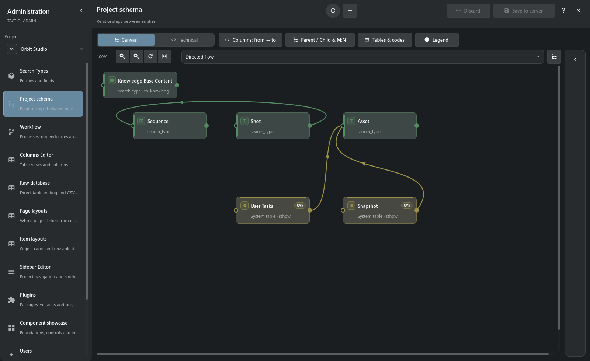

| Раздел | Что настраивается |
| --- | --- |
| **Search Types** | Типы сущностей, поля и правила нейминга. |
| **Project schema** | Связи между сущностями и граф проекта. |
| **Workflow** | Pipelines, свойства процессов, зависимости и автоматизация. |
| **Columns Editor** | Табличные представления, столбцы и нативные виджеты полей. |
| **Raw database** | Разрешённый просмотр/редактирование таблиц и CSV с ограничениями для защищённых таблиц. |
| **Page layouts** | Страницы дашбордов, блоки, источники данных и навигация. |
| **Item layouts** | Переиспользуемые карточки, строки и представления объектов. |
| **Sidebar Editor** | Группы навигации, пункты, представления и входы в рабочие пространства. |
| **Plugins** | Пакеты, версии и активация в проекте. |
| **Component showcase** | Набор компонентов, из которых построены интерфейсы. |
| **Users** | Учётные записи и доступ к проектам. |
| **Groups** | Участники групп и общие настройки доступа. |
| **Access rules** | Наследуемые и явные allow/deny, проверка эффективных прав пользователя. |

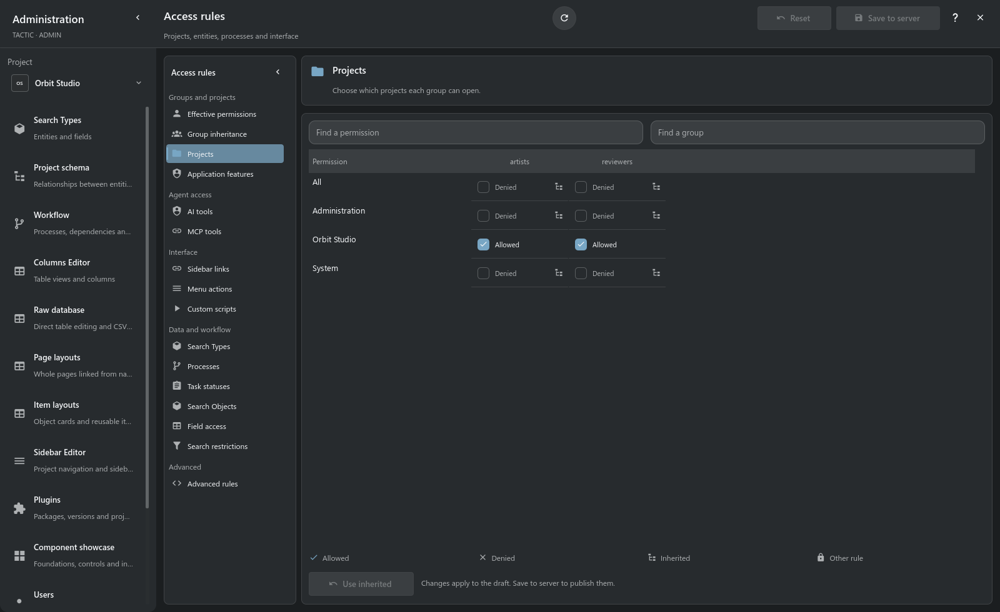

Редакторы хранят черновики до Save или Discard. Сохранение проверяет ревизию и серверные права. [Справка по Administration](../../thlib/ui/help_articles/administration.ru.md)

## Пользователи и права

Серверная учётная запись общая для проектов. К ней относятся профиль, контакты, настройки и членство в группах. Эта же запись указана автором задач, сообщений, публикаций и событий.

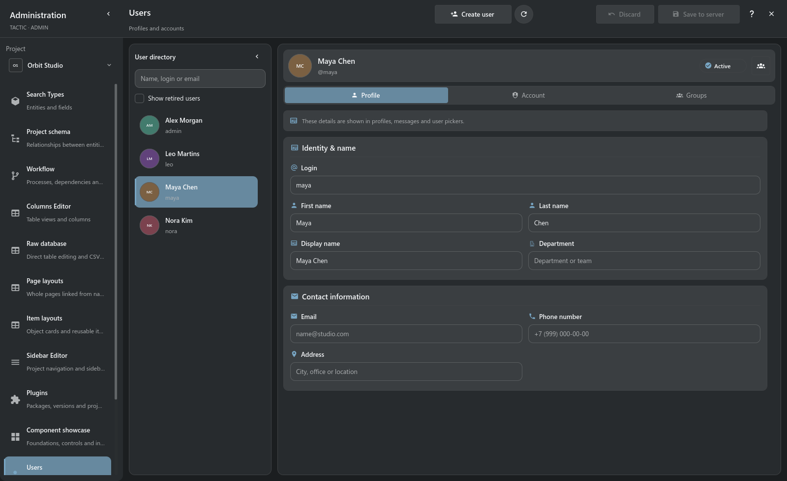

### Учётные записи

При создании пользователя задаются начальный пароль, профиль и группы. Сохранённый пароль не отображается. Retire отключает учётную запись, Reactivate включает её снова; авторство в истории проекта сохраняется.

### Группы и проверка доступа

Groups управляет участниками и описаниями групп. Access rules задаёт политику: уровень доступа, область проектов, поддерживаемые правила объектов/процессов/статусов/действий, наследование и явные allow/deny. Видимость sidebar — отдельная часть интерфейсной политики: скрыть ссылку не означает запретить доступ к её данным.

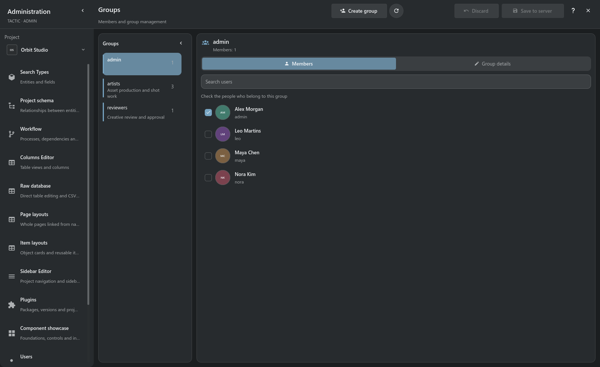

Итоговый доступ складывается из всех групп пользователя, наследования и явных правил. После настройки его можно проверить для конкретного аккаунта. Матрица одной группы показывает только её часть политики.

При подключении сотрудника создаются аккаунт, членство в группах, права на проект и видимость sidebar. Затем проверяется итоговый доступ. Выбор проекта в Administration ограничивает проектные настройки; сами аккаунты остаются общими для сервера.

## Configuration

В **Configuration** находятся подключение, хранилища и настройки клиента. Каждая страница сохраняет свой черновик: Apply применяет текущую страницу, Save — ожидающие изменения. При уходе с несохранёнными настройками появляется предупреждение. Оформление можно предварительно посмотреть и отменить.

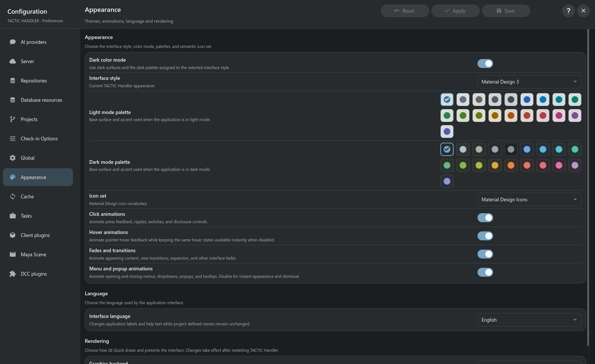

| Область | Назначение |
| --- | --- |
| **AI providers** | Профили провайдеров, получение моделей и выбор исполнителя ассистента. |
| **Server** | Подключение, поддерживаемые серверные параметры, состояние служб и явные команды управления. |
| **Database resources** | Настройка и проверка ресурсов, привязка существующих схем; без переноса данных. |
| **Repositories** | Имена, цвета, пути репозиториев и поддерживаемые настройки серверного хранения. Сохранение пути не перемещает файлы. |
| **Projects** | Создание проектов, шаблоны и проектные настройки. |
| **Check-in Options** | Параметры подготовки файлов, naming и публикации по умолчанию. |
| **Global** | Общие настройки взаимодействия и обновления данных, доступные данному клиенту. |
| **Appearance** | Светлые/тёмные темы, палитры, иконки, английский и русский интерфейс. |
| **Cache** | Политика, состояние и обслуживание кэша. |
| **Tasks** | Настройки задач, времени и трудозатрат. |
| **DCC plugins** | Установка и настройка поддерживаемых интеграций. |
| **Client plugins** | Поиск и настройка desktop-расширений. |
| **Страницы интеграций** | Параметры активного приложения, например поведение сцен Maya. |

Поддерживаемые параметры серверного XML охватывают службы, сеть, безопасность, каталоги и расписание, с валидацией и указанием необходимости перезапуска. Сохранение конфигурации и рестарт службы — отдельные действия. Перенос базы или репозитория требует отдельной процедуры. [Справка по Configuration](../../thlib/ui/help_articles/configuration.ru.md)

## Помощник проекта

**External agent** читает задачи, заметки и публикации выбранных объектов. Контекст разговора включает проект, страницу, Search Type и выделение. Запись требует отдельного разрешения.


В показанном запросе помощник обнаружил завершённую задачу моделинга без публикации модели. Подробности работы с диалогами, провайдерами, вложениями, изменениями и скриптами приведены в отдельной презентации.

**[Подробная презентация встроенного ассистента →](assistant.ru.md)**

## Дашборды

В дашборде размещаются метрики, отчёты, диаграммы, Item View, формы и действия. Детали могут следовать за выбранным объектом. Страница сохраняется в проекте и открывается из sidebar; доступ к данным определяется правами пользователя.


**[Подробная презентация дашбордов и визуального редактора →](dashboards.ru.md)**

## Установка и интеграции

### Коннектор Maya

Поставляемый коннектор Maya регистрируется в локальном **Handler Server**. Перед open, import, reference или сохранением сцены выбирается нужная сессия. Maya подготавливает сцену; Handler выполняет TACTIC check-in и передачу файлов. Другим приложениям нужен коннектор с явно зарегистрированными нативными возможностями.

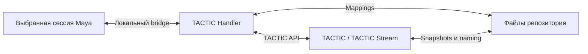

[Установка Maya](../../installer/README.md) · [DCC API](../dcc_api.md) · [Протокол thin client](../thin_client_protocol.md)

### Установить Handler из исходников на Windows

Нужны современный checkout, Python 3.14 и работающий сервер TACTIC.

```powershell
py -3.14 -m venv .venv
.\.venv\Scripts\python.exe -m pip install -r requirements.txt
.\.venv\Scripts\python.exe launch.py
```

В **Configuration → Server** проверьте пресет подключения и получите ticket. Выберите проект и настройте mappings репозитория до файловых операций. [Первое подключение](../handbook.ru.md) · [Начало работы](../../thlib/ui/help_articles/getting_started.ru.md)

### API Handler

Публичный `tactic_handler_api` открывает клиентские объекты, файловые операции и поддерживаемые действия UI. Точки входа для standalone, Script Editor и DCC сохраняют собственный контекст исполнения.

```python
from tactic_handler_api import local

with local() as handler:
    assets = handler.project("orbit").stype("orbit/asset")
    result = assets.query(limit=12, order_by=["name asc"])
    for asset in result.items:
        print(asset.get_code(), asset.get_value("name"))
```

Замените демонстрационный проект и Search Type своими. [API и примеры](../handler_api.md) · [Архитектура](../application_architecture.md) · [Руководство](../handbook.ru.md)

## Совместимость, ограничения и лицензии

Здесь Handler показан с сервером Stream. Специфичные для Stream редакторы проекта, дашборды и ассистент требуют именно этого сервера; их наличие в презентации не обещает такие же службы в любой установке исходного TACTIC. Для существующей установки проверьте [карту совместимости](../tactic_compatibility/README.md).

Perforce-like File Workspace остаётся прототипом. Реализованные Commit Queue и Repository Sync не означают полного поведения Perforce. Здесь поставляется коннектор Maya; другие DCC требуют своего присутствующего и проверенного коннектора. [Индекс документации](../index.md)

Скриншоты сделаны на небольшом демонстрационном проекте. Для производственного внедрения нужны проверки схемы, скриптов, интеграций и прав на используемой версии.

TACTIC Handler распространяется под [Eclipse Public License 1.0](../../LICENSE). Серверная интеграция основана на [Southpaw TACTIC](https://github.com/Southpaw-TACTIC/TACTIC).

[Maya-плагин и shelf](maya.ru.md)
