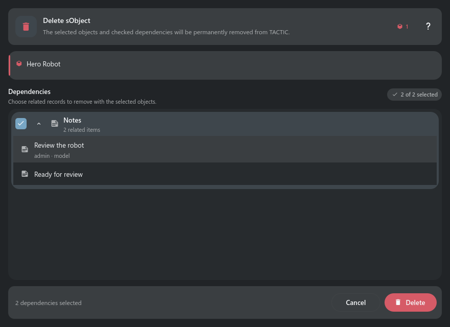

# Deleting sObjects

> Delete SObject discovers every server dependency before anything is removed and preserves the
> dependency defaults defined by TACTIC relationships.

## Main controls

The window separates selected objects, dependency review, errors, progress, and the final action.
Dependency groups use native Search Type titles, semantic icons, selection counts, and checkboxes.

Expand a group to review readable item titles and useful metadata; technical search keys stay
hidden. Expanded dependency lists keep rounded group edges.

Status log records show the status transition followed by process, user, and timestamp instead of
technical log codes.

## Usage notes

- Unchecked dependency types are preserved.
- The selected root objects are always deleted.
- Deletion is permanent, runs outside the UI thread, and refreshes the originating results or
  Snapshot Browser when complete.

## Review before deletion

Expand each dependency group to inspect actual records, not just totals. Change
the checked groups, then Delete. A read error offers Retry without submitting
anything. A lost deletion reply disables another Delete: close, refresh and
inspect the remaining objects before making another deletion request.

## Presentation examples

Examples use test data and show the panel content. The surrounding window or dock keeps its normal behavior.

