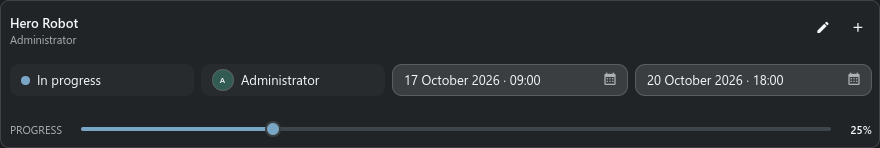
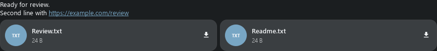

# Task Inspector dock

> Task Inspector combines the exact selected process or task with its editable details, notes,
> attachments and linked objects.

## What the dock follows

Search selection supplies the parent sObject. Tasks or Task Manager can additionally select the
process and exact task. When several tasks share one process, the compact task selector remains in the
header even while the editor is collapsed.

The expanded or collapsed state is a saved user choice; selecting another task does not override it.

## Task details

The inspector shows status, assignee, dates, progress and available workflow fields. **Edit** exposes
the compact editor. The adjacent plus action opens full task creation when the process has no task.
Saving editable workflow defaults creates that missing task immediately.

Each sObject, process and selected task keeps its own unsent note draft. Moving between targets does
not place one task's draft into another task.

## Notes timeline

- Write a note for the current object, process or task.
- Attach local files or paste an image from the clipboard.
- Open linked sObjects and file attachments from the timeline.
- Edit or delete a note only when ownership and server permissions allow it.
- The timeline stays anchored to the newest entry when new notes arrive.

Keyboard behavior:

- **Enter** sends a note.
- **Ctrl+Enter** inserts a line break.

## Typical workflow

1. Select the parent object in Search.
2. Select the process or exact task in Tasks.
3. Confirm the target shown in the Inspector header.
4. Edit task details or add a note and attachments.
5. Save the task separately from sending the note.

## Empty and error states

- **No target** means no current sObject has been published by Search.
- **No task** still permits creating one from workflow defaults.
- A note upload failure preserves the draft and attachment selection for retry.
- If Notes was opened from Task Manager, it follows that task even when its parent was not previously selected.

## Note editing and files

Open a note's **Note actions → Edit note**. Its modeless editor keeps the text
when saving fails; Save closes it only after confirmation. **Delete note** uses
a modal confirmation. A lost reply blocks another write: close the child,
refresh and check the actual note first. Your composer draft is independent.
Long text, emoji-only notes, link previews and file cards use measured heights.
Browser files open FilePreview with Download; Handler retains local open/folder
and Repository Sync. sKey previews use the same protected resolver as Messages.
Quick **Edit task in full editor** opens the normal modeless object form;
Stream's existing inline editor remains in **Task actions → Edit task**.

## Presentation examples

Examples use test data and show the panel content. The surrounding window or dock keeps its normal behavior.

