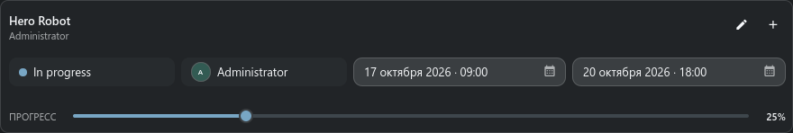
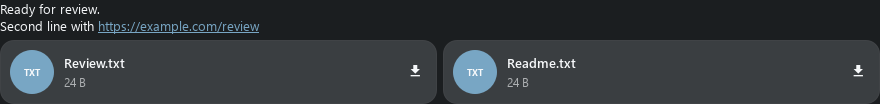

# Док «Инспектор задач»

> Инспектор задач объединяет точный выбранный процесс или задачу с редактируемыми полями, заметками,
> вложениями и связанными объектами.

## За чем следит док

Поиск задаёт родительский sObject. Задачи или Менеджер задач дополнительно выбирают процесс и точную
задачу. Если одному процессу принадлежат несколько задач, компактный селектор остаётся в заголовке,
даже когда редактор свёрнут.

Раскрытое или свёрнутое состояние — сохранённый выбор пользователя; смена задачи его не меняет.

## Поля задачи

Инспектор показывает статус, исполнителя, даты, прогресс и доступные поля воркфлоу. **Редактировать**
открывает компактный редактор. Соседний плюс открывает полное создание, если задачи ещё нет. Сохранение
редактируемых дефолтов процесса сразу создаёт отсутствующую задачу.

Каждый sObject, процесс и выбранная задача хранят отдельный неотправленный черновик заметки. Переход
между целями не переносит текст одной задачи в другую.

## Лента заметок

- Напишите заметку для текущего объекта, процесса или задачи.
- Прикрепите локальные файлы или вставьте изображение из буфера.
- Открывайте связанные sObject и файловые вложения из ленты.
- Редактируйте или удаляйте заметку только при подходящих авторстве и правах.
- При новых сообщениях лента остаётся у самой свежей записи.

Клавиатура:

- **Enter** отправляет заметку.
- **Ctrl+Enter** вставляет новую строку.

## Обычная последовательность

1. Выберите родительский объект в Поиске.
2. Выберите процесс или точную задачу в Задачах.
3. Проверьте цель в заголовке Инспектора.
4. Измените поля задачи или добавьте заметку и вложения.
5. Сохраните задачу отдельно от отправки заметки.

## Пустые состояния и ошибки

- **Нет цели** означает, что Поиск не опубликовал текущий sObject.
- **Нет задачи** всё равно позволяет создать её из дефолтов воркфлоу.
- Ошибка загрузки заметки сохраняет черновик и выбранные вложения для повтора.
- При открытии из Менеджера задач Инспектор следует той задаче, даже если родитель раньше не был выбран.

## Редактирование заметок и файлы

Откройте **Действия заметки → Редактировать заметку**. Немодальный редактор
сохраняет текст при ошибке и закрывается после подтверждённого сохранения.
Удаление требует модального подтверждения. Потеря ответа блокирует повторную
запись: закройте дочернее окно, обновите и сначала проверьте саму заметку.
Черновик нового сообщения независим. Высота длинного текста, emoji, превью
ссылок и файлов измеряется по содержимому. В браузере файл открывается в
FilePreview со скачиванием; ТХ сохраняет локальное открытие/папку и Repository
Sync. Превью sKey используют тот же защищённый механизм, что Messages.
Быстрое **Редактировать задачу в полном редакторе** открывает обычную немодальную
форму; встроенный редактор ТС остаётся в **Действия задачи → Редактировать задачу**.

## Примеры панелей

На снимках показано содержимое панелей на тестовых данных. Окно или док сохраняет своё обычное поведение.

