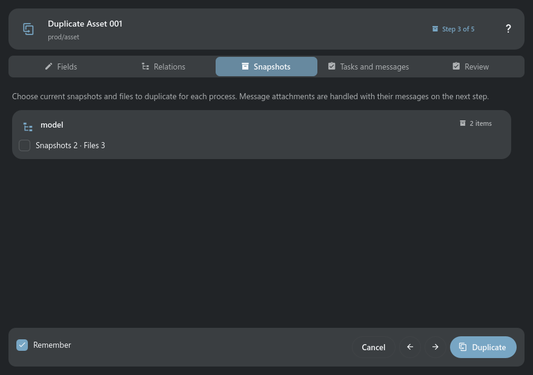

# Duplicating Search Objects

> Duplicate… opens a five-step wizard that separates the new object's field values, schema
> relationships, snapshots, tasks and messages, and final review.

## Main controls

Fields excludes identity and relationship columns managed by TACTIC. Relations can omit a parent,
preserve a parent, duplicate direct children, or recreate instance links without cloning their
target objects.

Snapshot choices are separated from tasks and messages. Process messages, task-scoped messages, and
their attached files are discovered and copied through their native TACTIC relationships.

## Usage notes

- Duplicate stays available on every wizard step and uses the choices already shown, including a
  remembered profile.
- Remember for this Search Type stores only relationship and process-content choices; it never
  stores the source object's title, description, or other edited values.
- Quick duplicate with last settings still performs a fresh background analysis before creating
  anything.
- Analysis, preference persistence, and creation run without making the rest of the application
  modal or blocking the UI thread.

## Conflict and uncertain result

Review all five steps and Duplicate. Reanalysis after a known conflict retains
compatible field values and relationship/content choices. If the server reply
is lost, this wizard cannot repeat the write. Close it, refresh the source/search
and check whether the duplicate already exists before starting another wizard.

## Presentation examples

Examples use test data and show the panel content. The surrounding window or dock keeps its normal behavior.

