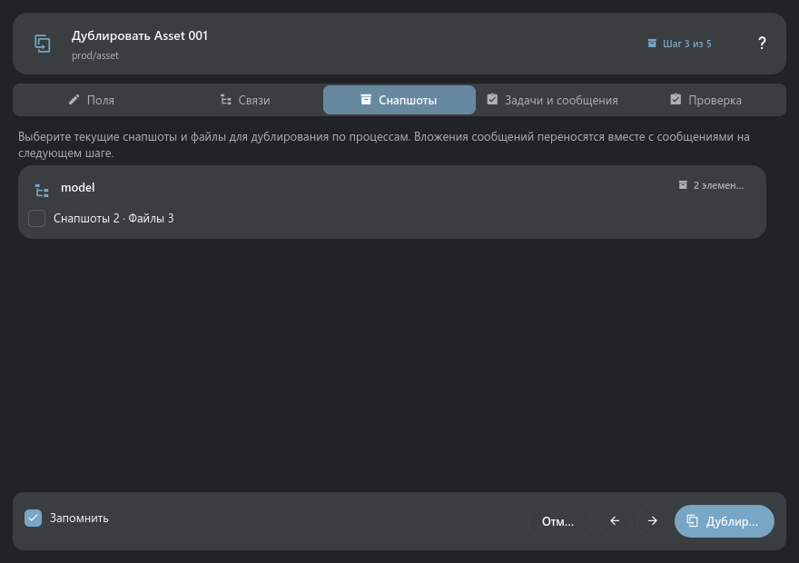

# Дублирование серч-объектов

> «Дублировать…» открывает пятишаговый мастер: поля нового объекта, связи схемы, снапшоты, задачи и
> сообщения, итоговая проверка.

## Основные элементы

Из полей исключаются идентификаторы и столбцы связей, которыми управляет TACTIC. Родителя можно
пропустить или сохранить, прямых детей — продублировать, а instance-связи — пересоздать без
копирования целевых объектов.

Снапшоты вынесены отдельно от задач и сообщений. Сообщения процесса, сообщения конкретных задач и их
файлы находятся и копируются через нативные связи TACTIC.

## Как пользоваться

- Кнопка «Дублировать» доступна на каждом шаге и использует уже показанные настройки, включая
  запомненный профиль.
- «Запомнить для этого серч-тайпа» сохраняет только выбор связей и содержимого процессов; заголовок,
  описание и другие значения объекта не сохраняются.
- Быстрый дубль с прошлыми настройками всё равно заново анализирует объект в фоне.
- Анализ, сохранение настроек и создание выполняются без модальной блокировки остального приложения
  и без блокировки UI-потока.

## Конфликт и неизвестный результат

Проверьте все пять шагов и выполните дублирование. Повторный анализ после
подтверждённого конфликта сохраняет совместимые значения полей и выбранные
связи/содержимое. При потере ответа повторная запись в этом окне блокируется.
Закройте его, обновите поиск и проверьте, появился ли дубликат, прежде чем
начинать новое дублирование.

## Примеры панелей

На снимках показано содержимое панелей на тестовых данных. Окно или док сохраняет своё обычное поведение.

