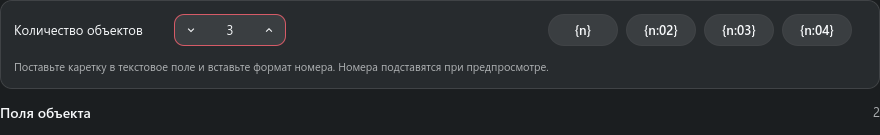

# Создание и редактирование sObject

> Редактор объекта использует активный дефинишен TACTIC EditWdg.

На настроенной странице кнопка **Изменить** открывает штатную форму выбранного
объекта. Страница показывает значения из записи; раскладка задаёт их оформление.
Если показанного значения нет в форме, добавьте его реальную колонку в определение
`edit` этого типа объектов. Для длинного текста и Markdown используйте TextAreaWdg.
Измените исходный текст, нажмите **Сохранить изменения** и обновите выбранную карточку,
чтобы увидеть оформленное содержимое. Закрытие без сохранения не меняет запись.

Поле тегов использует тот же редактор, что и таблица результатов. Нажмите поле,
чтобы добавить или удалить отдельные теги. «Сохранить» переносит теги в черновик
формы; для записи в TACTIC сохраните сам объект. «Отмена» оставляет поле без изменений.

## Основные элементы

Каждое поле сохраняет серверные название, порядок, колонку, обязательность, режим только для чтения,
подписи вариантов и записываемые значения. Текстовые, многострочные, логические поля, списки,
пользователи, проекты, процессы, пайплайны, статусы, даты, пароли, родители, превью и миниатюры
используют единую адаптивную Material-форму.

Цвета статусов и процессов, а также исполнители задач берутся из workflow выбранного объекта.

## Как пользоваться

- При открытии созданного объекта текущая раскладка доков сохраняется; затем его вкладка поиска хранит собственную раскладку.
- В узком окне поля идут одним упорядоченным столбцом.
- При расширении окна создания или редактирования уже созданные карточки полей перестраиваются в два
  или три столбца вместо растягивания каждого контрола на всю ширину.
- Внутри карточки подпись по-прежнему располагается рядом с контролом, когда её собственная ширина
  это позволяет.
- Форма и многострочные поля показывают полосы прокрутки в цветах темы, когда содержимое превышает
  доступную высоту.
- Выпадающие списки скрывают пустые варианты без названия; вариант с названием вроде «По умолчанию» остаётся доступен.
- Редактирование пароля никогда не раскрывает текущее значение; оставьте поле пустым, чтобы
  сохранить пароль.
- Неподдерживаемые пользовательские серверные виджеты остаются видимыми и доступными только для
  чтения вместо записи ошибочного резервного значения.

## Пример общей формы объекта

Откройте **Создать** для Assets, заполните имя и описание, сохраните. Режим
**Несколько** сохраняет отдельный просмотр каждого объекта: `Robot {n:03}`
создаёт Robot 001, Robot 002 и т. д. Проверьте каждый просмотр до создания.
ТХ сохраняет свои настроенные пакетные адаптеры. В браузере этот режим пока
поддерживает обычные поля БД; пользовательские действия, загрузки и создание
связей требуют отдельных форм, причина показана в интерфейсе. Отмена ничего
не записывает. Ошибка сохраняет черновик; при неизвестном результате повторная
запись блокируется — закройте форму, обновите и проверьте объекты.

## Примеры панелей

На снимках показано содержимое панелей на тестовых данных. Окно или док сохраняет своё обычное поведение.

