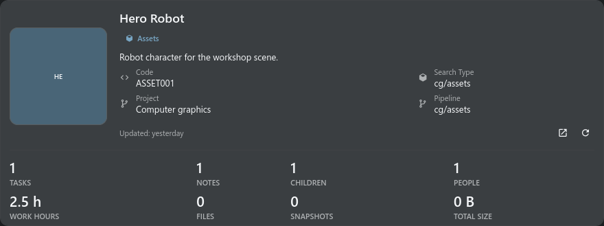

# SObject Report

> SObject Report combines object identity, task and note state, related children, work totals, cost
> visibility, snapshots, files, and recent activity for the current project object.

## Main controls

The profile-style object card combines the preview, identity, description, object details, and key
metrics. The complete card, icon-labelled section switcher, and selected task, note, child,
snapshot, or activity section share one continuous scrollbar.

The Tasks section lists every participant gathered from tasks, notes, publications, and work-hour
entries, with their individual activity counts and logged hours. Task status and process chips open
Task Manager with the matching object filter.

Selecting a task opens Task Manager for this object and selects the exact task in Task Inspector.
Object and task notes open their original note context.

Snapshots are grouped by process with snapshot, file, and size totals. The object header and
activity bubbles reflow at narrow widths: summary metrics change columns, activity metadata wraps,
and no fixed minimum content width forces horizontal clipping.

Object details are placed with the object identity on the left and are not repeated in a separate
header section. The Snapshots tab is a process tree.

Process branches start collapsed, and snapshot previews and file cards are created only after a
branch is opened. Detailed report sections are prepared when selected.

Opening Snapshots checks local files in the background without blocking the report. The Activity tab
uses the shared server audit and presents each event as a chat-style bubble with the actor avatar,
display name, timestamp, action details, and links to the related context.

It includes changes to the object, task creation and field updates, task statuses, notes, snapshots,
work hours, direct child creation and deletion, and instance link or unlink events. The first
activity page loads with the report.

Reaching the end loads older object events; relation links are resolved before pagination, so a busy
project cannot displace an object's older child history. Related children are resolved from the
project native Search Type catalog and loaded with snapshot metadata, so their rows and previews do
not depend on an already expanded search tree.

## Usage notes

- Work cost is shown only when TACTIC grants cost-view permission.
- Project-defined Search Type, pipeline, process, status, relation, context, and user values remain
  unchanged.
- Activity opens the current project object, task, note, or snapshot context and never redirects to
  a technical sthpw search.

## Shared report and exact context

Open **Details** on an object. Tasks, Notes and Children use the same sections
and controls in Handler and Stream. A task opens that exact task in Inspector
and Task Manager; a note opens its process/context and focuses the entry.
Opening the same ready Inspector target preserves its draft without reloading.
Publications keep their source project. Expand a process to inspect snapshots
and files; empty, loading and error states remain visible. Cost data is absent
unless the server grants the relevant access.

When inspecting a task record itself, the title shows its process and referenced object code (for example, `model · ROBOT`). The task code remains available in the metadata. Stream excludes service relations that cannot be read through the ordinary record API; they do not prevent the task report from loading.

## Presentation examples

Examples use test data and show the panel content. The surrounding window or dock keeps its normal behavior.

Object reports and record editors are modal windows. Close the report to return to the workspace; selecting a task, note or linked object closes it and opens that context. Tasks use their own project, including when opened from another project, and show logged hours for that exact task.

Summary statistics keep digits and captions fully visible; only the surrounding card has rounded corners.
