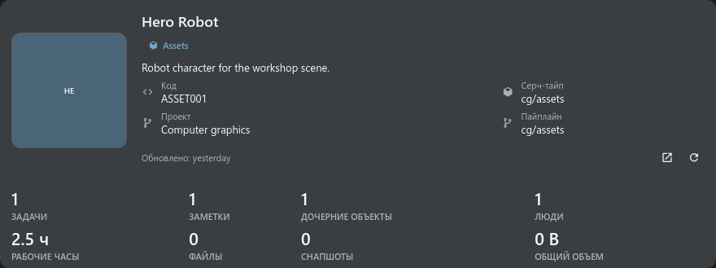

# Отчет по sObject

> SObject Report объединяет сведения об объекте, состоянии задач и заметок, связанных дочерних
> объектах, трудозатратах, доступной стоимости, снапшотах, файлах и недавней активности текущего
> проектного объекта.

## Основные элементы

Карточка объекта в стиле профиля объединяет превью, идентификацию, описание, сведения об объекте и
ключевые показатели. Полная карточка, переключатель разделов с иконками и выбранный раздел задач,
заметок, дочерних объектов, снапшотов или активности используют единую полосу прокрутки.

В разделе задач перечислены все участники, найденные по задачам, заметкам, публикациям и записям
рабочих часов, с их личными счётчиками активности и отработанными часами. Чипы статусов и процессов
открывают диспетчер задач с соответствующим фильтром объекта.

Выбор задачи открывает диспетчер для этого объекта и выбирает точную задачу в инспекторе. Заметки
объекта и задач открываются в исходном контексте.

Снапшоты сгруппированы по процессам с итогами по снапшотам, файлам и объёму. Шапка объекта и облачка
активности перестраиваются при узкой ширине: сводные показатели меняют число колонок, метаданные
активности переносятся, а фиксированная минимальная ширина больше не вызывает горизонтальное
обрезание.

Сведения об объекте размещены слева вместе с его основной информацией и не повторяются в отдельной
секции заголовка. Вкладка снапшотов представляет собой дерево процессов.

Ветки процессов изначально свернуты, а превью снапшотов и карточки файлов создаются только после
раскрытия ветки. Подробные разделы отчёта подготавливаются при выборе.

При открытии снапшотов локальные файлы проверяются в фоне, не блокируя отчёт. Вкладка активности
использует общий серверный аудит и показывает каждое событие как облачко чата с аватаром и именем
автора, временем, описанием действия и ссылками на связанный контекст.

В неё входят изменения самого объекта, создание задач и изменение их полей, статусы задач, заметки,
снапшоты, рабочие часы, создание и удаление прямых дочерних объектов, а также добавление и удаление
связей через instance. Первая страница активности загружается вместе с отчётом.

При достижении конца подгружаются более старые события объекта; связи определяются до пагинации,
поэтому активность большого проекта не вытесняет старую историю дочерних объектов. Дочерние объекты
определяются через нативный каталог Search Type проекта и загружаются вместе с метаданными
снапшотов, поэтому их строки и превью не зависят от уже развёрнутого дерева поиска.

## Как пользоваться

- Стоимость работ показывается только при наличии разрешения TACTIC на просмотр стоимости.
- Заданные проектом значения Search Type, пайплайна, процесса, статуса, связи, контекста и
  пользователя отображаются без изменений.
- Активность открывает контекст текущего проектного объекта, задачи, заметки или снапшота и никогда
  не перенаправляет в технический поиск sthpw.

## Общий отчёт и точный контекст

Откройте **Подробности** объекта. Задачи, заметки и дочерние объекты используют
одинаковые секции и контролы в ТХ и ТС. Задача открывает именно эту задачу в
инспекторе и менеджере задач; заметка открывает свой процесс/контекст и выделяет
нужную запись. Повторное открытие уже готового контекста инспектора сохраняет
черновик без перезагрузки. Публикации сохраняют исходный проект. Разверните
процесс для просмотра снимков и файлов. Пустые состояния, загрузка и ошибки
показаны явно. Данные стоимости отсутствуют без соответствующего доступа.

При просмотре самой записи задачи заголовок содержит процесс и код связанного объекта (например, `model · ROBOT`). Код задачи остаётся в метаданных. Stream исключает служебные связи, недоступные через обычное чтение записей; они не мешают загрузке отчёта задачи.

## Примеры панелей

На снимках показано содержимое панелей на тестовых данных. Окно или док сохраняет своё обычное поведение.

Отчёты об объектах и редакторы записей открываются модально. Закройте отчёт для возврата в рабочую область; выбор задачи, заметки или связанного объекта закрывает его и открывает выбранный контекст. Задачи используют собственный проект, в том числе при открытии из другого проекта, и показывают трудозатраты именно этой задачи.
