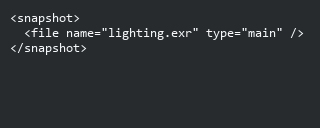
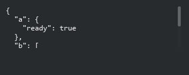

# Table View: value widgets

> Array, XML, JSON and snapshot-version cells now share the typed value contract with Stream. These are read/copy/scroll presenters; Stream general inline XML/JSON editing remains unfinished.

## ArrayTableElementWdg

```xml
<element name="tags"><display class="ArrayTableElementWdg" /></element>
```


## XmlWdg

```xml
<element name="snapshot"><display class="XmlWdg" /></element>
```



## tactic.ui.table.JsonElementWdg

```xml
<element name="metadata"><display class="tactic.ui.table.JsonElementWdg" /></element>
```



## tactic.ui.table.SnapshotVersionElementWdg

```xml
<element name="version"><display class="tactic.ui.table.SnapshotVersionElementWdg" /></element>
```


Arrays convert || to comma-space; NULL is empty. XML decompresses native zlib: values for display only and preserves invalid text with a diagnostic. JSON uses sorted keys, two-space indentation and the configured height. Snapshot versions show No version / Latest / Current / padded positive numbers; NULL now shows No version. No display operation changes a record or executes text as HTML/JS.

The Columns Editor keeps the existing native edit contract and permissions. The server procedure uses get_cell_value when available and equivalent source-value computation on original servers. The two transports are tested; this is not a claim of complete legacy/widget/table migration.
