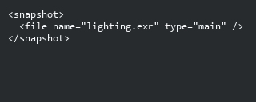
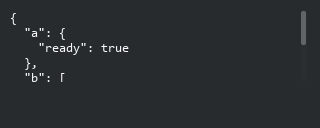
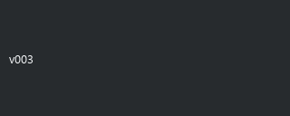

# Table View: виджеты значений

> Ячейки Array, XML, JSON и версии снапшотов используют тот же typed-контракт, что и ТС. Это чтение/копирование/прокрутка; общий inline XML/JSON editor ТС пока не готов.

## ArrayTableElementWdg

```xml
<element name="tags"><display class="ArrayTableElementWdg" /></element>
```


## XmlWdg

```xml
<element name="snapshot"><display class="XmlWdg" /></element>
```



## tactic.ui.table.JsonElementWdg

```xml
<element name="metadata"><display class="tactic.ui.table.JsonElementWdg" /></element>
```



## tactic.ui.table.SnapshotVersionElementWdg

```xml
<element name="version"><display class="tactic.ui.table.SnapshotVersionElementWdg" /></element>
```



Array заменяет || на запятую с пробелом; NULL пустой. XML распаковывает нативный zlib: только для отображения и сохраняет некорректный текст рядом с ошибкой. JSON сортирует ключи, использует отступ в два пробела и заданную высоту. Версии: Нет версии / Последняя / Текущий / номер с padding; NULL теперь показывает Нет версии. Отображение не меняет объект и не исполняет текст как HTML/JS.

Columns Editor сохраняет существующий нативный контракт редактирования и права. Серверная процедура использует get_cell_value, если он доступен, и эквивалентное вычисление исходных значений на оригинальном сервере. Проверены оба транспорта; полная готовность всех legacy/table виджетов не заявляется.
