# Table View: B07 typed cells

## Parent groups and changing a parent

```xml
<element name="parent" title="Parent">
  <display class="tactic.ui.table.ParentGroupTableElementWdg"/>
  <action class="tactic.ui.table.ParentGroupAction"/>
</element>
```

Choose Group by this column in its header menu. The parent header shows its
preview, code/name, type, description and row count. Collapse/reopen keeps the
group. Add Another Item opens the usual configured creation form with this parent.
Different object types with equal codes remain separate groups. Missing parent
references stay explicit. `disable=true` turns off the rich grouping projection.
The historical `label` option has no extra behavior in the original implementation.

Change parent opens a panel beside the cell, with a Search Type choice and literal
code/name/title search (50 results per page). Choose a current object and Save.
Cancel/Refresh asks before discarding a changed selection. If the response is lost,
use Check saved changes before retrying. Conflicts require explicit refresh;
retired targets, cycles and foreign projects are rejected. An Expression cell with
the same action keeps its calculated display text. Dropping one object opens this
same picker preselected; it never silently writes the relationship.

This checkpoint covers administrator operations. Ordinary-user table ACL and
all legacy group summaries/options remain pending; no arbitrary HTML/Mako editor
is added. Only safe parent display fields are sent to the interface.


B07 is still in progress. The catalogue contains 72 server classes and 174 named aliases. This article documents the added value adapters; it does not certify every historical option. Unsupported options remain explicit errors. Keep existing view definitions and replace only the intended element.

Shared picker body and parent header on the same data/theme/size; native font
rasterization may differ from the browser. These images do not certify every
legacy group option.

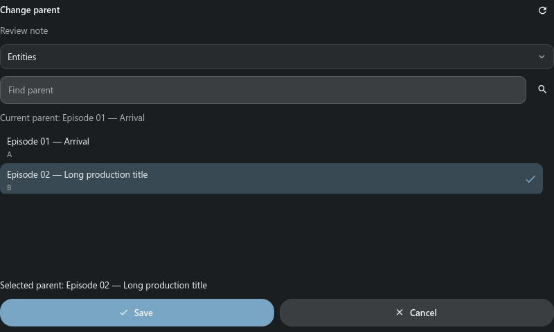
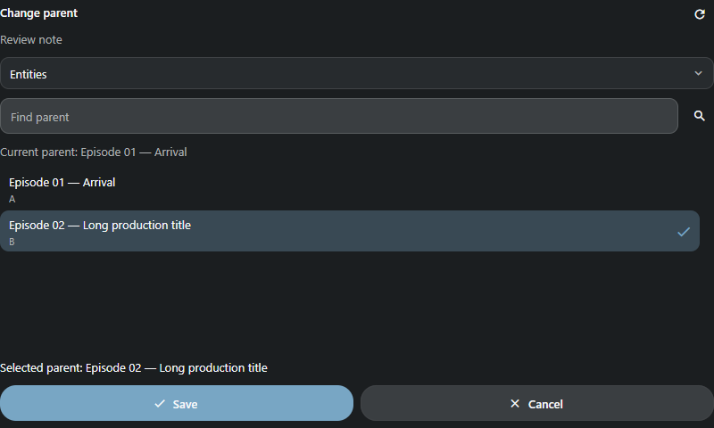
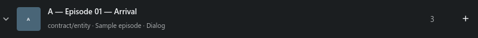
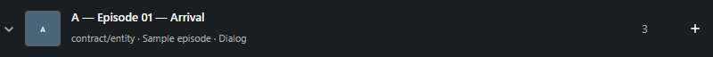

## Snapshot dependencies

Add the dependency action to an object or snapshot table:

```xml
<element name="dependency" width="64">
  <display class="pyasm.widget.DependencyLink"/>
</element>
```

The modeless Dependencies window shows files and upstream, input, downstream and
file-local references. The arrow shows branch loading; collapse/reopen reuses the
loaded branch. Retired/missing objects and cyclic references remain explicit.
An object resolves its latest snapshot once; an exact snapshot keeps that version.
Refresh starts a new root session. A changed revision requires Refresh before
loading more. Closing the window or changing project discards late replies.
Snapshots selected from a global administrative table open in their own project.

Expand a file sequence to read its member names, 50 at a time with Show more.
This does not download the sequence. A normal file opens through the existing
file preview/desktop file action. Sequence/UDIM transfers remain in progress.
Sequence thumbnails use the first frame. An older document's delayed response
cannot replace the newer window or reopen it after Close.
The current viewer requires administrator access.

| Dependencies, MD3 dark | Handler | Stream |
| --- | --- | --- |
| Expanded tree | 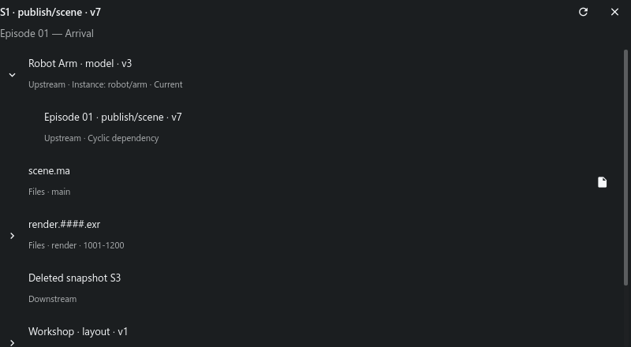 | 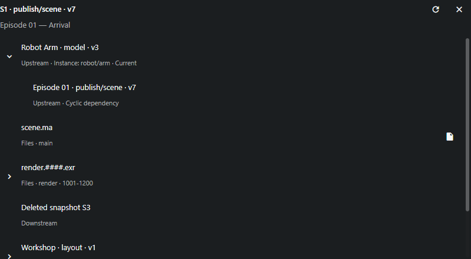 |

## Snapshot attachments

`FileAppendLinkTableElement` opens **Attach files** for the selected snapshot version. Choose local files or paste an image, enter **File type**, optionally keep original names, then attach. This adds files to that version; it does not create a new snapshot. A versionless alias first resolves to a concrete version.

```xml
<element name="append" width="64">
  <display class="pyasm.widget.FileAppendLinkTableElement"/>
</element>
```

The original client files remain untouched. Duplicate/existing names and changes by another client are rejected before writing. Cancel asks to discard selected files. If the server result is unknown, repeat is disabled: close the window and refresh the snapshot before retrying. A late server error uses FileUndo to restore registered files and data; disposable server uploads are not local originals.

Ctrl+V attaches an image; ordinary text paste keeps editing the focused field. Choose files rather than directories, up to 50 per operation. Each open draft has its own temporary upload directory. Saving refreshes both the concrete version and its original current/latest row.

Handler opens an ordinary native modal window; Stream uses the corresponding browser dialog. The form body shares one Frame description, including type/name controls, loading/errors and discard. Native uploads and filesystem work run off the GUI thread. This checkpoint accepts administrator table scope; ordinary-user ACL, PostgreSQL/original-server execution and physical phone/DPI testing remain open.

| Tactic Handler | TACTIC Stream |
| --- | --- |
| 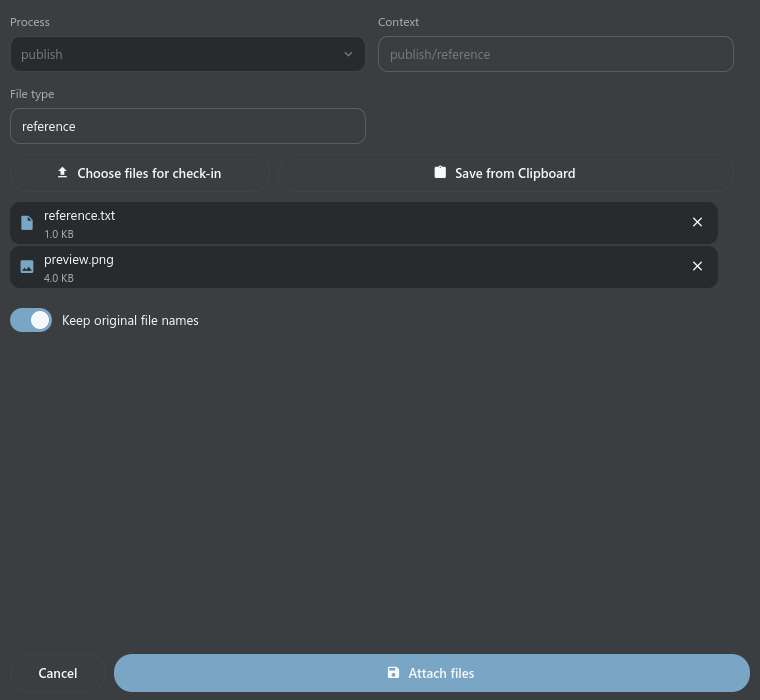 | 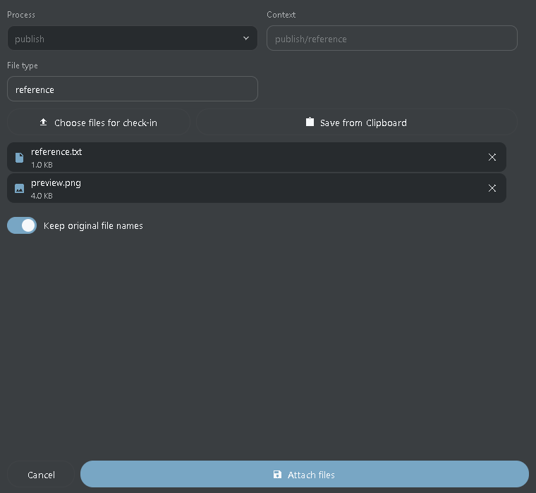 |

## Check out snapshot files

`CheckoutButtonElementWdg` opens **Check out** for a concrete snapshot. A current/latest alias resolves to its concrete version before the file list is shown. Choose the required file and press **Check out**. The project and version remain captured even when the main table belongs to another workspace project.

```xml
<element name="checkout" width="64">
  <display class="tactic.ui.table.CheckoutButtonElementWdg">
    <transfer_mode>browser</transfer_mode>
  </display>
</element>
```

Handler uses the file's configured native repository path and the existing transfer queue. If a local file differs from the server, choose **Overwrite** explicitly or cancel to preserve it. Files that appear during transfer are preserved by the default policy. Stream downloads the selected file through the browser; the browser owns its destination and overwrite prompts. `copy` and `client_repo` modes require the desktop client; the browser reports this limitation.

**Cancel transfer** stops the current download. **Close** also cancels it and ignores any late response; neither action creates a snapshot or changes its version. Private message attachments keep the privacy-aware Messages download flow.

This checkpoint supports ordinary individual files in administrator table scope. Sequence/UDIM expansion, other historical display options, ordinary-user ACL and original-server/PostgreSQL acceptance remain open. Unsupported groups report an error rather than downloading only one member. The shared file list uses the same Frame body in both products, with scrolling at narrow widths.

| Tactic Handler | TACTIC Stream |
| --- | --- |
| 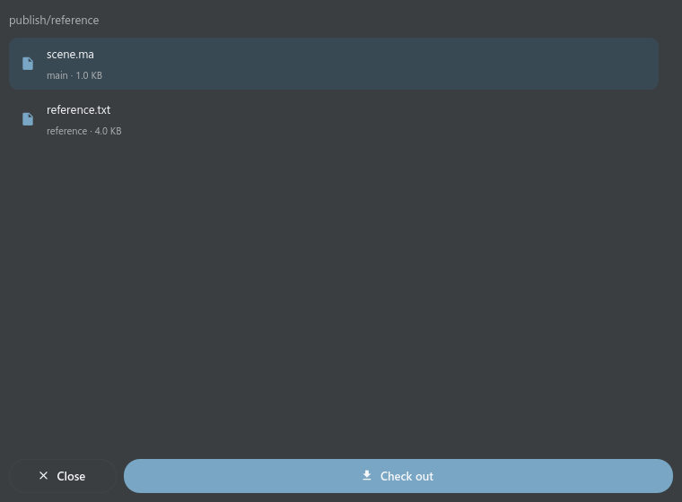 | 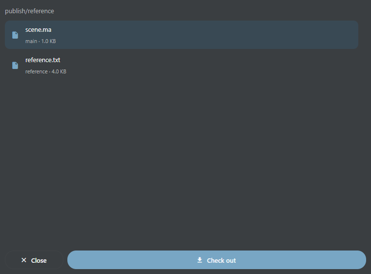 |

## L02: legacy cells using existing panels

These four adapters
reuse the existing notes/Task Inspector, task drafts and table controls; they do
not create another Messages or Task Manager window.

```xml
<element name="notes">
  <display class="pyasm.widget.DiscussionWdg">
    <include_submission>false</include_submission>
  </display>
</element>
<element name="tasks">
  <display class="pyasm.widget.SObjectTaskTableElement">
    <width>280</width><supe>true</supe><bid_edit>true</bid_edit>
    <simple_date>true</simple_date>
  </display>
</element>
<!-- Use this column in sthpw/task. -->
<element name="context"><display class="pyasm.widget.TaskParentSpacingTableElement"/></element>
<!-- Use this column in sthpw/message or sthpw/message_log. -->
<element name="message"><display class="tactic.ui.app.MessageTableElementWdg"/></element>
```

Discussion reads existing notes and offers setting/append_setting process
choices, including empty branches. Clicking a branch opens the existing owner;
saving/editing/deleting a note uses its ordinary permission/revision checks.
Task cells show the existing compact cards; status, assignee and dates use the
existing editors and explicit Save/Discard. `supe` enables inline assignment,
`bid_edit` enables inline dates; these display options do not grant server rights.
`simple_date` uses short month-day dates instead of full ISO dates when the row
has room for dates. The old HTML CalendarBar is not embedded. Explicit column
width overrides the 250px default. TaskParentSpacing displays the context before
its first slash, retaining the complete context as a tooltip.

Formatted messages show plain/chat text and note/task/snapshot changes, the
author and progress. Message markup is displayed as text. The old HTML preview
is not recreated. Invalid JSON/non-finite progress is an explicit cell error.

`include_submission=true` remains unsupported: old Submission is part of the
agreed excluded pyasm.prod subsystem. Slash subcontexts in old setting choices
and CGI filter state are not implemented; modern Discussion supports an explicit
context option. `scroll=false` is an old HTML layout hint; the modern owner keeps
its shared scrollbar. Unknown options stay explicit rather than being ignored.
That earlier checkpoint had 54 adapted / 20 pending referenced classes. See the active checklist for the current census; B07 is open.

### L02: paired cell examples

Fresh production Qt/Vue captures use the same data, MD3 dark theme, language and 280px column width. These examples cover the four cell adapters, not every historical HTML option.

| Cell | Tactic Handler | TACTIC Stream |
| --- | --- | --- |
| `DiscussionWdg` | 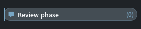 | 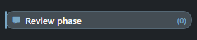 |
| `SObjectTaskTableElement` | 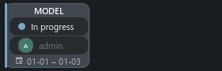 | 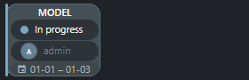 |
| `TaskParentSpacingTableElement` | 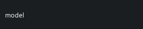 | 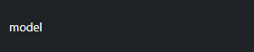 |
| `MessageTableElementWdg` | 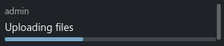 | 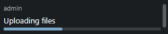 |

## Snapshot lock

Snapshot context lock; read only.

```xml
<element name="locked" width="180">
  <display class="tactic.ui.table.SnapshotLockedElementWdg"></display>
</element>
```

## Snapshot file

Original filename, sequence range and safe repository link.

```xml
<element name="file" width="180">
  <display class="tactic.ui.table.SnapshotFileElementWdg"></display>
</element>
```

## Milestone completion

Use on sthpw/milestone; task visibility still applies.

```xml
<element name="completion" width="180">
  <display class="tactic.ui.table.MilestoneCompletionWdg"></display>
</element>
```

## Grouped completion

Average of the tasks matching each context group.

```xml
<element name="completion" width="180">
  <display class="tactic.ui.table.TaskGroupCompletionWdg"><options>[{"label":"MODEL","context":["model"]}]</options></display>
</element>
```

## Due date

Use on tasks. Labels and urgency follow the original thresholds.

```xml
<element name="due" width="180">
  <display class="tactic.ui.table.TaskDaysDueElementWdg"><due_date_col>bid_end_date</due_date_col></display>
</element>
```

## Subcontext

Preserves all text after the first slash in context.

```xml
<element name="subcontext" width="180">
  <display class="tactic.ui.table.SubContextElementWdg"></display>
</element>
```

## Selection

A second view of the same row selection; not a database checkbox.

```xml
<element name="select" width="180">
  <display class="CheckboxColWdg"></display>
</element>
```

## Search Type title

Displays the native title for the row search_type value.

```xml
<element name="search_type" width="180">
  <display class="SearchTypeElementWdg"></display>
</element>
```

## Compact task summary

Click the process to inspect that exact task; default mode uses full task cards.

```xml
<element name="tasks" width="180">
  <display class="tactic.ui.table.TaskSummaryElementWdg"><mode>minimal</mode></display>
</element>
```

## Older completion

Integer result and obsolete-process filtering differ from the modern widget.

```xml
<element name="completion" width="180">
  <display class="pyasm.widget.TaskCompletionWdg"></display>
</element>
```

## Discussion

Uses the existing process note counts and inspector. This is not pyasm.widget.DiscussionWdg.

```xml
<element name="notes" width="180">
  <display class="tactic.ui.widget.DiscussionWdg"></display>
</element>
```

## Project database

Use on sthpw/project. Reads database existence and version without creating a database.

```xml
<element name="database" width="180">
  <display class="tactic.ui.table.ProjectWdg"></display>
</element>
```

## Table availability

Use on sthpw/search_object. Checks the physical table.

```xml
<element name="table" width="180">
  <display class="tactic.ui.app.SearchTypeHasTableElementWdg"></display>
</element>
```

## Preference description

Use on sthpw/pref_list; includes the original contextual hints.

```xml
<element name="description" width="180">
  <display class="tactic.ui.table.PreferenceDescriptionWdg"></display>
</element>
```

## Recipients

Use on sthpw/notification_log. Reads linked notification_login rows. Sending email and public recipient insertion remain unfinished.

```xml
<element name="recipients" width="180">
  <display class="tactic.ui.table.RecipientElementWdg"></display>
</element>
```

## Related value

Replace the relationship path/column with your schema. Native joins select the related record.

```xml
<element name="category" width="180">
  <display class="tactic.ui.table.RelatedElementWdg"><template>cg/assets.cg/assets_category</template><column>name</column></display>
</element>
```

## Editor and limits

The same Frame scene defines text, multiline, choice/user, switch, date/datetime, color and multi-value editor composition. Enter commits a single line; multiline Enter adds a newline and Save commits. Escape cancels. Existing revision/ACL/rollback and uncertain-write checks stay active. Native tags retain their specialized editor. Thirty-six referenced widget classes still require complete workflows: nested tables, schedules, work hours, loader/publish and configurable action forms.

## Current paired examples

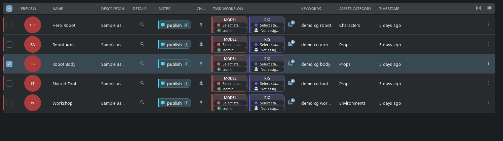

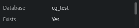

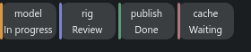


## Stage 1: service cells, configured actions and task processes

Stream 0.112.174 / Handler 0.6.0.121 add 16 table adapters and the shared inline
tags editor. Both products retain independent resources. B07 and stage 1 remain
open where an original layout requires nested tables or file ingest.

### Tags and service columns

Double-click Keywords to edit tokens and suggestions. Enter adds a token; Save
also includes pending text. Cancel/Escape discard the draft. An outside click
never commits it. Preferences likewise require explicit Save/Cancel; a conflicting
revision requires reload, and an unknown write outcome can be checked without
resending the mutation.

```xml
<!-- Use these elements in their corresponding system Search Types. -->
<element name="update"><display class="pyasm.widget.UpdateWdg">
  <insert_view>insert</insert_view><edit_view>edit</edit_view>
  <retire>true</retire><delete>false</delete>
</display></element>
<element name="login"><display class="tactic.ui.input.LoginTableElementWdg"/></element>
<element name="security"><display class="tactic.ui.panel.SecurityManagerButtonWdg"/></element>
<element name="value"><display class="tactic.ui.table.PreferenceEditWdg"/></element>
<element name="template"><display class="tactic.ui.table.ProjectTemplateUpdateWdg"/></element>
<element name="summary"><display class="pyasm.widget.MyTacticSummaryWdg"/></element>
<element name="test"><display class="tactic.ui.table.NotificationTriggerElementWdg"/></element>
```

Update uses the configured insert/edit views and the existing object editor.
Retire/reactivate compare the full record revision; Delete uses the existing
object-deletion owner. Login and Security open the existing administration
editors using the user/group identity. Preferences are scoped to the current
login. Template export calls the existing template command. Summary counts the
current user's activity for the last hour, today and week, plus assigned-task statuses. The notification test invokes
the original forced-trigger path with an unsaved test record; the cell is not
proof that SMTP/Telegram delivery is configured or certified.

### Original JavaScript, without an embedded browser in Handler

```xml
<element name="action"><display class="tactic.ui.table.ButtonElementWdg">
  <script_path>assets/my_action</script_path>
  <icon>EDIT</icon><hint>Open configured action</hint>
</display></element>
```

Use an existing JavaScript custom script at that path, or the original
`script_code`, `cbjs_action` or `javascript` options. The original SDK is retained.
The bridge supplies the clicked record, view, column and captured selection;
`bvr.kwargs.search_key`, `spt.table.get_search_key()` and SDK methods use that
context. Configured Edit, Notes, Tasks, user/group/schema/workflow/script-editor
ports open their existing owners. A confirmation must precede the first API
call. It does not replay completed writes. Session/project changes cancel the
run and suppress stale UI commands. Calls time out after 120 seconds.

Browser scripts run in a Worker under the application CSP; Handler runs them
in an isolated QJSEngine process so script loops do not block QML. This preserves
client scripting, not arbitrary browser DOM/MooTools compatibility. Unsupported
DOM, Promise callbacks and unknown popup classes produce explicit errors.
Scripts keep the logged-in user's server permissions. Fixtures execute the
three supplied CG JavaScript actions with a fake SDK, not against user data.

### Portable CustomLayout

```xml
<element name="script"><display class="tactic.ui.table.CustomLayoutElementWdg">
  <view>episodes/columns/script</view>
</display></element>
```

Slash references resolve to dotted saved views. The actual CG script layout
renders text, document links and its configured edit action in both clients.
Supported layout nodes are labels, safe links, Thumb previews, nested portable
CustomLayouts and click actions. External documents open through a link; no
HTML/WebEngine view is inserted into QML. Data-only Mako reads the supplied record
and formats text; imports, server calls, writes and file/network I/O are rejected.
This bounded formatting subset is not general Python/Mako compatibility.

Security Summary opens a modeless window with group selection and one readonly
source editor showing that group's stored rules. It is not a computed effective
permission report. Its Help button opens the common help article.

CG definitions are preserved. `columns/tasks_parent` embeds FastTable and remains
a dependency of L01. `episodes.columns.assets` contains only `No html` and is not
accepted as a working feature. Complex development layouts remain unaccepted.

### Instance links and tasks

```xml
<!-- Use in cg/assets: the CG template defines this texture relationship. -->
<element name="links"><display class="tactic.ui.table.DropElementWdg">
  <instance_type>cg/texture_in_assets</instance_type>
  <accepted_drop_type>cg/texture</accepted_drop_type>
</display></element>
<element name="parallel"><display class="pyasm.widget.ParallelStatusWdg">
  <bar_height>3</bar_height><label_format>abbr</label_format>
</display></element>
<element name="new_task"><display class="pyasm.widget.ParallelStatusEditWdg"/></element>
<element name="tasks"><display class="tactic.ui.table.SObjectTaskStatusElementWdg"/></element>
<!-- These three columns belong to a task table. -->
<element name="process"><display class="tactic.ui.table.ProcessElementWdg"/></element>
<element name="status"><display class="tactic.ui.widget.TaskStatusElementWdg">
  <edit_scope>assigned</edit_scope>
</display></element>
<element name="work"><display class="tactic.ui.table.WorkElementWdg">
  <transfer_mode>upload</transfer_mode>
</display></element>
```

Drop accepts configured object keys, not arbitrary files. Link Objects gives a
keyboard/click alternative: select, Save or Cancel in the existing link editor.
The complete instance revision and every target are validated before any removal;
a failed replacement rolls back. `path` selects the configured schema relation.
The legacy `folder_drop` JavaScript/FileIngest callback remains L04 work; it is
not silently treated as an instance relationship.

Parallel bars retain the original 33/66/100 steps, overdue color and exact task
identity. Click a bar or its process target to open the existing task owner.
Task status uses that task's configured status pipeline; assigned scope is checked
before mutation. Work retains process/context/task identity and opens existing
check-in. Browser upload is supported; local copy/move/inplace remains a desktop
capability. Calendar remains a separate dock. Bottom/group totals belong to L07b.

### Verification and limits

Reproducible examples live in `tests/test_table_stage_one.py`,
`tests/test_table_services.py`, `tests/test_table_drop_links.py` and
`frontend/tests/table_script_runtime.mjs`. Native input/lifecycle scenarios are
`tests.test_frame_table`, `tests.test_table_scripts` and
`tests.test_table_service_workflows` in the independent Handler checkout.
`tools/frame_table/capture.py` and `frontend/tests/frame_table.mjs` compare current
Qt/Vue geometry, paint and input across three themes, EN/RU and light/dark.

No production business script, real notification delivery, PostgreSQL server,
physical touch device or frozen Windows build was exercised for this checkpoint.
Nested FastTable/HiddenRow, file-ingest DOM actions, unrestricted Mako and complete
bottom reports remain explicitly open in L01/L04/L07b/L11.

### Stage 1: paired production cells

Same fixture, width, MD3 dark theme and language; these cell crops do not certify a complete legacy workflow.

| Cell | Tactic Handler | TACTIC Stream |
| --- | --- | --- |
| `tags` | 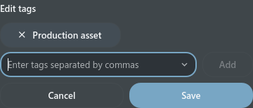 | 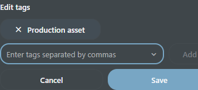 |
| `service_actions` | 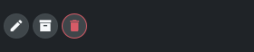 | 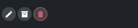 |
| `parallel_status` | 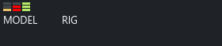 | 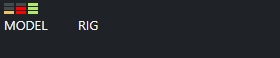 |
| `drop_links` | 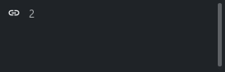 | 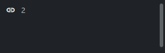 |
| `custom_layout` | 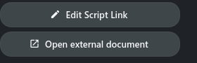 | 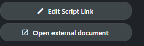 |


## Combined stage 2: expanded tables and time cells

The old HTML Custom Layout Editor is excluded. Create new portable layouts with
Frame and the existing layout editor. Saved supported CustomLayout definitions
remain available; an unsupported DOM widget reports its limitation explicitly.

An expanded table owns its selection, filter and page. Selecting a child does
not change the search selection. Refresh applies the child filter; Close collapses
the branch. Reopening a loaded branch retains its rows and selection for the
current context. The disclosure shows loading in its icon. Create/Edit reuse the
existing object form and server permissions. Only one expanded surface per parent
row is currently shown; recursive child surfaces and remaining relation/group
widgets are not yet accepted.

```xml
<element name="tasks" title="Tasks">
  <display class="tactic.ui.table.HiddenRowElementWdg">
    <dynamic_class>tactic.ui.panel.FastTableLayoutWdg</dynamic_class>
    <search_type>sthpw/task</search_type>
    <view>table</view>
    <show_insert>false</show_insert>
  </display>
</element>
```

The original CG `columns/tasks_parent` opens the task's parent table. Its saved
definition is retained; transferring it does not restore the old HTML editor.
Table schedule bars open the existing Task Manager Gantt. Daily hours open the
existing Timesheet for that task/week; all-user hours stay read-only. The common
presentation does not certify legacy inline/cascade Gantt writes, all timecard
operations, bottom totals or file actions. The combined second stage remains open.


The current expanded surface uses a fixed 50-record page and 320-pixel viewport.
Shelf/search/paging and selection flags now hide their controls. `init_load_num` is a rendering hint replaced by viewport virtualization; it never changes the 50-record page. Explicit `show_gear=true` remains an error until nested Columns authoring is ready.

Paired examples from this checkpoint (identical data, MD3 dark):

| Surface | Handler | Stream |
| --- | --- | --- |
| `nested` | 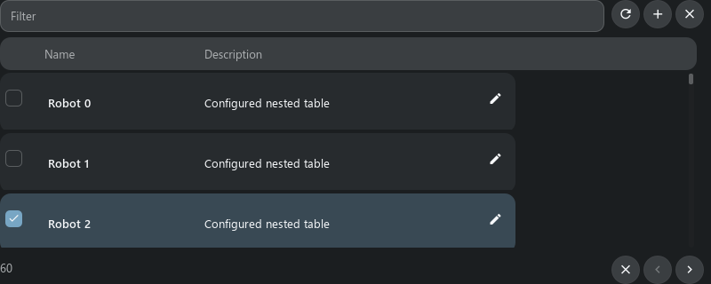 | 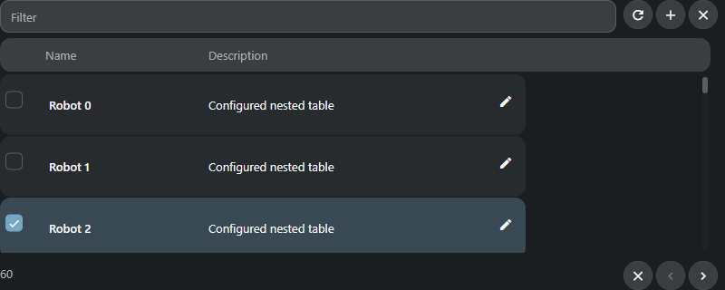 |
| `schedule` |  | 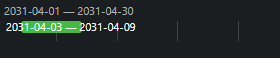 |
| `hours` | 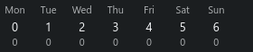 | 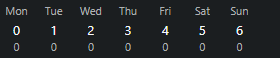 |


## Connections, nested tables and summary

The connection cell shows incoming (`dst`) or outgoing (`src`) targets, previews,
filenames and retired/missing records. Remove connection asks for confirmation,
checks the latest revision and preserves both objects. An uncertain response
refreshes the list before another operation.

```xml
<element name="connections" width="400">
  <display class="pyasm.widget.SObjectConnectionElement">
    <direction>dst</direction><icon_size>60</icon_size>
  </display>
</element>
<element name="summary" width="200">
  <display class="tactic.ui.table.SObjectSummaryElementWdg"/>
</element>
```

The summary shows tasks, check-ins, notes and straight-time hours. Task/check-in
buttons expand their own configured tables. Project summaries use the selected
project, including its table/editor/script context. Nested tables may expand more
nested tables; a repeated ancestor scope is rejected. Each level keeps its own
selection and loaded rows, so reopening it does not wait for another server read.
These workflows currently accept administrator scope. Stage 2/B07 remains open.


Current matching examples (MD3, dark, test data):

| Cell | Handler | Stream |
| --- | --- | --- |
| Summary | 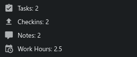 | 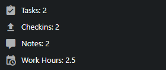 |
| Connections |  | 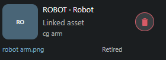 |


## Configured publication

`PublishTableElement` opens the existing record's `publish` form. `GeneralPublishElementWdg` also accepts a configured `view` and optional `preview=false`. The same Frame cell, bounded preview, title and Publish action ship independently in Handler and Stream. Unsaved, busy, batch and uncertain forms cannot be overwritten by a second row; a clean form can switch records.

```xml
<element name="publish" width="100">
  <display class="tactic.ui.table.GeneralPublishElementWdg">
    <view>review_publish</view><preview>true</preview>
  </display>
</element>
```

Define the actual input actions in `review_publish`, for example:

```xml
<review_publish>
  <element name="attachment">
    <display class="tactic.ui.widget.SimpleUploadWdg"><context>publish/reference</context></display>
    <action class="pyasm.command.UploadAction"/>
  </element>
</review_publish>
```

The optional `multi_publish=true` header on `PublishTableElement` opens the explicitly configured `multi_publish` view. It does not enable generic batch creation. UploadAction creates the configured snapshot; NullAction remains a nonworking upload configuration and is reported explicitly. The excluded production Publish Browser and arbitrary DOM callbacks are not provided. Full ordinary-user ACL and legacy option acceptance remain stage 2 work.

| Cell | Handler | Stream |
| --- | --- | --- |
| Publish |  |  |

Native configured publication currently accepts text, multiline, select, checkbox and SimpleUpload/UploadAction inputs. Unported input/action combinations block the form explicitly. It uses the configured EditCmd instead of the ordinary native editor’s direct database update. The file selector is a reusable base control in each client, with one shared Frame description. Other native forms retain their existing persistence.
