# Table View: типизированные ячейки B07

B07 ещё не завершён. Каталог содержит 68 серверных классов и 163 имени. Здесь описаны добавленные адаптеры значений; поддержка всех исторических опций не заявляется. Неподдерживаемые опции остаются явными ошибками. Сохраните существующий вид и заменяйте только нужный элемент.

## Вложения снапшота

`FileAppendLinkTableElement` открывает **Прикрепить файлы** для выбранной версии снапшота. Выберите локальные файлы или вставьте изображение, укажите **Тип файла**, при необходимости сохраните исходные имена и прикрепите файлы. Они добавляются к этой версии; новая версия не создаётся. Versionless-ссылка сначала разрешается в конкретную версию.

```xml
<element name="append" width="64">
  <display class="pyasm.widget.FileAppendLinkTableElement"/>
</element>
```

Исходные файлы клиента остаются нетронутыми. Повторяющиеся/уже существующие имена и изменение снапшота другим клиентом останавливают запись. Отмена предлагает сбросить выбранные файлы. Если результат записи неизвестен, повтор заблокирован: закройте окно и обновите снапшот перед новой попыткой. Поздняя серверная ошибка откатывает зарегистрированные файлы и данные через FileUndo; временная загрузка сервера не является исходным локальным файлом.

Ctrl+V прикрепляет изображение; обычный текст вставляется в поле с фокусом. Выбирайте файлы, а не папки, до 50 за операцию. У каждого черновика своя временная папка загрузки. Сохранение обновляет конкретную версию и исходную строку current/latest.

ТХ открывает обычное отдельное модальное окно, ТС — соответствующий браузерный диалог. Тело формы описано одним Frame-скелетом, включая тип/имя, загрузку, ошибки и отмену. В ТХ загрузка и файловые операции выполняются вне GUI-потока. Эта проверка охватывает административную таблицу; ordinary-user ACL, исполнение на PostgreSQL/исходном сервере и физические телефоны/другие DPI ещё не приняты.

| Tactic Handler | TACTIC Stream |
| --- | --- |
| 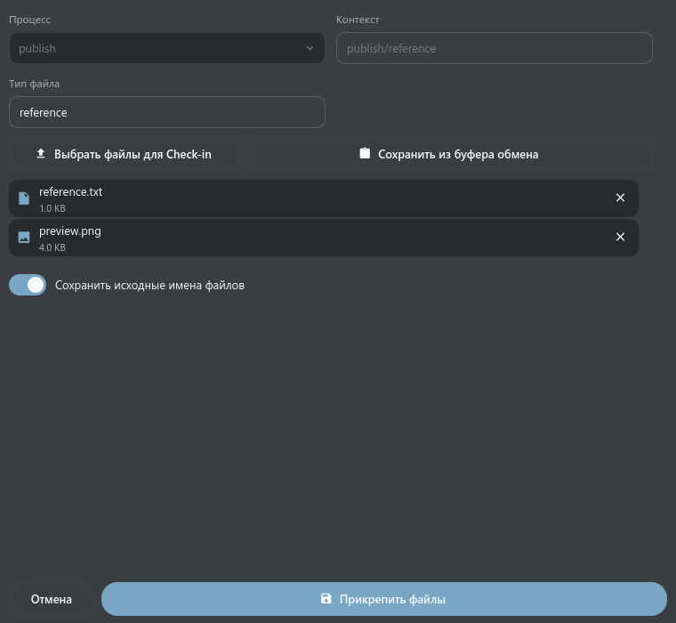 | 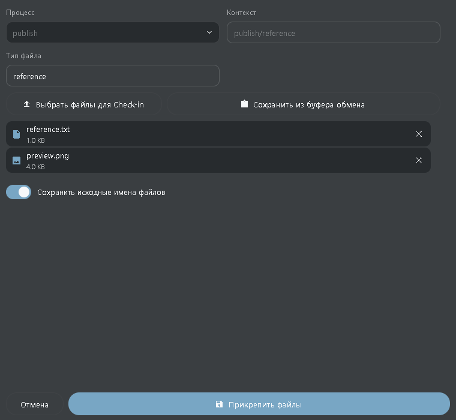 |

## Получение файлов снапшота

`CheckoutButtonElementWdg` открывает **Получить файлы** для конкретной версии снапшота. Ссылка current/latest сначала разрешается в конкретную версию. Выберите нужный файл и нажмите **Получить файлы**. Проект и версия фиксируются, даже если главная таблица открыта в другом проекте рабочего пространства.

```xml
<element name="checkout" width="64">
  <display class="tactic.ui.table.CheckoutButtonElementWdg">
    <transfer_mode>browser</transfer_mode>
  </display>
</element>
```

ТХ использует настроенный локальный путь файла в репозитории и существующую очередь передач. Если локальный файл отличается от серверного, явно выберите **Перезаписать** либо отмените операцию, чтобы сохранить его. Файл, появившийся во время передачи, стандартная политика сохраняет. ТС скачивает выбранный файл через браузер; папку назначения и подтверждение замены определяет браузер. Режимы `copy` и `client_repo` требуют настольного клиента; браузер сообщает это ограничение.

**Отменить передачу** останавливает текущую загрузку. **Закрыть** также отменяет её и игнорирует запоздавший ответ; снапшот и его версия не изменяются. Вложения личных сообщений остаются в существующем защищённом сценарии скачивания Messages.

Эта контрольная точка поддерживает обычные отдельные файлы в административной таблице. Разворачивание последовательностей/UDIM, другие исторические display options, ordinary-user ACL и проверка исходного сервера/PostgreSQL ещё открыты. Неподдерживаемая группа сообщает ошибку, а не скачивает только один элемент. Общий список файлов использует одно Frame-тело в обоих продуктах, с полосой прокрутки на узкой ширине.

| Tactic Handler | TACTIC Stream |
| --- | --- |
| 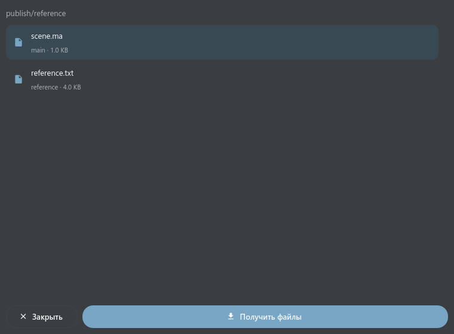 | 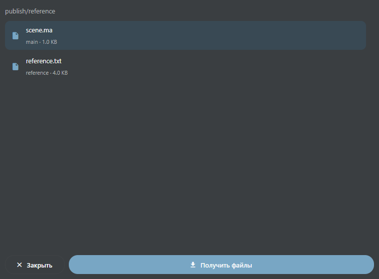 |

## L02: legacy-ячейки с готовыми панелями

Эти четыре адаптера используют готовые
заметки/Task Inspector, черновики задач и табличные контролы; второй Messages
или Task Manager не создаётся.

```xml
<element name="notes">
  <display class="pyasm.widget.DiscussionWdg">
    <include_submission>false</include_submission>
  </display>
</element>
<element name="tasks">
  <display class="pyasm.widget.SObjectTaskTableElement">
    <width>280</width><supe>true</supe><bid_edit>true</bid_edit>
    <simple_date>true</simple_date>
  </display>
</element>
<!-- Этот элемент применяется в sthpw/task. -->
<element name="context"><display class="pyasm.widget.TaskParentSpacingTableElement"/></element>
<!-- Этот элемент применяется в sthpw/message или sthpw/message_log. -->
<element name="message"><display class="tactic.ui.app.MessageTableElementWdg"/></element>
```

Discussion читает существующие заметки и предлагает процессы из
setting/append_setting, включая пустые ветки. Клик открывает существующую
панель; создание/изменение/удаление заметки сохраняет её проверки прав и ревизий.
В задачах используются готовые компактные карточки, редакторы статуса,
исполнителя и дат с обычными Save/Discard. `supe` включает назначение в ячейке,
`bid_edit` — редактирование дат; эти параметры отображения не выдают серверных
прав. `simple_date` показывает месяц-день вместо полной ISO-даты, когда высоты
строки хватает для дат. Старый HTML CalendarBar не встраивается. Явная ширина
колонки заменяет исходные 250px. TaskParentSpacing показывает контекст до первого
слеша, а полный контекст сохраняет в подсказке.

Сообщения показывают обычный/чатовый текст, изменения заметок/задач/снапшотов,
автора и прогресс. Разметка сообщения отображается как текст. Старое HTML-превью
не воспроизводится. Неверный JSON/нечисловой прогресс дают явную ошибку ячейки.

`include_submission=true` не поддерживается: старый Submission входит в
согласованно исключённый pyasm.prod. Подконтексты со слешем в старых setting
choices и CGI filter state не перенесены; современный Discussion поддерживает
явный context. `scroll=false` — старая HTML-подсказка компоновки; современная
панель сохраняет общую полосу прокрутки. Неизвестные options остаются явными.
В поставляемых XML/CG теперь 54 адаптированных / 20 ожидающих классов. B07 открыт.


### L02: парные примеры ячеек

Свежие снимки настоящих Qt/Vue-компонентов: одинаковые данные, тёмная MD3, язык и ширина колонки 280px. Примеры показывают четыре адаптера ячеек; все исторические HTML options ими не подтверждаются.

| Ячейка | Tactic Handler | TACTIC Stream |
| --- | --- | --- |
| `DiscussionWdg` | 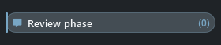 | 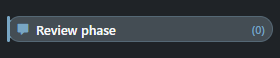 |
| `SObjectTaskTableElement` | 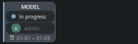 | 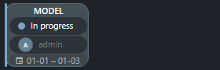 |
| `TaskParentSpacingTableElement` | 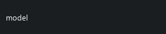 | 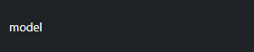 |
| `MessageTableElementWdg` | 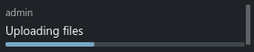 | 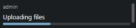 |

## Блокировка снапшота

Блокировка контекста снапшота; только чтение.

```xml
<element name="locked" width="180">
  <display class="tactic.ui.table.SnapshotLockedElementWdg"></display>
</element>
```

## Файл снапшота

Исходное имя файла, диапазон кадров и безопасная ссылка.

```xml
<element name="file" width="180">
  <display class="tactic.ui.table.SnapshotFileElementWdg"></display>
</element>
```

## Готовность вехи

Для sthpw/milestone; права на процессы сохраняются.

```xml
<element name="completion" width="180">
  <display class="tactic.ui.table.MilestoneCompletionWdg"></display>
</element>
```

## Готовность по группам

Средняя готовность задач каждой группы контекстов.

```xml
<element name="completion" width="180">
  <display class="tactic.ui.table.TaskGroupCompletionWdg"><options>[{"label":"MODEL","context":["model"]}]</options></display>
</element>
```

## Срок задачи

Для задач. Подписи и срочность следуют порогам оригинала.

```xml
<element name="due" width="180">
  <display class="tactic.ui.table.TaskDaysDueElementWdg"><due_date_col>bid_end_date</due_date_col></display>
</element>
```

## Подконтекст

Сохраняет весь текст после первой косой черты контекста.

```xml
<element name="subcontext" width="180">
  <display class="tactic.ui.table.SubContextElementWdg"></display>
</element>
```

## Выбор строки

Отображает существующий выбор строки; это не поле БД.

```xml
<element name="select" width="180">
  <display class="CheckboxColWdg"></display>
</element>
```

## Название Search Type

Показывает штатное название типа из поля search_type.

```xml
<element name="search_type" width="180">
  <display class="SearchTypeElementWdg"></display>
</element>
```

## Компактная сводка задач

Клик открывает конкретную задачу процесса; режим default использует обычные карточки задач.

```xml
<element name="tasks" width="180">
  <display class="tactic.ui.table.TaskSummaryElementWdg"><mode>minimal</mode></display>
</element>
```

## Старая готовность задач

Целочисленный результат и фильтрация старых процессов отличаются от нового виджета.

```xml
<element name="completion" width="180">
  <display class="pyasm.widget.TaskCompletionWdg"></display>
</element>
```

## Обсуждение

Использует существующие счётчики заметок процессов и инспектор. Это отдельный класс от pyasm.widget.DiscussionWdg.

```xml
<element name="notes" width="180">
  <display class="tactic.ui.widget.DiscussionWdg"></display>
</element>
```

## База проекта

Для sthpw/project. Читает наличие и версию БД без её создания.

```xml
<element name="database" width="180">
  <display class="tactic.ui.table.ProjectWdg"></display>
</element>
```

## Наличие таблицы

Для sthpw/search_object. Проверяет наличие физической таблицы.

```xml
<element name="table" width="180">
  <display class="tactic.ui.app.SearchTypeHasTableElementWdg"></display>
</element>
```

## Описание настройки

Для sthpw/pref_list; включает исходные пояснения к настройкам.

```xml
<element name="description" width="180">
  <display class="tactic.ui.table.PreferenceDescriptionWdg"></display>
</element>
```

## Получатели

Для sthpw/notification_log. Читает связанные notification_login. Отправка почты и публичное добавление получателей ещё не перенесены.

```xml
<element name="recipients" width="180">
  <display class="tactic.ui.table.RecipientElementWdg"></display>
</element>
```

## Связанное значение

Замените путь связи и колонку своей схемой. Связанная запись выбирается штатным JOIN.

```xml
<element name="category" width="180">
  <display class="tactic.ui.table.RelatedElementWdg"><template>cg/assets.cg/assets_category</template><column>name</column></display>
</element>
```

## Редактор и ограничения

Одна сцена Frame задаёт текст, многострочный ввод, выбор/пользователя, переключатель, дату/время, цвет и множественные значения. Enter сохраняет строку; в многострочном поле добавляет перенос, а сохраняет кнопка Save. Escape отменяет. Проверки ревизий, прав, откат и проверка неизвестного результата сохранены. Нативные теги используют специализированный редактор. Тридцать шесть упомянутых классов ещё требуют полного переноса: вложенные таблицы, расписания, учёт часов, loader/publish и формы настраиваемых действий.

## Актуальные парные примеры

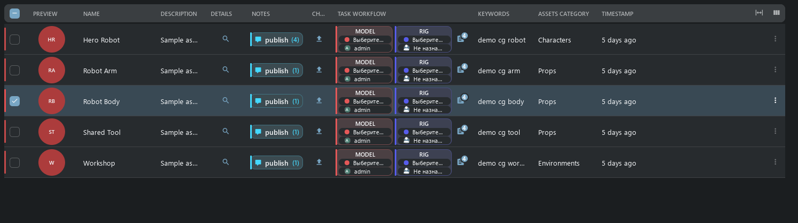

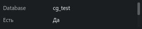

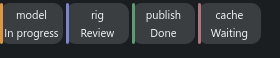


## Этап 1: служебные ячейки, действия и процессы задач

Stream 0.112.174 / Handler 0.6.0.121 добавляют 16 табличных адаптеров и общий
inline-редактор тегов. Ресурсы продуктов остаются независимыми. B07 и этап 1
не закрыты: часть исходных layouts зависит от вложенных таблиц и файлового ingest.

### Теги и служебные колонки

Двойной клик по Keywords открывает токены и подсказки. Enter добавляет токен;
Save также включает ещё не добавленный текст. Cancel/Escape отменяют черновик.
Клик снаружи ничего не сохраняет. Preferences также требуют явного Save/Cancel:
конфликт ревизии требует перечитать данные, неизвестный результат записи можно
проверить без повторной отправки изменения.

```xml
<!-- Элементы предназначены для соответствующих системных Search Types. -->
<element name="update"><display class="pyasm.widget.UpdateWdg">
  <insert_view>insert</insert_view><edit_view>edit</edit_view>
  <retire>true</retire><delete>false</delete>
</display></element>
<element name="login"><display class="tactic.ui.input.LoginTableElementWdg"/></element>
<element name="security"><display class="tactic.ui.panel.SecurityManagerButtonWdg"/></element>
<element name="value"><display class="tactic.ui.table.PreferenceEditWdg"/></element>
<element name="template"><display class="tactic.ui.table.ProjectTemplateUpdateWdg"/></element>
<element name="summary"><display class="pyasm.widget.MyTacticSummaryWdg"/></element>
<element name="test"><display class="tactic.ui.table.NotificationTriggerElementWdg"/></element>
```

Update использует настроенные insert/edit views и существующий редактор объектов.
Retire/reactivate сверяют ревизию всей записи; Delete работает через текущего
владельца удаления. Login и Security открывают готовую админку с нужной
идентичностью пользователя/группы. Preferences относятся к текущему логину.
Template export вызывает существующую команду шаблона. Summary считает активность
текущего пользователя за час, сегодня и неделю, а также назначенные ему задачи по статусам. Test уведомления вызывает исходный forced
trigger с несохранённой тестовой записью; наличие кнопки не подтверждает настройку
или доставку SMTP/Telegram.

### Исходный JavaScript без браузера внутри Handler

```xml
<element name="action"><display class="tactic.ui.table.ButtonElementWdg">
  <script_path>assets/my_action</script_path>
  <icon>EDIT</icon><hint>Open configured action</hint>
</display></element>
```

По этому пути должен существовать JavaScript custom script. Также поддержаны
исходные `script_code`, `cbjs_action`, `javascript`. Используется оригинальный
SDK. Мост передаёт нажатую строку, view, колонку и зафиксированное выделение;
`bvr.kwargs.search_key`, `spt.table.get_search_key()` и вызовы SDK получают этот
контекст. Переходы Edit/Notes/Tasks/users/groups/schema/workflow/script editor
открывают существующих владельцев. Подтверждение должно предшествовать первому
API-вызову и не переигрывает уже выполненные записи. Смена сессии/проекта отменяет
запуск и отбрасывает запоздалые UI-команды. Тайм-аут — 120 секунд.

В браузере скрипт работает в Worker под CSP приложения, в Handler — в отдельном
процессе QJSEngine: бесконечный цикл не блокирует QML. Это поддержка клиентских
скриптов, а не произвольного DOM/MooTools. Неподдержанные DOM, Promise callbacks
и неизвестные popup-классы дают явную ошибку. Серверные права текущего пользователя
сохраняются. Три поставляемых CG JavaScript действия проверяются с fake SDK,
без изменения пользовательских данных.

### Переносимый CustomLayout

```xml
<element name="script"><display class="tactic.ui.table.CustomLayoutElementWdg">
  <view>episodes/columns/script</view>
</display></element>
```

Слеши в ссылке сопоставляются с точками в сохранённом имени. Настоящий CG layout
сценария показывает текст, ссылку на документ и настроенное редактирование в
обоих клиентах. Поддержаны labels, безопасные ссылки, Thumb previews, вложенные
переносимые CustomLayout и click actions. Внешний документ открывается по ссылке;
HTML/WebEngine в QML не вставляется. Data-only Mako читает переданные данные
записи и форматирует текст; imports, серверные вызовы, запись и файловый/сетевой
I/O отклоняются. Это ограниченное форматирование, не общая совместимость Python/Mako.

Security Summary открывает немодальное окно с выбором группы и одним readonly
редактором исходника её сохранённых правил. Это не вычисленный отчёт эффективных
прав. Кнопка Help ведёт в общую справку.

CG definitions сохранены. `columns/tasks_parent` содержит FastTable и остаётся
зависимостью L01. В `episodes.columns.assets` только `No html`; рабочим виджетом
он не объявляется. Сложные development layouts также не приняты.

### Instance-связи и задачи

```xml
<!-- Для cg/assets: связь с текстурами из поставляемого шаблона CG. -->
<element name="links"><display class="tactic.ui.table.DropElementWdg">
  <instance_type>cg/texture_in_assets</instance_type>
  <accepted_drop_type>cg/texture</accepted_drop_type>
</display></element>
<element name="parallel"><display class="pyasm.widget.ParallelStatusWdg">
  <bar_height>3</bar_height><label_format>abbr</label_format>
</display></element>
<element name="new_task"><display class="pyasm.widget.ParallelStatusEditWdg"/></element>
<element name="tasks"><display class="tactic.ui.table.SObjectTaskStatusElementWdg"/></element>
<!-- Эти три колонки предназначены для таблицы задач. -->
<element name="process"><display class="tactic.ui.table.ProcessElementWdg"/></element>
<element name="status"><display class="tactic.ui.widget.TaskStatusElementWdg">
  <edit_scope>assigned</edit_scope>
</display></element>
<element name="work"><display class="tactic.ui.table.WorkElementWdg">
  <transfer_mode>upload</transfer_mode>
</display></element>
```

Drop принимает ключи объектов настроенного типа, не произвольные файлы.
Link Objects даёт альтернативу клавиатурой/кликом: выбрать, Save или Cancel в
готовом редакторе связей. Полная ревизия instance-записей и все цели проверяются
до удаления; ошибка замены откатывается транзакцией. `path` выбирает связь схемы.
Legacy `folder_drop` с JavaScript/FileIngest остаётся задачей L04 и не подменяется
обычной instance-связью.

Parallel bars сохраняют исходные шаги 33/66/100, цвет просрочки и точную задачу.
Бар или доступная кнопка процесса открывает существующего владельца задач.
Task status использует status pipeline конкретной задачи; assigned scope
проверяется до изменения. Work сохраняет process/context/task identity и открывает
готовый check-in. В браузере доступен upload; local copy/move/inplace остаются
возможностью desktop. Calendar остаётся отдельным доком. Bottom/group totals — L07b.

### Проверка и границы

Примеры воспроизводятся через `tests/test_table_stage_one.py`,
`tests/test_table_services.py`, `tests/test_table_drop_links.py`,
`frontend/tests/table_script_runtime.mjs`. Реальный native input/lifecycle —
`tests.test_frame_table`, `tests.test_table_scripts`,
`tests.test_table_service_workflows` в независимом Handler.
`tools/frame_table/capture.py` и `frontend/tests/frame_table.mjs` сравнивают текущие
Qt/Vue geometry, paint и ввод: три темы, EN/RU, light/dark.

Рабочие business scripts, реальная доставка уведомлений, сервер PostgreSQL,
физический touch и frozen Windows build в этой контрольной точке не проверялись.
Вложенные FastTable/HiddenRow, файловые DOM-actions, произвольный Mako и полные
bottom reports остаются открытыми в L01/L04/L07b/L11.

### Этап 1: парные снимки настоящих ячеек

Одинаковые fixture, ширина, MD3 dark и язык. Снимки ячеек не означают приёмку полного legacy-сценария.

| Cell | Tactic Handler | TACTIC Stream |
| --- | --- | --- |
| `tags` | 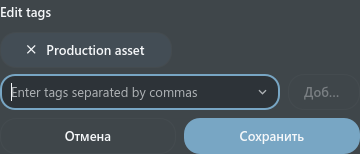 | 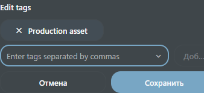 |
| `service_actions` | 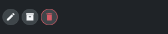 | 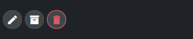 |
| `parallel_status` | 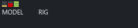 | 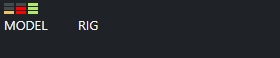 |
| `drop_links` | 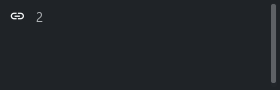 | 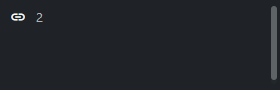 |
| `custom_layout` | 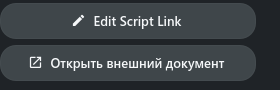 | 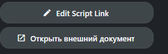 |


## Объединённый этап 2: вложенные таблицы и временные ячейки

Старый HTML Custom Layout Editor исключён. Новые переносимые раскладки создаются
через Frame и существующий редактор раскладок. Поддержанные сохранённые CustomLayout
остаются доступными; неподдержанный DOM-виджет явно сообщает об ограничении.

У раскрытой таблицы свои выделение, фильтр и страница. Выбор дочерней строки
не меняет выделение поиска. Обновить применяет её фильтр, Закрыть сворачивает
ветку. Повторное раскрытие сохраняет загруженные строки и выделение в текущем
контексте. Загрузка показывается в иконке раскрытия. Создать/Редактировать вызывают
существующую форму объекта с серверными правами. Сейчас у родительской строки
показывается одна раскрытая поверхность; рекурсивные дочерние поверхности и
оставшиеся виджеты связей/групп ещё не приняты.

```xml
<element name="tasks" title="Tasks">
  <display class="tactic.ui.table.HiddenRowElementWdg">
    <dynamic_class>tactic.ui.panel.FastTableLayoutWdg</dynamic_class>
    <search_type>sthpw/task</search_type>
    <view>table</view>
    <show_insert>false</show_insert>
  </display>
</element>
```

Исходный CG `columns/tasks_parent` открывает таблицу родителя задачи. Его
определение сохранено; перенос не возвращает старый HTML-редактор.
Полоса расписания открывает существующий Gantt таск-менеджера. Дневные часы
открывают существующий Timesheet для задачи/недели; часы всех пользователей
остаются только для чтения. Общая отрисовка не означает приёмку старых
inline/cascade-записей Gantt, всех операций timecard, итогов таблицы или файловых
действий. Объединённый второй этап остаётся открытым.


Сейчас вложенная область использует страницу на 50 записей и высоту 320 пикселей.
Полные options shelf/gear/search-limit и начальной загрузки ещё не приняты.

Парные примеры этой контрольной точки (одинаковые данные, MD3 dark):

| Поверхность | ТХ | ТС |
| --- | --- | --- |
| `nested` | 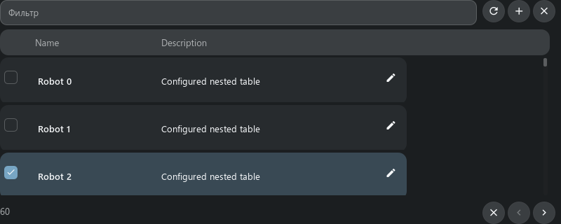 | 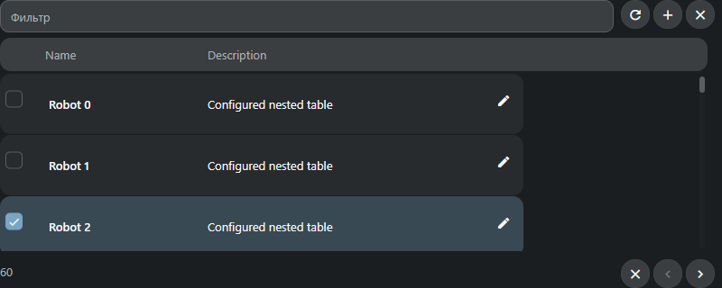 |
| `schedule` |  | 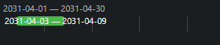 |
| `hours` | 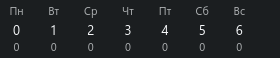 | 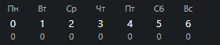 |
